# MUON2: Boosting MUON via Adaptive Second-Moment Preconditioning

Ziyue Liu1, Ruijie Zhang1, Zhengyang Wang1, Yequan Zhao1, Yupeng Su1,

Zi Yang2, Zheng Zhang1

1University of California at Santa Barbara; 2University at Albany, SUNY {ziyueliu, zzhang01}@ucsb.edu

## Abstract

MUON has emerged as a promising optimizer for large-scale foundation model pre-training by exploiting the matrix structure of neural network updates through iterative orthogonalization. However, the orthogonalization quality of MUON hinges on the number of Newton– Schulz (NS) iterations performed, which poses efficiency challenges due to its non-trivial computation and communication cost. We propose MUON2, an extension of MUON, to improve both quality and efficiency by applying Adamstyle adaptive second-moment preconditioning before orthogonalization. Our key insight is that the core challenge of polar approximation in MUON lies in the ill-conditioned momentum matrix, of which the spectrum is substantially improved by MUON2, leading to faster convergence toward a practically sufficient orthogonalization. We further characterize the practical orthogonalization quality via directional alignment, under which MUON2 demonstrates dramatic improvement over MUON at each polar step. Across GPT, LLaMA, and Mixtureof-Experts pre-training experiments up to 13B parameters, MUON2 (and its memory-efficient variant MUON2-F that preserves most of its benefits) consistently outperforms MUON and its variants while reducing NS iterations by 40%, and saves up to 1/4 training time over MUON when achieving the same loss.

## 1 Introduction

The rapid progress of modern large-scale neural networks has been driven by the continual expansion of model capacity and training data (Hoffmann et al., 2022; Kaplan et al., 2020). This paradigm has enabled the emergence of highly capable foundation models across language, vision, and multimodal domains (Achiam et al., 2023; Grattafiori et al., 2024; Team et al., 2023). However, the increasing scale of these systems has made pretraining extremely resource-intensive, requiring vast computational budgets and long training durations. As a result, numerous efforts have been devoted to improve the efficiency of the pre-training system, spanning across model architectures (Adler et al., 2024; Liu et al., 2025b; Zhang et al., 2025), infrastructures (Shoeybi et al., 2019; Rajbhandari et al., 2020; Wang et al., 2025), and optimization algorithms (Gupta et al., 2018; Vyas et al., 2024; Jordan et al., 2024).

Among existing optimization methods, adaptive first-order optimizers such as Adam (Kingma and Ba, 2014) and AdamW (Loshchilov and Hutter, 2017) remain the de facto choice for training large models due to their robustness and ease of use. Nevertheless, their overlook of the underlying matrix structure of neural network parameters, have motivated substantial research into alternative optimization strategies (Martens and Grosse, 2015; Gupta et al., 2018; Vyas et al., 2024).

MUON (Jordan et al., 2024) has emerged as a breakthrough that explicitly exploits the matrix structure of neural network gradients, without the full cost of computing second-order statistics. MUON approximates a polar decomposition of the momentum via the Newton–Schulz iteration to efficiently orthogonalize the update to mitigate gradient rank collapse and improve optimization dynamics in large models. Various studies have shown improved stability and overall performance by deploying MUON in large-scale foundation model pre-training (Liu et al., 2025a; Shah et al., 2025; Zeng et al., 2025; Team et al., 2025).

Building on these successes, MUON remains an active area of research, with a number of recent works proposing variants that improve different aspects of the optimizer (Khaled et al., 2025; Li et al., 2025; Si et al., 2025; Amsel et al., 2025; Boissin et al., 2025; Ahn et al., 2025; Zhang et al., 2026). Most of these approaches explore modifications to MUON ’s update rules, yet few has devoted to tackle the core challenge: a non-trivial amount of Newton–Schulz (NS) iterations per update that determines the orthogonalization quality and introduces computation and communication overhead. This raises a natural question: can we simultaneously enhance the quality and reduce the burden of MUON’s orthogonalization procedure?

Contributions In this work, we investigate this question and introduce MUON2, a simple yet effective modification of MUON that leverages adaptive second-moment scaling as an effective preconditioner for MUON’s orthogonalization step. Our key observation is that applying Adam-style perparameter scaling prior to the orthogonalization significantly improves the spectral properties of the momentum matrix. Empirically, this produces a more favorable singular value distribution that simultaneously improves the convergence of Newton–Schulz iterations and the final model performance. These improvements lead to an optimizer that is both computationally lighter and empirically stronger. We summarize our contributions:

• We propose MUON2, a novel generalization of MUON optimizer that preconditions the momentum matrix via Adam-style adaptive scaling prior to MUON’s orthogonalization. This simple yet effective approach simultaneously boosts model performance and training efficiency.

• To justify MUON2, we identify the challenge of polar approximation lies in its input matrix’s ill-conditioned spectrum and demonstrate that MUON2 significantly improves the input matrix conditioning, achieving superior directional alignment to the true orthogonalized update and substantially reducing polar iterations.

• We also propose MUON2-F, a memory-efficient version of MUON2 with a factorized secondmoment preconditioner. This variant effectively reduces the memory overhead of saving the full second-moment while preserving most of MUON2’s performance gain.

• We conduct comprehensive experiments on pretraining GPT, LLaMA and Mixture-of-Experts models for up to 13B parameters. Experiments show that MUON2 family consistently outperforms MUON and its variants with 40% fewer Newton–Schulz iterations, and reduce 1/4 training time for achieving the same loss.

## 2 Related Work

Coordinate-wise Adaptive Methods. Despite ignoring underlying matrix structures, adaptive firstorder optimizers remain the dominant choice for large-scale training. Adagrad (Duchi et al., 2011) introduced per-parameter adaptive scaling based on historical gradients, while Adam(W) (Kingma and Ba, 2014; Loshchilov and Hutter, 2017) further incorporate exponential moving averages of first and second moments. To reduce memory overhead, Adafactor (Shazeer and Stern, 2018) factorizes second-moment statistics, while more recent variants such as Adam-mini (Zhang et al., 2024) and GaLore (Zhao et al., 2024) simplify or compress optimizer states while retaining performance.

Matrix-Structured Methods. An alternative line of work leverages matrix structure for improved conditioning. Shampoo (Gupta et al., 2018) applies Kronecker-factored second-order preconditioning, while SOAP (Vyas et al., 2024) stabilizes it with adaptive scaling. MUON (Li et al., 2025) operates directly on matrix-valued momentum, approximating its polar factor via iterative orthogonalization.

Variants of MUON. Recent works extend MUON along multiple directions. PolarExpress (Amsel et al., 2025) and Turbo-Muon (Boissin et al., 2025) improve the convergence of polar approximation, while NorMuon (Li et al., 2025) and AdaMuon (Si et al., 2025) incorporate second-moment statistics into the update rule. Dion (Ahn et al., 2025) explores low-rank orthogonalization for scalability in distributed settings. These methods improve either the efficiency or effectiveness of MUON, rather than jointly addressing both.

## 3 The MUON2 Optimizer

## 3.1 Introducing MUON2

We introduce MUON2, a novel generalization of MUON that integrates second-moment preconditioning prior to the orthogonalization step. The algorithm is summarized in Algorithm 1.

Given a parameter matrix $\mathbf { W } _ { t } \in \mathbb { R } ^ { n \times m }$ and gradient

$$
\mathbf {G} _ {t} = \nabla_ {\mathbf {W} _ {t}} \mathcal {L} (\mathbf {W} _ {t}),\tag{1}
$$

MUON first constructs a momentum estimate

$$
\mathbf {M} _ {t} = \beta_ {1} \mathbf {M} _ {t - 1} + (1 - \beta_ {1}) \mathbf {G} _ {t}.\tag{2}
$$

MUON2 augments this step with a secondmoment accumulator

$$
\mathbf {V} _ {t} = \beta_ {2} \mathbf {V} _ {t - 1} + (1 - \beta_ {2}) (\mathbf {G} _ {t} \odot \mathbf {G} _ {t}),\tag{3}
$$

Algorithm 1 The MUON² Optimizer
Require: 2D weights $W_{t} \in R^{n \times m}$ , objective L, learning rate $\eta$ , momentum coefficients $\beta_{1}, \beta_{2}$ , Newton–Schulz steps K, numerical constant $\epsilon$ Ensure: Updated weights $W_{t+1}$ 1: $M_{0} \leftarrow 0$ , $V_{0} \leftarrow 0$ 2: for $t \leftarrow 1, 2, \ldots$ do
3: $G_{t} \leftarrow \nabla_{W_{t}} \mathcal{L}(W_{t})$ 4: $M_{t} \leftarrow \beta_{1} M_{t-1} + (1 - \beta_{1}) G_{t}$ 5: $V_{t} \leftarrow \beta_{2} V_{t-1} + (1 - \beta_{2})(G_{t} \odot G_{t})$ 6: $\widetilde{M}_{t} \leftarrow M_{t} \oslash (\sqrt{V_{t}} + \epsilon 1)$ 7: $O_{t} \leftarrow Newton-Schulz(\widetilde{M}_{t}, K)$ 8: $W_{t+1} \leftarrow W_{t} - \eta \sqrt{m/n} O_{t}$ 9: end for

which produces a preconditioned momentum

$$
\widetilde {\mathbf {M}} _ {t} = \mathbf {M} _ {t} \oslash (\sqrt {\mathbf {V} _ {t}} + \epsilon \mathbf {1}),\tag{4}
$$

where $\odot$ and $\oslash$ denote element-wise multiplication and division, respectively.

The preconditioned matrix is then orthogonalized using $K$ steps of the Newton–Schulz (NS) iteration

$$
\mathbf {O} _ {t} = \mathrm{NewtonSchulz} (\widetilde {\mathbf {M}} _ {t}, K).\tag{5}
$$

Finally the parameter update is

$$
\mathbf {W} _ {t + 1} = \mathbf {W} _ {t} - \eta \sqrt {\frac {m}{n}} \mathbf {O} _ {t}.\tag{6}
$$

where the $\sqrt { \frac { m } { n } }$ learning rate factor is proposed by (Bernstein, 2025) for better scalability.

Compared with MUON, the only modification introduced by $\mathbf { M } \mathrm { U O N } ^ { 2 }$ is the second-moment scaling prior to orthogonalization, as shown in Eq. (4). As we will show in the following sections, this simple yet effective modification substantially improves the spectral properties of the matrix entering the NS iteration, enabling better and faster convergence of the orthogonalization procedure.

## 3.2 Revisiting Polar Approximation in MUON

A central component of MUON is the use of the Newton–Schulz iteration to approximate the polar factor of a matrix. Existing theoretical analyses of polar methods (Amsel et al., 2025; Chen and Chow, $2 0 1 4 ;$ Grishina et al., 2025) typically measure approximation quality through exact orthogonality, for example via quantities such as

$$
\| \mathbf {Q} ^ {\top} \mathbf {Q} - \mathbf {I} \|,\tag{7}
$$

which quantifies how close the approximate factor Q is to an orthogonal matrix.

However, we argue that despite of its unwavering mathematical correctness, this notion of quality does not fully characterize the role polar approximation plays in MUON-family optimizers. In particular, the original MUON work (Jordan et al., 2024) explicitly uses an inexact orthogonalization that roughly maps singular values to $[ 1 - \epsilon , 1 + \epsilon ]$ And surprisingly, ϵ can be as large as ∼ 0.3 without harming the performance of MUON.

Let’s pivot to another example showcasing why Eq. (7) may fail as a practically effective metric. Consider a scenario where all singular values are projected to an exact constant $c \in [ 0 , 1 ]$ . Under this construction, the resulting matrix can be written as

$$
\mathbf {Q} = c \mathbf {U V} ^ {\top},\tag{8}
$$

where $\mathbf { U V } ^ { \top }$ is the exact polar factor from singular value decomposition (SVD)

$$
\mathbf {G} = \mathbf {U} \boldsymbol {\Sigma} \mathbf {V} ^ {\mathrm{T}}, \mathbf {Q} _ {\star} = \mathbf {U} \mathbf {V} ^ {\mathrm{T}}.\tag{9}
$$

And Eq. (7) becomes

$$
\left\| \mathbf {Q} ^ {\top} \mathbf {Q} - \mathbf {I} \right\| = \left| c ^ {2} - 1 \right| \cdot \left\| \mathbf {I} \right\|.\tag{10}
$$

Therefore, the orthogonality error depends entirely on the deviation of c from 1. In particular, even if the matrix preserves the exact singular directions, any global scaling $c \neq 1$ leads to a large orthogonality error despite $\mathbf { Q }$ being perfectly aligned with the true polar factor.

We remark that for optimization, the approximate orthogonalized matrix is not used as a standalone object but rather as the update direction, where

$$
\Delta \mathbf {W} = - \eta \mathbf {Q},\tag{11}
$$

and any scaling factor c that $\mathbf { Q }$ may possess will be absorbed into the step size η and being tuned as a hyper-parameter in practice. Therefore, a scale dependent metric such as Eq. (7) does not fully capture what orthogonalization achieves in practice and could be misleading in certain cases.

## 3.3 Directional Alignment

In contrast, if we were to measure directional alignment instead of exact orthogonality, cosine similarity becomes a strong candidate as it cancels the scaling effect on each singular value, i.e.,

$$
\frac {\langle \mathbf {Q} , \mathbf {Q} _ {\star} \rangle_ {F}}{\| \mathbf {Q} \| _ {F} \| \mathbf {Q} _ {\star} \| _ {F}} = \frac {c \| \mathbf {Q} _ {\star} \| _ {F} ^ {2}}{| c | \| \mathbf {Q} _ {\star} \| _ {F} ^ {2}} = 1.\tag{12}
$$

Thus, cosine similarity1 is invariant to the global scaling factor c and reflects the fact that the update direction is unchanged.

More generally, within the Newton–Schulz (NS) iteration that MUON (Jordan et al., 2024) applies, running one step yields

$$
\begin{array}{r l} & {\mathbf {Q} _ {\mathrm{NS}} ^ {(1)} = a \mathbf {G} + b (\mathbf {G} \mathbf {G} ^ {T}) \mathbf {G} + c (\mathbf {G} \mathbf {G} ^ {T}) ^ {2} \mathbf {G}} \\ & {\quad = \mathbf {U} (a \boldsymbol {\Sigma} + b \boldsymbol {\Sigma} ^ {3} + c \boldsymbol {\Sigma} ^ {5}) \mathbf {V} ^ {T}} \\ & {\quad = \mathbf {U} \operatorname{diag} (\phi (\sigma_ {1}), \ldots , \phi (\sigma_ {n})) \mathbf {V} ^ {\top}} \end{array}\tag{13}
$$

where $\mathbf { G } = \mathbf { U } \pmb { \Sigma } \mathbf { V } ^ { T }$ is the SVD of the momentum matrix, $\phi ( x ) = a x + b x ^ { 3 } + c x ^ { 5 }$ with coefficients $( a , b , c ) = ( 3 . 4 4 4 5 , - 4 . 7 7 5 0 , 2 . 0 3 1 5 )$ transforms each singular value $\sigma _ { i }$ . MUON repeats Eq. (13) by five times, yielding

$$
\mathbf {Q} _ {\mathrm{NS}} ^ {(5)} = \mathbf {U} \operatorname{diag} (\phi^ {5} (\sigma_ {1}), \dots , \phi^ {5} (\sigma_ {n})) \mathbf {V} ^ {\top}\tag{14}
$$

In this case, the cosine similarity between the NS output and the true polar factor becomes

$$
\cos (\mathbf {Q} _ {\mathrm{NS} ^ {(5)}}, \mathbf {Q} _ {\star}) = \frac {\sum_ {i} \phi^ {5} (\sigma_ {i})}{\sqrt {n} \sqrt {\sum_ {i} \phi^ {5} (\sigma_ {i}) ^ {2}}},\tag{15}
$$

which depends only on the relative singular value distribution of the NS output matrix and is invariant to scale-dependent statistics.

We remark that the cosine similarity we promote [Eq. (15)] does not necessarily contradict with the exact orthogonalization error [Eq. (7)] in practice, but cosine similarity does have superior robustness, interpretability and their practical applicability. We refer detailed discussions to Section B.

## 3.4 Spectral Effects of MUON2

We now investigate why $\mathbf { M } \mathrm { U O N } ^ { 2 }$ can jointly improve the efficiency and effectiveness of MUON. We center around the Newton–Schultz (NS) iteration for our analysis as it is the only major complexity that MUON introduces over SGD/Adam-family optimizers. As shown by Eq. (13), each NS step introduces multiple matrix multiplications per parameter that require accessing the full-matrix on each device. This introduces not just computational overhead, but also communicational overhead that’s often non-trivial and latency-bound in large-scale distributed setting. Therefore, it is essential to reduce the necessary NS steps for developing efficient MUON, yet the convergence of NS iteration largely depends on the steps being performed. To understand how $\mathrm { \mathbf { M } \mathrm { { U O N } ^ { 2 } } }$ breaks free from this limitation, we analyze it in two-fold, focusing on how $\mathbf { M } \mathrm { U O N } ^ { 2 }$ changes: (1) The momentum matrix prior to the NS iteration. (2) The output of each NS iteration step.

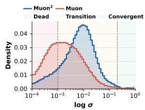

(a) Early-training spectrum

(b) Mid-training spectrum

(c) Effective rank

(d) Dead zone fraction

Figure 1: Spectral effect of $\mathrm { \mathbf { M } U O N } ^ { 2 }$ on the input matrix of the Newton–Schultz iteration.

For consistency, all quantitative studies in this section are conducted on training data collected from a LLaMA-60M model with MUON and $\mathbf { M } \mathrm { { U O N } ^ { 2 } }$ using the polar approximation defined in (Jordan et al., 2024). We argue that the claims and observations we make also generalize to other polar methods such as PolarExpress (Amsel et al., 2025), with minor differences in certain numerical values, see full details in Section C.

## 3.4.1 MUON2 Improves NS Input Spectrum

We start with characterizing the singular value distribution of the input momentum matrix of NS, that is Eq. (2) for MUON and Eq. (4) for $\mathbf { M } \mathrm { { U O N } ^ { 2 } }$ . We normalize it by its Frobenius norm (Jordan et al., 2024) to reflect the actual input of the NS iteration. Given an ϵ, which defines the practical orthogonalization target of mapping any normalized singular values $\sigma _ { i }$ to $[ 1 - \epsilon , 1 + \epsilon ]$ , and given a practical choice of Newton-Schultz steps $N _ { s }$ , we define the following convergence zones for a polar approximation based on its destination values $\phi _ { \epsilon } ^ { N _ { s } } ( \sigma _ { i } )$

• Dead zone: $\phi _ { \epsilon } ^ { N _ { s } } ( \sigma _ { i } ) < 1 - \epsilon$ , reflects the range of singular values that fail to converge after $N _ { s }$ steps. Larger the dead zone is, more deviated the results are from the true orthogonalized update.

• Transition zone: $\phi _ { \epsilon } ^ { N _ { s } } ( \sigma _ { i } ) \geq 1 - \epsilon$ and $\phi _ { \epsilon } ^ { 1 } ( \sigma _ { i } ) <$ 1−ϵ. This is the region where non-trivial amount of $N _ { s }$ steps are needed to achieve the practical orthogonalization target.

(a) Spectrum at $N _ { s } = 1$

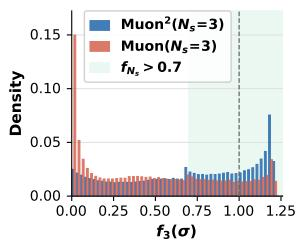

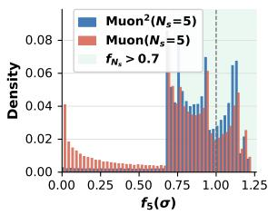

(b) Spectrum at $N _ { s } = 3$

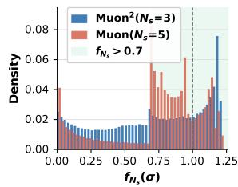

(c) Spectrum at $N _ { s } = 5$

(d) Spectrum at $N _ { s } = 3$ vs. 5

Figure 2: Spectral effect of $\mathbf { M } \mathbf { U } \mathbf { O N } ^ { 2 }$ on the Newton– Schultz (NS) output $\left( \mathrm { i . e . , f _ { N _ { s } } } ( \sigma ) \right)$ at each step $( \mathrm { i } . \mathrm { e } . , N _ { s } )$

• Convergent zone: $\phi _ { \epsilon } ^ { 1 } ( \sigma _ { i } ) \geq 1 - \epsilon$ , where $\sigma _ { i }$ is large enough that only one NS iteration is needed.

Concretely, under MUON’s setting where $\epsilon \approx 0 . 3$ $N _ { s } = 5$ , we can calculate each zone roughly as [0, 0.001], [0.001, 0.2], [0.2, 1], and is colored differently in Figures 1a and 1b.

The biggest practical challenge for NS is to project a wide range of singular values that spans multiple orders of magnitude to close one as fast as possible. As shown in Figure 1a, MUON’s earlytraining stage singular value distribution for NS input spans from $1 0 ^ { - 4 } \mathrm { t o } 1$ , and is centered around $1 0 ^ { - 3 }$ , where almost half singular values fall into the dead zone. Comparatively, $\mathbf { M } \mathrm { U O N } ^ { 2 }$ shows a significantly right-shifted distribution, where it centers around $1 0 ^ { - 2 }$ , 10× larger than MUON, and the majority falls into the transition zone. As the training continues, both methods have their distribution shifting right, while $\mathbf { M } \mathrm { { U O N } ^ { 2 } }$ shows consistently lower fraction in the dead zone, demonstrated by Figures 1b and 1d. In addition to lower dead-zone fraction, Figure 1c shows that $\mathbf { M } \mathrm { { U O N } ^ { 2 } }$ has consistently higher effective rank throughout training, highlighting the fact that its singular values are closer together, i.e., a tighter spectrum, which coincides with the properties that cosine similarity [Eq. (15)] promotes. Therefore, we anticipate the spectrum after polar transformation will also be tighter, resulting a higher cosine similarity, thus more aligned with the true orthogonalized update.

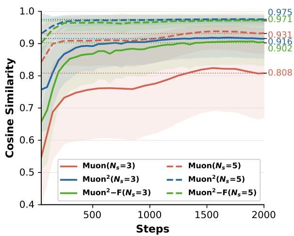

Figure 3: Cosine similarity of the output matrix vs. true orthogonalized update for MUON, $\mathrm { \mathbf { M } U O N ^ { 2 } }$ and $\mathrm { \mathbf { M } } \mathrm { { U O N } } ^ { 2 } .$ F at different Newton-Schultz steps.

These findings conclude our first perspective: the preconditioning effect of $\mathrm { \mathbf { M } \mathrm { { U O N } ^ { 2 } } }$ significantly improves the input spectrum of the NS iteration, providing a stronger baseline that is easier to achieve practically sufficient polar approximation.

## 3.4.2 MUON2 Improves Polar Quality

Now we compare the polar approximation behavior of $\mathrm { \mathbf { M } \mathrm { { U O N } ^ { 2 } } }$ and MUON by visualizing their singular value distributions at NS steps $( N _ { s } ) 1 , 3 ,$ , and 5 in Figures 2a to 2c. Across all cases, $\mathbf { M } \mathrm { { U O N } ^ { 2 } }$ exhibits a tighter spectrum with substantially fewer nearzero singular values. By $N _ { s } = 5$ , its singular values fall almost entirely within the target range. We further compare $\mathbf { M } \mathrm { U O N } ^ { 2 }$ at $N _ { s } = 3$ against MUON at $N _ { s } = 5$ in Figure 2d. Despite using substantially fewer iterations, $\mathbf { M } \mathrm { { U O N } ^ { 2 } }$ produces a highly similar distribution while reducing the density of extremely small singular values by roughly half. These findings suggest that $\mathbf { M } \mathrm { { U O N } ^ { 2 } }$ at $N _ { s } ~ = ~ 3$ already provides a strong polar approximation.

Quantitatively, we calculate the cosine similarity [Eq. (15)] of $\mathbf { M } \mathrm { { U O N } ^ { 2 } }$ and MUON at each $N _ { s } ,$ reflecting how closely the approximate polar factors align with the true orthogonalized gradients. As shown in Figure 3, $\mathrm { \bf M U O N } ^ { \mathrm { 2 } }$ at $N _ { s } = 3$ already achieves cosine similarity comparable to MUON at $N _ { s } = 5 ( 0 . 9 1 6 \mathrm { v s . } 0 . 9 3 1 )$ , and further improves to 0.975 at $N _ { s } = 5$ , substantially surpassing MUON. In contrast, reducing MUON from $N _ { s } = 5$ to $N _ { s }$ $= 3$ causes a significant drop in cosine similarity $( 0 . 9 3 1  0 . 8 0 8 )$ , which we later show also leads to a dramatic degradation in model performance.

To better connect the qualitative and quantitative analyses, we compare $\mathrm { \bar { M } U O N ^ { 2 } }$ at $N _ { s } ~ = ~ 3$ with

MUON at $N _ { s } = 5$ in Figure 2d. The visualization shows that MUON has monotonically decreasing densities between near-zero and the target range, whereas $\mathbf { M } \mathrm { { U O N } ^ { 2 } }$ exhibits a more uniform spread with higher density in the transition and convergent zones. This suggests a more practically favored spectrum of $\mathbf { M } \mathrm { { U O N } ^ { 2 } }$ that accounts for its further improvement at $N _ { s } = 5$

These findings conclude our second perspective: benefited from the spectral effect of the second moment preconditioning, $\mathbf { M } \mathrm { { U O N } ^ { 2 } }$ always produces updates that are both better aligned with and easier to progress towards the true orthogonalized gradient at every NS iteration. This effectively reduces the necessary steps of the NS iteration and substantially improves the polar approximation quality.

## 3.5 Overall Benefits of MUON2

$\mathbf { M U O N } ^ { 2 }$ delivers a stronger orthogonalization. With the same number of Newton-Schultz (NS) iterations, $\mathbf { M } \mathrm { U O N } ^ { 2 }$ significantly improves the alignment of MUON’s update direction with the true orthogonalized gradient.

$\mathbf { M U O N } ^ { 2 }$ reduces NS iterations for practically sufficient orthogonalization. To achieve a similar level of update-direction alignment, $\mathbf { M } \mathrm { { U O N } ^ { 2 } }$ reduces the required NS iterations by 40%. We will further show in the experiments that 3-step $\mathrm { \mathbf { M } \mathrm { { U O N } ^ { 2 } } }$ already achieves better model performance than 5- step MUON. We speculate that this is due to the richer historical information carried by our secondmoment preconditioning.

## 3.6 MUON2-F: A Memory Efficient MUON2

From Eq. (3) and (4), $\mathrm { \mathbf { M } \mathrm { { U O N } ^ { 2 } } }$ introduces additional memory overhead by maintaining a second moment throughout training. However, since the second moment only conditions the input to orthogonalization rather than directly determining the update, we expect $\mathbf { M } \mathrm { U O N } ^ { 2 }$ to be relatively insensitive to approximation error. Motivated by this, we adopt Adafactor-style factorized second moments:

$$
\begin{array}{r l} & {\mathbf {r} _ {t} \leftarrow \beta_ {2} \mathbf {r} _ {t - 1} + (1 - \beta_ {2}) \mathrm{sum} _ {\mathrm{col}} (\mathbf {R} _ {t}),} \\ & {\mathbf {c} _ {t} \leftarrow \beta_ {2} \mathbf {c} _ {t - 1} + (1 - \beta_ {2}) \mathrm{sum} _ {\mathrm{row}} (\mathbf {R} _ {t}),} \\ & {\widehat {\mathbf {V}} _ {t} \leftarrow \frac {\mathbf {r} _ {t} \mathbf {c} _ {t} ^ {\top}}{\mathrm{sum} (\mathbf {r} _ {t})}.} \end{array}\tag{16}
$$

Instead of storing the full second-moment matrix, this approximation keeps only row- and columnwise statistics and reconstructs the matrix via their outer product. We denote this variant as $\mathbf { M } \mathbf { U } \mathbf { O } \mathbf { N } ^ { 2 } .$ Factorized $( \mathrm { M U O N ^ { 2 } { - } F ) }$ . As shown later, $\mathrm { \Delta M U O N ^ { 2 } { - } F }$ remains close to the exact $\mathbf { M } \mathrm { { U O N } ^ { 2 } }$ in both reduced NS iteration requirements and model performance, while keeping memory overhead nearly unchanged from MUON. Full details are in Algorithm 2.

<table><tr><td>Model</td><td>NS Steps</td><td>MUON</td><td><eq>\mathbf{MUON}^{2}</eq></td><td><eq>\mathbf{MUON}^{2}\text{-}\mathbf{F}</eq></td></tr><tr><td rowspan="2">GPT-Small</td><td><eq>N_{s}=3</eq></td><td>32.70</td><td>28.12 (-4.58)</td><td>28.30 (-4.40)</td></tr><tr><td><eq>N_{s}=5</eq></td><td>29.51</td><td>27.95 (-1.56)</td><td>27.93 (-1.58)</td></tr><tr><td rowspan="2">GPT-Base</td><td><eq>N_{s}=3</eq></td><td>24.69</td><td>20.39 (-4.30)</td><td>21.17 (-3.52)</td></tr><tr><td><eq>N_{s}=5</eq></td><td>21.47</td><td>19.96 (-1.51)</td><td>20.58 (-0.89)</td></tr><tr><td rowspan="2">GPT-Large</td><td><eq>N_{s}=3</eq></td><td>21.13</td><td>16.99 (-4.14)</td><td>17.69 (-3.44)</td></tr><tr><td><eq>N_{s}=5</eq></td><td>17.56</td><td>16.52 (-1.04)</td><td>16.55 (-1.01)</td></tr></table>

Table 1: Validation perplexity (↓) of MUON and $\mathrm { \mathbf { M } U O N ^ { 2 } }$ on GPT models across Newton–Schulz iterations.

## 4 Experiments

In this section, we evaluate $\mathbf { M } \mathbf { U } \mathbf { O N } ^ { 2 }$ on extensive pre-training experiments that cover GPT, LLaMA and Mixture-of-Experts architectures on various scales. These experiments strongly and consistently demonstrate that $\mathbf { M } \mathrm { { U O N } ^ { 2 } }$ achieves two benefits: (1) Significantly better model performance; (2) Substantially fewer Newton–Schulz (NS) iterations. We also compare $\mathbf { M } \mathrm { { U O N } ^ { 2 } }$ against other MUON variants and show that none of them can achieve both benefits as $\mathbf { M } \mathrm { { U O N } ^ { 2 } }$ does.

## 4.1 Pre-Training GPT

We pre-train GPT models at three scales: small, base and large, with respectively 3.0B, 7.2B, and 15.5B tokens, following the compute-optimal training regime (Hoffmann et al., 2022). We use the FineWeb dataset (Penedo et al., 2024) tokenized by the GPT tokenizer. Trainings are run on H100/A100 GPUs, with the pipeline adapted from NanoGPT (Karpathy, 2022). We use the polar method from the original MUON work (Jordan et al., 2024). Detailed configurations and hyperparameters are provided in Section D.1.

As shown in Table 1, $\mathbf { M } \mathrm { U O N } ^ { 2 }$ consistently outperforms MUON not just when they use the same NS steps, but also when $\mathbf { M } \mathrm { { U O N } ^ { 2 } }$ uses substantially fewer NS steps. With only $N _ { s } = 3 , \mathrm { M U O N } ^ { 2 }$ outperforms MUON with $N _ { s } = 5$ at all three scales. When both at $N _ { s } = 3 .$ , the gap between $\mathbf { M } \mathrm { U O N } ^ { 2 }$ and MUON is even more dramatic. Meanwhile, the memory efficient version $\mathrm { \Delta M U O N ^ { 2 } { - } F }$ also achieves comparatively good performance with practically negligible memory cost. To ensure fair comparison, we sweep learning rates for MUON and $\mathbf { M } \mathrm { U O N } ^ { 2 }$ and show results at GPT-Large scale in Figure 4. We can observe that the benefits $\mathbf { M } \mathrm { { U O N } ^ { 2 } }$ provides are irrelevant to each individual choice of learning rate, suggesting its broad practical applicability.

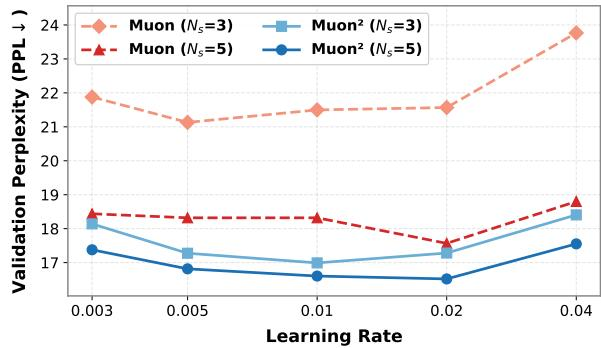

Figure 4: Learning rate sweep on GPT-Large comparing $\mathrm { \Delta } \mathrm { \bar { M u o d } \mathrm { ^ 2 } }$ and MUON across Newton–Schulz iterations.

<table><tr><td>Model</td><td>NS Steps</td><td>MUON</td><td><eq>\mathbf{MUON}^{2}</eq></td><td><eq>\mathbf{MUON}^{2}-\mathbf{F}</eq></td></tr><tr><td rowspan="2">LLaMA-60M</td><td><eq>N_{s}=3</eq></td><td>26.37</td><td>24.59 (-1.78)</td><td>24.68 (-1.69)</td></tr><tr><td><eq>N_{s}=5</eq></td><td>24.98</td><td>24.60 (-0.38)</td><td>24.66 (-0.32)</td></tr><tr><td rowspan="2">LLaMA-350M</td><td><eq>N_{s}=3</eq></td><td>14.91</td><td>13.44 (-1.47)</td><td>13.55 (-1.36)</td></tr><tr><td><eq>N_{s}=5</eq></td><td>14.03</td><td>13.46 (-0.57)</td><td>13.44 (-0.59)</td></tr><tr><td rowspan="2">LLaMA-1B</td><td><eq>N_{s}=3</eq></td><td>11.63</td><td>10.42 (-1.21)</td><td>10.49 (-1.14)</td></tr><tr><td><eq>N_{s}=5</eq></td><td>10.62</td><td>10.21 (-0.41)</td><td>10.21 (-0.41)</td></tr></table>

Table 2: Validation perplexity (↓) of MUON and $\mathrm { \mathbf { M } U O N ^ { 2 } }$ on LLaMA models across Newton–Schulz iterations.

## 4.2 Pre-Training LLaMA

We pre-train LLaMA-style models at four scales: 60M, 350M, 1B and 13B, with respectively 1.0B, 7.3B, 20.1B, and 26.8B. We use C4 (Raffel et al., 2020) dataset tokenized by LLaMA-2 tokenizer. We adopt the training pipeline from Nanotron (Tazi et al., 2025). Detailed configurations and hyperparameters are provided in Section D.2.

As shown in Tables 2 and 3, the results are consistent with GPT models. $\mathbf { M } \mathrm { { U O N } ^ { 2 } }$ continues to outperform MUON even with fewer NS iterations. At all four scales, reducing NS steps will cause a dramatic degradation for MUON but only minimum drops for MUON2, and the gap between $\mathbf { M } \mathrm { { U O N } ^ { 2 } }$ and $\mathrm { \Delta M U O N ^ { 2 } { - } F }$ is also less pronounced.

## 4.3 Pre-Training Mixture-of-Experts

We further evaluate on Mixture-of-Experts (MoE), a family of model architectures that is widely adopted in industry (Achiam et al., 2023; Zeng et al., 2025; Liu et al., 2024). We pre-train a 7B-A1B MoE (1B active parameters, 2 out of total 16 experts) for 20.1B tokens on 4 variants: MUON and $\mathbf { M } \mathrm { { U O N } ^ { 2 } }$ each with $N _ { s } = 3$ and $N _ { s } = 5$ (Table 3). $\mathbf { M } \mathbf { U } \mathbf { O N } ^ { 2 }$ continues to outperform MUON significantly on both NS settings, and reduces NS steps by 40% while improving model performance.

<table><tr><td>Model</td><td>NS Steps</td><td>MUON</td><td><eq>\mathbf{MUON}^{2}</eq></td></tr><tr><td rowspan="2">LLaMA-13B</td><td><eq>N_s = 3</eq></td><td>10.54</td><td>9.11 (-1.43)</td></tr><tr><td><eq>N_s = 5</eq></td><td>9.24</td><td>8.71 (-0.53)</td></tr><tr><td rowspan="2">MoE-7B-A1B</td><td><eq>N_s = 3</eq></td><td>11.93</td><td>9.85 (-2.08)</td></tr><tr><td><eq>N_s = 5</eq></td><td>10.61</td><td>9.66 (-0.95)</td></tr></table>

Table 3: Validation perplexity (↓) of MUON and $\mathrm { \mathbf { M } U O N ^ { 2 } }$ on LLaMA-13B and MoE models across NS iterations.

## 4.4 Downstream Performance Evaluation

Beyond validation perplexity, we also verify the effectiveness of $\mathbf { M } \mathrm { { U O N } ^ { 2 } }$ by performing zero-shot evaluations on the trained LLaMA-1B in Table 4. Results are well aligned with validation perplexity that $\mathbf { M } \mathrm { { U O N } ^ { 2 } }$ consistently outperforms MUON. Full details and more evaluations are in Section D.4.

## 4.5 Comparisons against MUON Variants

We have demonstrated that $\mathbf { M } \mathrm { { U O N } ^ { 2 } }$ consistently outperforms MUON while reducing 40% NS iterations across various scales and architectures. Now we verify that existing MUON variants cannot achieve these benefits at the same extent.

## 4.5.1 Variants of Polar Method

Methods that solely modify the polar approximation are closer to $\mathbf { M } \mathrm { U O N } ^ { 2 }$ in design principles, such as PolarExpress (Amsel et al., 2025) and Turbo-Muon (Boissin et al., 2025). We compare $\mathbf { M } \mathrm { { U O N } ^ { 2 } }$ with them on GPT-Small and GPT-Base. To ensure fairness, we also sweep hyper-parameters for baselines and report their best results in Table 5. Full details are provided in Section D.5. By setting $\mathbf { M } \mathrm { { U O N } ^ { 2 } }$ as the baseline in Table 5, we clearly observe that both PolarExpress and Turbo-Muon underperform $\mathbf { M } \mathrm { { U O N } ^ { 2 } }$ even with more NS iterations. They do suffer less degradation than plain MUON with reduced NS steps, but not comparable to $\mathrm { \mathbf { M } } \mathrm { \mathbf { U } } \mathrm { O N } ^ { 2 }$ , and their improvement (if any) over MUON at $N _ { s } = 5$ is much less pronounced.

## 4.5.2 Variants of Update Rules

For other variants of MUON, we focus on ones that are closer to $\mathrm { \mathbf { M } \mathrm { { U O N } ^ { 2 } } }$ in form, such as NorMuon (Li et al., 2025) and AdaMuon (Si et al., 2025). Despite of both using second moment in certain capacity, these approaches are fundamentally different from ours: they adapt the step size of each update direction similar to Adam, while $\mathrm { \mathbf { M } \mathrm { { U O N } ^ { 2 } } }$ preserves the orthogonalized directions as in MUON.

<table><tr><td></td><td>NS Steps</td><td>Avg</td><td>ARC-c</td><td>ARC-e</td><td>OBQA</td><td>HellaS.</td><td>PIQA</td><td>WinoG.</td><td>LAMBADA</td><td>MMLU</td></tr><tr><td rowspan="2">MUON</td><td><eq>N_s = 3</eq></td><td>40.94</td><td>24.23</td><td>42.80</td><td>32.00</td><td>44.37</td><td>71.22</td><td>53.43</td><td>36.52</td><td>22.95</td></tr><tr><td><eq>N_s = 5</eq></td><td>43.43</td><td>26.79</td><td>46.09</td><td>33.20</td><td>49.75</td><td>72.25</td><td>55.41</td><td>40.99</td><td>22.96</td></tr><tr><td rowspan="2"><eq>MUON^2</eq></td><td><eq>N_s = 3</eq></td><td>43.61</td><td>26.37</td><td>47.81</td><td>31.80</td><td>50.23</td><td>72.20</td><td>55.01</td><td>42.50</td><td>22.97</td></tr><tr><td><eq>N_s = 5</eq></td><td>45.24</td><td>27.13</td><td>49.03</td><td>35.20</td><td>52.61</td><td>74.05</td><td>55.88</td><td>45.08</td><td>22.95</td></tr></table>

Table 4: Zero-shot evaluation on LLaMA-1B trained by MUON and $\mathrm { \mathbf { M } U O N ^ { 2 } }$ across different NS iterations.

<table><tr><td></td><td colspan="2">GPT-Small</td><td colspan="2">GPT-Base</td></tr><tr><td>NS Steps</td><td><eq>N_s = 3</eq></td><td><eq>N_s = 5</eq></td><td><eq>N_s = 3</eq></td><td><eq>N_s = 5</eq></td></tr><tr><td><eq>MUON^2</eq></td><td>28.12</td><td>27.95</td><td>20.39</td><td>19.96</td></tr><tr><td>MUON(Jordan et al., 2024)</td><td>32.70(+4.58)</td><td>29.51(+1.56)</td><td>24.69(+4.30)</td><td>21.47(+1.51)</td></tr><tr><td>PolarExpress(Amsel et al., 2025)</td><td>30.01(+1.89)</td><td>29.42(+1.47)</td><td>22.74(+2.35)</td><td>21.16(+1.20)</td></tr><tr><td>Turbo-Muon(Boissin et al., 2025)</td><td>29.70(+1.58)</td><td>29.66(+1.71)</td><td>23.46(+3.07)</td><td>21.93(+1.97)</td></tr><tr><td>NorMuon(Li et al., 2025)</td><td>30.35(+2.23)</td><td>28.40(+0.45)</td><td>23.33(+2.94)</td><td>21.27(+1.31)</td></tr><tr><td>AdaMuon(Si et al., 2025)</td><td>31.20(+3.08)</td><td>29.30(+1.35)</td><td>26.07(+5.68)</td><td>22.42(+2.46)</td></tr></table>

Table 5: Validation perplexity (↓) of $\mathrm { \mathbf { M } U O N ^ { 2 } }$ comparing against MUON variants on GPT-Small and Base.

Figure 5: On LLaMA-1B, $\mathbf { M } \mathbf { U } \mathbf { O N } ^ { 2 }$ achieves same loss with 25% fewer training steps than MUON.

Similarly, we compare $\mathbf { M } \mathbf { U } \mathbf { O N } ^ { 2 }$ with NorMuon and AdaMuon on GPT-Small and GPT-Base with hyper-parameter sweeping, and report their best results in Table 5 (full results in Section D.5). Despite their improvement (if any) over MUON, both methods fail to reduce the necessary NS iterations, and they both underperform $\mathrm { \bf M U O N ^ { \mathrm { 2 } } }$ in all settings, even with more NS steps than $\mathbf { M } \mathrm { { U O N } ^ { 2 } }$

## 4.6 Training Speedup

We show in Figure 5 that on LLaMA-1B, $\mathrm { \mathbf { M } \mathrm { { U O N } ^ { 2 } } }$ achieves the same training loss as MUON with up to 25% fewer steps. Meanwhile, the second-moment scaling of $\mathbf { M } \mathrm { { U O N } ^ { 2 } }$ is computationally minimal, so that the per-training-step time is almost unchanged from MUON. As a result, the reduced steps directly translate to 25% fewer training time (1042 vs. 796 GPU-hours) when achieving the same loss $( 2 . 3 6 )$ For the same training steps, $\mathbf { M } \mathrm { { U O N } ^ { 2 } }$ with $N _ { s } = 3$ achieves a lower loss (2.34 vs 2.36) while reducing GPU-hours from 1044 to 1016. See Section D.6.

<table><tr><td rowspan="2">Model</td><td colspan="4">Memory (GB)</td></tr><tr><td>AdamW</td><td>MUON</td><td><eq>MUON^2</eq></td><td><eq>MUON^2-F</eq></td></tr><tr><td>LLaMA-1B</td><td>20.39</td><td>18.56</td><td>20.36</td><td>18.57</td></tr><tr><td>LLaMA-7B</td><td>59.31</td><td>47.29</td><td>60.66</td><td>47.53</td></tr></table>

Table 6: Memory comparison across Adam, MUON, $\mathrm { \mathbf { M } U O N ^ { 2 } }$ and $\mathrm { \bf M U O N ^ { 2 } { - } F . }$

## 4.7 Memory Efficiency of $\mathbf { M U O N ^ { 2 } { - } F }$

Table 6 shows the memory usage across numerous approaches. $\mathrm { \Delta M U O N ^ { 2 } { - } F }$ uses practically same memory as MUON, verifying its superior memory efficiency while preserving most of $\mathbf { M } \mathbf { U } 0 \mathbf { N } ^ { 2 \cdot } \mathbf { \vec { s } }$ performance gains. See details in Section D.7.

## 5 Conclusion

We have presented $\mathrm { { \bf M U O N } ^ { 2 } }$ , a simple yet effective extension of MUON that applies adaptive secondmoment preconditioning before orthogonalization, and shown that $\mathrm { \bf M U O N ^ { 2 } }$ achieves two desirable outcomes simultaneously: improved optimization behavior and reduced orthogonalization cost. We have analyzed the effect of $\mathrm { \Delta \ k u o N ^ { 2 } }$ by first identifying the core challenge of the polar approximation lies in its ill-conditioned input, then showing how the proposed preconditioning fundamentally addresses this issue and results in significantly higher orthogonalization quality. As a result, $\mathbf { M } \mathrm { U O N } ^ { 2 }$ achieves practically sufficient orthogonalization with substantially fewer polar iterations. We have shown through comprehensive experiments that $\mathbf { M } \mathrm { { U O N } ^ { 2 } }$ (-F) consistently improves model performance while reducing polar iterations by 40%. When achieving the same training loss, $\mathbf { M } \mathrm { U O N } ^ { 2 }$ saves up to 25% GPU-hours over MUON, significantly lowers the massive pre-training cost, pushing forward the frontier of efficient and powerful optimizers for LLM pre-training.

## 6 Limitation

MUON2 is developed under academic budgets, following training settings in state-of-the-art literature (Li et al., 2025; Si et al., 2025; Zhang et al., 2026; Ahn et al., 2025; Amsel et al., 2025; Boissin et al., 2025), where training models on 13B parameters already exceeds the scales adopted in most of these papers. As a result, we have not yet evaluated $\mathbf { M } \mathrm { U O N } ^ { 2 }$ at frontier-scale settings that are only viable under industrial budgets. In addition to MUON2-F, there may still exist other memoryefficient designs that better balance optimization quality and optimizer-state cost. We leave this as a future research.

## 7 Ethical Considerations

This work studies optimization methods for largescale language model pre-training and does not introduce new datasets or involve the collection of personally identifiable information. All experiments are conducted on publicly available corpora (Penedo et al., 2024; Raffel et al., 2020) that follow their respective licenses and terms of use. As our method focuses on improving training efficiency and optimization quality, we do not foresee ethical concerns beyond those already associated with large language model pre-training. In particular, models trained with MUON2 may still inherit biases, toxic content, hallucinations, or other harmful behaviors present in the underlying training data. Therefore, models trained using our optimizer should still undergo standard safety evaluation and responsible deployment practices.

## References

Josh Achiam, Steven Adler, Sandhini Agarwal, Lama Ahmad, Ilge Akkaya, Florencia Leoni Aleman, Diogo Almeida, Janko Altenschmidt, Sam Altman, Shyamal Anadkat, and 1 others. 2023. Gpt-4 technical report. arXiv preprint arXiv:2303.08774.

Bo Adler, Niket Agarwal, Ashwath Aithal, Dong H Anh, Pallab Bhattacharya, Annika Brundyn, Jared Casper, Bryan Catanzaro, Sharon Clay, Jonathan Cohen, and 1 others. 2024. Nemotron-4 340b technical report. arXiv preprint arXiv:2406.11704.

Kwangjun Ahn, Byron Xu, Natalie Abreu, Ying Fan, Gagik Magakyan, Pratyusha Sharma, Zheng Zhan, and John Langford. 2025. Dion: Distributed orthonormalized updates. arXiv preprint arXiv:2504.05295

Noah Amsel, David Persson, Christopher Musco, and Robert M Gower. 2025. The polar express: Optimal matrix sign methods and their application to the muon algorithm. arXiv preprint arXiv:2505.16932.

Jeremy Bernstein. 2025. Deriving muon.

Yonatan Bisk, Rowan Zellers, Ronan Le Bras, Jianfeng Gao, and Yejin Choi. 2020. PIQA: Reasoning about physical commonsense in natural language. In Proceedings of the AAAI Conference on Artificial Intelligence (AAAI), volume 34, pages 7432–7439.

Thibaut Boissin, Thomas Massena, Franck Mamalet, and Mathieu Serrurier. 2025. Turbo-muon: Accelerating orthogonality-based optimization with preconditioning. arXiv preprint arXiv:2512.04632.

Jie Chen and Edmond Chow. 2014. A stable scaling of newton-schulz for improving the sign function computation of a hermitian matrix. Preprint]. ANL/MCS-P5059-0114.

Xiangning Chen, Chen Liang, Da Huang, Esteban Real, Kaiyuan Wang, Hieu Pham, Xuanyi Dong, Thang Luong, Cho-Jui Hsieh, Yifeng Lu, and 1 others. 2023. Symbolic discovery of optimization algorithms. Advances in neural information processing systems, 36:49205–49233.

Peter Clark, Isaac Cowhey, Oren Etzioni, Tushar Khot, Ashish Sabharwal, Carissa Schoenick, and Oyvind Tafjord. 2018. Think you have solved question answering? Try ARC, the AI2 reasoning challenge. arXiv preprint arXiv:1803.05457.

Tim Dettmers, Mike Lewis, Sam Shleifer, and Luke Zettlemoyer. 2021. 8-bit optimizers via block-wise quantization. arXiv preprint arXiv:2110.02861.

John Duchi, Elad Hazan, and Yoram Singer. 2011. Adaptive subgradient methods for online learning and stochastic optimization. Journal ofmachine learning research, 12(7).

Aaron Grattafiori, Abhimanyu Dubey, Abhinav Jauhri, Abhinav Pandey, Abhishek Kadian, Ahmad Al-Dahle, Aiesha Letman, Akhil Mathur, Alan Schelten, Alex Vaughan, and 1 others. 2024. The llama 3 herd of models. arXiv preprint arXiv:2407.21783.

Ekaterina Grishina, Matvey Smirnov, and Maxim Rakhuba. 2025. Accelerating newton-schulz iteration for orthogonalization via chebyshev-type polynomials. arXiv preprint arXiv:2506.10935.

Vineet Gupta, Tomer Koren, and Yoram Singer. 2018. Shampoo: Preconditioned stochastic tensor optimization. In International Conference on Machine Learning, pages 1842–1850. PMLR.

Dan Hendrycks, Collin Burns, Steven Basart, Andy Zou, Mantas Mazeika, Dawn Song, and Jacob Steinhardt. 2021. Measuring massive multitask language understanding. In Proceedings of the International Conference on Learning Representations (ICLR).

Jordan Hoffmann, Sebastian Borgeaud, Arthur Mensch, Elena Buchatskaya, Trevor Cai, Eliza Rutherford, DDL Casas, Lisa Anne Hendricks, Johannes Welbl, Aidan Clark, and 1 others. 2022. Training compute-optimal large language models. arXiv preprint arXiv:2203.15556, 10.

Keller Jordan, Yuchen Jin, Vlado Boza, Jiacheng You, Franz Cesista, Laker Newhouse, and Jeremy Bernstein. 2024. Muon: An optimizer for hidden layers in neural networks.

Jared Kaplan, Sam McCandlish, Tom Henighan, Tom B Brown, Benjamin Chess, Rewon Child, Scott Gray, Alec Radford, Jeffrey Wu, and Dario Amodei. 2020. Scaling laws for neural language models. arXiv preprint arXiv:2001.08361.

Andrej Karpathy. 2022. nanogpt.

Ahmed Khaled, Kaan Ozkara, Tao Yu, Mingyi Hong, and Youngsuk Park. 2025. Muonbp: Faster muon via block-periodic orthogonalization. arXiv preprint arXiv:2510.16981

Diederik P Kingma and Jimmy Ba. 2014. Adam: A method for stochastic optimization. arXiv preprint arXiv:1412.6980.

Zichong Li, Liming Liu, Chen Liang, Weizhu Chen, and Tuo Zhao. 2025. Normuon: Making muon more efficient and scalable. arXiv preprint arXiv:2510.05491.

Aixin Liu, Bei Feng, Bing Xue, Bingxuan Wang, Bochao Wu, Chengda Lu, Chenggang Zhao, Chengqi Deng, Chenyu Zhang, Chong Ruan, and 1 others. 2024. Deepseek-v3 technical report. arXiv preprint arXiv:2412.19437.

Jingyuan Liu, Jianlin Su, Xingcheng Yao, Zhejun Jiang, Guokun Lai, Yulun Du, Yidao Qin, Weixin Xu, Enzhe Lu, Junjie Yan, and 1 others. 2025a. Muon is scalable for llm training. arXiv preprint arXiv:2502.16982.

Ziyue Liu, Ruijie Zhang, Zhengyang Wang, Mingsong Yan, Zi Yang, Paul D. Hovland, Bogdan Nicolae, Franck Cappello, Sui Tang, and Zheng Zhang. 2025b. CoLA: Compute-efficient pre-training of LLMs via low-rank activation. In Proceedings ofthe 2025 Con ference on Empirical Methods in Natural Language Processing, pages 4627–4645, Suzhou, China. Association for Computational Linguistics.

Ilya Loshchilov and Frank Hutter. 2017. Decoupled weight decay regularization. arXiv preprint arXiv:1711.05101.

James Martens and Roger Grosse. 2015. Optimizing neural networks with kronecker-factored approximate curvature. In International conference on machine learning, pages 2408–2417. PMLR.

Todor Mihaylov, Peter Clark, Tushar Khot, and Ashish Sabharwal. 2018. Can a suit of armor conduct electricity? A new dataset for open book question answering. In Proceedings ofthe 2018 Conference on

Empirical Methods in Natural Language Processing (EMNLP), pages 2381–2391.

Denis Paperno, Germán Kruszewski, Angeliki Lazaridou, Ngoc Quan Pham, Raffaella Bernardi, Sandro Pezzelle, Marco Baroni, Gemma Boleda, and Raquel Fernández. 2016. The LAMBADA dataset: Word prediction requiring a broad discourse context. In Proceedings ofthe 54th Annual Meeting ofthe Associationfor Computational Linguistics (ACL), pages 1525–1534.

Guilherme Penedo, Hynek Kydlícek, Anton Lozhkov,ˇ Margaret Mitchell, Colin A Raffel, Leandro Von Werra, Thomas Wolf, and 1 others. 2024. The fineweb datasets: Decanting the web for the finest text data at scale. Advances in Neural Information Processing Systems, 37:30811–30849.

Colin Raffel, Noam Shazeer, Adam Roberts, Katherine Lee, Sharan Narang, Michael Matena, Yanqi Zhou, Wei Li, and Peter J Liu. 2020. Exploring the limits of transfer learning with a unified text-to-text transformer. Journal ofmachine learning research, 21(140):1–67.

Samyam Rajbhandari, Jeff Rasley, Olatunji Ruwase, and Yuxiong He. 2020. Zero: Memory optimizations toward training trillion parameter models. In SC20: international conferencefor high performance computing, networking, storage and analysis, pages 1–16. IEEE.

Keisuke Sakaguchi, Ronan Le Bras, Chandra Bhagavatula, and Yejin Choi. 2020. WinoGrande: An adversarial Winograd schema challenge at scale. In Proceedings of the AAAI Conference on Artificial Intelligence (AAAI), volume 34, pages 8732–8740.

Ishaan Shah, Anthony M Polloreno, Karl Stratos, Philip Monk, Adarsh Chaluvaraju, Andrew Hojel, Andrew Ma, Anil Thomas, Ashish Tanwer, Darsh J Shah, and 1 others. 2025. Practical efficiency of muon for pretraining. arXiv preprint arXiv:2505.02222.

Noam Shazeer and Mitchell Stern. 2018. Adafactor: Adaptive learning rates with sublinear memory cost. In International conference on machine learning, pages 4596–4604. PMLR.

Mohammad Shoeybi, Mostofa Patwary, Raul Puri, Patrick LeGresley, Jared Casper, and Bryan Catanzaro. 2019. Megatron-lm: Training multi-billion parameter language models using model parallelism. arXiv preprint arXiv:1909.08053.

Chongjie Si, Debing Zhang, and Wei Shen. 2025. Adamuon: Adaptive muon optimizer. arXiv preprint arXiv:2507.11005.

Nouamane Tazi, Ferdinand Mom, Haojun Zhao, Phuc Nguyen, Mohamed Mekkouri, Leandro Werra, and Thomas Wolf. 2025. The ultra-scale playbook: Training llms on gpu clusters. 2025. URl: https://huggingface.co/spaces/nanotron/ultrascaleplaybook.

Gemini Team, Rohan Anil, Sebastian Borgeaud, Jean-Baptiste Alayrac, Jiahui Yu, Radu Soricut, Johan Schalkwyk, Andrew M Dai, Anja Hauth, Katie Mil lican, and 1 others. 2023. Gemini: a family of highly capable multimodal models. arXiv preprint arXiv:2312.11805.

Kimi Team, Angang Du, Bohong Yin, Bowei Xing, Bowen Qu, Bowen Wang, Cheng Chen, Chenlin Zhang, Chenzhuang Du, Chu Wei, and 1 others. 2025. Kimi-vl technical report. arXiv preprint arXiv:2504.07491.

Nikhil Vyas, Depen Morwani, Rosie Zhao, Mujin Kwun, Itai Shapira, David Brandfonbrener, Lucas Janson, and Sham Kakade. 2024. Soap: Improving and stabilizing shampoo using adam. arXiv preprint arXiv:2409.11321.

Zhengyang Wang, Ziyue Liu, Ruijie Zhang, Avinash Maurya, Paul Hovland, Bogdan Nicolae, Franck Cappello, and Zheng Zhang. 2025. Boost: Bottleneckoptimized scalable training framework for lowrank large language models. arXiv preprint arXiv:2512.12131.

Rowan Zellers, Ari Holtzman, Yonatan Bisk, Ali Farhadi, and Yejin Choi. 2019. HellaSwag: Can a machine really finish your sentence? In Proceedings of the 57th Annual Meeting of the Association for Computational Linguistics (ACL), pages 4791–4800.

Aohan Zeng, Xin Lv, Qinkai Zheng, Zhenyu Hou, Bin Chen, Chengxing Xie, Cunxiang Wang, Da Yin, Hao Zeng, Jiajie Zhang, and 1 others. 2025. Glm-4.5: Agentic, reasoning, and coding (arc) foundation models. arXiv preprint arXiv:2508.06471.

Ruijie Zhang, Ziyue Liu, Zhengyang Wang, and Zheng Zhang. 2025. Lax: Boosting low-rank training of foundation models via latent crossing. arXiv preprint arXiv:2505.21732.

Ruijie Zhang, Yequan Zhao, Ziyue Liu, Zhengyang Wang, Dongyang Li, Yupeng Su, Sijia Liu, and Zheng Zhang. 2026. Teon: Tensorized orthonormalization beyond layer-wise muon for large language model pre-training. arXiv preprint arXiv:2601.23261.

Yushun Zhang, Congliang Chen, Ziniu Li, Tian Ding, Chenwei Wu, Diederik P Kingma, Yinyu Ye, Zhi-Quan Luo, and Ruoyu Sun. 2024. Adam-mini: Use fewer learning rates to gain more. arXiv preprint arXiv:2406.16793.

Jiawei Zhao, Zhenyu Zhang, Beidi Chen, Zhangyang Wang, Anima Anandkumar, and Yuandong Tian. 2024. Galore: Memory-efficient llm training by gradient low-rank projection. arXiv preprint arXiv:2403.03507.

Algorithm 2 The MUON²-F Optimizer
Require: 2D weights $W_{t} \in R^{n \times m}$ , objective L, learning rate $\eta$ , momentum coefficients $\beta_{1}, \beta_{2}$ , Newton–Schulz steps K, numerical constant $\epsilon$ Ensure: Updated weights $W_{t+1}$ 1: $M_{0} \leftarrow 0$ , $r_{0} \leftarrow 0 \in R^{n}$ , $c_{0} \leftarrow 0 \in R^{m}$ 2: for $t \leftarrow 1, 2, \ldots$ do

3: $G_{t} \leftarrow \nabla_{W_{t}} L(W_{t})$ 4: $M_{t} \leftarrow \beta_{1} M_{t-1} + (1 - \beta_{1}) G_{t}$ 5: $R_{t} \leftarrow G_{t} \odot G_{t}$ 6: $r_{t} \leftarrow \beta_{2} r_{t-1} + (1 - \beta_{2}) \text{sum}_{\text{col}}(\mathbf{R}_{t})$ 7: $c_{t} \leftarrow \beta_{2} c_{t-1} + (1 - \beta_{2}) \text{sum}_{\text{row}}(\mathbf{R}_{t})$ 8: $\widehat{V}_{t} \leftarrow \frac{r_{t} c_{t}^{\top}}{\text{sum}(r_{t})}$ 9: $\widetilde{M}_{t} \leftarrow M_{t} \oslash (\sqrt{V_{t}} + \epsilon 1)$ 10: $O_{t} \leftarrow Newton-Schulz(\widetilde{M}_{t}, K)$ 11: $W_{t+1} \leftarrow W_{t} - \eta \sqrt{m/n} O_{t}$ 12: end for

## A MUON2-F Algorithm

Note that many approaches have been proposed to reduce the memory overhead introduced by the second-moment matrix (Shazeer and Stern, 2018; Zhang et al., 2024; Zhao et al., 2024; Chen et al., 2023; Dettmers et al., 2021), we leave it as future work for comprehensively studying and comparing among them. In this paper, we adopt Adafactor (Shazeer and Stern, 2018) due to its simplicity and widely demonstrated effectiveness. The full algorithm of $\mathrm { \Delta M U O N ^ { 2 } { - } F }$ is provided in Section A.

## B Discussion on Cosine Similarity

To elaborate, cosine similarity [Eq. (15)] is robust against adversarial settings, such as in Eq. (8) where a global scaling exists. Furthermore, it delivers an interpretable measurement that lies in [0, 1] which reflects how much the polar approximate aligns with the ground truth direction, where 1 represents a perfect alignment and 0 represents an almost orthogonal direction. In contrast, the exact orthogonality error [Eq. (7)] gives a numerical value that is incident to the actual size of the matrix, and can only be used as a comparative metric for ranking purposes. Last but not least, cosine similarity presents a more practically meaningful measurement. To highlight how different messages these metrics convey, we consider a rather synthetic setting: we evaluate the singular values mapped by NS from a uniform grid of [0, 1], using the following two sets of coefficients:

Figure 6: How the NS iteration maps singular values using different coefficients.

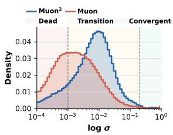

(a) Keller

(b) PolarExpress

Figure 7: The comparison of convergence zones between Keller (MUON’s (Jordan et al., 2024) polar method) and PolarExpress (Amsel et al., 2025).

• Loose target: (3.4445, −4.7750, 2.0315), which is adopted by (Jordan et al., 2024) that roughly maps singular values from [0, 1] to [0.7, 1.3].

• Exact target: (2, −1.5, 0.5), an earlier attempt of (Jordan et al., 2024) that vast majority of singular values are mapped to exact one except small values near zero.

MUON favors the loose target as it rapidly reaches a practically sufficient orthogonalization with only 5 NS iterations (Figure 6). However, Eq. (7) yields 0.03 for the exact target and 0.31 for the loose target, a 10x higher error for the latter. This reflects the fact that Eq. (7) measures the exact orthogonality, while in practice, the loose target provides sufficient orthogonalization that is well aligned with the ground truth, suggested by the 0.98 cosine similarity given by Eq. (15).

## C Convergence Zones for PolarExpress

As per discussion in Section 3.4.1, we divide the singular values of the NS input matrix from [0, 1] into Dead, Transition, and Convergent zones. This partition is determined given particular choices of polar approximation method and the practical tolerance ϵ, where the orthogonalization objective is mapping singular values to $[ 1 - \epsilon , 1 + \epsilon ]$ , as suggested by (Jordan et al., 2024). That said, the boundary of each convergence zone can change when different polar methods are used, such as PolarExpress (Amsel et al., 2025). When using Polar-Express, the boundary of dead zone reduces from 0.001 to 0.0008, and the boundary that separates transition and convergent zone reduces from 0.2 to 0.1. However, such changes are insufficient to solve the underlying challenge of the ill-conditioned input matrix. As demonstrate by Figure 7, a substantial part of singular values for MUON with Polar-Express still fall in dead zone, and the advantages of $\mathrm { \mathbf { M } \mathrm { { U O N } ^ { 2 } } }$ (i.e., significantly lower dead zone fraction, right-shifted distribution) persist.

## D Detailed Evaluations

## D.1 GPT Models

Model configurations of each scale of the GPT models we considered are listed in Table 7. The learning rate sweeping results and their visualization are in Table 8 and Figure 8 for GPT-Small, Table 9 and Figure 9 for GPT-Base, and Table 10 and Figure 4 for GPT-Large.

<table><tr><td>Model</td><td><eq>n_{\text{embd}}</eq></td><td><eq>n_{\text{layer}}</eq></td><td><eq>n_{\text{head}}</eq></td><td>Param(M)</td></tr><tr><td>GPT-Small</td><td>768</td><td>12</td><td>12</td><td>124</td></tr><tr><td>GPT-Base</td><td>1024</td><td>24</td><td>16</td><td>362</td></tr><tr><td>GPT-Large</td><td>1280</td><td>36</td><td>20</td><td>774</td></tr></table>

Table 7: Architecture configurations of GPT models.

<table><tr><td rowspan="2">LR</td><td colspan="2">Baseline</td><td colspan="2"><eq>Muon^2</eq> (ours)</td></tr><tr><td><eq>N_s=3</eq></td><td><eq>N_s=5</eq></td><td><eq>N_s=3</eq></td><td><eq>N_s=5</eq></td></tr><tr><td>0.003</td><td>34.90</td><td>31.18</td><td>31.00</td><td>30.04</td></tr><tr><td>0.005</td><td>32.70</td><td>29.51</td><td>28.83</td><td>28.41</td></tr><tr><td>0.010</td><td>33.49</td><td>29.85</td><td>28.36</td><td>28.01</td></tr><tr><td>0.020</td><td>33.36</td><td>29.86</td><td>28.12</td><td>27.95</td></tr><tr><td>0.040</td><td>33.40</td><td>30.13</td><td>29.30</td><td>28.99</td></tr></table>

Table 8: Learning rate sweep on GPT-Small. The best validation perplexity (↓) of each method is bolded.

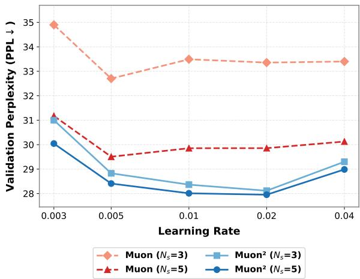

Figure 8: Learning Rates Sweep on GPT-Smal

<table><tr><td rowspan="2">LR</td><td colspan="2">Baseline</td><td colspan="2"><eq>Muon^2</eq> (ours)</td></tr><tr><td><eq>N_s=3</eq></td><td><eq>N_s=5</eq></td><td><eq>N_s=3</eq></td><td><eq>N_s=5</eq></td></tr><tr><td>0.003</td><td>25.43</td><td>22.11</td><td>21.73</td><td>21.01</td></tr><tr><td>0.005</td><td>24.69</td><td>21.75</td><td>20.64</td><td>20.33</td></tr><tr><td>0.010</td><td>25.42</td><td>21.99</td><td>20.39</td><td>19.96</td></tr><tr><td>0.020</td><td>24.78</td><td>21.47</td><td>20.50</td><td>20.40</td></tr><tr><td>0.040</td><td>25.75</td><td>22.22</td><td>21.97</td><td>21.24</td></tr></table>

Table 9: Learning rate sweep on GPT-Base. The best validation perplexity (↓) of each method is bolded.

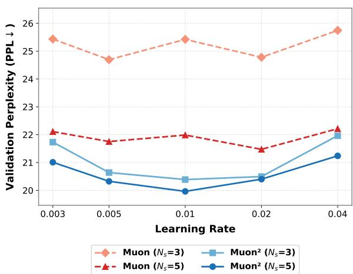

Figure 9: Learning Rates Sweep on GPT-Base

<table><tr><td rowspan="2">LR</td><td colspan="2">Baseline</td><td colspan="2"><eq>Muon^2</eq> (ours)</td></tr><tr><td><eq>N_s=3</eq></td><td><eq>N_s=5</eq></td><td><eq>N_s=3</eq></td><td><eq>N_s=5</eq></td></tr><tr><td>0.003</td><td>21.88</td><td>18.44</td><td>18.14</td><td>17.38</td></tr><tr><td>0.005</td><td>21.13</td><td>18.32</td><td>17.28</td><td>16.82</td></tr><tr><td>0.010</td><td>21.50</td><td>18.32</td><td>16.99</td><td>16.60</td></tr><tr><td>0.020</td><td>21.57</td><td>17.57</td><td>17.28</td><td>16.52</td></tr><tr><td>0.040</td><td>23.77</td><td>18.80</td><td>18.41</td><td>17.55</td></tr></table>

Table 10: Learning rate sweep on GPT-Large. The best validation perplexity (↓) of each method is bolded.

## D.2 LLaMA Models

Model configurations of each scale of the LLaMA models we considered are listed in Table 11. The learning rate sweeping results and their visualization are in Table 12 and Figure 10 for LLaMA-60M, Table 13 and Figure 11 and for LLaMA-350M, and Table 14 and Figure 12 for LLaMA-1B.

<table><tr><td>Model</td><td><eq>n_{\text{embd}}</eq></td><td><eq>n_{\text{inter}}</eq></td><td><eq>n_{\text{layer}}</eq></td><td><eq>n_{\text{head}}</eq></td><td>Param(M)</td></tr><tr><td>LLaMA-60M</td><td>512</td><td>1344</td><td>8</td><td>8</td><td>58</td></tr><tr><td>LLaMA-350M</td><td>1024</td><td>2736</td><td>24</td><td>16</td><td>368</td></tr><tr><td>LLaMA-1B</td><td>2048</td><td>5472</td><td>24</td><td>32</td><td>1280</td></tr><tr><td>LLaMA-13B</td><td>5120</td><td>13827</td><td>40</td><td>40</td><td>13018</td></tr></table>

Table 11: Architecture configurations of LLaMA models.

<table><tr><td rowspan="2">LR</td><td colspan="2">MUON</td><td colspan="2"><eq>MUON^2</eq> (ours)</td></tr><tr><td><eq>N_s=3</eq></td><td><eq>N_s=5</eq></td><td><eq>N_s=3</eq></td><td><eq>N_s=5</eq></td></tr><tr><td>0.02</td><td>26.44</td><td>25.91</td><td>25.90</td><td>25.87</td></tr><tr><td>0.04</td><td>26.37</td><td>24.91</td><td>24.77</td><td>24.68</td></tr><tr><td>0.05</td><td>27.06</td><td>24.94</td><td>24.78</td><td>24.68</td></tr><tr><td>0.06</td><td>27.26</td><td>24.98</td><td>24.59</td><td>24.60</td></tr><tr><td>0.08</td><td>27.35</td><td>25.15</td><td>24.71</td><td>24.71</td></tr></table>

Table 12: Learning rate sweep on LLaMA-60M. The best validation perplexity (↓) of each method is bolded.

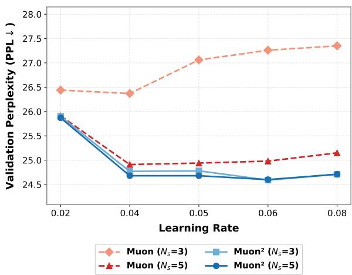

Figure 10: Learning Rates Sweep on LLaMA-60M

<table><tr><td rowspan="2">LR</td><td colspan="2">MUON</td><td colspan="2"><eq>MUON^2</eq> (ours)</td></tr><tr><td><eq>N_s=3</eq></td><td><eq>N_s=5</eq></td><td><eq>N_s=3</eq></td><td><eq>N_s=5</eq></td></tr><tr><td>0.04</td><td>14.91</td><td>14.03</td><td>13.44</td><td>13.46</td></tr><tr><td>0.05</td><td>15.18</td><td>14.12</td><td>13.50</td><td>13.51</td></tr><tr><td>0.06</td><td>15.33</td><td>14.18</td><td>13.58</td><td>13.59</td></tr><tr><td>0.07</td><td>15.43</td><td>14.30</td><td>13.67</td><td>13.63</td></tr><tr><td>0.08</td><td>15.76</td><td>14.49</td><td>13.71</td><td>13.73</td></tr></table>

Table 13: Learning rate sweep on LLaMA-350M. The best validation perplexity (↓) of each method is bolded.

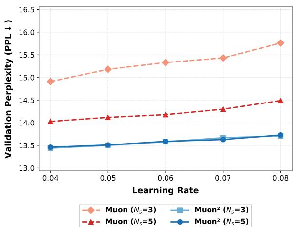

Figure 11: Learning Rates Sweep on LLaMA-350M

<table><tr><td rowspan="2">LR</td><td colspan="2">MUON</td><td colspan="2"><eq>MUON^2</eq> (ours)</td></tr><tr><td><eq>N_s=3</eq></td><td><eq>N_s=5</eq></td><td><eq>N_s=3</eq></td><td><eq>N_s=5</eq></td></tr><tr><td>0.04</td><td>11.63</td><td>10.62</td><td>10.43</td><td>10.21</td></tr><tr><td>0.05</td><td>11.86</td><td>10.70</td><td>10.50</td><td>10.26</td></tr><tr><td>0.06</td><td>11.98</td><td>10.77</td><td>10.55</td><td>10.31</td></tr></table>

Table 14: Learning rate sweep on LLaMA-1B. The best validation perplexity (↓) of each method is bolded.

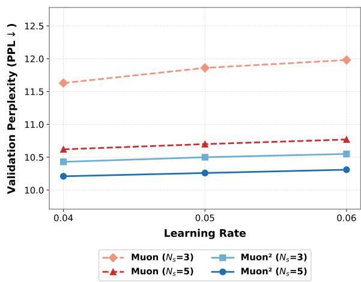

Figure 12: Learning Rates Sweep on LLaMA-1B

## D.3 Mixture-of-Experts

<table><tr><td>Model</td><td><eq>n_{\text{embd}}</eq></td><td><eq>n_{\text{inter}}</eq></td><td><eq>n_{\text{layer}}</eq></td><td><eq>n_{\text{head}}</eq></td><td><eq>n_{\text{exp}}</eq></td><td><eq>n_{\text{act}}</eq></td><td>Param(M)</td></tr><tr><td>MoE-7B-A1B</td><td>2048</td><td>4096</td><td>24</td><td>32</td><td>16</td><td>2</td><td>6980</td></tr></table>

Table 15: Architecture configurations of Mixture-of Experts model.

Model configuration of the Mixture-of-Experts model of Section 4.3 is in Table 15.

## D.4 Downstream

We evaluate downstream performance on a standard suite of zero-shot benchmarks covering commonsense reasoning, reading comprehension, and knowledge recall. Specifically, we report results on ARC-Challenge and ARC-Easy (Clark et al., 2018), which test grade-school science questions at two difficulty levels; OpenBookQA (OBQA) (Mihaylov et al., 2018), a multi-step reasoning benchmark requiring elementary science facts; HellaSwag (Zellers et al., 2019), which evaluates commonsense sentence completion; PIQA (Bisk et al., 2020), focused on physical commonsense reasoning; WinoGrande (Sakaguchi et al., 2020), a largescale Winograd-style coreference resolution benchmark; LAMBADA (Paperno et al., 2016), which measures long-range contextual word prediction; and MMLU (Hendrycks et al., 2021), covering multitask language understanding across 57 subjects. We report accuracy for all tasks and the unweighted average (Avg) across the suite. See additional downstream evaluations on GPT-Large in Table 16.

## D.5 MUON Variants

We compare with MUON variants including Polar-Express (Amsel et al., 2025), Turbo-Muon (Boissin et al., 2025), NorMuon (Li et al., 2025) and AdaMuon (Si et al., 2025). We focus on comparing them with $\mathbf { M } \mathrm { { U O N } ^ { 2 } }$ on GPT-Small and GPT-Base. We integrated their methods into our training framework using exactly what have been provided in their official repositories. For fairness, all methods are being sweeped on learning rate to make sure each method performs at their best capabilities, full sweeping results are in Tables 17 to 19. The reason we have AdaMuon separately in Table 19 is because it requires significantly smaller learning rates than other methods.

<table><tr><td rowspan="2">LR</td><td colspan="2">PolarExpress</td><td colspan="2">Turbo-Muon</td><td colspan="2">NorMuon</td></tr><tr><td><eq>N_s=3</eq></td><td><eq>N_s=5</eq></td><td><eq>N_s=3</eq></td><td><eq>N_s=5</eq></td><td><eq>N_s=3</eq></td><td><eq>N_s=5</eq></td></tr><tr><td>0.003</td><td>31.51</td><td>30.45</td><td>31.36</td><td>30.31</td><td>32.50</td><td>29.90</td></tr><tr><td>0.005</td><td>30.01</td><td>29.42</td><td>29.74</td><td>29.66</td><td>30.70</td><td>28.40</td></tr><tr><td>0.010</td><td>31.32</td><td>29.73</td><td>29.70</td><td>29.79</td><td>31.43</td><td>28.72</td></tr><tr><td>0.020</td><td>30.31</td><td>29.66</td><td>30.10</td><td>29.88</td><td>31.05</td><td>28.48</td></tr><tr><td>0.040</td><td>31.25</td><td>30.03</td><td>30.07</td><td>30.82</td><td>30.35</td><td>29.09</td></tr></table>

Table 17: Learning rate sweep on GPT-Small. The best validation perplexity (↓) of each method is bolded.

<table><tr><td rowspan="2">LR</td><td colspan="2">PolarExpress</td><td colspan="2">Turbo-Muon</td><td colspan="2">NorMuon</td></tr><tr><td><eq>N_s=3</eq></td><td><eq>N_s=5</eq></td><td><eq>N_s=3</eq></td><td><eq>N_s=5</eq></td><td><eq>N_s=3</eq></td><td><eq>N_s=5</eq></td></tr><tr><td>0.003</td><td>23.10</td><td>21.80</td><td>24.48</td><td>22.79</td><td>24.70</td><td>21.89</td></tr><tr><td>0.005</td><td>22.75</td><td>21.39</td><td>23.95</td><td>22.51</td><td>23.90</td><td>21.54</td></tr><tr><td>0.010</td><td>23.38</td><td>21.44</td><td>24.14</td><td>22.42</td><td>24.18</td><td>21.42</td></tr><tr><td>0.020</td><td>22.74</td><td>21.16</td><td>23.46</td><td>21.93</td><td>23.33</td><td>21.27</td></tr><tr><td>0.040</td><td>23.70</td><td>22.43</td><td>26.23</td><td>22.72</td><td>24.25</td><td>21.64</td></tr></table>

Table 18: Learning rate sweep on GPT-Base. The best validation perplexity (↓) of each method is bolded.

<table><tr><td></td><td>NS Steps</td><td>Avg</td><td>ARC-c</td><td>ARC-e</td><td>OBQA</td><td>HellaS.</td><td>PIQA</td><td>WinoG.</td><td>LAMBADA</td><td>MMLU</td></tr><tr><td rowspan="2">MUON</td><td><eq>N_s = 3</eq></td><td>39.42</td><td>24.32</td><td>44.23</td><td>30.80</td><td>39.92</td><td>68.82</td><td>52.09</td><td>32.19</td><td>22.95</td></tr><tr><td><eq>N_s = 5</eq></td><td>40.34</td><td>24.91</td><td>44.07</td><td>30.40</td><td>42.50</td><td>69.80</td><td>51.07</td><td>37.07</td><td>22.92</td></tr><tr><td rowspan="2"><eq>MUON^2</eq></td><td><eq>N_s = 3</eq></td><td>40.86</td><td>25.77</td><td>44.91</td><td>29.40</td><td>43.72</td><td>69.70</td><td>50.51</td><td>40.03</td><td>22.85</td></tr><tr><td><eq>N_s = 5</eq></td><td>41.57</td><td>24.49</td><td>46.93</td><td>31.60</td><td>45.01</td><td>69.80</td><td>51.62</td><td>40.07</td><td>23.02</td></tr></table>

Table 16: Zero-shot evaluation on GPT-Large trained by MUON and $\mathbf { M } \mathbf { U } \mathbf { O N } ^ { 2 }$ across different NS iterations.

<table><tr><td rowspan="2">LR</td><td colspan="2">GPT-Small</td><td colspan="2">GPT-Base</td></tr><tr><td><eq>N_s=3</eq></td><td><eq>N_s=5</eq></td><td><eq>N_s=3</eq></td><td><eq>N_s=5</eq></td></tr><tr><td>0.001</td><td>36.63</td><td>31.49</td><td>26.07</td><td>22.73</td></tr><tr><td>0.003</td><td>31.20</td><td>29.30</td><td>27.91</td><td>22.94</td></tr><tr><td>0.005</td><td>33.45</td><td>30.48</td><td>26.08</td><td>22.42</td></tr></table>

Table 19: Learning rate sweep of AdaMuon on GPT-Small and GPT-Base. The best validation perplexity (↓) of each method is bolded.

## D.6 Training Speedup

Here we show the wall-time vs. training loss in Fig ure 13, and the per-training-step time in Table 20.

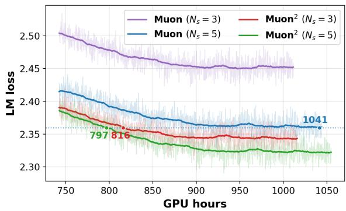

Figure 13: On LLaMA-1B, $\mathrm { \mathbf { M } U O N ^ { 2 } }$ achieves same loss with 1/4 fewer GPU-hours than MUON.

<table><tr><td>Model</td><td>NS Steps</td><td>Step Time (ms)</td></tr><tr><td rowspan="2">MUON</td><td><eq>N_s = 3</eq></td><td>2958</td></tr><tr><td><eq>N_s = 5</eq></td><td>3053</td></tr><tr><td rowspan="2"><eq>MUON^2</eq></td><td><eq>N_s = 3</eq></td><td>2971</td></tr><tr><td><eq>N_s = 5</eq></td><td>3085</td></tr></table>

Table 20: Per-training-step time for LLaMA-1B on a supercomputer with 64 nodes (4 GPUs each).

## D.7 Memory Efficiency of MUON2-F

The memory profiling shown in Table 6 is conducted on a single 94GB H100 GPU using training framework adopted from Nanotron (Karpathy, 2022) with bfloat 16 precision, sequence length 4096, and micro batch size 1.

## E LLM Usage

We used large language models solely as writing assistance tools for grammar and wording refinement. They were not involved in the development of ideas, experimental design, analysis, or interpretation of results. All technical content, claims, and conclusions were produced and verified by the authors.
