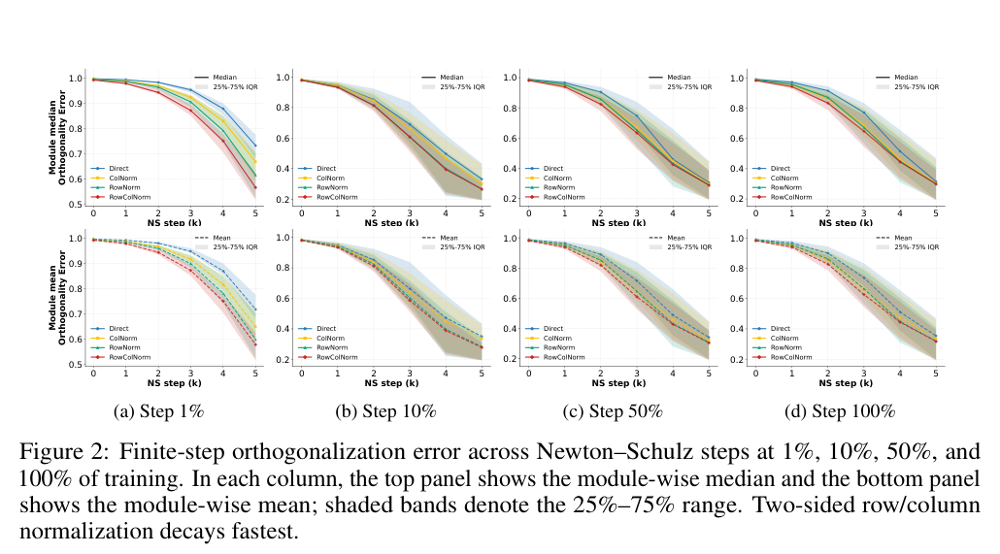
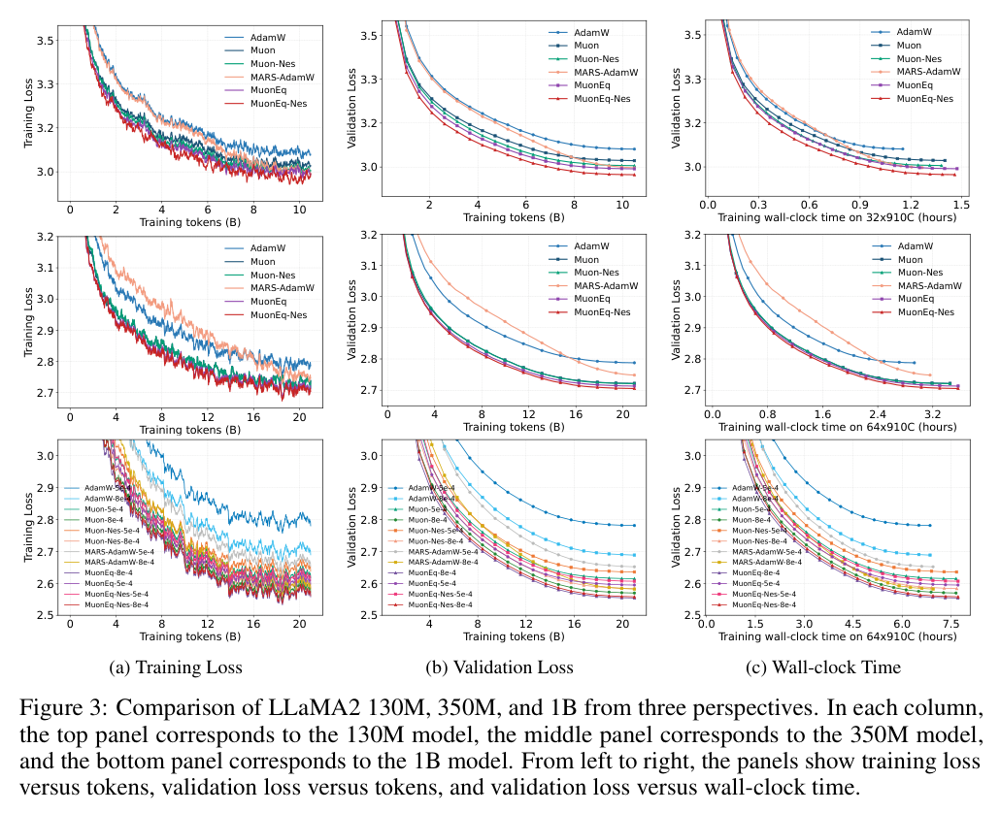
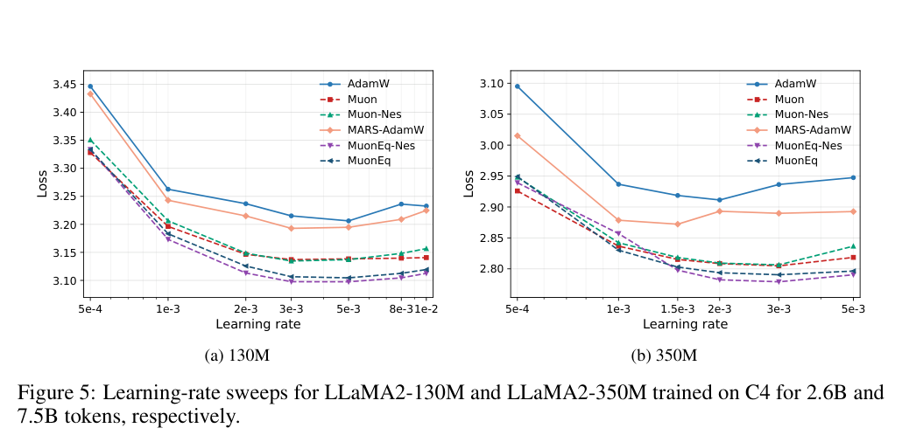
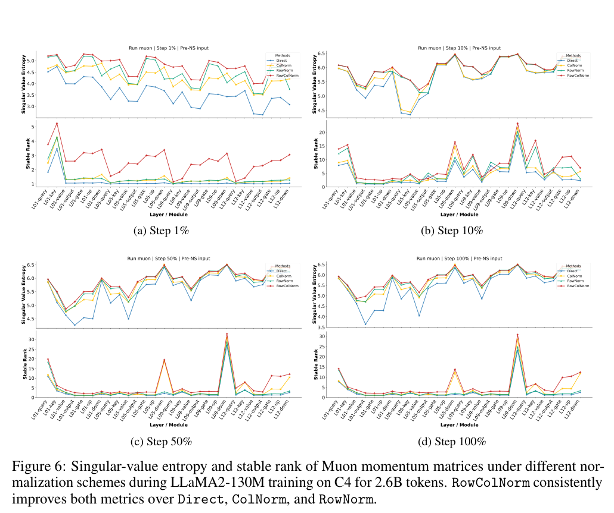
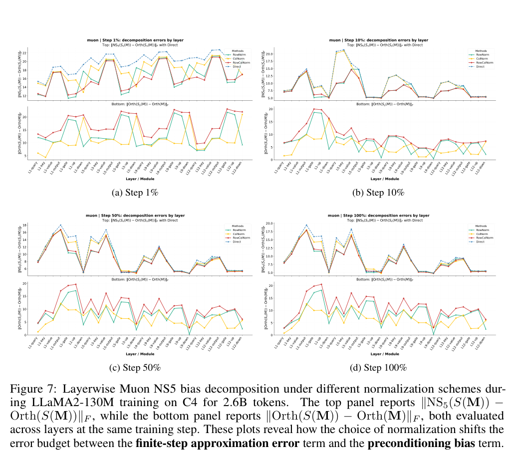
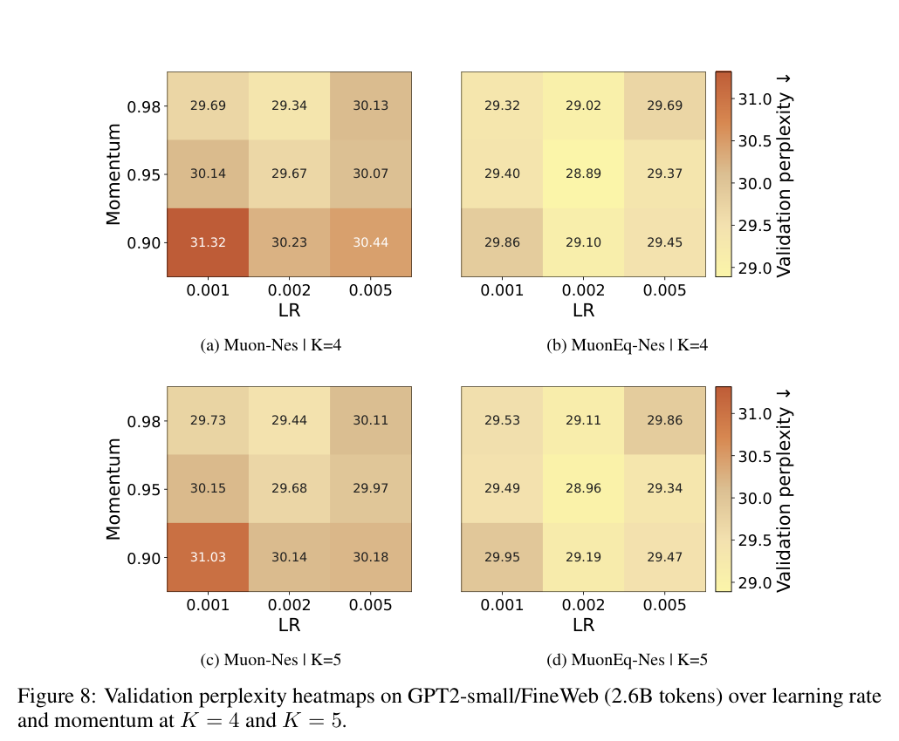

# MuonEq: Balancing Before Orthogonalization with Lightweight Equilibration

原文：[arXiv v2](https://arxiv.org/abs/2603.28254v2) | [本地 PDF](../../01-raw/2026-10/MuonEq_Balancing_Before_Orthogonalization_with_Lightweight_Equilibration.pdf)

解析说明：以下逐页保留 PDF 原生文本提取结果。多栏算法、表格和数学公式的阅读顺序或符号可能损失；正式引用以 PDF 为准。插图为 PDF 原始图形裁剪，图片来源见 [溯源](images/MuonEq_Balancing_Before_Orthogonalization_with_Lightweight_Equilibration/_sources.md)。

## PDF 第 1 页

          MuonEq: Balancing Before Orthogonalization with
                         Lightweight Equilibration

                         Da Chang137, Qiankun Shi34, Lvgang Zhang35, Yu Li6, Ruijie Zhang7
                                       Yao Lu3, Yongxiang Liu3∗, Ganzhao Yuan2∗

                               1Shenzhen Institute of Advanced Technology, Chinese Academy of Sciences
                      2Shenzhen University of Advanced Technology 3Pengcheng Laboratory 4Sun Yat-sen University
                               5Southern University of Science and Technology 6George Washington University2026                                            7University of Chinese Academy of Sciences
May                                            Abstract

                               Orthogonalized-update optimizers such as Muon improve training of matrix-valued10
                               parameters, but existing extensions typically either rescale updates after orthogo-
                                  nalization or use heavier whitening-based preconditioners before it. We introduce
                       MuonEq, a lightweight family of pre-orthogonalization equilibration schemes
                                  for Muon with three forms: two-sided row/column normalization (RC), row nor-
                               malization (R), and column normalization (C). By rebalancing the momentum
                               matrix before finite-step Newton–Schulz orthogonalization, MuonEq improves the[cs.LG]                      geometry seen by orthogonalization. We show that finite-step orthogonalization
                                       is governed by the input spectrum, especially stable rank and condition number,
                            and that row/column normalization acts as a zeroth-order surrogate for whitening.
                             For hidden matrix weights, R is the default variant. Theoretically, MuonEq (R)
                                   retains the standard O(T −1/4) Muon-type nonconvex stationarity guarantee with                                       e
                              decoupled weight decay and a horizon-free diminishing learning-rate schedule, and
                              extends it to finite-step NS5 up to an explicit inexactness constant. In LLaMA2
                                  pretraining on C4, MuonEq (R) consistently outperforms Muon on 130M, 350M,
                            and 1B models, with faster convergence and lower validation perplexity. The code
                                        is available at the MuonEq codebase.

                1  Introduction

                  As the computational and data costs of large language model pretraining grow, optimization increas-
                       ingly determines sample efficiency, throughput, and scalability. Beyond coordinate-wise adaptivearXiv:2603.28254v2               methods such as AdamW [1], Adan [2], and MARS [3], recent work has shifted toward a geometric
                    view of matrix-valued updates. Muon [4], for instance, uses a Newton–Schulz approximation to
                        the polar factor of the momentum matrix to produce spectrally aligned updates [5, 6]. It has shown
                        strong empirical scalability in LLM pretraining, often improving the trade-off among data efficiency,
                     compute, and wall-clock time at fixed target loss [7, 8, 9]. Recent theory further characterizes Muon
                       as spectral-norm steepest descent and establishes nonconvex convergence guarantees for both exact
                    and approximate orthogonalization [10, 11, 12, 13, 14, 15, 16].

                     Follow-up work around Muon mainly proceeds along two directions.  (i) Post-orthogonalization
                       rescaling augments an already constructed orthogonal update with additional magnitude correc-
                           tion. Muon+ [17], NorMuon [18], and AdaMuon [19] respectively add row/column normalization,
                     neuron-wise normalization, or element-wise variance adaptation after orthogonalization. These
                         variants show that orthogonal updates remain compatible with later adaptive scaling, but they do not

                             ∗Corresponding authors: liuyx@pcl.ac.cn and yuanganzhao@foxmail.com

                                Preprint.

## PDF 第 2 页

change the matrix that finite-step Newton–Schulz actually sees. (ii) Pre-orthogonalization geometric
correction instead modifies the coordinate system before spectral optimization. SOAP [20] connects
Shampoo [21] with Adam/Adafactor [22, 23] through a preconditioned basis, while FISMO [24] and
Mousse [25] further perform spectral optimization in whitened coordinates. These methods motivate
studying geometry correction before orthogonalization as a promising lever, but existing approaches
typically incur substantially higher state and computational overhead.

These works motivate a more precise question:

  Is there a lightweight design between post-orthogonalization rescaling and full whitening-based
  preconditioning that directly improves the input geometry for orthogonalization?

Our starting point is that, in Muon, the relevant object is not only the exact polar factor but also
the finite-step Newton–Schulz approximation used in practice. Section 3.1 shows that both the
convergence speed of Newton–Schulz iterations and the gap between finite-step iterations and exact
orthogonalization are governed by input spectral geometry, especially stable rank and condition
number. This points to a simple design principle: improve the geometry before orthogonalization,
but do so with the smallest possible intervention. A natural formalization is the optimal diagonal
preconditioning problem:

                           min  κ D1/21 AD−1/22       .
                             D1,D2≻0

Qu et al. [26] derive an optimal diagonal preconditioner, but applying it online typically requires
an auxiliary iterative solve.  Classical row/column equilibration is less exact yet much lighter-
weight [27]; moreover, recent operator-geometry results identify row and column normalization as
steepest-descent directions under the p →∞and 1 →q geometries, respectively [28]. This makes
diagonal equilibration a natural lightweight way to improve the matrix presented to Muon-style
orthogonalization.

Motivated by this observation, we propose MuonEq, a lightweight family of pre-orthogonalization
equilibration schemes for Muon, instantiated as two-sided row/column normalization (RC), row
normalization (R), and column normalization (C). All variants rescale the momentum matrix before
Newton–Schulz, using row/column squared-norm reductions from the current momentum. Section 3
provides the theory: Theorem 3.1 quantifies the spectral sensitivity of finite-step orthogonalization;
Proposition 3.2 shows that row/column normalization is a zeroth-order whitening surrogate; and
Proposition 3.4, Theorem 3.5, and Corollary 3.6 formalize the RC/R trade-off. In particular, the
default R variant satisfies the standard O(T −1/4) nonconvex stationarity guarantee while explicitly                            e
accounting for decoupled weight decay, horizon-free learning-rate schedules, and finite-step NS5. For
the hidden Transformer weight matrices targeted by MuonEq, recent architecture-aware analyses [28]
identify row-sided geometry as the natural one-sided choice, while column-sided geometry is more
aligned with embeddings; hence we use R by default and keep RC/C for analysis and ablation.
Compared with Muon+ [17], which rescales updates after orthogonalization, MuonEq changes the
input to orthogonalization. Unlike whitening-based methods such as FISMO and Mousse [24, 25],
MuonEq avoids Kronecker factors, matrix-valued second-order statistics, eigendecomposition, and
momentum transport; its diagonal rescaling is computed on the fly from row/column squared norms,
with no persistent optimizer state.

Our contributions are threefold.   (i) First, we propose MuonEq, a lightweight family of pre-
orthogonalization equilibration schemes for Muon with three forms: RC, R, and C; these variants
rebalance the current momentum matrix before Newton–Schulz using row/column squared norms
computed on the fly, with R as the default for hidden matrix weights. (ii) Second, we analyze how
pre-orthogonalization geometry affects finite-step Newton–Schulz: Theorem 3.1 links its behavior to
stable rank and condition number, Proposition 3.2 identifies row/column normalization as a zeroth-
order whitening surrogate, and Proposition 3.4 together with Theorem 3.5 and Corollary 3.6 formalize
the trade-off between stronger two-sided spectral correction and cleaner one-sided geometry. In
particular, MuonEq (R) satisfies the standard O(T −1/4) nonconvex stationarity guarantee while                                   e
accounting for decoupled weight decay, horizon-free learning-rate schedules, and finite-step NS5. (iii)
Third, empirically, the default R variant consistently outperforms Muon across model sizes and token
budgets, while ablations over RC, R, and C show that R is the default form for the hidden-weight
setting targeted by MuonEq.

                                       2

## PDF 第 3 页

2  Method

Notation and setup. Scalars are denoted by non-bold letters, vectors by bold lowercase letters, and
matrices by bold uppercase letters. On Rd, we use the Euclidean inner product ⟨x, y⟩2 := x⊤y and
norm ∥x∥2. For matrices, ⟨A, B⟩F := tr(A⊤B) and ∥A∥F denote the Frobenius inner product and
norm, and ∥A∥∗denotes the nuclear norm. We write [m] := {1, 2, . . . , m} and let N be the set of
non-negative integers. The model parameter is a matrix X ∈Rm×n, and, unless otherwise stated,
we assume m ≥n. For any matrix A ∈Rm×n with rank r ≤n, we write its compact singular
value decomposition as A = UΣV⊤, where Σ = diag(σ1, . . . , σr) and σ1 ≥· · · ≥σr > 0, and
define the polar factor, which we also call the orthogonalized form, as Orth(A) := UV⊤. Here,
orthogonalization and polar step mean applying or approximating this map, whereas whitening
denotes full Gram inverse-square-root preconditioning. The row and column rescalings introduced
below are diagonal equilibration operations. In finite-data form, the training objective can be written as
f(X) := N1 Pi∈[N] fi(X), where fi(X) is the loss associated with the i-th sample zi. Equivalently,
we use the stochastic formulation
                     min  f(X),    f(X) = Eξ∼D[f(X; ξ)],                         (1)
                    X∈Rm×n
where f may be nonconvex, ξ is independent of X, and Eξ[·] denotes expectation with respect to
                                                                         ∥A∥2F
ξ. For any matrix A with singular values {σi(A)}ri=1, we further use sr(A) := ∥A∥22 , κ(A) :=
                                                      , H(p) := −Pri=1 pi log pi.σr(A),σ1(A) κi(A) := σ1(A)σi(A) , pi := σi(A)2∥A∥2F
Muon as finite-step orthogonalized momentum. For matrix parameters, Muon constructs the
update by orthogonalizing the momentum matrix. Let Mt denote the momentum at iteration t. The
abstract Muon update is

                   Ot = Orth(fMt),    Xt+1 = Xt −aηtOt,                         (2)
where Mt is the standard momentum or its Nesterov variant [4, 7, 10]; following LLM Muon   f
practice [7], we set a = 0.2p max{m, n}. In practice, Orth(fMt) is implemented by a fixed number
of Newton–Schulz iterations rather than exact polar decomposition [4].

Pre-orthogonalization equilibration family. MuonEq inserts diagonal preconditioning before
orthogonalization:
          ˆMt = DiagPre(fMt, s, ε),    Ot = Orth(ˆMt),    Xt+1 = Xt −aηtOt,        (3)
where the mode s ∈{RC, R, C} selects one of three equilibration forms. Let

       Dr,t = diag rowsum(fMt ⊙fMt) + ε  ,     Dc,t = diag colsum(fMt ⊙fMt) + ε  .
We consider the following three maps:

                                                       D−1/2r,t  MtD−1/2f    c,t    ,  s = RC,                    
                 DiagPre(fMt, s, ε) =  D−1/2r,t  Mt,f         s = R,                       (4)
                                                                                   ,        s = C.                    MtD−1/2                   f    c,t
Unlike methods that rely on matrix-valued or adaptive preconditioners [21, 22, 23, 24], MuonEq
changes only the transient input fed to Newton–Schulz. Relative to Muon [4], the orthogonalization
routine and persistent optimizer state are unchanged; relative to Muon+, NorMuon, and AdaMuon [17,
18, 19], MuonEq rebalances the input rather than rescales the output.

Why the default variant is R. This choice is block-dependent rather than a universal preference for
row normalization. The trade-off is guided by

  ∥NSK(S(M)) −Orth(M)∥F ≤∥NSK(S(M)) −Orth(S(M))∥F + ∥Orth(S(M)) −Orth(M)∥F ,
                                  |          finite-step approximation{z         error      }   |           preconditioning{z    bias       }
                                                                                                               (5)

where S is one of RC, R, or C. The first term is the finite-step Newton–Schulz error and depends
on the spectrum of S(M); Theorem 3.1 therefore explains why the more aggressive two-sided RC
map often gives the largest spectral correction. The second term is the bias induced by preprocessing.

                                       3

## PDF 第 4 页

Algorithm 1 MuonEq (mode s ∈{RC, R, C}; Algorithm 2 DiagPre
default s = R)
                                                                     1: Input:  Momentum Mt, mode s ∈                                f  1: Input:   Initial parameters X1 ∈ Rm×n,    {RC, R, C}, stability term ε ≥0
     learning rates ηt >  0, momentum coeffi-    2:  if s ∈{RC, R} then
     cients {βt}t≥1 ⊂[0, 1), weight decay λt ≥
                                                                     3:   Dr,t = diag(rowsum(fMt ⊙fMt) + ε)     0, mode s ∈{RC, R, C},  stability term                                                                     4: end if
    ε ≥0, Nesterov flag, scaling constant a =                                                                     5:  if s ∈{RC, C} then
    0.2pmax(m, n).
                                                                     6:   Dc,t = diag(colsum(fMt ⊙fMt) + ε)  2: Initialize M0 = 0                                                                     7: end if
  3:         t =          1     for              to T do                                                                              D−1/2r,t  MtD−1/2f    c,t    ,  s = RC;  4:      =     Gt          ∇f(Xt;                       ξt)                             
                                                                           s = R;  5:  Mt = βtMt−1 + (1 −βt)Gt                     8: ˆMt =   D−1/2r,t  Mt,f
                                                                                                               ,        s = C.  6:     if Nesterov then                   MtD−1/2                           f    c,t
  7:    Mt = βt+1Mt + (1 −βt+1)Gt    f                                                     9: return ˆMt  8:    else
  9:    Mt = Mt
    f                            Remark 2.1. Unless otherwise stated, we use 10:   end if
                                            s = R; RC and C are retained for analysis
 11:   ˆMt = DiagPre(fMt, s, ε)               and ablation. For varying βt, the Nesterov 12:   Ot = NS5(ˆMt)                                                       line follows the EMA-buffer convention; for
 13:   Xt+1 = (1 −λtηt)Xt −aηtOt                                                βt ≡β, it reduces to the Nesterov form [3, 10]. 14: end for

Proposition 3.2 shows that row/column normalization is a zeroth-order surrogate for whitening,
removing marginal scale mismatch before orthogonalization. Among the one-sided variants, re-
cent operator-geometry analyses identify row-sided geometry as the natural choice for the hidden
Transformer weight matrices targeted by MuonEq, whereas column-sided geometry is more closely
associated with embedding matrices [28]. This makes R the most appropriate default in our set-
ting. Consistent with this picture, Proposition 3.4 characterizes the pure RC regime as a stronger
two-sided spectral corrector, whereas Theorem 3.5 gives the cleanest nonconvex guarantee for the
row-normalized variant.

3  Analysis

The analysis follows the logic of MuonEq: Section 3.1 establishes the spectrum sensitivity of finite-
step Newton–Schulz; Section 3.2 interprets row/column normalization as a zeroth-order surrogate for
whitening; and Section 3.3 motivates the R rather than RC, with row normalization admitting a clean
stochastic nonconvex guarantee. Together, these results motivate the MuonEq family and clarify
the trade-off between stronger spectral correction and preprocessing bias. Within the hidden-weight
setting studied here, they support using R as our default working variant.

3.1 Why spectral geometry matters for finite-step Newton–Schulz orthogonalization

For clarity, the theorem below is stated for the wide case p ≤q; the tall case follows by transposition.
Theorem 3.1. Let G ∈Rp×q have rank r ≥1 and compact SVD G = UΣV⊤, where Σ =
diag(σ1, . . . , σr) with σ1 ≥· · · ≥σr > 0 and p ≤q. Consider the Newton–Schulz iteration

               G
               X0 =           ,  Xk+1 =  aIp + bXkX⊤k + c(XkX⊤k )2 Xk,
                    ∥G∥F
where ϕ(s) := as + bs3 + cs5 and q(t) := a + bt + ct2 satisfy a > 1, 0 < q(t) ≤a, t ∈[0, 1]. Such
coefficient choices include those used in [4, 15]. Then, for each k ≥0,
                                                        σi
       Xk = U diag s(k)1   , . . . , s(k)r  V⊤,      s(0)i =           ,     s(k+1)i   = ϕ s(k)i     .
                                      ∥G∥F
Moreover,
                                                                                          1/2
                             r
                        1                     1                                                                 ak   !2 
                                                       1 −                                                                                                                                        .                  √r Xk −Orth(G) F ≥ √r X
                                                           i=1                                                                     κi p sr(G) + 

                                       4

## PDF 第 5 页

Equivalently, the i-th singular direction leaves the linear regime at τi = loga  κi psr(G)  . In particular,
τ1 = loga p sr(G), τr = loga κ(G) p sr(G)   , τr −τ1 = loga κ(G). See Appendix B for details.
Remark 3.1. Theorem 3.1 shows that the stable rank controls the onset of the linear to nonlinear
transition, while the condition number controls its width across singular directions.

                                                     1.0                                           1.0                                           1.0                 Methods         1.0
                                                                                                                                                                                                                                                               Direct
         0.9                                                     0.9                                           0.9                                           0.9                                  ColNormRowNorm
                                                                                                                                                                                                       RowColNorm                                                     0.8                                           0.8      Error                                                                                                                                                0.8         0.8
                                                     0.7                                           0.7
         0.7                                                                                                                                     0.7
                                                     0.6                                           0.6
         0.6                                                                                                                                     0.6                                                     0.5                                           0.5
         0.5                                                     0.4                                           0.4                                           0.5               Orthogonality
         0.4
                                                     0.3                                           0.3                                           0.4
           0     1     2                             3     4     5        0     1     2 Steps 3     4     5        0     1     2 Steps 3     4     5        0     1     2 Steps 3     4     5                          Steps
                                                                                                                                                                                                                                                                               Spread: 0.0

                                                                                                                                                                                                                                                                               Spread:                                                                                                                                                                                                                                                                                                 1.0      105                               102                                102                                                                                                            Spread: 0.5                                                                                                                                                                                                                                                                               Spread:                                                                                                                                                                                                                                                                                                 1.5
                                                                                                                                                                                                                                                                               Spread: 2.0

                                                                                                                                                                                                                                                                       Wide: raw cond
                                                                                                                                                                                                                                                                               Narrow: precond cond        Number                                                                                                       105

      104
                                        101                                101           Condition                                                                                                              104
           DirectColNormRowNormRowColNorm       DirectColNormRowNormRowColNorm       DirectColNormRowNormRowColNorm       DirectColNormRowNormRowColNorm

           (a) 1024×1024               (b) 1024×4096               (c) 4096×1024              (d) 4096×4096

Figure 1: Random Gaussian matrices with controlled shapes and spectral spreads. Top: finite-step
relative Frobenius error to the exact polar factor across Newton–Schulz steps. Bottom: raw and
post-normalization condition numbers. Two-sided row/column normalization yields the smallest
error and the most consistent spectral compression.

To isolate this effect, Figure 1 uses random Gaussian matrices with controlled shapes and spectral
spreads. The top row shows the finite-step error in Theorem 3.1, and the bottom row shows the
corresponding condition numbers before and after normalization.

To verify the same mechanism on real training trajectories, Figure 2 uses pre-NS momentum matrices
from a 2.6B-token Muon run on LLaMA2-130M [29] trained on C4 [30]. The top row shows the
module-wise median of the error in Theorem 3.1, and the bottom row shows the corresponding mean.
Appendix J provides a more detailed module-wise view of the same phenomenon: Figure 6 reports
singular-value entropy and stable-rank diagnostics for the pre-NS momentum matrices, showing that
equilibration reshapes the spectrum seen by finite-step Newton–Schulz.

3.2  Row/column normalization as a zeroth-order surrogate for whitening

The next result shows that normalization is not merely heuristic rescaling. It is the leading-order
term of exact whitening/orthogonalization when the normalized Gram matrix is close to identity.
Consequently, normalization removes marginal scale mismatch first and leaves only the correlation
correction to the polar step.
Proposition 3.2. The following first-order expansions hold.

(i) Column/right whitening.
Let M ∈Rp×q have full column rank, and set Dc :=  diag(∥M:,1∥2, . . . , ∥M:,q∥2) ≻0,
Nc := MD−1c   , and Cc := N⊤c Nc −Iq. If ∥DcCcDc∥2 is sufficiently small, then Orthr(M) :=
M(M⊤M)−1/2 = Nc −NcLcD−1c + O ∥DcCcDc∥22  , where Lc is the unique solution of
DcLc + LcDc = DcCcDc. In particular,
                        Orthr(M) = Nc + O ∥Cc∥2  .
(ii) Row/left whitening.
Let M ∈Rp×q have full row rank, and set Dr := diag(∥M1,:∥2, . . . , ∥Mp,:∥2) ≻0, Nr := D−1r M,
and Cr := NrN⊤r −Ip. If ∥DrCrDr∥2 is sufficiently small, then Orthℓ(M) := (MM⊤)−1/2M =

                                       5

## PDF 第 6 页

           1.0                                 Median25%-75% IQR    1.0                                      Median25%-75% IQR    1.0                                      Median25%-75% IQR    1.0                                      Median25%-75% IQR
              Error0.9                                          0.8                                               0.8                                               0.8
            median  0.8
                                                         0.6                                               0.6                                               0.6

                            Direct            Module  0.7                                                                                                          0.4        Direct                                                         0.4        Direct
                       ColNorm                                                                           ColNorm                                                                                                                                    ColNorm                                                                                                                                                            0.4        DirectColNorm                                   Orthogonality0.6
                     RowNorm                                                                   RowNorm                                                                                                                      RowNorm                                                                                                                                                                         RowNorm
           0.5       RowColNorm                           0.2       RowColNorm                                0.2       RowColNorm                                0.2       RowColNorm
             0     1     2     3     4     5       0      1      2      3      4      5        0      1      2      3      4      5        0      1      2      3      4      5
                   NS step (k)                        NS step (k)                          NS step (k)                          NS step (k)
           1.0                              Mean25%-75% IQR    1.0                                  Mean25%-75% IQR    1.0                                  Mean25%-75% IQR    1.0                                  Mean25%-75% IQR
              Error0.9                                          0.8                                               0.8                                               0.8
        mean  0.8
                                                         0.6                                               0.6                                               0.6
           0.7            Module                            Direct                                                                                                          0.4        Direct                                                         0.4        Direct
                       ColNorm                                                                           ColNorm                                                                                                                                    ColNorm                                                                                                                                                            0.4        DirectColNorm                                   Orthogonality0.6
                     RowNorm                                                                   RowNorm                                                                                                                      RowNorm                                                                                                                                                                         RowNorm
           0.5       RowColNorm                           0.2       RowColNorm                                0.2       RowColNorm                                0.2       RowColNorm
             0     1     2     3     4     5       0      1      2      3      4      5        0      1      2      3      4      5        0      1      2      3      4      5
                   NS step (k)                        NS step (k)                          NS step (k)                          NS step (k)

             (a) Step 1%                 (b) Step 10%                  (c) Step 50%                (d) Step 100%

Figure 2: Finite-step orthogonalization error across Newton–Schulz steps at 1%, 10%, 50%, and
100% of training. In each column, the top panel shows the module-wise median and the bottom panel
shows the module-wise mean; shaded bands denote the 25%–75% range. Two-sided row/column
normalization decays fastest.

Nr−D−1r LrNr+O ∥DrCrDr∥22  , where Lr is the unique solution of DrLr+LrDr = DrCrDr.
In particular,
                         Orthℓ(M) = Nr + O ∥Cr∥2  .
See Appendix D for details.
Corollary 3.3. Under the assumptions of the row/left part of Proposition 3.2, if ∥Cr∥2 is sufficiently
small, then
             Orthℓ(Nr) = (Ip + Cr)−1/2Nr = Nr −1    + O ∥Cr∥22  ,                                      2CrNr
and hence
                 ∥Orthℓ(Nr) −Nr∥2 ≤1        + O ∥Cr∥22  .                                  2∥Nr∥2∥Cr∥2
In particular, since diag(NrN⊤r ) = Ip, row normalization removes the marginal scale mismatch, so
the leading whitening correction acts only on the residual off-diagonal Gram error.
Remark 3.2. By contrast, the corresponding bound for Orthℓ(M) −M contains the additional
zeroth-order term
                           ∥Dr −Ip∥2∥Nr∥2.

Thus row normalization separates marginal rescaling from the genuine whitening step. The column-
normalized/right analogue and the corresponding two-sided normalization statements are completely
symmetric; see Appendix E.

Together, Proposition 3.2, Corollary 3.3, and Remark 3.2 explain the division of labor in MuonEq:
normalization removes marginal-scale mismatch at zeroth order, and the subsequent Newton–Schulz
orthogonalization handles the remaining correlation structure. This is exactly why DiagPre Eq. (4) is
a meaningful lightweight surrogate for a much more expensive whitening step.

3.3  Convergence analysis of the RC and R variants

To analyze the MuonEq family, we focus on the two variants that are most informative theoreti-
cally: RC and the default row-normalized R. RC gives stronger two-sided spectral correction but
leads to a more involved alignment term, while R has a cleaner one-sided geometry. Accordingly,
Proposition 3.4 studies RC. For R, Theorem 3.5 gives the main guarantee for the exact-polar update,
and Corollary 3.6 extends it to the finite-step NS5 implementation. Compared with recent Muon
analyses [10, 11, 13, 15, 16, 31], our contribution is not to improve the asymptotic rate, but to
establish a guarantee closer to the optimizer setting used in practice: the same O(T −1/4) stationarity                                                        e
rate is proved while explicitly covering decoupled weight decay, a learning-rate schedule independent
of the training horizon, and finite-step NS5 through the inexactness constant εns.

                                       6

## PDF 第 7 页

Assumption 3.1. The objective is bounded below: there exists f ⋆> −∞such that f(X) ≥f ⋆for
all X ∈Rm×n.
Assumption 3.2. The function f is L-smooth, that is, ∥∇f(Y) −∇f(X)∥F ≤L∥Y −X∥F for all
X, Y ∈Rm×n.
Assumption 3.3. The stochastic gradient is unbiased with bounded variance. Specifically, there exists
σ > 0 such that, for all X ∈Rm×n, E[∇f(X; ξ)] = ∇f(X), E∥∇f(X; ξ) −∇f(X)∥2F ≤σ2.

These assumptions are standard in analyses of adaptive and Muon-type methods [2, 6, 32, 33, 34, 35,
36].
Proposition 3.4. Let ηt = t−3/4, βt = 1−t−1/2, ht := 1−βt = t−1/2, and a := 0.2pmax{m, n}.
Assume Assumptions 3.1, 3.2, and 3.3. Moreover, assume there exists G∞> 0 such that ∥Gt∥∞≤
G∞almost surely. For Algorithm 1, consider the exact-polar RC variant in (4), with Nesterov
momentum disabled and λt = 0. Suppose further that ε ≥45G2∞max{m, n}, and define ρr :=
q    nG2∞    q    mG2∞         (ρr+1)(ρc+1)  1 +   ε   , ρc :=   1 +   ε   , χε :=     4ρrρc    −3ρrρc−ρr−ρc−14          . Then ρr, ρc ≤3/2 and
hence χε ≥1/144. Consequently,

                    T
                1                −f ⋆+ C1(1 + ln T) + C2
                                                                                                                  ,      X E∥∇f(Xt)∥F ≤f(X1)             1/4              T                            aχε · T                    t=1
        √             a                                                aσ2   3La2nwhere C1 = L 2  2L2a2n + σ2 + aL χε + ρrρc √n 2, C2 = L +   2    . See Appendix G for
details.
Theorem 3.5. Let ηt = t−3/4, βt = 1 −t−1/2, ht := 1 −βt = t−1/2, ε = 0 and a :=
0.2p max{m, n}. Assume Assumptions 3.1, 3.2, and 3.3. For Algorithm 1, consider the exact-polar
R variant in (4), with Nesterov momentum disabled and 0 ≤ρ < √m,a  0 ≤λt ≤ ∥X1∥Fρ+4a√n t−1/4.
Then, for every T ≥1,

               1                  T               −f ⋆+ Cep1,ρ(1 + ln T) + Cep2,ρ
                                                                                                                     ,      X E∥∇f(Xt)∥F ≤f(X1)                                                                    1/4            T                               a/√m −ρ  · T
                   t=1
         √                                           2              a                                      1                   aσ2   3L                             + √n    , Cep2,ρ = L +  2 (a√n + ρ)2.where Cep1,ρ = L 2 2L2(a√n + ρ)2 + σ2 + aL √m
Corollary 3.6. Under the assumptions of Theorem 3.5, replace the exact-polar step by the finite-step
NS5 step Ot := NS5(ˆMt), where NS5 is the five-step pre-scaled Newton–Schulz map in Lemma H.2.
For the fixed horizon T, we define

                        εns := εns,T =                           max  NS5(ˆMt) −Orth(ˆMt)  2.                                 1≤t≤T
By Lemma H.2, εns < 1. Replace the decoupled weight decay condition by 0 ≤ρ < a(1−εns)√m    , 0 ≤
λt ≤ ∥X1∥F +4a(1+εns)√nρ         t−1/4. Then, for every T ≥1,

               1                  T               −f ⋆+ Cns1,ρ(1 + ln T) + Cns2,ρ      X                                                                                                                     ,                  E∥∇f(Xt)∥F ≤f(X1)                                                                         1/4            T                                         a(1 −εns)/√m −ρ  · T                   t=1

               a          √                         2               1−εns                  2          aσ2                                    + (1 + εns)√n    , Cns2,ρ =  L +where Cns1,ρ = L 2  2L2 a(1 + εns)√n + ρ + σ2 + aL  √m
3L 2  a(1 + εns)√n + ρ 2. See Appendix I for details.
Remark 3.3. When ε = 0, D−1/2r,t    is interpreted as (D1/2r,t )†, leaving zero rows unchanged. Theo-
rem 3.5 is the main exact-polar guarantee for the default R variant. Corollary 3.6 transfers the same
T −1/4 dependence to the NS5 implementation, up to the explicit (1 ± εns) constants. In Algorithm 1,
enabling Nesterov momentum simply amounts to replacing Mt with Mt in both Dr, t and ˆMt; this                           −1/4             fshould not change the stated T      stationarity result, consistent with [6, 10].
Remark 3.4. Equation (5) separates finite-step orthogonalization error from preprocessing bias.
RC is the stronger two-sided spectral corrector, but Proposition 3.4 requires the auxiliary condition
χε > 0. By contrast, the row-normalized map satisfies
                           1    ⟨M, Orth(P(M)M)⟩≥                  ,   P(M) := diag(rowsum(M ⊙M))1/2 †,                  √m∥M∥F

                                       7

## PDF 第 8 页

so Theorem 3.5 needs no χε-type condition, and Corollary 3.6 only degrades this coefficient by the
explicit factor 1 −εns. Hence the default R variant obeys

                            T
                        1                      1 + ln T
         X E∥∇f(Xt)∥F = O      1/4      ,                    T                    T
                             t=1

matching the standard Muon-type baseline up to logarithmic [6, 10, 15, 16] and constant factors,
while C is retained as the embedding-aligned companion and studied empirically [28]. Improvements
beyond this baseline typically require additional mechanisms such as variance reduction [3, 10, 37,
38, 39, 40, 41, 42].

4  Experiments

4.1  Main Results

In this section, we evaluate the performance of the proposed MuonEq optimizers on LLM pretraining.
We use the same 8-node Ascend 910C cluster for all LLaMA experiments; 130M uses 32 NPUs,
whereas 350M and 1B use 64 NPUs. Detailed experimental settings are provided in Appendix K. We
will refer to the MuonEq with Nesterov acceleration enabled as MuonEq-Nes.

                                                                                                                    3.5                            AdamW                                                            3.5                            AdamW   3.5                            AdamW                                                                                                                                              Muon                                                                                          Muon                                      Muon
                                         Muon-Nes                                                  Muon-Nes                                                 Muon-Nes
                                                                                                                                             Loss3.3                              MARS-AdamWMuonEq                                                                       Loss3.3                               MARS-AdamWMuonEqLoss3.3                               MARS-AdamWMuonEq                                                                                                                                                           MuonEq-Nes                                                                                                   MuonEq-Nes                                         MuonEq-Nes
   3.2                                                     3.2                                                     3.2Training                                                                                                                                                                      Validation                                                                                                                                                                      Validation
   3.0                                                     3.0                                                     3.0

       0      2      4      6      8     10                 2      4      6      8      10            0.0      0.3      0.6      0.9      1.2      1.5
                       Training tokens (B)                                          Training tokens (B)                             Training wall-clock time on 32x910C (hours)
   3.2                                                     3.2                                                     3.2
                                 AdamW                                         AdamW                                         AdamW
   3.1                                MuonMuon-Nes           3.1                                MuonMuon-Nes           3.1                                MuonMuon-Nes
Loss3.0                               MARS-AdamWMuonEq            Loss3.0                               MARS-AdamWMuonEq            Loss3.0                               MARS-AdamWMuonEq
                                         MuonEq-Nes                                               MuonEq-Nes                                               MuonEq-Nes
                                                            2.9                                                                                                                    2.9Training2.9                                                                                                                                                             Validation                                                                                                                                                                                                                                                                                                                                                                 Validation   2.8                                                     2.8                                                     2.8

   2.7                                                     2.7                                                     2.7
       0      4      8     12     16     20           0      4      8     12     16     20             0.0       0.8       1.6       2.4       3.2
                       Training tokens (B)                                          Training tokens (B)                             Training wall-clock time on 64x910C (hours)
   3.0                                                     3.0                                                     3.0

   2.9       AdamW-5e-4                                        2.9       AdamW-5e-4                                        2.9       AdamW-5e-4
Loss          AdamW-8e-4Muon-5e-4                                                Loss          AdamW-8e-4Muon-5e-4                                                Loss          AdamW-8e-4Muon-5e-4
   2.8       Muon-8e-4                                         2.8       Muon-8e-4                                         2.8       Muon-8e-4
                Muon-Nes-5e-4                                                                Muon-Nes-5e-4                                                                Muon-Nes-5e-4
                Muon-Nes-8e-4                                                                Muon-Nes-8e-4                                                                Muon-Nes-8e-4
                                                            2.7       MARS-AdamW-5e-4                                                                                                                    2.7       MARS-AdamW-5e-4Training2.7       MARS-AdamW-5e-4MARS-AdamW-8e-4                                                                                                      Validation                                                                                    MARS-AdamW-8e-4                                                                                                      Validation                                                                                                                                                          MARS-AdamW-8e-4
               MuonEq-8e-4                                                               MuonEq-8e-4                                                               MuonEq-8e-4
   2.6       MuonEq-5e-4                                        2.6       MuonEq-5e-4                                        2.6       MuonEq-5e-4
                MuonEq-Nes-5e-4                                                             MuonEq-Nes-5e-4                                                             MuonEq-Nes-5e-4
                MuonEq-Nes-8e-4                                                             MuonEq-Nes-8e-4                                                             MuonEq-Nes-8e-4
   2.5                                                     2.5                                                     2.5       0      4      8     12     16     20                 4      8      12     16     20            0.0      1.5      3.0      4.5      6.0      7.5
                       Training tokens (B)                                          Training tokens (B)                             Training wall-clock time on 64x910C (hours)

             (a) Training Loss                        (b) Validation Loss                        (c) Wall-clock Time

Figure 3: Comparison of LLaMA2 130M, 350M, and 1B from three perspectives. In each column,
the top panel corresponds to the 130M model, the middle panel corresponds to the 350M model,
and the bottom panel corresponds to the 1B model. From left to right, the panels show training loss
versus tokens, validation loss versus tokens, and validation loss versus wall-clock time.

▶LLaMA2 on C4 Dataset. We compare MuonEq/MuonEq-Nes with AdamW, MARS-AdamW,
Muon, and Muon-Nes on LLaMA2-130M, 350M and 1B trained on C4. In the main comparison,
130M is trained on 10.5B tokens, while 350M and 1B are trained on 21.0B tokens. Learning rates are
selected through shorter pilot runs using search grids {5e−4, 1e−3, 2e−3, 3e−3, 5e−3, 8e−3, 1e−2}
for 130M, {5e−4, 1e−3, 1.5e−3, 2e−3, 3e−3, 5e−3} for 350M, and {5e−4, 8e−4} for 1B. Ap-
pendix K. Figure 3 shows training loss versus tokens, validation loss versus tokens, and validation
loss versus wall-clock time for all three model sizes, while Table 1 summarizes the best validation

                                       8

## PDF 第 9 页

perplexity, peak memory usage (GB), and training time (s/step). Overall, MuonEq/MuonEq-Nes
consistently outperforms Muon/Muon-Nes.

Table 1: Best validation perplexity, peak memory usage, and wall-clock training time on LLaMA2/C4.

                         130M                   350M                     1B
     Optimizer
                         Perplexity   Memory   Time    Perplexity   Memory   Time    Perplexity   Memory   Time

 AdamW [1]             21.35       12.94     0.21      16.25       29.43     0.53      14.71       39.56     2.47
 MARS-AdamW [3]      20.03       12.99     0.23      15.62       29.47     0.57      13.22       39.57     2.50
 Muon [4, 7]             20.52       12.52     0.25      15.21       28.18     0.61      13.06       34.81     2.76
 Muon-Nes [4, 7, 10]     20.18       12.52     0.25      15.19       28.18     0.61      13.24       34.81     2.76
 MuonEq             19.96 ↓0.56    12.52     0.26   15.07 ↓0.14    28.18     0.63   12.86 ↓0.20    34.81     2.78
 MuonEq-Nes         19.56 ↓0.62    12.52     0.26   14.96 ↓0.23    28.18     0.63   12.91 ↓0.33    34.81     2.78

  Training Tokens                 10.5B                        21.0B                        21.0B

4.2  Ablation Study

We ablate the three static MuonEq-Nes variants, RC, R, and C, to isolate the effect of pre-
orthogonalization geometry. All ablations run on 4 RTX Pro6000 (96GB) GPUs. Detailed ex-
perimental settings are provided in Appendix K.2.

Tables 2 and 3 show that, with results averaged over three random seeds, R is consistently the strongest
static variant across both benchmarks, achieving higher test accuracy than Muon-Nes on CIFAR-10
with ResNet-18 and lower validation perplexity on FineWeb-10.5B tokens with GPT2-small.

                                                                   ↓
                                                                                          0.98    29.73      29.44      30.11              29.53      29.11      29.86      31.0 ↓
                              Muon-Nes              0.74
                    ↓                                                                                                                                                                  30.5                              MuonEq-Nes                                                   (R)
                                                     0.72
                              MuonEq-Nes                                                   (C)                                                            (s)     32.5                                                                                                                                                                                                                                                                                                                                                                                                                                                                                                                                                                                                                                                                                                 perplexity                                                                                          0.95    30.15      29.68      29.97              29.49      28.96      29.34                              MuonEq-Nes                                                (RC)                                                                                                                                                                  30.0                                                     0.70        perplexity 35.0
     30.0                                                                             Muon-Nes                                                                                 time
                                                     0.68                                                                                                                                                                  29.5                                                                             MuonEq-Nes (R)                  Momentum
     27.5                                                                                                                   31.03                                                                                                                               30.14                                                                                                                                          30.18                                                                                                                                                             29.95                                                                                                                                                                         29.19                                                                                                                                                                                    29.47                                                                                          0.90                                                                             MuonEq-Nes                                                                                                               (C)                                                                                 Step 0.66                                                                             MuonEq-Nes                                                                                                       (RC)                                                                                                                                                                  29.0 Validation     25.0        Validation
                                                                                              0.001                                                                                                       0.002                                                                                                                 0.005                                                                                                                                0.001                                                                                                                                          0.002                                                                                                                                                   0.005         0     1     2     3     4     5                                                   0     1     2                                                                     3     4                                                                                5
                NS steps                          NS steps                           LR                         LR

    (a) Validation Perplexity             (b) Step Time               (c) Muon-Nes | K=5        (d) MuonEq-Nes (R) | K=5

Figure 4: (a,b) Validation perplexity and step time vs. Newton–Schulz iterations K on GPT2-small/FineWeb
(10.5B tokens); (c,d) validation perplexity heatmaps over learning rate and momentum at K = 5 (2.6B tokens).

Table 2: Ablation on CIFAR-10 with ResNet-18.    Table 3: Ablation on FineWeb with GPT2-small.

                    Component                                          Component     Validation
   Method                             Test Acc. (%)           Method
                                                                                                            Perplexity
                 Row   Col                                   Row   Col
    Baseline Experiments                                          Baseline Experiments
  SGD                                92.82±0.04          AdamW                            26.48±0.12
  AdamW                            93.36±0.10            Muon-Nes                          25.23±0.08
   Muon                               94.39±0.04           AdaMuon                           24.99±0.13
   Muon-Nes                          94.44±0.05           Muon+                             25.12±0.08
                                                       Mousse                             25.16±0.10
    Ablation Experiments
   MuonEq-Nes (RC)  ✓   ✓      94.29±0.10               Ablation Experiments
   MuonEq-Nes (C)      ✓      94.45±0.02            MuonEq-Nes (RC)  ✓   ✓      24.94±0.04
   MuonEq-Nes (R)   ✓          94.57±0.07 ↑0.13          MuonEq-Nes (C)      ✓      25.23±0.06
                                                     MuonEq-Nes (R)   ✓          24.88±0.02 ↓0.35

Figure 4a and 4b show that the default R variant of MuonEq-Nes is markedly less sensitive to the
NS iteration count K than Muon-Nes: its validation perplexity remains stable over a wider range of
K, while step time stays comparable throughout the sweep. Complementary robustness evidence
is given in Figure 4c and 4d, where MuonEq-Nes (R) exhibits a broader low-perplexity region
over learning-rate and momentum sweeps than Muon-Nes, especially at K = 5. This pattern is
consistent with Eq. (5) and Section 3. RC applies stronger two-sided spectral correction and can
reduce finite-step NS error more aggressively, but at the cost of larger preconditioning bias. For
the hidden-weight settings we tested, R provides a favorable trade-off between spectral correction

                                       9

## PDF 第 10 页

and preprocessing bias, consistent with [28]. Comparisons with [43] and [44] require caution, as
row/column terms vary by layout and task; see Appendix K.3.

5  Conclusion

We improve the matrix geometry encountered by finite-step orthogonalization in Muon-style opti-
mization without resorting to full whitening. MuonEq reshapes the input to Newton–Schulz using
lightweight pre-orthogonalization equilibration in three forms, RC, R, and C; R is used by default
for hidden weights. Theoretically, these schemes serve as zeroth-order whitening surrogates: RC
provides stronger two-sided correction, whereas R yields cleaner one-sided geometry and supports the
main O(T −1/4) guarantee. Empirically, R consistently outperforms Muon in LLaMA2 pretraining     e
on C4 across all tested scales and budgets.

References

 [1] Ilya Loshchilov and Frank Hutter. Decoupled weight decay regularization. In 7th International
     Conference on Learning Representations, ICLR 2019. OpenReview.net, 2019.

 [2] Xingyu Xie, Pan Zhou, Huan Li, Zhouchen Lin, and Shuicheng Yan. Adan: Adaptive nesterov
    momentum algorithm for faster optimizing deep models. IEEE Transactions on Pattern Analysis
    and Machine Intelligence, 46(12):9508–9520, 2024.

 [3] Huizhuo Yuan, Yifeng Liu, Shuang Wu, Xun Zhou, and Quanquan Gu. Mars: Unleashing the
    power of variance reduction for training large models. arXiv preprint arXiv:2411.10438, 2024.

 [4] Keller Jordan, Yuchen Jin, Vlado Boza, You Jiacheng, Franz Cecista, Laker Newhouse, and
    Jeremy Bernstein. Muon: An optimizer for hidden layers in neural networks, 2024. URL
      https://kellerjordan. github. io/posts/muon, 6.

 [5] Jeremy Bernstein and Laker Newhouse. Old optimizer, new norm: An anthology. arXiv preprint
     arXiv:2409.20325, 2024.

 [6] Lizhang Chen, Jonathan Li, and Qiang Liu. Muon optimizes under spectral norm constraints.
     arXiv preprint arXiv:2506.15054, 2025.

 [7] Jingyuan Liu, Jianlin Su, Xingcheng Yao, Zhejun Jiang, Guokun Lai, Yulun Du, Yidao Qin,
    Weixin Xu, Enzhe Lu, Junjie Yan, et al. Muon is scalable for llm training. arXiv preprint
     arXiv:2502.16982, 2025.

 [8] Ishaan Shah, Anthony M Polloreno, Karl Stratos, Philip Monk, Adarsh Chaluvaraju, Andrew
     Hojel, Andrew Ma, Anil Thomas, Ashish Tanwer, Darsh J Shah, et al. Practical efficiency of
    muon for pretraining. arXiv preprint arXiv:2505.02222, 2025.

 [9] DeepSeek-AI. Deepseek-v4: Towards highly efficient million-token context intelligence, 2026.

[10] Da Chang, Yongxiang Liu, and Ganzhao Yuan. On the convergence of muon and beyond. arXiv
     preprint arXiv:2509.15816, 2025.

[11] Naoki Sato, Hiroki Naganuma, and Hideaki Iiduka. Convergence bound and critical batch size
     of muon optimizer. arXiv preprint arXiv:2507.01598, 2025.

[12] Jiaxiang Li and Mingyi Hong. A note on the convergence of muon.  arXiv preprint
     arXiv:2502.02900, 2025.

[13] Wei Shen, Ruichuan Huang, Minhui Huang, Cong Shen, and Jiawei Zhang. On the convergence
     analysis of muon. arXiv preprint arXiv:2505.23737, 2025.

[14] Maria-Eleni Sfyraki and Jun-Kun Wang. Lions and muons: Optimization via stochastic frank-
     wolfe. arXiv preprint arXiv:2506.04192, 2025.

[15] Min-hwan Oh Gyu Yeol Kim. Convergence of muon with newton-schulz. In The Fourteenth
     International Conference on Learning Representations, 2026.

                                       10

## PDF 第 11 页

[16] Egor Shulgin, Sultan AlRashed, Francesco Orabona, and Peter Richtárik. Beyond the ideal:
     Analyzing the inexact muon update. arXiv preprint arXiv:2510.19933, 2025.

[17] Ruijie Zhang, Yequan Zhao, Ziyue Liu, Zhengyang Wang, and Zheng Zhang. Muon+: Towards
      better muon via one additional normalization step. arXiv preprint arXiv:2602.21545, 2026.

[18] Zichong Li, Liming Liu, Chen Liang, Weizhu Chen, and Tuo Zhao. Normuon: Making muon
    more efficient and scalable. arXiv preprint arXiv:2510.05491, 2025.

[19] Chongjie Si, Debing Zhang, and Wei Shen. Adamuon: Adaptive muon optimizer. arXiv preprint
     arXiv:2507.11005, 2025.

[20] Nikhil Vyas, Depen Morwani, Rosie Zhao, Mujin Kwun, Itai Shapira, David Brandfonbrener,
     Lucas Janson, and Sham Kakade. Soap: Improving and stabilizing shampoo using adam. arXiv
     preprint arXiv:2409.11321, 2024.

[21] Vineet Gupta, Tomer Koren, and Yoram Singer. Shampoo: Preconditioned stochastic tensor
     optimization. In International Conference on Machine Learning, pages 1842–1850. PMLR,
     2018.

[22] Noam Shazeer and Mitchell Stern. Adafactor: Adaptive learning rates with sublinear memory
      cost. ArXiv, abs/1804.04235, 2018.

[23] Diederik P. Kingma and Jimmy Ba. Adam: A method for stochastic optimization. In Yoshua
    Bengio and Yann LeCun, editors, 3rd International Conference on Learning Representations,
    ICLR 2015, 2015.

[24] Chenrui Xu, Wenjing Yan, and Ying-Jun Angela Zhang. Fismo: Fisher-structured momentum-
     orthogonalized optimizer. ArXiv, abs/2601.21750, 2026.

[25] Yechen Zhang, Shuhao Xing, Junhao Huang, Kai Lv, Yunhua Zhou, Xipeng Qiu, Qipeng Guo,
     and Kai Chen. Mousse: Rectifying the geometry of muon with curvature-aware preconditioning.
     arXiv preprint arXiv:2603.09697, 2026.

[26] Zhaonan Qu, Wenzhi Gao, Oliver Hinder, Yinyu Ye, and Zhengyuan Zhou. Optimal diagonal
     preconditioning. Operations Research, 73(3):1479–1495, 2025.

[27] Daniel Ruiz. A scaling algorithm to equilibrate both rows and columns norms in matrices.
     Technical report, CM-P00040415, 2001.

[28] Ruihan Xu, Jiajin Li, and Yiping Lu. On the width scaling of neural optimizers under matrix
     operator norms i: Row/column normalization and hyperparameter transfer. arXiv preprint
     arXiv:2603.09952, 2026.

[29] Hugo Touvron, Louis Martin, Kevin R. Stone, Peter Albert, Amjad Almahairi, Yasmine Babaei,
     Nikolay Bashlykov, Soumya Batra, Prajjwal Bhargava, Shruti Bhosale, Daniel M. Bikel, Lukas
     Blecher, Cristian Cantón Ferrer, Moya Chen, Guillem Cucurull, David Esiobu, Jude Fernandes,
     Jeremy Fu, Wenyin Fu, Brian Fuller, Cynthia Gao, Vedanuj Goswami, Naman Goyal, Anthony S.
     Hartshorn, Saghar Hosseini, Rui Hou, Hakan Inan, Marcin Kardas, Viktor Kerkez, Madian
     Khabsa, Isabel M. Kloumann, A. V. Korenev, Punit Singh Koura, Marie-Anne Lachaux, Thibaut
      Lavril, Jenya Lee, Diana Liskovich, Yinghai Lu, Yuning Mao, Xavier Martinet, Todor Mihaylov,
     Pushkar Mishra, Igor Molybog, Yixin Nie, Andrew Poulton, Jeremy Reizenstein, Rashi Rungta,
    Kalyan Saladi, Alan Schelten, Ruan Silva, Eric Michael Smith, R. Subramanian, Xia Tan,
    Binh Tang, Ross Taylor, Adina Williams, Jian Xiang Kuan, Puxin Xu, Zhengxu Yan, Iliyan
     Zarov, Yuchen Zhang, Angela Fan, Melissa Hall Melanie Kambadur, Sharan Narang, Aurélien
     Rodriguez, Robert Stojnic, Sergey Edunov, and Thomas Scialom. Llama 2: Open foundation
     and fine-tuned chat models. ArXiv, abs/2307.09288, 2023.

[30] Colin Raffel, Noam Shazeer, Adam Roberts, Katherine Lee, Sharan Narang, Michael Matena,
    Yanqi Zhou, Wei Li, and Peter J Liu. Exploring the limits of transfer learning with a unified
      text-to-text transformer. Journal of machine learning research, 21(140):1–67, 2020.

[31] Shuntaro Nagashima and Hideaki Iiduka. Improved convergence rates of muon optimizer for
     nonconvex optimization. arXiv preprint arXiv:2601.19400, 2026.

                                       11

## PDF 第 12 页

[32] Haochuan Li, Alexander Rakhlin, and Ali Jadbabaie. Convergence of adam under relaxed
     assumptions. In Advances in Neural Information Processing Systems (NeurIPS), 2023.

[33] Bohan Wang, Jingwen Fu, Huishuai Zhang, Nanning Zheng, and Wei Chen. Closing the gap
    between the upper bound and lower bound of adam’s iteration complexity. In Advances in
     Neural Information Processing Systems (NeurIPS), 2023.

[34] Da Chang and Ganzhao Yuan. MGUP: A momentum-gradient alignment update policy for
      stochastic optimization. In The Thirty-ninth Annual Conference on Neural Information Process-
     ing Systems, 2026.

[35] Huan Li, Yiming Dong, and Zhouchen Lin. On the $o(\frac{\sqrt{d}}{K^{1/4}})$ convergence
      rate of adamw measured by $\ell_1$ norm. In The Thirty-ninth Annual Conference on Neural
     Information Processing Systems, 2026.

[36] Feihu Huang, Yuning Luo, and Songcan Chen. Limuon: Light and fast muon optimizer for
     large models. arXiv preprint arXiv:2509.14562, 2025.

[37] Yifeng Liu, Angela Yuan, and Quanquan Gu. Mars-m: When variance reduction meets matrices.
     arXiv preprint arXiv:2510.21800, 2025.

[38] Xun Qian, Hussein Rammal, Dmitry Kovalev, and Peter Richtarik. Muon is provably faster
     with momentum variance reduction. arXiv preprint arXiv:2512.16598, 2025.

[39] Cong Fang, Chris Junchi Li, Zhouchen Lin, and T. Zhang. Spider: Near-optimal non-convex
     optimization via stochastic path integrated differential estimator. ArXiv, abs/1807.01695, 2018.

[40] Dongruo Zhou, Pan Xu, and Quanquan Gu. Stochastic nested variance reduction for nonconvex
     optimization. Journal of machine learning research, 21(103):1–63, 2020.

[41] Ashok Cutkosky and Francesco Orabona. Momentum-based variance reduction in non-convex
     sgd. ArXiv, abs/1905.10018, 2019.

[42] Feihu Huang, Junyi Li, and Heng Huang. Super-adam: Faster and universal framework of
     adaptive gradients. ArXiv, abs/2106.08208, 2021.

[43] Thomas Pethick, Wanyun Xie, Kimon Antonakopoulos, Zhenyu Zhu, Antonio Silveti-Falls, and
    Volkan Cevher. Training deep learning models with norm-constrained lmos. arXiv preprint
     arXiv:2502.07529, 2025.

[44] Athanasios Glentis, Jiaxiang Li, Andi Han, and Mingyi Hong. A minimalist optimizer design
      for llm pretraining. arXiv preprint arXiv:2506.16659, 2025.

[45] Minxin Zhang, Yuxuan Liu, and Hayden Schaeffer. Adagrad meets muon: Adaptive stepsizes
      for orthogonal updates. arXiv preprint arXiv:2509.02981, 2025.

[46] Minxin Zhang, Yuxuan Liu, and Hayden Scheaffer. Adam improves muon: Adaptive moment
     estimation with orthogonalized momentum. arXiv preprint arXiv:2602.17080, 2026.

[47] Kwangjun Ahn, Byron Xu, Natalie Abreu, Ying Fan, Gagik Magakyan, Pratyusha Sharma,
    Zheng Zhan, and John Langford. Dion: Distributed orthonormalized updates. arXiv preprint
     arXiv:2504.05295, 2025.

[48] Benjamin Thérien, Xiaolong Huang, Irina Rish, and Eugene Belilovsky. Muloco: Muon is a
      practical inner optimizer for diloco. arXiv preprint arXiv:2505.23725, 2025.

[49] Aman Gupta, Rafael Celente, Abhishek Shivanna, DT Braithwaite, Gregory Dexter, Shao Tang,
     Hiroto Udagawa, Daniel Silva, Rohan Ramanath, and S Sathiya Keerthi. Effective quantization
     of muon optimizer states. arXiv preprint arXiv:2509.23106, 2025.

[50] Saurabh Page, Advait Joshi, and SS Sonawane. Muonall: Muon variant for efficient finetuning
     of large language models. arXiv preprint arXiv:2511.06086, 2025.

[51] Yubo Zhang and Junhong Lin. On convergence of muon for nonconvex stochastic optimization
     under generalized smoothness. Authorea Preprints, 2026.

                                       12

## PDF 第 13 页

[52] James Martens and Roger Grosse. Optimizing neural networks with kronecker-factored approx-
     imate curvature. In International conference on machine learning, pages 2408–2417. PMLR,
     2015.

[53] Runa Eschenhagen, Alexander Immer, Richard Turner, Frank Schneider, and Philipp Hennig.
     Kronecker-factored approximate curvature for modern neural network architectures. Advances
      in Neural Information Processing Systems, 36:33624–33655, 2023.

[54] Vladimir Feinberg, Xinyi Chen, Y Jennifer Sun, Rohan Anil, and Elad Hazan. Sketchy: Memory-
      efficient adaptive regularization with frequent directions. Advances in Neural Information
     Processing Systems, 36:75911–75924, 2023.

[55] Kang An, Yuxing Liu, Rui Pan, Yi Ren, Shiqian Ma, Donald Goldfarb, and Tong Zhang. Asgo:
     Adaptive structured gradient optimization. arXiv preprint arXiv:2503.20762, 2025.

[56] Ekaterina Grishina, Matvey Smirnov, and Maxim Rakhuba. Accelerating newton-schulz itera-
      tion for orthogonalization via chebyshev-type polynomials. arXiv preprint arXiv:2506.10935,
     2025.

[57] Noah Amsel, David Persson, Christopher Musco, and Robert M Gower. The polar express:
     Optimal matrix sign methods and their application to the muon algorithm. arXiv preprint
     arXiv:2505.16932, 2025.

[58] Rajendra Bhatia. Positive definite matrices. In Positive Definite Matrices. Princeton university
      press, 2009.

[59] Alex Krizhevsky, Geoffrey Hinton, et al. Learning multiple layers of features from tiny images.
     2009.

[60] Kaiming He, Xiangyu Zhang, Shaoqing Ren, and Jian Sun. Deep residual learning for image
      recognition. In Proceedings of the IEEE conference on computer vision and pattern recognition,
     pages 770–778, 2016.

[61] Guilherme Penedo, Hynek Kydlíˇcek, Anton Lozhkov, Margaret Mitchell, Colin Raffel, Leandro
    Von Werra, Thomas Wolf, et al. The fineweb datasets: Decanting the web for the finest text data
      at scale. Advances in Neural Information Processing Systems, 37:30811–30849, 2024.

[62] Alec Radford, Jeffrey Wu, Rewon Child, David Luan, Dario Amodei, Ilya Sutskever, et al.
    Language models are unsupervised multitask learners. OpenAI blog, 1(8):9, 2019.

                                       13

## PDF 第 14 页

Appendix

A  Related Work

MuonEq is viewed as a lightweight pre-balanced Muon family rather than as a fully whitened opti-
mizer. It inserts diagonal equilibration before Newton–Schulz orthogonalization and includes three
forms: two-sided row/column normalization (RC), row normalization (R), and column normalization
(C), with R as the default choice for the hidden matrix weights considered in this paper. All three
compute row/column squared norms from the current momentum and add no persistent optimizer
state beyond Muon.

Muon and orthogonalized-update optimizers. Muon [4] introduced the core design of orthogonal-
izing matrix-valued momentum with a small fixed number of Newton–Schulz iterations. Subsequent
work has expanded this idea into a broader family of orthogonalized-update optimizers, includ-
ing post-orthogonalization normalization and rescaling methods such as Muon+, NorMuon, and
AdaMuon [17, 18, 19]; adaptive stepsize variants such as AdaGO and NAMO [45, 46]; distributed
and communication-aware extensions such as Dion and MuLoCo [47, 48]; reduced-state implementa-
tions [49]; and fine-tuning-oriented variants [50]. These methods mainly alter the orthogonalized
update itself or the surrounding optimization machinery. By contrast, MuonEq modifies the matrix
fed into orthogonalization through lightweight pre-orthogonalization equilibration.

Theory of Muon-style methods. Recent theory interprets Muon as steepest descent under spectral-
norm or nuclear-norm geometry [5, 6], establishes stochastic and nonconvex convergence guaran-
tees [13, 10, 31, 51], and analyzes practical ingredients such as weight decay, critical batch size, and
inexact orthogonalization [11, 15, 16]. This literature is directly relevant to MuonEq because we
retain the same finite-step orthogonalization primitive as Muon and change only the geometry of its
input. Our analysis further highlights the role of input spectrum in finite-step Newton–Schulz and
clarifies how diagonal equilibration trades stronger spectral correction against preprocessing bias.

Structured preconditioning, factorized statistics, and whitening-inspired methods. A sepa-
rate line of work studies matrix-aware preconditioning, including Shampoo [21], K-FAC [52, 53],
SOAP [20], Sketchy [54], and ASGO [55]. Adafactor [22] is especially relevant from a systems
perspective because it shows how row- and column-factorized second-moment statistics reduce
optimizer state to O(m + n) for matrix-valued parameters. Recent Muon-adjacent whitening or
preconditioned-polar methods, including FISMO and Mousse [24, 25], pursue a similar high-level
goal: improve the geometry before imposing spectral constraints. The key difference is that these
methods rely on richer matrix- or Kronecker-structured preconditioners, whereas MuonEq restricts
the intervention to diagonal row/column equilibration. In this sense, MuonEq is closer to low-cost
equilibration than to full whitening.

Orthogonalization algorithms. There is also a complementary numerical literature on faster and
more accurate polar/orthogonalization routines, including improved Newton–Schulz variants and
matrix-sign methods such as CANS and Polar Express [56, 57]. This literature matters because
Muon-style optimizers operate in the regime of approximate orthogonalization, where only a small
number of iterations is affordable; MuonEq is designed explicitly for this setting.

B  Proofs of Theorem 3.1

Proof. Let α > 0. For k = 0, the desired form follows directly from
                                            σ1     σr
                  X0 = α−1G = U diag       , . . . ,   V⊤.
                                  α    α
Assume that, for some k ≥0,
                    Xk = U diag s(k)1   , . . . , s(k)r  V⊤.
Then
               XkX⊤k = U diag (s(k)1  )2, . . . , (s(k)r  )2 U⊤.
Inserting this expression into the iteration and using U⊤U = Ir gives
                   Xk+1 = U diag ϕ(s(k)1  ), . . . , ϕ(s(k)r  ) V⊤.

                                       14

## PDF 第 15 页

By induction,
            Xk = U diag s(k)1   , . . . , s(k)r  V⊤,     s(k+1)i   = ϕ  s(k)i      .
We also have
    Orth(G) = UV⊤= UIrV⊤,  Xk −Orth(G) = U diag(s(k)1   , . . . , s(k)r  ) −Ir V⊤.

Left and right multiplication by matrices with orthonormal columns preserves the Frobenius norm, so
                                                           r
                                                 2
                   Xk −Orth(G)                          = X(s(k)i  −1)2.                                       F
                                                  i=1
This proves the exact error representation.

We now establish the lower bound. Recall that
                                       q(t) := a + bt + ct2.

By assumption,
                            0 < q(t) ≤a,      t ∈[0, 1].
Fix i ∈[r] and k ≥0. If ak σiα ≥1, then
                                                        σi
                           1 −s(k)i  ≥0 =  1 −ak         .                                     α +
Now suppose that akσi/α < 1. We claim that, for every 0 ≤j ≤k,
                                                  σi
                               0 < s(j)i  ≤aj  < 1.                                 α
The statement is immediate for j = 0. Suppose it holds for some j < k. Then s(j)i  ∈(0, 1), and
hence (s(j)i  )2 ∈(0, 1). Therefore,
                                0 < q (s(j)i  )2 ≤a.
It follows that
                                                                  σi
                    0 < s(j+1)i   = s(j)i  q (s(j)i  )2  ≤as(j)i  ≤aj+1    .                                            α
Because j + 1 ≤k,
                                         σi      σi
                                 aj+1  ≤ak  < 1.
                            α    α
This proves the claim. In particular,
                                                  σi
                               0 < s(k)i  ≤ak  < 1,                                 α
and thus
                                                    σi            σi
                              =  1 −ak                        |1 −s(k)i   | = 1 −s(k)i ≥1 −ak                                   α                                            α  +.
Combining the two cases gives, for every i,
                                                      σi
                                     |1 −s(k)i   | ≥  1 −ak                                    α  +.
Finally, set α = ∥G∥F . Squaring both sides, summing over i, and using the exact error representation
together with
                                σi       σi/σ1         1
                    =      =                  ,
                     ∥G∥F   ∥G∥F /σ1    κi p sr(G)
we obtain
                       r             !2 1/2              1                     1                ak
                                              1 −                                                                                                                      .                               F                                              √r Xk −Orth(G)                     ≥ √r X                                                         κi p sr(G)                                               i=1                                                 +
Moreover,
                           ∥G∥F
                                 τi := loga    = loga  κi p sr(G)   ,
                                        σi
so
         τ1 = loga p sr(G),     τr = loga κ(G) psr(G)   ,     τr −τ1 = loga κ(G).

This completes the proof.

                                       15

## PDF 第 16 页

C  Lemmas for Proposition 3.2

C.1  Lemma C.1

Lemma C.1. Let A ∈Rn×n be symmetric positive definite, and let E ∈Rn×n be symmetric.
Define g(X) = X1/2, f(X) = X−1/2. Then g and f are Fréchet differentiable at A. We use
Lh(A; E) to denote the Fréchet derivative of a matrix function h at A applied to E, i.e., h(A+E) =
h(A)+Lh(A; E)+o(∥E∥2). If S = A1/2, L = Lg(A; E), then L is the unique symmetric solution
of the Sylvester equation
                         SL + LS = E.
Moreover,
                         Lf(A; E) = −A−1/2LA−1/2.
Consequently, for ∥E∥2 sufficiently small,
              (A + E)−1/2 = A−1/2 −A−1/2LA−1/2 + O(∥E∥22).

Proof. For completeness, differentiate the identity g(X)2 = X at A in the direction E. Writing
L = Lg(A; E) and S = A1/2 gives
                         SL + LS = E.
Since S ≻0, the Sylvester operator X 7→SX + XS is invertible, so the solution L is unique. Next,
since f = inv ◦g, the chain rule and the Fréchet derivative of the matrix inverse,
                               Linv(Z; W) = −Z−1WZ−1,

yield
                   Lf(A; E) = −S−1LS−1 = −A−1/2LA−1/2.
The stated first-order expansion follows from the Fréchet differentiability of f at A.

C.2  Lemma C.2

Lemma C.2. Let A ≻0 and set S = A1/2 ≻0. Consider the Sylvester equation

                         SL + LS = E.

Its unique solution is given by [58]
                               Z ∞
                      L =     e−tSEe−tSdt.
                                            0
Moreover, in the operator norm,
                               1                1
                    ∥L∥2 ≤ 2λmin(S)∥E∥2 = 2p λmin(A) ∥E∥2.
The same bound also holds for the Frobenius norm, and more generally for any unitarily invariant
norm.

Proof. Differentiate the integrand:
                   d
                      e−tSEe−tS = −Se−tSEe−tS −e−tSEe−tSS.
                      dt
Integrating from 0 to ∞yields
                         SL + LS = E,
which proves the integral representation.

For the norm bound, using submultiplicativity and the fact that
                                ∥e−tS∥2 = e−tλmin(S),

we have
              Z ∞                   Z ∞                  1
        ∥L∥2 ≤                    ∥e−tS∥22∥E∥2 dt = ∥E∥2                                                    e−2tλmin(S)dt = 2λmin(S)∥E∥2.                     0                                                    0
Since λmin(S) = pλmin(A), the stated bound follows.

                                       16

## PDF 第 17 页

D  Proofs of Proposition 3.2

Proof. For the column/right statement, we have

           M⊤M = Dc(In + Cc)Dc = D2c + DcCcDc.
Apply Lemma C.1 with A = D2c, E = DcCcDc. Then

              (M⊤M)−1/2 = D−1c −D−1c LcD−1c + O(∥DcCcDc∥22),

where Lc solves DcLc + LcDc = DcCcDc.

Multiplying on the left by M yields

              Orthr(M) = MD−1c −MD−1c LcD−1c + O(∥DcCcDc∥22)
                = Nc −NcLcD−1c + O(∥DcCcDc∥22).

Moreover, by Lemma C.2, we have

                             1                  ∥Dc∥22
                 ∥Lc∥2 ≤ 2λmin(Dc)∥DcCcDc∥2 ≤ 2λmin(Dc)∥Cc∥2.

Hence
                 ∥LcD−1c  ∥2 ≤∥Lc∥2∥D−1c  ∥2 ≤κ(Dc)2 ∥Cc∥2.
                                                 2
Therefore the first-order correction is O(∥Cc∥2), and

                        Orthr(M) = Nc + O(∥Cc∥2).

For the row/left statement, we have
          MM⊤= Dr(Im + Cr)Dr = D2r + DrCrDr.
Applying Lemma C.1 with A = D2r, E = DrCrDr gives

             (MM⊤)−1/2 = D−1r −D−1r LrD−1r + O(∥DrCrDr∥22),

where Lr solves DrLr + LrDr = DrCrDr.

Multiplying on the right by M yields

              Orthℓ(M) = D−1r M −D−1r LrD−1r M + O(∥DrCrDr∥22)
                = Nr −D−1r LrNr + O(∥DrCrDr∥22).

Again by Lemma C.2, we have

                             1                  ∥Dr∥22
                ∥Lr∥2 ≤ 2λmin(Dr)∥DrCrDr∥2 ≤ 2λmin(Dr)∥Cr∥2,

so
                 ∥D−1r Lr∥2 ≤∥D−1r ∥2∥Lr∥2 ≤κ(Dr)2 ∥Cr∥2.
                                                  2
Therefore
                         Orthℓ(M) = Nr + O(∥Cr∥2).

E  Normalization and whitening

This appendix collects the normalization–whitening estimates that are omitted from the main text. We
use the notation of Proposition 3.2. All O(·) terms are taken in operator norm; the implied constants
may depend on the fixed matrices in Proposition 3.2, but not on the perturbation terms.

                                       17

## PDF 第 18 页

Proposition E.1. The following estimates hold.

In the column/right setting of Proposition 3.2, if ∥Cc∥2 is sufficiently small, then Orthr(Nc) =
Nc(In + Cc)−1/2 = Nc −12NcCc + O(∥Cc∥22), and therefore ∥Orthr(Nc) −Nc∥2 ≤
 12∥Nc∥2∥Cc∥2 + O(∥Cc∥22). Moreover,
           ∥Orthr(M) −M∥2 ≤∥Nc∥2∥Dc −In∥2
                                  κ(Dc)2
                    +       ∥Nc∥2∥Cc∥2 + O(∥DcCcDc∥22).
                                     2
In the row/left setting of Proposition 3.2, if ∥Cr∥2 is sufficiently small, then Orthℓ(Nr) = (Im +
Cr)−1/2Nr = Nr −12CrNr +O(∥Cr∥22), and therefore ∥Orthℓ(Nr)−Nr∥2 ≤12∥Nr∥2∥Cr∥2 +
O(∥Cr∥22). Moreover,
           ∥Orthℓ(M) −M∥2 ≤∥Dr −Im∥2∥Nr∥2
                                 κ(Dr)2
                    +       ∥Nr∥2∥Cr∥2 + O(∥DrCrDr∥22).
                                    2

Proof. Consider first the column/right case. Applying Lemma C.1 with A = In and E = Cc gives
the Sylvester equation L + L = Cc. Thus L = 12Cc, and (In + Cc)−1/2 = In −12Cc + O(∥Cc∥22).
Multiplying on the left by Nc gives the expansion of Orthr(Nc), and the norm bound follows from
submultiplicativity.
To compare with M, Proposition 3.2 gives Orthr(M) = Nc −NcLcD−1c +O(∥DcCcDc∥22). Since
M = NcDc,
           Orthr(M) −M = Nc(In −Dc) −NcLcD−1c + O(∥DcCcDc∥22).
Lemma C.2 yields ∥LcD−1c  ∥2 ≤12κ(Dc)2∥Cc∥2, which gives the stated estimate.
The row/left case follows by the same argument. Applying Lemma C.1 with A = Im and E = Cr
gives (Im + Cr)−1/2 = Im −12Cr + O(∥Cr∥22), and hence Orthℓ(Nr) = (Im + Cr)−1/2Nr =
Nr −12CrNr +O(∥Cr∥22). The norm bound again follows from submultiplicativity. Proposition 3.2
also gives Orthℓ(M) = Nr −D−1r LrNr + O(∥DrCrDr∥22), so
           Orthℓ(M) −M = (Im −Dr)Nr −D−1r LrNr + O(∥DrCrDr∥22).
The bound ∥D−1r Lr∥2 ≤12κ(Dr)2∥Cr∥2 completes the proof.

Remark E.1. Proposition E.1 shows that one-sided normalization removes the zeroth-order marginal
scale terms ∥Nc∥2∥Dc −In∥2 and ∥Dr −Im∥2∥Nr∥2. Whitening then acts only on the first-order
Gram error. Since diag(N⊤c Nc) = In and diag(NrN⊤r ) = Im, the leading correction is purely
off-diagonal.
Corollary E.2. Assume that every row and every column of M is nonzero, and set ˆM :=
D−1/2r  MD−1/2c      .
If M has full column rank and ˆCc := ˆM⊤ˆM −In, then for ∥ˆCc∥2 sufficiently small, Orthr(ˆM) =
ˆM(In+ ˆCc)−1/2 = ˆM−12 ˆMˆCc+O(∥ˆCc∥22), and therefore ∥Orthr(ˆM)−ˆM∥2 ≤12∥ˆM∥2∥ˆCc∥2+
O(∥ˆCc∥22).
If M has full row rank and ˆCr := ˆMˆM⊤−Im, then for ∥ˆCr∥2 sufficiently small, Orthℓ(ˆM) =
(Im+ ˆCr)−1/2 ˆM = ˆM−12 ˆCr ˆM+O(∥ˆCr∥22), and therefore ∥Orthℓ(ˆM)−ˆM∥2 ≤12∥ˆM∥2∥ˆCr∥2+
O(∥ˆCr∥22).

Proof. The same expansion applies to the two-sided normalized matrix ˆM.
For the column-rank case, Lemma C.1 with A = In and E = ˆCc gives (In + ˆCc)−1/2 = In −
 1 ˆCc + O(∥ˆCc∥22). This yields the expansion of Orthr(ˆM) and the corresponding norm bound. 2
For the row-rank case, Lemma C.1 with A = Im and E = ˆCr gives (Im + ˆCr)−1/2 = Im −12 ˆCr +
O(∥ˆCr∥22). This yields the expansion of Orthℓ(ˆM) and the corresponding norm bound.

                                       18

## PDF 第 19 页

Remark E.2. After two-sided normalization, whitening is centered at the identity Gram matrix of ˆM.
It no longer corrects marginal row or column scales; it only removes the residual mismatch left after
diagonal equilibration.

F  Lemmas for Proposition 3.4

F.1  Lemma F.1

Lemma F.1. Let the momentum iterate satisfy Mt = βMt−1 + (1 −β)Gt, β ∈[0, 1), and
assume there exists a constant G∞> 0 such that ∥Gt∥∞≤G∞, ∥M0∥∞≤G∞. For ε > 0,
define Dr,t := diag rowsum(Mt ⊙Mt) + ε  , Dc,t := diag colsum(Mt ⊙Mt) + ε  , and Pt :=
D−1/2r,t    , Qt := D−1/2c,t    . Then, for all t,
       (nG2∞+ ε)−1/2Im ⪯Pt ⪯ε−1/2Im,  (mG2∞+ ε)−1/2In ⪯Qt ⪯ε−1/2In.

Moreover,
                           p mG2∞+ εIn.          √εIm ⪯P−1t ⪯             pnG2∞+ εIm,  √εIn ⪯Q−1t ⪯

Proof. We first show that the momentum iterate Mt is uniformly bounded entrywise.

Since
                    Mt = βMt−1 + (1 −β)Gt,
we have

       ∥Mt∥∞≤β∥Mt−1∥∞+ (1 −β)∥Gt∥∞≤β∥Mt−1∥∞+ (1 −β)G∞.

Using ∥M0∥∞= 0 ≤G∞, an induction on t yields

                     ∥Mt∥∞≤G∞,     ∀t.

Therefore, every entry of Mt satisfies

                                |(Mt)ij| ≤G∞,      ∀i, j, t.

Now fix any row i. Since that row has n entries,

                                 n
           X(Mt)2ij ≤nG2∞.
                                  j=1

Hence each diagonal entry of Dr,t satisfies

                                    n
                       ε ≤(Dr,t)ii = X(Mt)2ij + ε ≤nG2∞+ ε.
                                      j=1

Similarly, for any column j,
                       m
           X(Mt)2ij ≤mG2∞,
                                    i=1
so each diagonal entry of Dc,t satisfies

                         m
                       ε ≤(Dc,t)jj = X(Mt)2ij + ε ≤mG2∞+ ε.
                                        i=1
Since Pt = D−1/2r,t   and Qt = D−1/2c,t   are diagonal matrices, their diagonal entries are
           n      −1/2          m         !−1/2
             (Pt)ii = X(Mt)2ij + ε           ,   (Qt)jj = X(Mt)2ij + ε          .                 
                      j=1                                i=1

Using the bounds above, we obtain
         (nG2∞+ ε)−1/2 ≤(Pt)ii ≤ε−1/2,  (mG2∞+ ε)−1/2 ≤(Qt)jj ≤ε−1/2.

                                       19

## PDF 第 20 页

Since positive diagonal matrices are ordered entrywise in the Loewner sense, it follows that

       (nG2∞+ ε)−1/2Im ⪯Pt ⪯ε−1/2Im,  (mG2∞+ ε)−1/2In ⪯Qt ⪯ε−1/2In.

Because Pt and Qt are symmetric positive definite diagonal matrices, their singular values are exactly
their diagonal entries. Therefore,

(nG2∞+ε)−1/2 ≤σmin(Pt) ≤∥Pt∥2 ≤ε−1/2,  (mG2∞+ε)−1/2 ≤σmin(Qt) ≤∥Qt∥2 ≤ε−1/2.

Finally, inverting the above matrix inequalities gives

                           p mG2∞+ εIn.          √εIm ⪯P−1t ⪯             pnG2∞+ εIm,  √εIn ⪯Q−1t ⪯

This completes the proof.

F.2  Lemma F.2

Lemma F.2. Suppose that {Et, At} are nonnegative sequences. Assume Et+1 ≤(1 −αt+1)Et +
At+1 where αt = t−p, p ∈(0, 1]. Then αtEt ≤2(Et −Et+1 + At+1).

Proof. See [10], Lemma A.3.

F.3  Lemma F.3

Lemma F.3. For Algorithm 1, the accumulated error between the momentum term and the true
gradient is bounded for t ≥1:

    E ∥Mt+1 −∇f(Xt+1)∥2F  ≤βt+1E ∥Mt −∇f(Xt)∥2F
                                   β2t+1
                    +        L2η2t ∥aOt + λtXt∥2F + (1 −βt+1)2σ2.
                                  1 −βt+1

Proof. First, we have

      ∥Mt+1 −∇f(Xt+1)∥2F
     = ∥βt+1Mt + (1 −βt+1)∇f(Xt+1; ξt+1) −∇f(Xt+1)∥2F
     = ∥βt+1(Mt −∇f(Xt)) + (1 −βt+1)(∇f(Xt+1; ξt+1) −∇f(Xt+1))
      + βt+1(∇f(Xt) −∇f(Xt+1))∥2F
     = β2t+1∥Mt −∇f(Xt)∥2F + β2t+1∥∇f(Xt) −∇f(Xt+1)∥2F
      + (1 −βt+1)2∥∇f(Xt+1; ξt+1) −∇f(Xt+1)∥2F
      + 2β2t+1⟨Mt −∇f(Xt), ∇f(Xt) −∇f(Xt+1)⟩F
      + 2βt+1(1 −βt+1)⟨Mt −∇f(Xt), ∇f(Xt+1; ξt+1) −∇f(Xt+1)⟩F
      + 2βt+1(1 −βt+1)⟨∇f(Xt) −∇f(Xt+1), ∇f(Xt+1; ξt+1) −∇f(Xt+1)⟩F .

According to Assumption 3.3. Taking the expectation of its squared norm, and using the unbiasedness
and independence of the stochastic gradient, we obtain:

     E[∥Mt+1 −∇f(Xt+1)∥2F ] =β2t+1E[∥Mt −∇f(Xt)∥2F ]
                     + (1 −βt+1)2E[∥∇f(Xt+1; ξt+1) −∇f(Xt+1)∥2F ]
                   + β2t+1E[∥∇f(Xt) −∇f(Xt+1)∥2F ]
                   + 2β2t+1E[⟨Mt −∇f(Xt), ∇f(Xt) −∇f(Xt+1)⟩].

Applying Young’s inequality with a parameter (ab ≤ϵ2a2 + 2ϵb2),1   we have
⟨Mt −∇f(Xt), ∇f(Xt) −∇f(Xt+1)⟩F ≤ϵ    −∇f(Xt)∥2F + 1        −∇f(Xt+1)∥2F .                             2∥Mt             2ϵ∥∇f(Xt)

                                       20

## PDF 第 21 页

Thus, we have:
    E ∥Mt+1 −∇f(Xt+1)∥2F ≤β2t+1(1 + ϵ)E ∥Mt −∇f(Xt)∥2F
                                          1
                    + β2t+1  1 +   E ∥∇f(Xt) −∇f(Xt+1)∥2F
                                                    ϵ
                    + (1 −βt+1)2E ∥∇f(Xt+1; ξt+1) −∇f(Xt+1)∥2F   .

According to Assumption 3.2,

                 ∥∇f(Xt) −∇f(Xt+1)∥2F ≤L2∥Xt −Xt+1∥2F
                          = L2η2t ∥aOt + λtXt∥2F

Therefore:
   E h      ∥Mt+1 −∇f(Xt+1)∥2F i ≤β2t+1(1 + ϵ)E h ∥Mt −∇f(Xt)∥2F i

                                       1
                  + β2t+1  1 +    L2η2t ∥aOt + λtXt∥2F + (1 −βt+1)2σ2.
                                                 ϵ

Then, by letting ϵ := 1−βt+1 , t ≥1, we have                       βt+1
    E ∥Mt+1 −∇f(Xt+1)∥2F  ≤βt+1E ∥Mt −∇f(Xt)∥2F
                                   β2t+1                                                 (6)
                    +        L2η2t ∥aOt + λtXt∥2F + (1 −βt+1)2σ2.
                                  1 −βt+1

G  Proofs of Proposition 3.4

Proof. By Assumption 3.2 and the descent lemma,

                                      L
             f(Xt+1) ≤f(Xt) + ⟨∇f(Xt), Xt+1 −Xt⟩+  ∥Xt+1 −Xt∥2F
                                                    2
                                              La2η2t              = f(Xt) −aηt⟨∇f(Xt), Ot⟩+      ∥Ot∥2F
                                                  2
                                          La2n
                 ≤f(Xt) −aηt⟨∇f(Xt), Ot⟩+      η2t ,
                                                  2
where the last step uses ∥Ot∥2F ≤n.
Let St := ∇f(Xt) −Mt, rε := √ε, Rε := p nG2∞+ ε, Cε :=                          p mG2∞+ ε.
Define the midpoint-rescaled matrices

                 Rε + rε         Cε + rε
                                                                                       t   , eBt := eQ−1t   .                   ePt :=    2   Pt, eQt :=    2   Qt, eAt := eP−1

Since the rescaling is by positive scalars,

                       polar(ePtMt eQt) = polar(PtMtQt) = Ot.
Hence
                             D                E
                     ⟨∇f(Xt), Ot⟩=  eAt∇f(Xt)eBt, ePtOt eQt   .
By Lemma F.1, we have
               R−1ε Im ⪯Pt ⪯r−1ε Im,    C−1ε  In ⪯Qt ⪯r−1ε  In.

Since Rε = rερr, Cε = rερc, we obtain

               ρr + 1                 Im    ⪯ρr + 1 Im,     ρc + 1 In    ⪯ρc + 1 In.
                2ρr                     ⪯ePt     2            2ρc    ⪯eQt     2

                                       21

## PDF 第 22 页

Therefore, we have
              2ρr               2ρc             −1            −1      ≤          ≤           −Im∥2 ≤ρr         −In∥2 ≤ρc    ∥eAt∥2             ρr + 1,   ∥eBt∥2   ρc + 1,   ∥eAt           ρr + 1,   ∥eBt           ρc + 1.

Using ∇f(Xt) = Mt + St, we split

               D             E  D            E
    ⟨∇f(Xt), Ot⟩=  eAtMt eBt, ePtOt eQt +  eAtSt eBt, ePtOt eQt
                          D            E  D                 E
           = ∥ePtMt eQt∥∗+  eAtSt eBt, ePtOt eQt +  eAtMt eBt −Mt, ePtOt eQt   .

(i) First, by the singular-value inequality

                    σi(AXB) ≥σmin(A)σi(X)σmin(B),

we have
                         + 1)(ρc + 1)
                                                ∥Mt∥∗.                       ∥ePtMt eQt∥∗≥(ρr                                            4ρrρc
(ii) Second, using Hölder’s inequality, ∥Ot∥2 = 1, and the bounds above,

              D            E
                     eAtSt eBt, ePtOt eQt  ≤∥eAtSt eBt∥∗∥ePtOt eQt∥2
                                      ≤∥eAt∥2∥eBt∥2∥St∥∗∥ePt∥2∥eQt∥2
                                 ≤ρrρc∥St∥∗
                               ≤ρrρc √n∥St∥F .

(iii) Third, we use the symmetric decomposition

        eAtMt eBt −Mt = (eAt −Im)Mt + Mt(eBt −In) + (eAt −Im)Mt(eBt −In).
Hence
                                 ρr −1   ρc −1   (ρr −1)(ρc −1)
                       +                            +                                                          ∥Mt∥∗.         ∥eAtMt eBt −Mt∥∗≤                                 ρr + 1                                           ρc + 1                                                      (ρr + 1)(ρc + 1)
Therefore, we have

           D                 E
              eAtMt eBt −Mt, ePtOt eQt  ≤∥eAtMt eBt −Mt∥∗∥ePtOt eQt∥2
                                 ≤3ρrρc −ρr −ρc −1 ∥Mt∥∗.
                                                 4
Combining the above bounds, we obtain
                     ⟨∇f(Xt), Ot⟩≥χε∥Mt∥∗−ρrρc √n∥St∥F .

                      q    nG2∞  q        5nUnder the setting ε ≥45G2∞max{m, n}, we have ρr =   1 +   ε ≤   1 + 4 max{m,n} ≤32, ρc =
q   mG2∞  q      5m  1 +   ε  ≤   1 + 4 max{m,n} ≤32.

Let ψ(x, y) :=  (x+1)(y+1)4xy   −3xy−x−y−14        , x, y ≥1. A direct calculation gives ∂xψ(x, y) =
1−x−2−x−2y−1−3y                  1−y−2−x−1y−2−3x
         4     < 0, ∂yψ(x, y) =          4     < 0, for all x, y ≥1. Hence ψ is de-
creasing in each argument on [1, ∞)2. Therefore, we have χε = ψ(ρr, ρc) ≥ψ  32, 32 = 1441 > 0.
Since χε > 0, ∥Mt∥∗≥∥Mt∥F , and

                      ∥Mt∥F ≥∥∇f(Xt)∥F −∥St∥F ,

it follows that
               ⟨∇f(Xt), Ot⟩≥χε∥∇f(Xt)∥F − χε + ρrρc √n ∥St∥F .
Substituting the above inequality into the descent bound yields

                 f(Xt+1) ≤f(Xt) −aχεηt∥∇f(Xt)∥F
                                                 La2n                   + a χε + ρrρc √n ηt∥St∥F +      η2t .
                                                         2

                                       22

## PDF 第 23 页

Apply Young’s inequality with parameter ht+1/L:
                                                                               2 η2t                                                                                                                           .          a χε + ρrρc √n ηt∥St∥F ≤aht+1 ∥St∥2F + aL χε + ρrρc √n
                              2L          2                ht+1
Hence
                                                      aht+1
                 f(Xt+1) ≤f(Xt) −aχεηt∥∇f(Xt)∥F +      ∥St∥2F
                                             2L
                        aL                 2 η2t    La2n                 +    χε + ρrρc √n    +      η2t .
                              2                ht+1     2
Taking expectations and summing the above inequality over t = 1, . . . , T, then using f(XT +1) ≥f ⋆,
we have

               T                                    T
                                           a
         aχε X ηtE∥∇f(Xt)∥F ≤f(X1) −f ⋆+ X ht+1E∥St∥2F
                                      2L
               t=1                                     t=1

                                                                     T
                                                     La2n                           aL                                                     T   η2t                                                            2 X                      X                                     +                   +                                    χε + ρrρc √n                                                                         η2t .
                                 2                    ht+1     2                                                        t=1               t=1

By Lemma F.3 with λ = 0,
                                               (1 −ht+1)2
            E∥St+1∥2F ≤(1 −ht+1)E∥St∥2F +          L2η2t a2n + h2t+1σ2.
                                               ht+1
Since (1 −ht+1)2 ≤1 and
                             √
                                 √                    η2t        t−3/2     √t + 1      2               =       =    ≤2  = 2  2h2t+1,
                   ht+1    (t + 1)−1/2      t3/2      t + 1
we have                          √
               E∥St+1∥2F ≤(1 −ht+1)E∥St∥2F + h2t+1(2  2L2a2n + σ2).
                                √
According to Lemma F.2, by letting Et = E∥St∥2F , At+1 = h2t+1(2  2L2a2n + σ2), we have
                    htE∥St∥2F ≤2 E∥St∥2F −E∥St+1∥2F + At+1  .
Moreover, since β1 = 0,
                   E∥S1∥2F = E∥∇f(X1) −M1∥2F
                  = E∥∇f(X1) −∇f(X1; ξ1)∥2F ≤σ2.

It follows that
                 T                T
     X htE∥St∥2F ≤2 X E∥St∥2F −E∥St+1∥2F + At+1
                  t=1               t=1
                          √              T   1
                       ≤2E∥S1∥2F + 2(2  2L2a2n + σ2) X
                                                                                   t + 1
                                                                 t=1
                       √
                      ≤2σ2 + 2(2  2L2a2n + σ2)(1 + ln T).
Hence, since ht+1 ≤ht,

                  T              √
      X ht+1E∥St∥2F ≤2σ2 + 2(2  2L2a2n + σ2)(1 + ln T).
                   t=1

Also,
                                                      T                                                              T                      T     t−3/2           T   η2t   X           = X                            ≤2(1 + ln T), X                                                                      t−3/2 ≤3.                                                         η2t = X
              ht+1         (t + 1)−1/2           t=1         t=1                               t=1      t=1
Substituting these bounds into the previous inequality, we get

                    T
              aχε X ηtE∥∇f(Xt)∥F ≤f(X1) −f ⋆+ C1(1 + ln T) + C2,
                    t=1

                                       23

## PDF 第 24 页

where
              a √                                      aσ2   3La2n        C1 =   2  2L2a2n + σ2 + aL χε + ρrρc √n 2,  C2 =   +            .
           L                                L      2
Finally, since ηt = t−3/4 ≥T −3/4 for all 1 ≤t ≤T,

                            T                 T
                 T −3/4 X E∥∇f(Xt)∥F ≤ X ηtE∥∇f(Xt)∥F .
                             t=1                 t=1

Therefore, we have

                    T
                1                −f ⋆+ C1(1 + ln T) + C2
                                                                                                                  .      X E∥∇f(Xt)∥F ≤f(X1)             1/4              T                            aχε · T                    t=1

This completes the proof.

H  Lemmas for Theorem 3.5 and Corollary 3.6

H.1  Lemma H.1

Lemma H.1. Let
 Dr,t := diag rowsum(Mt ⊙Mt)  ,   Pr,t := (D1/2r,t )†,  Rt := Pr,tMt,  Ot := Orth(Rt),

where † denotes the Moore–Penrose pseudoinverse, so zero rows of Mt remain zero after row
normalization, and Orth(0) := 0. Then, for all t,

                             1
                                              F = rank(Rt) ≤n.                ⟨Mt, Ot⟩≥ √m∥Mt∥F ,    ∥Ot∥2

Proof. (i) If Mt = 0, then Rt = Ot = 0 and the claim is immediate.
(ii) Assume Mt̸ = 0. Let

                            di,t := ∥(Mt)i,:∥2,    Dt := diag(d1,t, . . . , dm,t),

so that Dt = D1/2r,t and Mt = DtRt. Let Ht := (RtR⊤t )1/2. If Rt = UtΣtV⊤t  is a compact SVD,
then Ot = UtV⊤t and therefore OtR⊤t = Ht. Hence

                                          m
         ⟨Mt, Ot⟩= tr(O⊤t DtRt) = tr(DtOtR⊤t ) = tr(DtHt) = X di,t(Ht)ii.
                                                                    i=1

If di,t > 0, then the ith row of Rt has unit Euclidean norm, so

              1 = e⊤i RtR⊤t ei = e⊤i H2tei ≤∥Ht∥2e⊤i Htei = ∥Rt∥2(Ht)ii.
Thus (Ht)ii ≥∥Rt∥−12  whenever di,t > 0. If di,t = 0, the corresponding term vanishes. Therefore,

                                m
                                         1
                           ⟨Mt, Ot⟩≥  X di,t.
                                     ∥Rt∥2                                                    i=1
Now each nonzero row of Rt has norm 1, so ∥Rt∥2F ≤m, hence ∥Rt∥2 ≤√m. Also, Pmi=1 di,t ≥
∥Mt∥F . It follows that
                                         1
                            ⟨Mt, Ot⟩≥ √m∥Mt∥F .
Finally, if rt := rank(Rt), then the nonzero singular values of Ot are all equal to 1, so ∥Ot∥2F =
rt ≤n.

                                       24

## PDF 第 25 页

H.2  Lemma H.2

Lemma H.2. Let { ˆMt}Tt=1 ⊂Rm×n be any finite algorithmic trajectory, and set Orth(0) := 0.
Consider the five-step pre-scaled Newton–Schulz map with the degree-two Taylor coefficients analyzed
in [15, Definition 2]. For any A ∈Rm×n, define

                                 A
                 α(A) := max{1, ∥A∥F },    Y(0)(A) := α(A),

and, for k = 0, 1, 2, 3, 4,

                   Y(k+1)(A) = pns Y(k)(A)Y(k)(A)⊤ Y(k)(A),

where
                                    15                                 Im −5 + 3                             pns(Z) :=                                     8    4Z   8Z2.
We define
                           NS5(A) := Y(5)(A).
For each t, let Πt be the orthogonal projector onto range(ˆMt), and define
                    δt,0 :=  Πt −Y(0)(ˆMt)Y(0)(ˆMt)⊤  2,      δ0,T := 1≤t≤Tmax δt,0.

Then δ0,T < 1. Moreover, the trajectory-wise NS5 polar-approximation error

                          εns,T :=                       max  NS5(ˆMt) −Orth(ˆMt) 2 < 1.                             1≤t≤T

Proof. If ˆMt =  0, then Πt = 0 and δt,0 =  0.  Otherwise, the pre-scaling by α(ˆMt) =
max{1, ∥ˆMt∥F } gives
                        0 < λ+min Y(0)(ˆMt)Y(0)(ˆMt)⊤ ≤1
on range(ˆMt), and hence δt,0 < 1. Since the horizon T is finite, δ0,T = max1≤t≤T δt,0 < 1.

The polynomial above is the degree-two Taylor Newton–Schulz polynomial in [15, Definition 2].
Applying [15, Theorem 2] with κ = 2 and q = 5 yields

                q        q                           εns,T ≤1 −  1 −δ(κ+1)q0,T  = 1 −  1 −δ350,T .
Finally, since 1 −√1 −x ≤x for x ∈[0, 1] and δ0,T < 1, we obtain

                                          εns,T ≤δ350,T < 1.

H.3  Lemma H.3

Lemma H.3. Let A ∈Rm×n. If A = 0, define Orth(A) = 0 and NS5(A) = 0. Otherwise, let
A = UΣV⊤be the compact SVD, and set Q := Orth(A) = UV⊤and O := NS5(A). Then
there exists a diagonal matrix eΣ such that O = UeΣV⊤. Moreover, for every row-normalized input
A = ˆMt along the algorithmic trajectory,

                        ∥NS5(A) −Orth(A)∥2 ≤εns.

Consequently, every diagonal entry eσi of eΣ satisfies
                      1 −εns ≤eσi ≤1 + εns,      i ∈[rank(A)].
In particular, whenever A = ˆMt̸ = 0, we have Orth(NS5(A)) = Orth(A).

                                       25

## PDF 第 26 页

Proof.  If A = 0, the conclusion is immediate by definition. Assume A̸ = 0.

The internal scaling multiplies A by a positive scalar and hence does not change its left or right
singular vectors. Thus
                              Y(0)(A) = UΣ(0)V⊤
for some diagonal matrix Σ(0). Assume inductively that

                             Y(k)(A) = UΣ(k)V⊤

with diagonal Σ(k). Then
                      Y(k)(A)Y(k)(A)⊤= U Σ(k) 2U⊤,

and therefore
                       Y(k+1)(A) = Upns (Σ(k))2 Σ(k)V⊤.
Hence every iterate has the same left and right singular vectors as A, and in particular
                            NS5(A) = UeΣV⊤
for some diagonal matrix eΣ.
Now, if A = ˆMt is a row-normalized input on the algorithmic trajectory, then by the definition of
εns,
            ∥NS5(A) −Orth(A)∥2 = ∥U(eΣ −I)V⊤∥2 = ∥eΣ −I∥2 ≤εns.
Hence
                          max   −1| ≤εns,                                                           i   |eσi
which is equivalent to
                         1 −εns ≤eσi ≤1 + εns     for all i.
Since εns < 1, these diagonal entries are strictly positive. Therefore

                           Orth(NS5(A)) = Orth(A)

whenever A = ˆMt̸ = 0.

H.4  Lemma H.4

Lemma H.4. Under Lemma H.3, for all t,

                          −εns                ⟨Mt, Ot⟩≥1    ∥Mt∥F ,    ∥Ot∥2F ≤(1 + εns)2n.                 √m

Proof.  If Mt = 0, then ˆMt = Ot = 0 and the claim is immediate. Assume Mt̸ = 0. We have
                       di,t := ∥(Mt)i,:∥2,    Dt := D1/2r,t = diag(d1,t, . . . , dm,t),

so that
                        Mt = Dt ˆMt.
Let
                  ˆMt = UtΣtV⊤t ,    Ht := (ˆMt ˆM⊤t )1/2 = UtΣtU⊤t .
By Lemma H.3,
                             Ot = Ut eΣtV⊤t
with diagonal entries of eΣt lying in [1 −εns, 1 + εns]. Therefore,
             Ot ˆM⊤t = Ut eΣtΣtU⊤t ⪰(1 −εns)UtΣtU⊤t = (1 −εns)Ht.
Hence

                                               m
 ⟨Mt, Ot⟩= tr(O⊤t Dt ˆMt) = tr(DtOt ˆM⊤t ) ≥(1 −εns) tr(DtHt) = (1 −εns) X di,t(Ht)ii.
                                                                             i=1

                                       26

## PDF 第 27 页

If di,t > 0, then the i-th row of ˆMt has unit Euclidean norm, so
              1 = e⊤i ˆMt ˆM⊤t ei = e⊤i H2tei ≤∥Ht∥2e⊤i Htei = ∥ˆMt∥2(Ht)ii.
Thus (Ht)ii ≥∥ˆMt∥−12  whenever di,t > 0. If di,t = 0, the corresponding term vanishes. Conse-
quently,
                                 m
                           tr(DtHt) ≥∥ˆMt∥−12 X di,t.
                                                     i=1
Now each nonzero row of ˆMt has norm 1, so ∥ˆMt∥2F ≤m, hence ∥ˆMt∥2 ≤√m. Also,
                  m      m                                                     1/2
         X di,t ≥ X d2i,t   = ∥Mt∥F .
                              i=1        i=1
Combining the above bounds gives
                                    −εns                           ⟨Mt, Ot⟩≥1    ∥Mt∥F .                       √m
For the norm bound, let rt := rank(ˆMt). Again by Lemma H.3, every nonzero singular value of Ot
is at most 1 + εns. Therefore
                                            rt
                                                           i,t ≤(1 + εns)2rt ≤(1 + εns)2n.                   ∥Ot∥2F = X eσ2
                                 i=1
This completes the proof.

H.5  Lemma H.5

Lemma H.5. Consider the row-normalized update with decoupled weight decay
                         Xt+1 = Xt −ηt(aOt + λtXt),
where Ot = NS5(ˆMt) and Lemma H.4 holds. Let γ := 1 −εns, 0 ≤ρ < √m,aγ  and assume
                                        ρ
                       0 ≤λt ≤                                                             (7)                           ∥X1∥F + 4a(1 + εns)√nt−1/4.
Then, along every realization,
             λt∥Xt∥F ≤ρ,    ∥Xt+1 −Xt∥F ≤(a(1 + εns)√n + ρ) · ηt.

                                                 we haveProof. Let λ0 := ∥X1∥F +4a(1+εns)√n.ρ          Since ρ < aγns/√m ≤a/√m,
                                        1
                             λ0 ≤            ≤1.                                    4(1 + εns)√mn
Hence
                              0 ≤ηtλt ≤λ0t−1 ≤1.
Using Lemma H.4,
                            ∥Ot∥F ≤(1 + εns)√n.
Therefore,
                     ∥Xt+1∥F = ∥(1 −ηtλt)Xt −aηtOt∥F
                       ≤(1 −ηtλt)∥Xt∥F + aηt∥Ot∥F
                        ≤∥Xt∥F + a(1 + εns)√nηt.
By induction and Pt−1s=1 s−3/4 ≤4t1/4,
                     ∥Xt∥F ≤∥X1∥F + 4a(1 + εns)√nt1/4.
Thus
               λt∥Xt∥F ≤λ0t−1/4 ∥X1∥F + 4a(1 + εns)√nt1/4 ≤ρ.

Finally,
                     ∥Xt+1 −Xt∥F = ηt∥aOt + λtXt∥F
                             ≤ηt a(1 + εns)√n + ρ

This completes the proof.

                                       27

## PDF 第 28 页

I  Proofs of Theorem 3.5 and Corollary 3.6
Proof. Let St := ∇f(Xt) −Mt, γ := 1 −εns, and define cnsm,n := √mγ + (1 + εns)√n.
By (7), we have √maγ −ρ > 0. By Assumption 3.2 and the descent lemma,

                               L
   f(Xt+1) ≤f(Xt) + ⟨∇f(Xt), Xt+1 −Xt⟩+  ∥Xt+1 −Xt∥2F
                                          2
                                                   Lη2t       = f(Xt) −aηt⟨∇f(Xt), Ot⟩−λtηt⟨∇f(Xt), Xt⟩+    ∥aOt + λtXt∥2F       (8)
                                                        2
                                       L         ≤f(Xt) −aηt⟨∇f(Xt), Ot⟩+ ρηt∥∇f(Xt)∥F +   a(1 + εns)√n + ρ 2η2t ,
                                                     2
where the last step uses Lemma H.5 and Cauchy’s inequality.

Again by Lemma H.4, we have

            ⟨∇f(Xt), Ot⟩= ⟨Mt, Ot⟩+ ⟨St, Ot⟩
                           γ
                ≥ √m∥Mt∥F −∥St∥F ∥Ot∥F
                           γ                                                               (9)                ≥         −(1 + εns)√n∥St∥F                   √m∥Mt∥F
                           γ                γ                ≥          −    + (1 + εns)√n ∥St∥F .                      √m∥∇f(Xt)∥F  √m

Substituting (9) into (8), we have

                   aγ                          Lf(Xt+1) ≤f(Xt) −    −ρ  ηt∥∇f(Xt)∥F + acnsm,nηt∥St∥F +   a(1 + εns)√n + ρ 2η2t .           √m                                   2
                                                                                            (10)
Apply Young’s inequality with parameter ht+1/L:
                                                                     2 η2t                                                                                                             .                      acnsm,nηt∥St∥F ≤aht+1 ∥St∥2F + aL cnsm,n
                              2L          2        ht+1
                                         aγ −ρ. HenceLet dnsρ := a(1 + εns)√n + ρ and κnsρ := √m

                                                     aht+1
                 f(Xt+1) ≤f(Xt) −κnsρ ηt∥∇f(Xt)∥F +      ∥St∥2F
                                             2L
                          aL       2 η2t   L                   +     cnsm,n    +    dnsρ  2η2t .
                                2        ht+1   2
Taking expectations and summing from t = 1 to T, then using f(XT +1) ≥f ⋆, we obtain

                T                                    T
                                            a
             κnsρ X ηtE∥∇f(Xt)∥F ≤f(X1) −f ⋆+ X ht+1E∥St∥2F
                                       2L
                 t=1                                     t=1
                                                                                            (11)
                                                 T                  T
                             aL                                         L                                                     η2t                     +                                  +                                                 cnsm,n 2 X                                                                    dnsρ  2 X η2t .
                                    2            ht+1   2                                                    t=1                 t=1
By Lemma F.3, using ∥Xt+1 −Xt∥F ≤dnsρ ηt from Lemma H.5, we have
                                             (1 −ht+1)2           E∥St+1∥2F ≤(1 −ht+1)E∥St∥2F +          L2 dnsρ  2η2t + h2t+1σ2.
                                              ht+1
Since (1 −ht+1)2 ≤1 and
                             √
                                 √                    η2t        t−3/2     √t + 1      2               =       =    ≤2  = 2  2h2t+1,
                   ht+1    (t + 1)−1/2      t3/2      t + 1

we have                              √          2
              E∥St+1∥2F ≤(1 −ht+1)E∥St∥2F + h2t+1 2  2L2 dnsρ  + σ2  .

                                       28

## PDF 第 29 页

Applying Lemma F.2 with
                            √          2
                Et = E∥St∥2F ,    At+1 = h2t+1 2  2L2 dnsρ  + σ2  ,

we get
                    htE∥St∥2F ≤2 E∥St∥2F −E∥St+1∥2F + At+1  .

Moreover, since β1 = 0,
          E∥S1∥2F = E∥∇f(X1) −M1∥2F = E∥∇f(X1) −∇f(X1; ξ1)∥2F ≤σ2.

Thus,
                T                T
     X htE∥St∥2F ≤2 X E∥St∥2F −E∥St+1∥2F + At+1
                t=1               t=1
                         √          2       T   1
                      ≤2E∥S1∥2F + 2 2  2L2 dnsρ  + σ2 X
                                                                                     t + 1
                                                                  t=1
                      √          2
                    ≤2σ2 + 2 2  2L2 dnsρ  + σ2 (1 + ln T).

Hence, since ht+1 ≤ht, we have

                 T              √          2
     X ht+1E∥St∥2F ≤2σ2 + 2 2  2L2 dnsρ  + σ2 (1 + ln T).
                 t=1

Also,
                                                              T                                                      T                      T     t−3/2           T   η2t   X                                                                      t−3/2 ≤3.            = X                            ≤2(1 + ln T), X                                                         η2t = X
              ht+1         (t + 1)−1/2           t=1         t=1                               t=1      t=1
Substituting the above bounds into (11),

                  T
               κnsρ X ηtE∥∇f(Xt)∥F ≤f(X1) −f ⋆+ Cns1,ρ(1 + ln T) + Cns2,ρ.
                   t=1

where
                a  √          2                         aσ2   3L
         Cns1,ρ :=    2  2L2 dnsρ  + σ2 + aL cnsm,n 2, Cns2,ρ :=   +     dnsρ  2.
            L                             L     2
Finally, since ηt = t−3/4 ≥T −3/4 for all 1 ≤t ≤T,

                            T                 T
                 T −3/4 X E∥∇f(Xt)∥F ≤ X ηtE∥∇f(Xt)∥F .
                             t=1                 t=1

Therefore,
               1                  T               −f ⋆+ Cns1,ρ(1 + ln T) + Cns2,ρ
                                                                                                                     .      X E∥∇f(Xt)∥F ≤f(X1)              1/4            T                                                   κnsρ  · T                   t=1
Setting εns to zero yields the corresponding exact-polar result for Theorem 3.5 with decoupled weight
decay. Setting additionally ρ = 0 recovers the zero weight decay proof. This completes the proof.

J  More Results

▶Learning Rate Search. Figure 5 shows the learning-rate sweeps for LLaMA2-130M and LLaMA2-
350M trained on C4 for 2.6B and 7.5B tokens, respectively.
▶Module-wise Pre-NS Momentum Analysis. Since MuonEq acts directly on the matrix fed into
Newton–Schulz, we analyze pre-NS momentum matrices along a 2.6B-token LLaMA2-130M/C4
training trajectory, tracking the query, key, value, output, gate, down, and up weights in layers
1, 5, 9, and 12 at 1%, 10%, 50%, and 100% of training. Figure 6 reports the singular-value entropy
and stable rank of these matrices; empirically, RowColNorm consistently improves both metrics

                                       29

## PDF 第 30 页

      3.45                                AdamW               3.10                                AdamW
                                             Muon                                                      Muon
      3.40                                        Muon-Nes             3.05                                        Muon-Nes
                                           MARS-AdamW                                              MARS-AdamW
      3.35                                        MuonEq-Nes           3.00                                        MuonEq-Nes
                                              MuonEq                                                     MuonEq      3.30
   Loss                                                                           Loss 2.95      3.25
                                                                             2.90
      3.20
                                                                             2.85
      3.15
                                                                             2.80
      3.10

          5e-4         1e-3         2e-3   3e-3     5e-3     8e-31e-2           5e-4             1e-3     1.5e-3  2e-3      3e-3        5e-3
                             Learning rate                                                 Learning rate

                             (a) 130M                                                     (b) 350M

Figure 5: Learning-rate sweeps for LLaMA2-130M and LLaMA2-350M trained on C4 for 2.6B and
7.5B tokens, respectively.

over direct, ColNorm, and RowNorm. Figure 7 provides the empirical counterpart of Eq. (5): the
top row measures the finite-step NS5 approximation error after preprocessing, and the bottom row
the bias introduced relative to the unpreconditioned polar direction. At 1% and 10% of training,
two-sided RowColNorm is usually lowest or near-lowest in the top panels across layers, indicating
that early RC equilibration most effectively improves the geometry seen by NS5, but it also yields
the largest preconditioning bias. By 50% and 100%, the top-panel differences shrink substantially
while the extra bias of the two-sided map remains visible. These plots illustrate the same trade-off as
Eq. (5): RC provides stronger two-sided spectral correction but also larger preprocessing bias. For
the hidden-weight setting studied here, R remains the more suitable default one-sided variant.
▶Sensitivity Analysis. Figure 8 analyzes hyperparameter sensitivity on GPT2-small trained on
FineWeb for 2.6B tokens by sweeping the learning rate (x-axis) and momentum (y-axis) at K = 4
and K = 5. Across both NS budgets, especially at K = 5, the default R variant of MuonEq-Nes
shows a broader low-perplexity region than Muon-Nes, indicating reduced sensitivity and stronger
robustness to hyperparameter choice.

K  Experimental Details

K.1  Pretraining on C4

▶Experimental setup. We use the same 8-node Ascend 910C cluster for all LLaMA experiments;
130M uses 32 NPUs, whereas 350M and 1B use 64 NPUs. We compare AdamW, MARS-AdamW,
Muon, Muon-Nes, and MuonEq/MuonEq-Nes on LLaMA2-130M, LLaMA2-350M and LLaMA2-
1B [29] trained on C4 [30]. We keep the model architecture, dataset, and training recipe fixed across
optimizers. The global batch size is 128 for LLaMA2-130M, 256 for LLaMA2-350M and 512 for
LLaMA2-1B, and the maximum sequence length is 4096 for both models. Hyperparameters are
selected according to validation performance.
▶Hyperparameter search. The selected hyperparameters are summarized in Tables 4 , 5 and
6. In the main comparison, LLaMA2-130M, LLaMA2-350M, and LLaMA2-1B are trained on
10.5B, 21.0B, and 21.0B tokens, respectively. Learning-rate sweeps are conducted on shorter pilot
runs of 2.6B tokens for LLaMA2-130M and 7.5B tokens for LLaMA2-350M. AdamW and MARS-
AdamW use (β1, β2) = (0.9, 0.95), ϵ = 10−8, and weight decay 0.1. Muon, Muon-Nes, and
MuonEq/MuonEq-Nes use Muon momentum 0.95 and weight decay 0.1. We set γ = 0.025 for
MARS-AdamW and γ = 0.05 for Muon-Nes and MuonEq/MuonEq-Nes. We set ε = 10−8 for
MuonEq/MuonEq-Nes. For all Muon-type optimizers, the number of NS iterations is set to 5 by
default. For Muon, Muon-Nes, and MuonEq/MuonEq-Nes, we use the Muon implementation from
Moonlight2. All 2D weight matrices except embeddings are optimized with the corresponding
Muon-type optimizer, while 1D parameters and embeddings are optimized with AdamW.

   2https://github.com/MoonshotAI/Moonlight

                                       30

## PDF 第 31 页

                                        Run muon | Step 1% | Pre-NS input                                                                        Run muon | Step 10% | Pre-NS input
                                                                                                                              Methods           6.5                                                                                                                   Methods
                                                                                                                                                                                                                                                                                                                                     Direct
                                                                                                                             ColNorm                                                                                                                                                                                                                                                                       ColNorm                                                                                                                              6.0                                                                                                                 RowNorm                                                                                                                                                                                                                                            RowNorm        Entropy5.04.5                                                                                                                                              Direct                                                                                                                         RowColNorm           Entropy
                                                                                                                              5.5      Value4.0                                                                                                                                                                                              Value                                                                                                                  RowColNorm
         Singular3.53.0                                                                                                                                                                                                                                                                                                                Singular5.04.5

       5
                                                                                                          20
       Rank4                                                                                                                                                         Rank15
          Stable3                                                                                                                                                                                                                                     Stable10
       2                                                                                                   5
       1                                                                                                   0
        L01-queryL01-keyL01-valueL01-outputL01-gateL01-upL01-downL05-queryL05-keyL05-valueL05-outputL05-gateL05-upL05-downL09-queryL09-keyL09-valueL09-outputL09-gateL09-upL09-downL12-queryL12-keyL12-valueL12-outputL12-gateL12-upL12-down             L01-queryL01-keyL01-valueL01-outputL01-gateL01-upL01-downL05-queryL05-keyL05-valueL05-outputL05-gateL05-upL05-downL09-queryL09-keyL09-valueL09-outputL09-gateL09-upL09-downL12-queryL12-keyL12-valueL12-outputL12-gateL12-upL12-down
                                                 Layer / Module                                                                                         Layer / Module

                            (a) Step 1%                                                  (b) Step 10%

                                        Run muon | Step 50% | Pre-NS input                                                                       Run muon | Step 100% | Pre-NS input
      6.5                                                                                                                   Methods           6.5                                                                                                                   Methods

                                                                                                                             ColNorm                                                                                                                                                                                                                                                                       ColNorm                                                                                                                              6.0
                                                                                                                 RowNorm                                                                                                                                                                                                                                            RowNorm        Entropy6.0                                                                                                                                              Direct                                                                                                                                                                    Direct                                                                                                                         RowColNorm           Entropy                                                                                                                              5.5
      5.5                                                                                                                                                                                              Value5.0      Value                                                                                                                                                                                                                                                      RowColNorm
         Singular5.04.5                                                                                                                                                                                                                                                                                                                Singular4.54.0
                                                                                                                              3.5
      30                                                                                                  30
      25                                                                                                  25
     Rank20                                                                                                                                                         Rank20
        Stable1510                                                                                                                                                                                                                                     Stable1510
       5                                                                                                   5
        L01-query0   L01-keyL01-valueL01-outputL01-gateL01-upL01-downL05-queryL05-keyL05-valueL05-outputL05-gateL05-upL05-downL09-queryL09-keyL09-valueL09-outputL09-gateL09-upL09-downL12-queryL12-keyL12-valueL12-outputL12-gateL12-upL12-down             L01-query0   L01-keyL01-valueL01-outputL01-gateL01-upL01-downL05-queryL05-keyL05-valueL05-outputL05-gateL05-upL05-downL09-queryL09-keyL09-valueL09-outputL09-gateL09-upL09-downL12-queryL12-keyL12-valueL12-outputL12-gateL12-upL12-down
                                                 Layer / Module                                                                                         Layer / Module

                           (c) Step 50%                                                 (d) Step 100%

Figure 6: Singular-value entropy and stable rank of Muon momentum matrices under different nor-
malization schemes during LLaMA2-130M training on C4 for 2.6B tokens. RowColNorm consistently
improves both metrics over Direct, ColNorm, and RowNorm.

▶Clarification of γ. The symbol γ in the hyperparameter tables denotes an algorithm-dependent
correction coefficient. For MARS-AdamW, γ is the variance-reduction correction coefficient used
by MARS. For Muon-Nes and MuonEq-Nes, γ denotes the correction coefficient in the following
one-batch Nesterov/MVR parameterization [3, 10]. Let Gt := ∇f(Xt; ξt), and let MNest   denote
the momentum matrix passed to the diagonal preconditioning and Newton–Schulz steps. In the
constant-momentum setting used in our experiments, the Nesterov buffer can be written as

     MNest  = βMNest−1 + (1 −β)Gt + γβ Gt −Gt−1  ,    Gt−1 := ∇f(Xt−1; ξt−1).

The MuonEq-Nes convention used in Algorithm 1 corresponds to γ = 1 −β. Indeed, if the EMA
buffer is MEMAt  = βMEMAt−1 + (1 −β)Gt and the Nesterov input is Mtf = βMEMAt  + (1 −β)Gt,
then Mt satisfies the recurrence above with γ = 1−β. Thus the reported Muon momentum β = 0.95  f
corresponds to γ = 0.05; the actual coefficient multiplying Gt −Gt−1 is γβ = 0.0475.

               Table 4: Hyperparameters used for training LLaMA2-130M on C4
  Hyper-parameter   AdamW  MARS-AdamW  Muon  Muon-Nes  MuonEq  MuonEq-Nes
 Max Learning Rate     5e-3          3e-3         3e-3      3e-3       3e-3         3e-3
  Warmup Steps                                    500
  Batch Size                                       128
 Maximum Length                                 4096
  Weight Decay                                            0.1
  (β1, β2)                                                  (0.9,0.95)
  Muon-Momentum   %     %                             0.95
 Gamma       %          0.025    %       0.05    %          0.05

                                       31

## PDF 第 32 页

                           muon | Step 1%: decomposition errors by layer                                                   muon | Step 10%: decomposition errors by layer
                                                 Top:  NS5(Ss(M))  Orth(Ss(M)) F with Direct                                                                                          Top:  NS5(Ss(M))  Orth(Ss(M)) F with Direct
   F 22                                                                                                                              MethodsRowNorm     F 20.0                                                                                                                            MethodsRowNorm

                                                                                                                                                                       Direct                                                                                                                                                                                                                                                                                                                                                             Direct            Orth(Ss(M)) 2018                                                                                                                             ColNormRowColNorm         17.5                                                                                                                           ColNormRowColNorm                                                                                                                                                                                                                                                                                                                                                                                                                                                                                       Orth(Ss(M)) 15.0
      16                                                                                                                                             12.5

      14
                                                                                                                                                               7.5           NS5(Ss(M))                                                                                                                                               10.0      12                                                                                                                                                                                                                                                                                                                                                                                                          NS5(Ss(M))                                                                                                                                                               5.0
                                                    Bottom:  Orth(Ss(M))  Orth(M) F                                                                                                Bottom:  Orth(Ss(M))  Orth(M) F
   F                                                                       F 20
      20
                                                                                                                                     15        Orth(M)                                                                                                                                                                                                                                                                                                Orth(M)
      15
                                                                                                                                     10

      10            Orth(Ss(M))                                                                                                                                                                                                                                                                                                                                                                                                                                                                     Orth(Ss(M)) 5
       5
           L1-queryL1-keyL1-valueL1-outputL1-gateL1-upL1-downL5-queryL5-keyL5-valueL5-outputL5-gateL5-upL5-downL9-queryL9-keyL9-valueL9-outputL9-gateL9-upL9-downL12-queryL12-keyL12-valueL12-outputL12-gateL12-upL12-down              0 L1-queryL1-keyL1-valueL1-outputL1-gateL1-upL1-downL5-queryL5-keyL5-valueL5-outputL5-gateL5-upL5-downL9-queryL9-keyL9-valueL9-outputL9-gateL9-upL9-downL12-queryL12-keyL12-valueL12-outputL12-gateL12-upL12-down
                                                      Layer / Module                                                                                                     Layer / Module

                            (a) Step 1%                                                  (b) Step 10%

                          muon | Step 50%: decomposition errors by layer                                                  muon | Step 100%: decomposition errors by layer
                                                 Top:  NS5(Ss(M))  Orth(Ss(M)) F with Direct
   F 18                                                                                                                                        Methods     F 20.0                                       Top:  NS5(Ss(M))  Orth(Ss(M)) F with Direct                                Methods
      16                                                                                                                RowNormColNorm             17.5                                                                                                               RowNormColNorm
      14                                                                                                                         RowColNormDirect               15.0                                                                                                                       RowColNormDirect            Orth(Ss(M)) 12                                                                                                                                                                                                                                                                                                                                                                                                                                                        Orth(Ss(M)) 12.5
      10                                                                                                                                             10.0
       8                                                                                                                                                     7.5           NS5(Ss(M)) 6                                                                                                                                                                                                                                                                                                                                                                                                          NS5(Ss(M))
                                                                                                                                                               5.0
                                                    Bottom:  Orth(Ss(M))  Orth(M) F                                                                                                                                                                                 Bottom:  Orth(Ss(M))  Orth(M) F
   F 20                                                                           F 20
        Orth(M) 15                                                                                                                                                                                                                                                                                           Orth(M) 15
            Orth(Ss(M)) 105                                                                                                                                                                                                                                                                                                                                                                                                                                                             Orth(Ss(M)) 105
       0 L1-queryL1-keyL1-valueL1-outputL1-gateL1-upL1-downL5-queryL5-keyL5-valueL5-outputL5-gateL5-upL5-downL9-queryL9-keyL9-valueL9-outputL9-gateL9-upL9-downL12-queryL12-keyL12-valueL12-outputL12-gateL12-upL12-down              0 L1-queryL1-keyL1-valueL1-outputL1-gateL1-upL1-downL5-queryL5-keyL5-valueL5-outputL5-gateL5-upL5-downL9-queryL9-keyL9-valueL9-outputL9-gateL9-upL9-downL12-queryL12-keyL12-valueL12-outputL12-gateL12-upL12-down
                                                      Layer / Module                                                                                                     Layer / Module

                           (c) Step 50%                                                 (d) Step 100%

Figure 7: Layerwise Muon NS5 bias decomposition under different normalization schemes dur-
ing LLaMA2-130M training on C4 for 2.6B tokens.  The top panel reports ∥NS5(S(M)) −
Orth(S(M))∥F , while the bottom panel reports ∥Orth(S(M)) −Orth(M)∥F , both evaluated
across layers at the same training step. These plots reveal how the choice of normalization shifts the
error budget between the finite-step approximation error term and the preconditioning bias term.

               Table 5: Hyperparameters used for training LLaMA2-350M on C4
  Hyper-parameter   AdamW  MARS-AdamW  Muon  Muon-Nes  MuonEq  MuonEq-Nes
 Max Learning Rate    1.5e-3         2e-3         1.5e-3      2e-3       2e-3         2e-3
 Warmup Steps                                    500
  Batch Size                                       256
 Maximum Length                                 4096
  Weight Decay                                            0.1
  (β1, β2)                                                  (0.9,0.95)
 Muon-Momentum   %     %                             0.95
 Gamma       %          0.025    %       0.05    %          0.05

                Table 6: Hyperparameters used for training LLaMA2-1B on C4
  Hyper-parameter   AdamW  MARS-AdamW  Muon  Muon-Nes  MuonEq  MuonEq-Nes
 Max Learning Rate                                   {5e-4, 8e-4}
 Warmup Steps                                    1000
  Batch Size                                       512
 Maximum Length                                 4096
  Weight Decay                                            0.1
  (β1, β2)                                                  (0.9,0.95)
 Muon-Momentum   %     %                             0.95
 Gamma       %          0.025    %       0.05    %          0.05

                                       32

## PDF 第 33 页

                                    ↓
                                                                                     31.0             0.98    29.69      29.34      30.13             29.32      29.02      29.69

                                                                                     30.5             0.95    30.14      29.67      30.07             29.40      28.89      29.37                                           perplexity                                                                                     30.0                                Momentum                                                                                     29.5
             0.90    31.32      30.23      30.44             29.86      29.10      29.45                                                                                     29.0 Validation
                   0.001    0.002    0.005          0.001    0.002    0.005
                       LR                        LR

                             (a) Muon-Nes | K=4                              (b) MuonEq-Nes | K=4

                                    ↓
                                                                                     31.0             0.98    29.73      29.44      30.11             29.53      29.11      29.86

                                                                                     30.5             0.95    30.15      29.68      29.97             29.49      28.96      29.34                                           perplexity                                                                                     30.0                                Momentum                                                                                     29.5
             0.90    31.03      30.14      30.18             29.95      29.19      29.47                                                                                     29.0 Validation
                   0.001    0.002    0.005          0.001    0.002    0.005
                       LR                        LR

                             (c) Muon-Nes | K=5                              (d) MuonEq-Nes | K=5

Figure 8: Validation perplexity heatmaps on GPT2-small/FineWeb (2.6B tokens) over learning rate
and momentum at K = 4 and K = 5.

              Table 7: Hyperparameters used for training ResNet-18 on CIFAR10
                                                    MuonEq-Nes  MuonEq-Nes  MuonEq-Nes
  Hyper-parameter   SGD   AdamW   Muon  Muon-Nes
                                                           (RC)           (C)            (R)
 Max Learning Rate   5e-2      1e-3      5e-2      5e-2          5e-2           5e-2           5e-2
  Warmup Steps                                          0
  Epochs                                               100
  Batch Size                                            128
  (β1, β2)                      (0.9,0.999)                                 (0.9,0.95)
  Muon-Momentum  %   %                                       0.9

              Table 8: Hyperparameters used for training GPT2-small on FineWeb
                                  Muon+                     MuonEq-Nes  MuonEq-Nes  MuonEq-Nes
  Hyper-parameter   AdamW  AdaMuon           Mousse  Muon-Nes
                                              (colrow)                         (RC)           (C)            (R)
 Max Learning Rate     2e-3       5e-3       5e-3      2e-3       2e-3          2e-3           2e-3           2e-3
  Warmup Steps                                               1000
  Total Steps                                                 20000
  Batch Size                                                   128
  Maximum Length                                            4096
  Weight Decay                                                          0.1
  (β1, β2)                                                                (0.9,0.95)
  Muon-Momentum   %                                               0.95
 Gamma       %    %    %   %    %                          0.05

K.2  Ablation Study Details

▶Experimental setup. All ablation experiments are conducted on 4 RTX Pro6000 (96GB) GPUs,
with results averaged over three random seeds. We use two workloads: CIFAR-10 [59] with
ResNet-18 [60] and FineWeb [61] pretraining of GPT2-small [62] up to 10.5B tokens. Unless
otherwise stated, the architecture, data pipeline, training budget, learning-rate schedule, warmup
length, weight decay, momentum, Newton–Schulz iteration budget, and parameter grouping are

                                       33

## PDF 第 34 页

kept identical to the corresponding reference recipe; only the diagonal map before orthogonalization
is changed. The selected hyperparameters are summarized in Tables 7 and 8. For learning-rate
tuning, we use discrete search grids that depend on the workload and optimizer family. On CIFAR-
10 with ResNet-18, the SGD baseline is tuned over {1e−1, 5e−2, 1e−2, 5e−3}, AdamW over
{5e−3, 1e−3, 5e−4, 1e−4} , and Muon-type optimizers over {1e−1, 5e−2, 1e−2, 5e−3, 1e−3}.
We use the Muon implementation from cifar10-airbench3. On FineWeb pretraining of GPT2-
small, all methods are tuned over the same learning-rate grid {5e−4, 1e−3, 2e−3, 5e−3}. We use
the Muon implementation from Moonlight4

We compare the three MuonEq-Nes variants RC, R, and C. RC applies two-sided row/column
normalization throughout training, R applies row normalization throughout training, and C applies
column normalization throughout training. We take R as the default variant.  In all cases, the
orthogonalization routine, optimizer states, and scalar hyperparameters are unchanged.

The purpose of this ablation is to isolate the effect of pre-orthogonalization geometry rather than to
redesign the optimizer for each variant. We therefore use the same training budget and evaluation
protocol across all runs. On CIFAR-10 we report final test accuracy. On FineWeb/GPT2-small we
report validation perplexity at the end of the 10.5B-token budget.

This ablation is directly connected to Eq. (5). RC provides the strongest two-sided spectral correction
and mainly targets the finite-step Newton–Schulz term. R and C test the two one-sided geometries
under the same optimizer configuration. Since MuonEq/MuonEq-Nes targets hidden matrix weights,
R is the more relevant default in our setting, while C is included as the column-sided companion
form.

K.3 A Note on Row/Column Terminology in Prior Work

A careful comparison to prior row/column normalization papers requires fixing the matrix convention.
[44] write linear weights as θ ∈Rdin×dout and define column-wise normalization along the output
dimension. Under the standard deep-learning storage layout W = θ⊤∈Rdout×din, this corresponds
to row normalization of the stored hidden-weight matrix. Their empirical observation that row-wise
normalization can be unstable is also traced largely to the LM-head, where row-wise normalization
produces extreme gradient values. This is not the same setting as MuonEq/MuonEq-Nes, which is
aimed at hidden matrix weights.
By contrast, [43] use the standard convention W ∈Rdout×din, so their ColNorm is genuinely column-
wise in the same orientation as ours. Their main recommendation for language models is first-layer
ColNorm, hidden-layer Spectral, and last-layer Sign. We therefore interpret our row-sided default
choice as directly aligned with [28], compatible with [44] after accounting for layout conventions,
and not in tension with [43] once first-layer/input geometry is separated from hidden-layer geometry.

L  Limitations

MuonEq is designed as a lightweight pre-orthogonalization correction for matrix-valued hidden
weights. The row-normalized variant is our default in this setting, but it should not be viewed as
a universally optimal choice for every parameter block or architecture. Our analysis isolates the
core geometry of the pre-balanced orthogonalized update, while broader coverage of implementation
variants and training regimes remains an open direction. Our convergence analysis for the RC variant
is restricted to an auxiliary exact-polar regime: Proposition 3.4 assumes Nesterov momentum is
disabled, no decoupled weight decay is used, and the stabilization parameter ε is sufficiently large.
Therefore, this RC guarantee does not formally cover the practical RC ablations, which use finite-step
Newton–Schulz iterations and the small numerical stabilization ε = 10−8. Extending the RC theory
to this practical regime is left for future work. This limitation is specific to the auxiliary RC analysis;
the main guarantee for the default R variant is given by Theorem 3.5 and Corollary 3.6. Empirically,
our large-scale evaluation focuses on LLaMA-style pretraining on C4, complemented by smaller-scale
ablations.

   3https://github.com/KellerJordan/cifar10-airbench
   4https://github.com/MoonshotAI/Moonlight

                                       34

## PDF 第 35 页

M  Broader Impacts

This work studies an application-agnostic optimizer that may improve training efficiency for matrix-
valued neural network parameters without introducing new data, data collection, or deployment
pipelines. Its direct societal risks are therefore mainly inherited from the downstream models and
datasets on which it is used. As with other efficiency improvements, MuonEq could lower the cost of
both beneficial and harmful model training, so appropriate downstream safeguards remain necessary.
Any environmental benefit depends on whether efficiency gains are used to reduce compute for a
fixed objective rather than to scale up training.

                                       35
