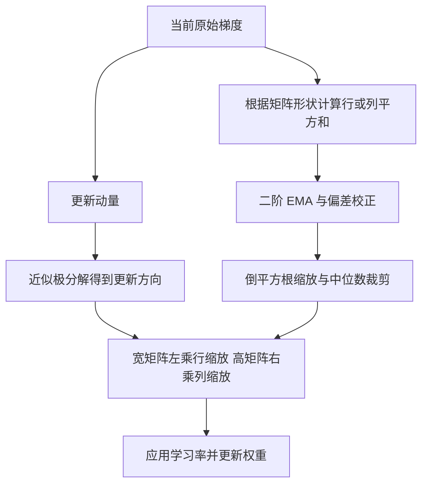
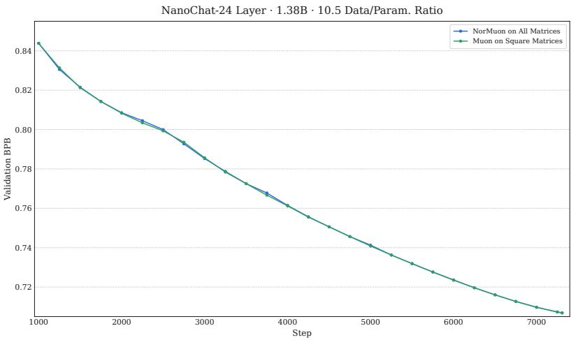
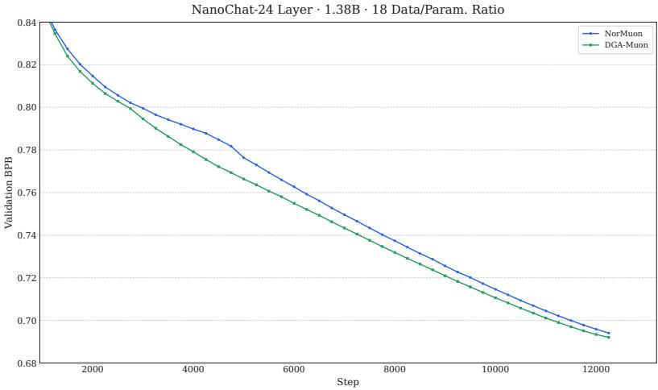
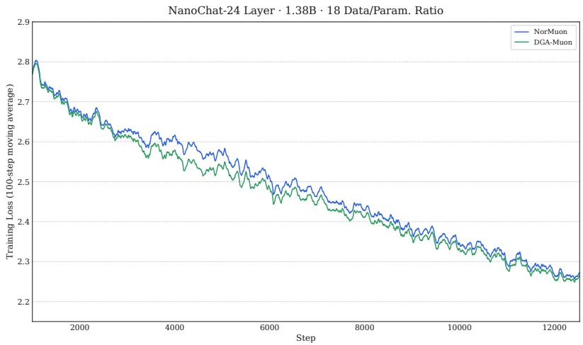

# DGA-Muon：与正交化解耦、与几何结构对齐的自适应缩放

## 核心信息与作者单位翻译

- **英文标题**：DGA-Muon: Decoupled Geometry-Aligned Adaptive Scaling for Muon。
- **作者**：Wenpeng Zhang、Runsheng Yu。保留作者英文署名，不据拼音猜测中文姓名。
- **首次提交 / 本次版本**：2026-10-05 / 2026-10-07，arXiv v2。
- **论文类型**：混合型，包含优化器机制分析、算法设计、非凸收敛理论和语言模型预训练实验。
- **发表状态**：本次分析的 PDF 标为 Preprint，不据参考文献中的会议名称推断本文录用状态。
- **分析范围**：本地 21 页 v2 PDF 全文及附录 A；MinerU Markdown 辅助定位；摘要、署名和版本回看 PDF 首页。
- **核查日期**：2026-10-19。近邻对照查阅原始论文网页；未执行大模型训练复现。
- **原文**：[arXiv v2](https://arxiv.org/abs/2610.06578v2) / [在线 PDF](https://arxiv.org/pdf/2610.06578v2) / [本地 PDF](../../../01-raw/2026-10/DGA_Muon_Decoupled_Geometry_Aligned_Adaptive_Scaling_for_Muon.pdf) / [本地解析正文](../../../02-markdown/2026-10/DGA_Muon_Decoupled_Geometry_Aligned_Adaptive_Scaling_for_Muon.md)。

| 作者 | PDF 首页单位原文 | 中文翻译 | 说明 |
|---|---|---|---|
| Wenpeng Zhang | Independent Reasearcher | 独立研究者 | 未列大学、企业或实验室单位 |
| Runsheng Yu | Independent Reasearcher | 独立研究者 | 未列大学、企业或实验室单位 |

“Reasearcher”是首页原文拼写，规范英文通常写作“Researcher”；译文按其含义处理。两位作者姓名后均有星号，但本次读取的正文未找到清楚说明其含义的脚注，因此不擅自解释为共同一作或通讯作者。作者单位只作信息记录，不参与质量评分。

## 一句话贡献与阅读结论

本文明确刻画了 **NorMuon 的行缩放如何受矩阵形状和正交化残差支配**，据此提出“用原始梯度估计能量、按宽矩阵的行或高矩阵的列进行缩放”的轻量方案；最可信的增量是机制辨析与几何设计原则，现有实验只支持特定 NanoChat 配方下的收益，尚不足以把收益单独归因于这两条原则。

**学术价值 5.0/10，评价置信度中；结合工作区明确的“大模型优化器设计”方向，阅读优先级为精读。** 优先吸收第 3–4 节的分析及其边界；第 5 节是基础保证，第 6 节应作为后续受控实验的起点。

## 摘要翻译

### 英文摘要（v2 PDF 原文，完整转录）

While NorMuon has achieved strong empirical performance in pretraining, its underlying adaptive mechanism remains largely heuristic and poorly understood. In this work, we provide the first systematic theoretical analysis of NorMuon’s adaptivity, revealing that it primarily arises from orthogonalization-induced geometry rather than genuine optimization dynamics, serving to offset the resulting geometric non-uniformity. Under exact orthogonalization, the adaptive scaling factors degenerate into a single global scalar for square and wide matrices, while for tall matrices their variation results from unevenly distributed row energy after orthogonalization. Under approximate orthogonalization, the orthogonality residuals introduce additional variation into the scaling, giving rise to a counterintuitive Orthogonalization–Adaptivity Paradox: more accurate orthogonalization weakens adaptivity. We further show that NorMuon’s rigid row-wise scaling is geometrically misaligned with the one-sided orthogonal structure of tall matrices by distorting column orthogonality. Motivated by these limitations, we propose two core design principles that a desirable adaptive mechanism for Muon should satisfy. First, adaptive scaling should be decoupled from orthogonalization, with the scaling factors computed directly from raw gradients. Second, adaptive scaling should be aligned with the shape-dependent orthogonal structure of the polar factor, using row-wise scaling for wide matrices and column-wise scaling for tall matrices. We prove that this geometry-aligned scaling preserves the orthogonal structure of the update. By incorporating several other techniques, we obtain Decoupled Geometry-Aligned Muon (DGA-Muon). We establish convergence guarantees for DGA-Muon and empirically validate both our theoretical characterization of NorMuon’s scaling degeneration and the superiority of DGA-Muon.

### 中文翻译（逐句对应）

尽管 NorMuon 在预训练中取得了良好的实证表现，其背后的自适应机制仍主要依赖启发式设计，且尚未得到充分理解。本文首次对 NorMuon 的自适应性进行系统的理论分析，揭示其主要源于正交化诱导的几何结构，而非真正的优化动态，其作用是抵消由此产生的几何非均匀性。在精确正交化下，对于方阵和宽矩阵，自适应缩放因子退化为单一的全局标量；而对于高矩阵，缩放因子的变化源于正交化后行能量分布的不均匀性。在近似正交化下，正交性残差会给缩放带来额外变化，产生一种反直觉的“正交化—自适应悖论”：正交化越精确，自适应性越弱。我们进一步表明，NorMuon 固定采用的逐行缩放会扭曲列之间的正交关系，因而与高矩阵的单侧正交结构在几何上不对齐。针对这些局限，我们提出了 Muon 的理想自适应机制应满足的两项核心设计原则。第一，自适应缩放应与正交化解耦，直接根据原始梯度计算缩放因子。第二，自适应缩放应与极因子中由矩阵形状决定的正交结构对齐，对宽矩阵采用逐行缩放，对高矩阵采用逐列缩放。我们证明，这种与几何结构对齐的缩放保留了更新的正交结构。结合其他若干技术，我们得到了解耦且几何对齐的 Muon（DGA-Muon）。我们为 DGA-Muon 建立了收敛保证，并通过实证验证了对 NorMuon 缩放退化的理论刻画以及 DGA-Muon 的优越性。

### 核心要点提炼（分析者理解）

摘要中的“首次”“真正的优化动态”“优越性”均为作者表述。全文能直接确立的是：满秩、精确极分解下，宽矩阵和方阵各行范数相同；以这些范数构造行缩放，不会产生行间差异。高矩阵只保证列正交，按列缩放能保留列间夹角。把这两条代数事实提升为“NorMuon 没有优化信息”或“DGA 的原则必然更优”，需要额外证据。

作者报告 DGA-Muon 最终验证 BPB 从 0.6924 降到 0.6910，CORE 从 0.2942 升到 0.3089；本笔记分别复算为约 0.20% 相对下降和 5.0% 相对提升。不同学习率日程、缺少组件消融与随机种子统计，是解释这些结果时最主要的限制。

## 研究背景、问题和成功判据

传统 AdamW 为每个坐标存储二阶统计，适应梯度尺度，但不直接利用权重的矩阵结构。Muon 则对动量做近似极分解，把非零奇异值拉向相同尺度，在保留部分方向结构的同时抛弃幅度信息。问题随之变为：既然正交化抹平了奇异值，怎样重新引入有用、低成本的非均匀步幅？NorMuon 的答案是在正交化之后，按每一行的历史能量归一化。[本文第 1–2 节]

本文指出，这个统计量可能主要反映正交化本身，而不是希望追踪的原始梯度能量。这个问题真实且可检验，但“后正交化统计”不必等同于“无优化意义”：方向和子空间也来自历史梯度。应分别问它保留了什么、遗漏了什么，以及这些信息在什么任务上有用，而不是用是否类似 Adam 作为唯一标准。

输入是一块权重矩阵及其随机梯度；输出是下一步矩阵更新。约束是维持接近 Muon 的内存与计算成本，同时允许不同更新单元采用不同步幅。合理的成功判据包括：统计量在更精确的正交化下仍有非平凡差异；缩放满足明确的几何性质；在相同 token、算力和调参预算下优于足够强的基线。本文完整满足前两项中的特定代数性质，第三项仅有初步证据。[第 3–6 节]

## 方法详解

### 1. 从 Muon 和 NorMuon 的数据流出发

设权重和梯度均为 $m$ 行、$n$ 列。动量为：

$$
M_t = \beta_1 M_{t-1} + (1-\beta_1)G_t.
$$

若薄奇异值分解为 $M_t=U_t\Sigma_t V_t^\top$，记其极因子为 $O_t=U_tV_t^\top$。理想 Muon 更新为 $W_{t+1}=W_t-\eta O_t$。以下先按论文的满秩情形讲解；数值秩亏和有限步近似的边界后述。[第 2 节]

NorMuon 为第 $i$ 行计算：

$$
v_{t,i}=\beta_2v_{t-1,i}+(1-\beta_2)\frac{1}{n}\sum_{j=1}^{n}O_{t,ij}^{2}.
$$

随后按 $1/(\sqrt{v_{t,i}}+\delta)$ 缩放该行。这里二阶统计的输入是 $O_t$，不是 $G_t$。本文第 2 节为分析省略了全局学习率缩放和权重衰减；近邻 NorMuon 原论文算法 1 还会将最终更新归一到目标整体范数。因此，“全局标量退化”首先是**相对行间自适应性消失**，实际有效步长还取决于实现中的全局归一化。[第 2 节；NorMuon 原论文算法 1]

### 2. 方阵和宽矩阵为什么退化

当 $m\le n$ 且动量满行秩时，精确极因子满足：

$$
O_tO_t^\top=I_m.
$$

左侧对角元就是各行平方范数，所以每行平方和都为 1。代入上式并从零初始化展开 EMA：

$$
v_{t,i}=\frac{1-\beta_2^t}{n}.
$$

它与行编号无关。若补上二阶偏差校正，每行都恰为 $1/n$。这里的净发现不是“矩阵总能量相同”，而是**满行秩极因子的逐行能量已经被恒等式固定**，所以对该能量再做历史平均无法恢复行间能量差异。[第 3.1 节]

这个推导简洁且可靠，但不能据此否定所有 NorMuon 收益。高矩阵不满足该恒等式；有限步正交化有残差；网络中不同矩阵形状占比也不同。只在方形注意力矩阵上移除归一化，不能代表把整个优化器替换成 Muon。

### 3. 近似正交化：残差决定变动，但不保证逐步单调

对方阵或宽矩阵，写成 $O_tO_t^\top=I_m+E_t$。第 3.2 节把二阶统计拆成均匀部分和残差部分：

$$
v_{t,i}=\frac{1-\beta_2^t}{n}+R_{t,i},
$$

$$
R_{t,i}=\frac{1-\beta_2}{n}\sum_{k=1}^{t}\beta_2^{t-k}(E_k)_{ii}.
$$

若所有历史残差的谱范数都不超过 $\epsilon$，则有：

$$
\Vert R_t\Vert_\infty\le\frac{\epsilon}{n},
$$

$$
|v_{t,i}-v_{t,j}|\le\frac{2\epsilon}{n}.
$$

因此，当整段历史残差一起趋近零时，行间差异也趋近零。这是“悖论”最稳妥的表述。它不说明任意增加一步 Newton–Schulz 都会使行间缩放差异严格减小，因为界约束的是可能范围，实际差异取决于残差对角线的空间分布及 EMA 历史。

以下用 $\mathcal{D}$ 表示把给定分量放到对角线上的对角矩阵构造。一个可直接核算的反例是：第一种近似矩阵为 $O_a=\sqrt{1.2}I_2$，残差谱范数为 0.2，但两行缩放完全相同；第二种为 $O_b=\mathcal{D}(\sqrt{1.1},\sqrt{0.9})$，残差只有 0.1，反而产生约 0.1423 的缩放极差。此处取单步统计、忽略稳定项。这不推翻残差趋零的定理，只排除了“精度更高必然逐点更弱”的过强解释。[分析者反例；核算记录见文末]

此外，原文从二阶统计差异转为倒平方根缩放差异时引入常数 $C$；该常数可能依赖统计量下界、矩阵宽度和早期步数。仅见 $\epsilon/n$ 就断言大宽度必然压低最终缩放差异并不充分。实际应测量相对缩放分布及正交残差，而不能只看一条上界。[第 3.2 节]

### 4. 高矩阵的能量是子空间杠杆值

当 $m>n$ 且满列秩时，精确极因子满足 $O_t^\top O_t=I_n$，总平方范数为 $n$，但行平方范数不必相同。由 $O_t=U_tV_t^\top$ 得：

$$
\sum_{j=1}^{n}O_{t,ij}^{2}=(U_tU_t^\top)_{ii}.
$$

右侧是列空间投影的对角元，也可理解为行杠杆值：其总和固定，但不同坐标对该子空间的参与程度不同。因此高矩阵的 NorMuon 确实有非平凡行缩放。[第 3.3 节；杠杆值解释为分析者补充]

需要修正作者的强叙述：子空间由历史梯度的动量决定，所以“由几何产生”不代表“与优化动态无关”。本文证明了能量的结构来源，没有证明该来源不含任务信息、与曲率无关或必然有害。满秩在数值上也不等于所有奇异值都足够远离零；有限步多项式对极小奇异值的处理尤其值得实测。

### 5. DGA-Muon：梯度分支估幅度，动量分支估方向

论文没有独立的方法架构图，下面按算法 1 重绘信息流；实验部分保留全部四张原图。

对宽矩阵与方阵，能量为行平方和；对高矩阵，能量为列平方和：

$$
e_{t,i}=\sum_{j=1}^{n}G_{t,ij}^{2},  m\le n.
$$

$$
e_{t,j}=\sum_{i=1}^{m}G_{t,ij}^{2},  m>n.
$$

这里的两个条件仅表示选择哪个分支。能量向量长度都是 $\ell=\min(m,n)$。更新 $v_t=\beta_2v_{t-1}+(1-\beta_2)e_t$，再做偏差校正：

$$
u_t=\frac{v_t}{1-\beta_2^t},  s_{t,k}=\frac{1}{\sqrt{u_{t,k}}+\delta}.
$$

设缩放中位数为 $q_t$，裁剪后的每个分量记为 $p_{t,k}$：

$$
p_{t,k}=\min\left(\max(s_{t,k},c q_t),d q_t\right).
$$

取 $D_t=\mathcal{D}(p_t)$；后续理论部分沿用原文记号，以 $s_t$ 表示裁剪后的因子。宽矩阵及方阵令 $Z_t=D_tO_t$，高矩阵令 $Z_t=O_tD_t$，最后 $W_{t+1}=W_t-\eta Z_t$。[算法 1，第 4.1–4.3 节]

直观上，原始梯度分支给出各单元历史能量，动量分支给出较稳定的矩阵方向。两者在计算路径上分开，但并非统计独立：都来源于同一梯度序列。“解耦”的准确含义是二阶统计不再由正交化输出构造。

### 6. 究竟保留了哪一种几何

对高矩阵有：

$$
Z_t^\top Z_t=D_tO_t^\top O_tD_t=D_t^2.
$$

Gram 矩阵仍为对角阵，所以列之间仍然正交，但列范数变为对应的缩放因子。宽矩阵同理得到 $Z_tZ_t^\top=D_t^2$，保留行之间的正交关系。若在高矩阵上左乘行缩放，则列 Gram 矩阵变为 $O_t^\top D_t^2O_t$，一般不再对角。[第 4.2 节]

**保留的是所选行或列的夹角，而非单位正交性、两侧同时正交、或原动量的全部奇异向量。** 例如宽矩阵有 $Z_tZ_t^\top=D_t^2$，若对角元素互异，更新的左奇异向量一般与坐标轴对齐，不再等于原来的 $U_t$。所以“按行缩放”不能直接解读为“给原动量每个奇异方向一个独立学习率”。方阵可以任选一侧，但非均匀左乘通常只保留行正交；非均匀右乘通常只保留列正交。

作者把这种结构称为适应矩阵的“必要性”，证据实际支持的是一种自然、计算便宜的选择。没有定理证明所有优秀矩阵优化器都必须保留这种坐标行列正交关系。

### 7. 额外设计及实现代价

**平方和与均值。** 同一矩阵每个自适应单元的长度相同。忽略稳定项时，用均值代替平方和，只会让全部缩放同时乘上单元长度的平方根；相对缩放不变。它主要改变层间有效学习率，不自动创造新的单元区分能力。若末端再做整体范数归一，该差异甚至可能抵消；应和全局尺度控制联合消融。[第 4.3 节；代数分析为本笔记补充]

**偏差校正。** 二阶 EMA 从零开始会低估早期能量，校正能减轻早期缩放过大。理想极分解对正的整体倍数不变，因此一阶动量的整体偏差校正不改变理想 $O_t$；有限精度、稳定项和实现归一化可能带来细节差异。二阶偏差校正与 warmup 都调节早期步幅，不能在没有消融时分别归功。

**相对裁剪。** 它保证同一步缩放最大值与最小值之比不超过 $d/c$，但不直接控制绝对步幅。表 1 给出的 0.001 和 20 若按算法 1 解释为相对中位数系数，则比例上界为 20,000，约束相当宽；表格本身未展开实现语义，应以代码确认。取 $c=d=1$ 只剩矩阵级标量，仍可测试全局梯度能量是否已足够。

**复杂度。** 除已有的矩阵动量外，DGA 二阶状态只需 $\ell$ 个元素；对比 Adam 的逐元素二阶状态是 $mn$ 个元素。计算平方和与广播缩放各为 $O(mn)$，无需显式形成完整 Gram 矩阵；中位数可用选择算法求得。对短边长为 $\ell$ 的矩阵，一步稠密多项式正交化通常仍涉及 $O(mn\ell)$ 量级运算。以上是算法层面的开销判断，论文没有端到端吞吐、峰值显存或通信实测，不能把“同量级”写成“已验证无额外成本”。[第 4.2 节，算法 1]

## 理论主线与严格边界

### 1. 假设与证明链

第 5 节采用 Frobenius 范数意义下的 $L$ 光滑性、条件无偏随机梯度、方差上界 $\sigma^2$ 和几乎处处的梯度范数上界 $G_{\max}$。分析使用**精确正交化**，并需要目标下界有限，以及缩放统一满足 $0<a\le s_{t,k}\le b$。这里用 $a,b$ 代替论文的全程缩放下界、上界，避免与逐步裁剪阈值混淆。

引理 1 的关键是正缩放与极因子仍有正对齐。定义 $A_t=\sum_{i,j}M_{t,ij}Z_{t,ij}$，论文先得到核范数下界，再放松为 Frobenius 范数：

$$
A_t\ge s_{t,\min}\Vert M_t\Vert_*\ge s_{t,\min}\Vert M_t\Vert_F.
$$

随后把真梯度与动量的差记为 $r_t=\Vert M_t-\nabla f(W_t)\Vert_F$。引理 2 将光滑性下降分成有利的梯度项、动量跟踪误差和步长平方项：

$$
f(W_{t+1})\le f(W_t)-\eta s_{t,\min}\Vert\nabla f(W_t)\Vert_F
+\eta(s_{t,\min}+\sqrt{\ell}s_{t,\max})r_t
+\frac{\eta^2\ell Ls_{t,\max}^2}{2}.
$$

引理 3 再把动量误差拆成初始化衰减、随机噪声平均和梯度漂移。噪声交叉项依靠条件无偏形成的鞅差性质消掉，不要求不同步的梯度完全独立；漂移项用光滑性和更新范数上界控制。最后累加下降不等式，得到定理 1。这条证明链在明确假设下基本自洽。[第 5 节，引理 1–3]

### 2. 定理 1 的完整口径

记 $\Delta=f(W_1)-f^*$，固定步长下的结论为：

$$
\min_{1\le t\le T}\mathbb{E}\Vert\nabla f(W_t)\Vert_F
\le\frac{\Delta}{\eta aT}
+\frac{(1+\sqrt{\ell})b}{aT}\left(\sigma+\frac{\beta_1G_{\max}}{1-\beta_1}\right)
+\frac{(1+\sqrt{\ell})b}{a}\sqrt{\frac{1-\beta_1}{1+\beta_1}}\sigma
+\frac{\beta_1\eta\sqrt{\ell}L(1+\sqrt{\ell})b^2}{(1-\beta_1)a}
+\frac{\eta\ell Lb^2}{2a}.
$$

它约束的是“前 $T$ 步中最小的期望梯度范数”，证明过程也给出平均版本；并非最后一步保证、函数值最优性或参数轨迹实际收敛。固定其他量时可简记为 $O(1/T+\sigma+\eta)$，但其中瞬态项实为 $1/(\eta T)$。让学习率依赖 $T$ 时，不能继续把其常数隐藏后声称 $O(1/T)$ 收敛至精确驻点。

即使只让步长趋零，固定动量和固定噪声下，定理的噪声项仍然存在。作者关于衰减步长消除稳态误差的讨论是展望，本定理本身不能推出；可能还需增大 batch、调整动量或更精细证明。[定理 1 及后续讨论]

### 3. 统一缩放界可以成立，但可能很松

由梯度范数有界，每个单元的梯度能量不超过 $G_{\max}^2$；偏差校正后的 EMA 是历史能量的凸组合。因此未裁剪缩放在下列区间内：

$$
\frac{1}{G_{\max}+\delta}\le s_{t,k}\le\frac{1}{\delta}.
$$

因为中位数也在此区间，而相对裁剪区间包含中位数，裁剪不会把原有数值推到该全局区间之外。这为定理的 $a,b$ 提供了一个可用选择，是本笔记补充推导。但若 $\delta$ 很小，上界极大，常数中的 $b/a$、$b^2/a$ 仍可能使界缺乏数值解释力。限制相对各向异性，并不等同于限制每一步绝对移动距离。

### 4. 理论没有识别“几何对齐为何更优”

引理 1 的正对齐下界，事实上对精确极因子在任意一侧乘正对角阵都可建立：用薄 SVD 展开，缩放矩阵压到正交子空间后仍为正定，最小特征值不小于缩放下界。更新范数的上界 $\Vert Z_t\Vert_F\le\sqrt{\ell}b$ 也不要求必须使用几何对齐侧。因此，类似的基础下降证明可以覆盖“不保留所选行列正交”的正缩放。

这意味着定理 1 证明了算法在一组有界条件下可控，却没有把“保留正交夹角”识别为更快优化的原因。它也没有利用二阶统计的特定结构得到优于任意有界正缩放的界，未分析有限步 Polar Express、cautious weight decay 或真实多参数组训练。作者明确把相对 Muon 的可证明改进留作未来工作。[第 5 节；扩展判断为分析者推导]

## 实验结果与证据审计

### 1. 任务、硬件和可比较条件

| 项目 | 本文明确给出的设置 | 需要保留的边界 |
|---|---|---|
| 模型 | NanoChat 默认架构，24 层，1.38B 参数，全层 full attention | 仅一个架构与规模的主要结果 |
| 硬件 | 单节点 8 张 NVIDIA A100，单卡 80GB | 未给总 GPU 小时与速度表 |
| 优化器分工 | Q/K/V/O、FFN 矩阵用 NorMuon 或 DGA；其余用 AdamW | 是混合训练方案 |
| 正交化与衰减 | Polar Express；矩阵采用 cautious weight decay | 定理不覆盖该完整实现 |
| 退化验证 | 7,308 步，每 250 步及末尾验证 | 正文写数据参数比约 10，图 1 写 10.5 |
| 主结果 | 数据参数比 18；验证 BPB，训练 loss，下游 DCLM CORE | 未完整列明数据版本、划分、去重和污染检查 |
| batch | 每设备 32，总 batch 标为 Auto | 缺实际全局 token batch 与自动选择结果 |
| 统计报告 | 曲线及单组汇总值 | 未报告多种子、误差条或置信区间 |

正文与图 1 的数据参数比存在 10 / 10.5 的小差异，不据此判定核心结果错误，但完整复现前应澄清。论文借用 NanoChat 仓库说明数据和实现，未固定可复现的 commit、全部配置与运行命令；不能把当前仓库默认值当作当时实验设置。[第 6.1–6.3 节，图 1–2，表 1]

### 2. 移除方形注意力矩阵的缩放

> 原论文图 1。对比是“所有矩阵用 NorMuon”与“方形矩阵改用 Muon”，其他矩阵仍保留 NorMuon；图题标为数据参数比 10.5。

> 原论文附录图 3。训练损失同样近乎重合；它补充了验证曲线，但没有提供直接的行缩放分布测量。

该实验和第 3.1 节一致：方形 Q/K/V/O 的行缩放在该设置下没有可见收益。但它不是精确相等的数值证明，图中没有逐步报告正交残差、缩放变异系数、范数匹配结果及多种子差异。曲线重叠也可能源于缩放扰动太小、最终归一抵消了影响，或注意力子模块对该差异不敏感。它不能证明高矩阵的缩放无效，也没有验证残差精度与自适应程度之间的函数关系。[第 6.2 节]

### 3. 主结果及差异复算

> 原论文图 2，数据参数比 18。DGA 曲线较低；横轴是训练步数，没有给出相同墙钟时间的比较。

| 指标 | NorMuon | DGA-Muon | 有利方向的绝对变化 | 相对变化 |
|---|---:|---:|---:|---:|
| 最终验证 BPB，越低越好 | 0.6924 | 0.6910 | 降低 0.0014 BPB | 下降 0.2022% |
| 最终训练 loss，越低越好 | 2.2799 | 2.2708 | 降低 0.0091 | 下降 0.3991% |
| DCLM CORE，越高越好 | 0.2942 | 0.3089 | 提高 0.0147，即 1.47 个百分点 | 提高 4.9966% |

相对变化都用 NorMuon 作分母。例如 BPB 相对下降按 $(0.6924-0.6910)/0.6924$ 计算；CORE 相对提升按 $(0.3089-0.2942)/0.2942$ 计算。训练 loss 的具体归一化与单位应以实现为准，不将它混同于 BPB。CORE 的 5.0% 是相对提升，不能写成所有任务准确率提高 5 个百分点。[第 6.3 节，表 2；数值由本笔记复算]

> 原论文附录图 4。训练损失差异支持两套配方优化轨迹不同，尚不能识别哪个组件造成了差异。

### 4. 下游逐项结果：11 项提高、10 项降低

| 任务 | NorMuon | DGA-Muon | DGA 减 NorMuon |
|---|---:|---:|---:|
| HellaSwag ZeroShot | 0.6080 | 0.6100 | +0.0020 |
| Jeopardy | 0.1680 | 0.1840 | +0.0160 |
| BIG-Bench QA Wikidata | 0.5300 | 0.5560 | +0.0260 |
| ARC-Easy | 0.7460 | 0.7420 | -0.0040 |
| ARC-Challenge | 0.4760 | 0.4580 | -0.0180 |
| COPA | 0.6400 | 0.7100 | +0.0700 |
| CommonsenseQA | 0.2300 | 0.2560 | +0.0260 |
| PIQA | 0.7800 | 0.7840 | +0.0040 |
| OpenBookQA | 0.4320 | 0.4080 | -0.0240 |
| LAMBADA | 0.4880 | 0.4860 | -0.0020 |
| HellaSwag | 0.6180 | 0.6260 | +0.0080 |
| Winograd | 0.7143 | 0.6996 | -0.0147 |
| Winogrande | 0.5760 | 0.5660 | -0.0100 |
| BIG-Bench Dyck Languages | 0.0660 | 0.0940 | +0.0280 |
| AGI-Eval LSAT-AR | 0.2478 | 0.3130 | +0.0652 |
| BIG-Bench CS Algorithms | 0.3940 | 0.4220 | +0.0280 |
| BIG-Bench Operators | 0.2238 | 0.1857 | -0.0381 |
| BIG-Bench Repeat Copy Logic | 0.0312 | 0.0312 | 0.0000 |
| SQuAD | 0.5100 | 0.4740 | -0.0360 |
| CoQA | 0.3220 | 0.3100 | -0.0120 |
| BoolQ | 0.5660 | 0.6280 | +0.0620 |
| BIG-Bench Language Identification | 0.2640 | 0.2500 | -0.0140 |
| CORE 汇总 | 0.2942 | 0.3089 | +0.0147 |

原论文表 2 中，22 个非汇总条目有 11 升、10 降、1 平。COPA、LSAT-AR、BoolQ 的增量较大，Operators、SQuAD 等有明显数值回落。CORE 是预定义汇总量，不能擅自用这些原始分数的简单平均重构；应取得 NanoChat 当时的标准化/聚合定义。没有题数、逐样本预测和重复运行，无法判断改善是否超出训练波动和评测抽样误差。也不能将这些负项解释成统计显著的能力退化。[表 2]

### 5. 关键混杂：学习率和日程一起改变

| 超参数 | NorMuon | DGA-Muon | 对解释的影响 |
|---|---:|---:|---|
| 矩阵基础 LR | 0.020 | 0.019 | 下降 5% |
| warmup 步数 | 40 | 200 | 增加到 5 倍 |
| warmdown ratio | 0.65 | 0.78 | 衰减阶段占比改变 |
| 最终 LR 比例 | 0.05 | 0.01 | 降为原比例的 1/5 |
| 下 / 上缩放裁剪 | 无 | 0.001 / 20 | 引入独立的幅度控制 |
| weight decay | 0.28 | 0.28 | 数值相同，仍需核对具体实现 |

不同优化器单独调参本身合理，也更接近实际使用，但需要等额搜索预算，以及交叉日程或固定日程消融。本文没有报告 NorMuon 使用 DGA 日程、DGA 使用 NorMuon 日程的结果，也没有原始梯度信号、对齐轴、偏差校正、裁剪和平方和的逐项消融。作者在第 6 节开头明确说明部分小规模消融未纳入当前版本。[表 1，第 6 节]

所以最强实证结论是：**一套 DGA-Muon 配方在这次 1.38B NanoChat 实验中优于所列 NorMuon 配方。** “两项核心设计分别有效”“提升源于保留正交结构”“更省训练时间”“普遍优于所有 Muon 变体”都尚未被现有实验确立。论文没有给数据污染或泄漏证据，本笔记也不把未报告污染检查当作已经发生泄漏。

## 主张—证据—限制矩阵

| 核心主张 | 原文证据 | 能支持的最强结论 | 限制或竞争解释 | 置信度 |
|---|---|---|---|---|
| NorMuon 在方阵、宽矩阵上退化 | 第 3.1 节；图 1、3 | 满行秩精确极因子下无行间缩放差异；该 NanoChat 方阵移除实验无可见损失 | 不能外推高矩阵或所有近似实现 | 高 |
| 更准正交化削弱自适应 | 第 3.2 节残差分解 | 历史残差统一趋零时，宽矩阵行间差异趋零 | 上界不保证每次精度改进的实际差异单调下降 | 高，针对限定结论 |
| 几何对齐缩放保留正交结构 | 第 4.2 节 Gram 矩阵恒等式 | 精确情形保留所选行或列的两两正交 | 非单位范数；不保留全部奇异向量；不证明训练更优 | 高 |
| DGA 有收敛保证 | 第 5 节，引理 1–3、定理 1 | 特定假设、精确正交化下的有限步期望梯度界 | 噪声与步长残差；不覆盖完整训练实现；不证明优于 Muon | 中高 |
| DGA 的两条原则带来更优训练 | 第 6.3 节；图 2、4；表 1–2 | 所报告完整配方在该实验上的指标更好 | 日程混杂、消融与种子缺失、未比较多个强近邻 | 中低，针对因果归因 |

## 最接近工作与净增量

下列对照依据原始论文的方法和算法页面核查，未在统一任务上重跑。因此比较方法关系，不跨论文直接排列性能高低；部分网页是其当前可访问版本，与本文引用时版本可能不同。

| 工作 | 同一个问题上的技术选择 | DGA 的区别 | 公平性与净增量判断 |
|---|---|---|---|
| **NorMuon**，Li 等，arXiv:2510.05491 | 正交化后做行二阶统计，并控制整体更新范数 | 原始梯度统计；高矩阵改列缩放 | 最直接近邻；本文机制刻画清楚，但当前实验未拆开信号与轴的作用 |
| **AdaGO**，Zhang、Liu、Schaeffer，arXiv:2509.02981 | 用梯度范数控制整个矩阵的标量步长 | 用多个行/列单元因子代替单标量 | “梯度幅度与正交方向分离”已有先例；DGA 新增细粒度及形状原则 |
| **DeVA**，Song 等，arXiv:2602.06880 | 将方差适应与尺度不变更新分开；矩阵版在旋转基中缩放 | 原坐标中仅保存短轴向量，无需完整曲率特征分解 | 解耦是已有大方向；DGA 净增量是更轻的形状对齐实现和 NorMuon 诊断 |
| **Muon²**，Liu 等，arXiv:2604.09967 | 原始梯度二阶预条件放在正交化之前 | 缩放放在原动量极因子之后 | 操作顺序和状态粒度不同；应作为强基线，而非笼统视为高成本方法 |

### NorMuon：本文修正了动机中的理想化部分

原始 NorMuon 的图 1 关注 MLP up-projection 的非均匀神经元更新，算法 1 在缩放后重新控制整体范数。DGA 证明方阵、宽矩阵精确情形不可能具有这种行范数不均匀，因此关键要看原实验矩阵形状与近似残差。其批评缩小了 NorMuon 机制解释的范围，并没有反驳 NorMuon 在高矩阵或实际近似下的实证收益。[原始论文第 3.1 节、算法 1](https://arxiv.org/html/2510.05491#S3.SS1)

### AdaGO：不能把细粒度自适应写成首次分离方向与步幅

AdaGO 算法 2 用历史梯度范数与裁剪量形成标量步长，保留整个正交方向；DGA 进一步把幅度分到行或列。AdaGO 定理 3.3 的随机非凸结果采用随总步数设定的参数，与 DGA 固定步长噪声邻域界口径不同，不能据 $1/T$ 和 $T^{-1/4}$ 的表面形式声称 DGA 更快。其 CIFAR/回归实验也不是 DGA 的 LLM 协议。[原始论文第 2–3 节](https://arxiv.org/html/2509.02981)

### DeVA：解耦已有先例，轻量化才是可辨认的差异

DeVA 矩阵版算法 2 在曲率因子的特征基中构造方差适应与矩阵符号更新，并需周期性特征分解；另有节省二阶状态的实现。DGA 不做这种旋转，只在原坐标轴上做形状相关的对角缩放，因此更简单，但不应把自身解释为保留相同的谱方向适应能力。两者没有同预算直接对照。[原始论文第 3.2–3.3 节、算法 2](https://arxiv.org/html/2602.06880)

### Muon²：预条件放在极分解前后并不等价

Muon² 算法 1 先用逐元素二阶统计缩放动量，再正交化预条件后的矩阵，并提供低内存变体 Muon²-F。它改变进入正交化的方向和谱；DGA 保留原动量极因子，再改变输出幅度。DGA 引言把 Muon² 引文放在正交化改进的讨论中，主实验却没有该基线，这留下显著的定位缺口。[原始论文第 3.1、3.6 节](https://arxiv.org/html/2604.09967)

补充背景：同作者的 **Matrix AdaGrad: Row-wise and Column-wise Adaptive Subgradient Methods** 也已研究行列梯度能量构造自适应步幅，基于在线镜像下降。它与这里的非凸极因子更新、形状轴选择不是同一定理；不应把已有行列能量统计本身算成 DGA 的独立首次贡献。[原始论文](https://arxiv.org/html/2609.21815v2)

技术上，本文处在“Muon 的矩阵方向提取”与“低状态成本的块自适应”之间。它最有用的贡献是逼迫研究者区分：**统计量取自哪里、在哪个基中估计、缩放放在哪一步、保留何种几何、整体幅度如何控制**。用户已有的 [Convergence of Muon with Newton–Schulz 精读](../Convergence_of_Muon_with_Newton_Schulz/精读.md) 可用于衔接有限步正交化的理论边界；本笔记未据该本地笔记内容替本文补证明。

## 优势、局限与潜在失败方式

**优势。** 第 3.1 节给出可验证且容易复用的退化恒等式；第 4.2 节将行列缩放和半正交结构联系起来；算法仅增加短轴向量状态，适合先做低成本实验。论文还提供完整的主要证明链和逐项下游分数，允许读者发现汇总结果下的异质性，而不只看摘要中的提升。

**尚无足以推翻核心代数结论的致命错误证据。** 满秩精确条件下的退化与正交保留结论成立。本笔记发现的是强叙述超出定理、机制归因不足和实证可复核性缺口；这些会削弱“原则必然更优”“普遍优越”的结论，但不应混同于整篇论文无效。

**外推限制。** GQA/MQA、按头切分、转置存储、低秩梯度或其他 FFN 结构可能改变矩阵形状及自适应单元的语义。有限步输出只近似正交时，DGA 不会自动消除原有的方向相关误差；它只选择不额外混合精确情形中的指定方向。稀有特征所在低能量单元也可能被过度放大，是否有益依赖信号噪声比，不能仅由倒平方根规则推出。

**损失尺度敏感性。** 按算法 1、忽略稳定项并保持同一历史轨迹，若把损失及梯度整体放大 $\alpha$ 倍，极因子不变，二阶能量放大 $\alpha^2$ 倍，输出缩放约变为原来的 $1/\alpha$。因此 DGA 的该原始更新规则不具有 Muon 的整体梯度尺度不变性；本笔记数值检查将梯度放大 10 倍，更新范数变为 0.1 倍。此结论不自动适用于可能带最终范数归一化的未核实训练代码，必须检查实现。它是测试 loss reduction、batch 和尺度迁移的优先问题。

**适用建议。** 适合作为低内存矩阵优化器设计的机制参考，以及比较不同自适应来源、轴与裁剪的实验起点。尚不适合作为免调参优化器的证据，也不支持直接推广到全部参数、极端低精度、稀疏/秩亏情形或更大规模训练。

## 复现与最小反证计划

### 已核实与缺失材料

已具备原始 PDF、算法 1、假设与证明、表 1 的主要超参数，以及四张曲线图和表 2。本文和其 arXiv 页面未给出可直接定位的 DGA 专属代码链接；本次定向检索也未核实官方实现，不据此断言作者从未公开。NanoChat 和 NorMuon 有公开仓库，但不能代替 DGA 实验的固定版本。

关键缺项包括二阶动量等完整参数、稳定项、精确正交化实现与步数、随机种子、训练数据及验证版本、全局 batch 的 Auto 结果、训练 commit、整体更新归一化、完整调参记录及总训练时间。表 1 没列出的参数可能沿用当时 NanoChat 默认值，仍需固定版本才能重建。

### 阶段一：无需 GPU 的代数复核

本次已对宽、方、高三种随机满秩矩阵做精确 SVD 检查：宽矩阵和方阵的行能量极差约为 $1.55\times10^{-15}$；高矩阵示例的极差约为 0.8223；按对齐轴缩放后的 Gram 非对角范数小于 $2.5\times10^{-15}$，反侧缩放则明显非零。也检查了两侧正缩放均满足正对齐下界、平方和/均值的全局倍率关系及上述损失重标度反例。这些是代数核查，不是 LLM 效果复现。

### 阶段二：单卡识别来源、轴与全局幅度

先用固定 token 数据和 100M–300M 级稠密 Transformer，在一张足够显存的 GPU 上验证实现；这是建议资源规模，实际步时和显存需预跑测量。固定数据顺序、初始化、混合精度、非矩阵参数优化器、正交化与衰减，比较 NorMuon、只换原始梯度信号、再换对齐轴、完整裁剪 DGA，以及每矩阵单标量基线。至少报告 3 个配对种子；若噪声大再增加，不能预先保证 3 个就足够。

同时记录每层缩放变异、裁剪命中率、更新 Frobenius 范数、Gram 非对角比例、最小奇异值与验证 BPB。先做统一日程，再做双方日程交叉；确保方法和调参预算分开核算。若单标量加相同范数/日程已解释大部分收益，就应停止宣称细粒度几何原则是主要原因。

### 阶段三：有条件才扩大到 1.38B

只有阶段二显示跨种子、跨日程的稳定优势后，再申请复现作者 8×A100 的完整设置。按相同 token 和墙钟时间分别比较，报告调参成本；下游保留逐样本输出，以配对重采样评估 CORE 和主要任务的差异。成功条件是可重复的 BPB 改善且不依赖单一日程，机制指标与受控干预方向一致；停止条件是优势被公平日程或范数匹配消除，或额外开销抵消同时间收益。

## 可证伪的后续研究机会

| 假设与证据缺口 | 最小验证 | 指标与预期 | 失败 / 停止判据 | 资源 |
|---|---|---|---|---|
| H1：DGA 的主要收益来自矩阵级幅度和日程，而非行列相对自适应；源于表 1 混杂 | 固定日程与更新范数，比较全向量缩放与只用中位数标量 | BPB、loss、更新范数；若假设成立，两者接近 | 细粒度缩放在多个种子上仍稳定领先，则否定该解释 | 单卡小模型起步 |
| H2：对齐轴只在足够精确的正交化下形成额外优势；源于第 4.2 节精确假设 | 轴选择×正交化步数交叉；方阵复用同一缩放向量，长矩阵另控统计构造并做转置检查 | Gram 非对角比例、BPB、步时；效应随残差改变 | 几何更好却无效果改善，或最佳结果来自反侧，否定普遍性能优势 | 合成矩阵加小模型 |
| H3：缺少最终范数控制时，DGA 对损失尺度和低能量噪声敏感；源于倒平方根分支 | 固定梯度轨迹做 0.1/1/10 倍尺度检查，再比较有无最终范数控制 | 更新范数、裁剪率、稳定 LR 区间；原规则预期随尺度反向变化 | 实现已有归一化使差异消失，则停止把该风险归于真实训练方案 | CPU 即可查原规则，训练单卡 |

## 我的综合评价

采用共享八维量表；前七维按默认权重聚合，课题契合度独立报告。分数反映本次可见证据，不用机构、引用量或作者自称的新颖性加分。

| 维度 | 分数（1–5） | 权重 | 证据与理由 | 置信度 |
|---|---:|---:|---|---|
| 问题重要性与界定 | 4 | 15% | 第 2–3 节：定位矩阵优化中自适应信号来源，问题明确且贴近 LLM 训练 | 高 |
| 原创性与净增量 | 3 | 20% | 第 3–4 节及近邻：退化刻画和形状对齐组合有用；解耦、行列统计分别已有先例 | 中 |
| 技术正确性与严谨性 | 3 | 20% | 第 3.1、4.2、5 节：主代数与证明链基本成立；机制强叙述及有限步连接不足 | 中高 |
| 证据强度与替代解释 | 2 | 20% | 第 6 节，表 1：方法与日程联合变化，缺少关键组件与种子消融 | 高 |
| 可复现性与透明度 | 2 | 10% | 算法和表格可读；DGA 代码、固定版本、完整数据/参数与日志未核实 | 中 |
| 外推边界与稳健性 | 2 | 5% | 图 1–4、表 2：单主要架构规模，逐任务有升有降，缺分布/精度/形状稳健性评测 | 高 |
| 研究生成力 | 4 | 10% | 第 3–4 节：产生信号来源、缩放轴、残差与全局尺度的可干预研究问题 | 中高 |
| 当前课题契合度 | 4.5 | 不计入学术分 | 工作区配置于 2026-10-07 明确方向为大模型优化器设计，含裁剪、范数几何、自适应与状态内存 | 高，具体课题仍可细化 |

前七维加权均值为 2.9。按共享准则，以 $2.5\times(2.9-1)$ 映射为 4.75/10，再按 0.5 分档四舍五入，报告 **5.0/10**。整体置信度为中：代数结论把握较高，实践收益的归因与复现把握较低；获得等预算消融、完整实现和跨种子结果后应重新评分。

**当前课题优先级：精读。** 其价值在于帮助设计更有辨别力的优化器实验，而非现阶段直接决定更换训练默认优化器。先读第 3.1、3.3、4.2 节，再对照表 1 设计消融；定理 1 要连同噪声残差、缩放常数和精确正交化条件一起读。

> **关键启示：** 自适应更新必须分别审查统计信号、坐标基、作用顺序与整体幅度；“有行列差异”和“有用的自适应”不是同一个已经被证明的结论。

## 核查记录与外部资源

- 原文定位优先使用章节、引理、定理、图表号；MinerU 公式中存在 OCR 杂符号，本笔记已按 PDF 含义重新书写，未修改原解析文件。
- 四张图片来自本地 MinerU 插图，均复制为笔记内部资产；[图片来源说明](images/_sources.md)。原论文无独立方法图，方法流程为分析者依据算法 1 重绘。
- [本次代数与数值核查脚本](../../../.planning/dga-muon-analysis/audit.py) / [核算结果](../../../.planning/dga-muon-analysis/audit-results.json)。脚本属于过程材料；笔记与 images 文件夹可独立阅读，不依赖运行脚本。
- [本文 arXiv v2](https://arxiv.org/abs/2610.06578v2)。元数据与本地 PDF 版本一致，摘要以本地 PDF 为准。
- [NorMuon 原始论文](https://arxiv.org/html/2510.05491) / [NorMuon 官方仓库](https://github.com/zichongli5/NorMuon)。
- [AdaGO 原始论文](https://arxiv.org/html/2509.02981)。
- [DeVA 原始论文](https://arxiv.org/html/2602.06880)。
- [Muon² 原始论文](https://arxiv.org/html/2604.09967)。
- [Matrix AdaGrad 原始论文](https://arxiv.org/html/2609.21815v2)。
- [NanoChat 仓库](https://github.com/karpathy/nanochat)，作为论文引用的训练框架入口，本文实验 commit 未核实。

## 我的笔记

（供后续手动补充。）
