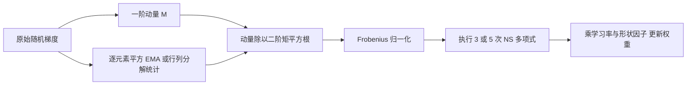
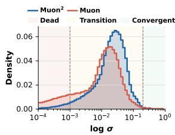
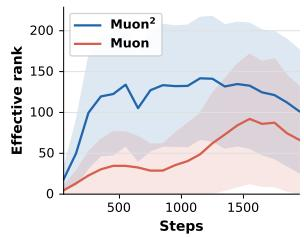
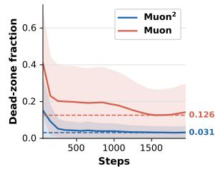
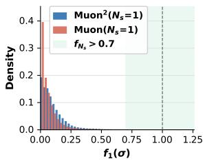
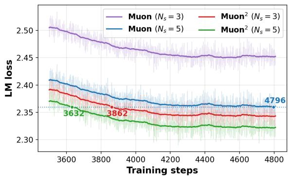
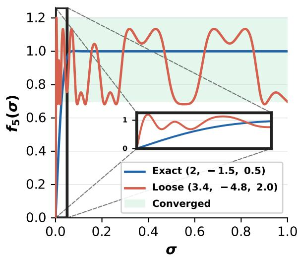
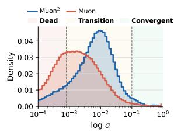

# Muon²：通过自适应二阶矩预条件增强 Muon

## 核心信息与作者单位翻译

- **英文标题**：Muon²: Boosting Muon via Adaptive Second-Moment Preconditioning。
- **论文 ID / 分析版本**：arXiv:2604.09967v2，2026-06-05；首次提交为 2026-04-11。
- **本地入库月份**：2026-10，与论文发表月份分开记录。
- **论文类型**：实证方法与效率评测为主，辅以极分解数值分析；不是给出优化收敛率的理论算法论文。
- **来源范围**：本地 16 页 v2 PDF 全文、附录 A–E，以及本地 MinerU 解析；摘要与作者单位已回看 PDF 首页。
- **外部核查日期**：2026-10-19。原始近邻论文与作者项目页用于补充定位；未进行预训练效果复现。
- **发表状态区分**：v2 来源页标注 Preprint；作者当前项目页标为 EMNLP 2026 Oral。本笔记仍分析本地 v2，不将项目页新增内容回填为 v2 结果。[作者项目页](https://alvin-zyl.github.io/muon2/)
- **原文入口**：[arXiv v2](https://arxiv.org/abs/2604.09967v2) / [在线 PDF](https://arxiv.org/pdf/2604.09967v2) / [本地 PDF](../../../01-raw/2026-10/MUON2_Boosting_MUON_via_Adaptive_Second_Moment_Preconditioning.pdf) / [本地解析正文](../../../02-markdown/2026-10/MUON2_Boosting_MUON_via_Adaptive_Second_Moment_Preconditioning.md)。

| 作者 | PDF 单位标号 | 英文单位 | 中文翻译 |
|---|---:|---|---|
| Ziyue Liu | 1 | University of California at Santa Barbara | 加州大学圣塔芭芭拉分校 |
| Ruijie Zhang | 1 | University of California at Santa Barbara | 加州大学圣塔芭芭拉分校 |
| Zhengyang Wang | 1 | University of California at Santa Barbara | 加州大学圣塔芭芭拉分校 |
| Yequan Zhao | 1 | University of California at Santa Barbara | 加州大学圣塔芭芭拉分校 |
| Yupeng Su | 1 | University of California at Santa Barbara | 加州大学圣塔芭芭拉分校 |
| Zi Yang | 2 | University at Albany, SUNY | 纽约州立大学奥尔巴尼分校 |
| Zheng Zhang | 1 | University of California at Santa Barbara | 加州大学圣塔芭芭拉分校 |

SUNY 是 State University of New York（纽约州立大学系统）的缩写；UCSB 对应第一所学校。作者姓名保留论文英文署名，不据拼音猜测中文姓名；不按学校声望评分。

## 一句话贡献与阅读结论

Muon² 将原始梯度的逐元素二阶矩预条件放在动量正交化之前，改变 NS 输入的尺度结构与方向，在多种预训练设置中以 3 次 NS 达到优于原 Muon 5 次 NS 的验证困惑度，并用行列分解版本降低新增二阶状态成本；**最可复用的贡献是“先改善输入，再决定需要多少近似计算”的实验路线，而非普遍条件数改善或优化加速定理。**

综合学术价值 **6.0/10，置信度中**。结合工作区“大模型优化器设计、范数几何、自适应与状态内存”的研究方向，建议精读并优先做小规模复现。需始终区分 NS 次数、每训练步时间、达到目标损失所需步数、总 GPU 小时和最终验证性能。

## 摘要翻译

### 英文摘要（v2 PDF 原文，完整转录）

MUON has emerged as a promising optimizer for large-scale foundation model pre-training by exploiting the matrix structure of neural network updates through iterative orthogonalization. However, the orthogonalization quality of MUON hinges on the number of Newton–Schulz (NS) iterations performed, which poses efficiency challenges due to its non-trivial computation and communication cost. We propose MUON², an extension of MUON, to improve both quality and efficiency by applying Adam-style adaptive second-moment preconditioning before orthogonalization. Our key insight is that the core challenge of polar approximation in MUON lies in the ill-conditioned momentum matrix, of which the spectrum is substantially improved by MUON², leading to faster convergence toward a practically sufficient orthogonalization. We further characterize the practical orthogonalization quality via directional alignment, under which MUON² demonstrates dramatic improvement over MUON at each polar step. Across GPT, LLaMA, and Mixture-of-Experts pre-training experiments up to 13B parameters, MUON² (and its memory-efficient variant MUON²-F that preserves most of its benefits) consistently outperforms MUON and its variants while reducing NS iterations by 40%, and saves up to 1/4 training time over MUON when achieving the same loss.

> 转录保留原句、数字与措辞；排版中的小型大写统一写为 MUON，上标统一为 ²，合并 PDF 的断行和断词。MinerU 中 “Adamstyle”“Mixtureof-Experts”已按 PDF 恢复为 “Adam-style”“Mixture-of-Experts”。

### 中文翻译（逐句对应）

Muon 通过迭代正交化利用神经网络更新的矩阵结构，已成为一种有前景的大规模基础模型预训练优化器。然而，Muon 的正交化质量取决于所执行的 Newton–Schulz（NS）迭代次数，而正交化的计算和通信成本不可忽略，因此带来了效率方面的挑战。我们提出了 Muon 的扩展 Muon²，通过在正交化之前施加 Adam 风格的自适应二阶矩预条件，同时改善质量与效率。我们的关键认识是，Muon 中极分解近似的核心挑战在于病态的动量矩阵，而 Muon² 显著改善了该矩阵的谱，从而更快地达到实践中足够好的正交化程度。我们进一步使用方向对齐来刻画实际正交化质量；在这一度量下，Muon² 在每个极分解步骤都表现出相较于 Muon 的大幅改善。在涵盖 GPT、LLaMA 和混合专家模型、参数规模最高达到 13B 的预训练实验中，Muon² 及保留其大部分收益的内存高效变体 Muon²-F，在将 NS 迭代次数减少 40% 的同时，持续优于 Muon 及其变体；在达到相同损失时，相比 Muon 最多节省四分之一的训练时间。

### 核心要点提炼（分析者理解）

本文把原始梯度二阶统计用于**改变送入正交化的矩阵**，不是在正交化后给最终方向乘一个 Adam 分母。这样既改变有限步近似的难度，也改变精确极因子本身。实验跨 8 个模型配置、两种 NS 次数，并提供学习率扫描，证据广度明显超过仅报告一组训练曲线的方法。

但“输入谱更好”主要是 LLaMA-60M 梯度上的观测，没有一般性保证；方向余弦高也不等于训练一定更好。摘要的“减少 40%”专指 5 次变为 3 次 NS，而同训练预算下每步时间只改善约 2.7%。同损失成本下降主要靠训练步数减少，且正文、图中标注存在小幅数值差异，后文分别核算。

## 研究背景、问题与成功判据

Muon 保留权重矩阵结构，将动量的奇异值拉向相近尺度，避免把矩阵完全当成长向量处理。但精确 SVD 不适合在每个大模型训练步对所有矩阵执行，于是实践使用少量矩阵多项式迭代近似极因子。小奇异值若离目标尺度很远，5 次近似后仍可能接近零；直接减到 3 次虽减少矩阵乘，却可能损害训练。[第 1–3.2 节]

本文要回答：能否用廉价历史统计预先调整输入，使 3 次近似足够，同时最终模型性能也提高？这个问题有两层：第一是计算某个给定矩阵极因子的数值近似难度；第二是改变矩阵以后，新的极因子是否更适合优化。两者不能合并成“原方向被更快、更精确地算出来”。

输入是二维权重、当前梯度和历史动量/二阶状态；输出是矩阵权重更新。成功应同时满足：固定 token 下验证性能不下降；固定实际时间下更高效；额外状态与通信成本可接受；收益在公平调参后仍存在。本文对固定 token 和部分墙钟场景提供了证据，但完整代码、随机种子、所有训练参数与通信分解仍不充分。[第 4 节，附录 D]

## 方法与关键公式

### 1. Muon² 的数据流：先逐元素预条件，再正交化

沿用论文维度，权重为 $n$ 行、 $m$ 列。式 (1)–(3) 先计算梯度、一阶动量和逐元素二阶矩：

$$
G_t=\nabla\mathcal{L}(W_t),
$$

$$
M_t=\beta_1M_{t-1}+(1-\beta_1)G_t,
$$

$$
V_{t,ij}=\beta_2V_{t-1,ij}+(1-\beta_2)G_{t,ij}^{2}.
$$

用逐元素写法表达原式 (4)，记预条件动量为 $H_t$ ：

$$
H_{t,ij}=\frac{M_{t,ij}}{\sqrt{V_{t,ij}}+\epsilon}.
$$

以 $\mathcal{P}_K$ 表示执行 $K$ 次指定 NS 多项式的算子，式 (5)–(6) 为：

$$
O_t=\mathcal{P}_K(H_t),
$$

$$
W_{t+1}=W_t-\eta\sqrt{\frac{m}{n}}O_t.
$$

论文算法 1 没有列出偏差校正、权重衰减、完整非矩阵参数组方案；不能把 AdamW 的所有实现细节自动补入。理想情况下，偏差校正只给 $H_t$ 乘一个全局正标量，会被随后的 Frobenius 归一消掉；因此“不写偏差校正”不自动构成错误。但有稳定项、低精度和具体参数组实现时仍须核实。[第 3.1 节，算法 1]

> 分析者依据算法 1–2 绘制。它明确显示：二阶预条件位于极分解近似之前。原论文没有独立方法流程图。

二阶矩不是 Hessian。它混合了梯度平均信号与随机波动，并依赖 batch、数据顺序和 EMA 衰减；其有用性不能仅从“二阶”二字推出。

### 2. NS 为什么怕极小奇异值

先归一化 $X_0=H_t/\Vert H_t\Vert_F$ 。原式 (13) 的五阶多项式迭代为：

$$
X_{k+1}=aX_k+b(X_kX_k^\top)X_k+c(X_kX_k^\top)^2X_k,
$$

其中 $(a,b,c)=(3.4445,-4.7750,2.0315)$ 。实现通常选短边形成 Gram 矩阵，避免在高矩阵上构造昂贵的大侧 Gram；上式是便于说明的一个方向。

若输入 SVD 为 $X_0=U\Sigma V^\top$ ，则在精确算术下，迭代保留该输入的奇异向量，只逐个映射奇异值：

$$
\phi(x)=ax+bx^3+cx^5.
$$

这里 $\phi^K$ 在论文中指复合 $K$ 次，不是普通的 $K$ 次幂。小值区域主要由线性项 $ax$ 支配，非常小的值需要多次乘性放大才能进入约 1 的区间；零奇异值在该多项式下始终为零。因而，“增加迭代就能恢复一切方向”对严格秩亏不成立。[第 3.3–3.4 节]

### 3. 方向对齐指标：对全局尺度不敏感，对相对谱仍敏感

论文指出，若 $Q=cUV^\top$ 且 $c>0$ ，它与精确极因子方向相同，即使 Gram 与单位矩阵有误差。全局尺度可由学习率吸收，因此可以用矩阵 Frobenius 余弦评价近似。对同一满秩输入、薄 SVD 和非负输出谱，设 $r=\min(n,m)$ ，第 $K$ 步各输出奇异值为 $z_i$ ，则原式 (15) 可写为：

$$
C_K=\frac{\sum_{i=1}^{r}z_i}{\sqrt{r}\sqrt{\sum_{i=1}^{r}z_i^2}}.
$$

它只消去**统一的正比例尺度**，并不会对各奇异值分别缩放保持不变。若以谱的标准差除以均值定义变异系数 $\nu_z$ ，则本笔记进一步得到：

$$
C_K=\frac{1}{\sqrt{1+\nu_z^2}}.
$$

所以该指标本质上奖励相对谱均匀。余弦接近 1 不说明绝对步长合适，也不说明目标方向本身接近真梯度。 $c=0$ 时余弦无定义，不能把原文示例区间端点机械代入。另一个矩形边界是：宽矩阵的精确极因子满足行正交，不能用大侧列 Gram 与单位阵的差衡量其应有的零误差；须选择实际半正交的一侧。[第 3.2–3.3 节，附录 B；变异系数恒等式为分析者推导]

### 4. 谱观测：一个有解释力、尚非普适定理的机制

> 原论文图 1 的前两幅子图。比较经过 Frobenius 归一化的输入，Muon² 分布整体右移，极小奇异值较少。

> 原论文图 1 后两幅子图。Muon² 有更高的有效秩和更低的死区占比；图中阴影不能在缺少说明时擅自解释为跨种子置信区间。

第 3.4 节机制实验使用 LLaMA-60M 的训练数据。作者按有限步后是否达到约 0.7 的阈值，把输入谱划为 dead、transition、convergent 三个区域。原文约写为 $[0,0.001]$ 、 $[0.001,0.2]$ 、 $[0.2,1]$ ；按所列多项式精确复算，五步达到 0.7 的下阈值约为 0.001552，一步约为 0.2171。因此图中的区域边界是近似示意，不是精确常数或与方法无关的定律。

本文说早期归一化谱的中心由约 $10^{-3}$ 移到 $10^{-2}$ ，训练后期图 1d 标出死区占比 0.126 与 0.031，约相差 4.1 倍。它支持“在该模型和样本统计中，输入更容易被有限次多项式处理”。有效秩的明确计算定义和聚合采样细节未充分交代，不能把有效秩上升直接当作最坏条件数下降的严格证明。[第 3.4.1 节，图 1]

> 原论文图 2。核心信息是有限预算下谱的相对均匀程度；分布更平坦与“最终训练更好”仍是两个待分别检验的层次。

> 原论文图 3。Muon 三次/五次约 0.808/0.931，Muon² 约 0.916/0.975；F 变体约 0.902/0.971。

Muon² 的三次余弦比 Muon 三次高 0.108，但仍比 Muon 五次低 0.015。它在这种余弦较低的情况下仍能获得更低验证困惑度，本身就说明“对齐越高，训练必然越好”不是由这些数据确立的普遍关系。[第 3.4.2 节]

### 5. 两个必须保留的机制边界

**预条件改变了极因子目标。** 一般不能将 $\mathcal{P}(H_t)$ 等同于 $\mathcal{P}(M_t)$ ；其中 $\mathcal{P}$ 表示精确极因子。逐元素除法不是与 SVD 可交换的简单标量变换。本文的谱余弦公式针对同一输入与其自身极因子；没有取样代码时，不能把两种算法的余弦理解为“都相对原始 Muon 同一个方向的误差”。应同时记录对各自精确目标、原始动量精确目标和真梯度的对齐。作者关于收益还可能来自更丰富历史信息的解释，在第 3.5 节也明确属于推测。

**逐元素归一并不保证条件数改善。** 一个可复核反例是首步梯度矩阵四个元素依次为第一行 $(1,1)$ 、第二行 $(1,2)$ ，原矩阵条件数约为 6.85。若零初始化、 $\beta_1=0.9$ 、 $\beta_2=0.99$ ，忽略稳定项，则首步预条件结果的每个元素都等于 1，变成秩一矩阵。取 $\epsilon=10^{-8}$ 时，本笔记算得条件数约 $8.0\times10^7$ ，仍远劣于原输入。它只是一个反驳普遍保证的合成例子，不代表真实 LLM 梯度通常如此，也不推翻作者跨模型的平均收益。

### 6. Muon²-F：保留行列边际，丢弃逐元素交互

全版本要存储 $nm$ 个二阶状态。F 变体只保存平方梯度的行和、列和 EMA。令 $r_t$ 长度为 $n$ ， $c_t$ 长度为 $m$ ，式 (16) 为：

$$
r_{t,i}=\beta_2r_{t-1,i}+(1-\beta_2)\sum_{j=1}^{m}G_{t,ij}^{2},
$$

$$
c_{t,j}=\beta_2c_{t-1,j}+(1-\beta_2)\sum_{i=1}^{n}G_{t,ij}^{2},
$$

$$
F_{t,ij}=\frac{r_{t,i}c_{t,j}}{\sum_{i=1}^{n}r_{t,i}}.
$$

然后用 $F_t$ 替代完整 $V_t$ 构造 $H_t$ 。它是 Adafactor 风格的可分离二阶统计近似，额外持久状态从 $O(nm)$ 降为 $O(n+m)$ ；矩阵动量仍须保存。完整统计若恰好可分离，该重构精确；若二阶能量集中在两个对角元素，行列边际相同却会把它重构成均匀矩阵，交互信息不能保留。[第 3.6 节，附录 A]

在忽略稳定项时，F 预条件可以写成对动量的左、右对角缩放再乘全局标量。实现可通过广播完成，无需把重构矩阵作为持久状态；临时矩阵和峰值显存仍取决于具体 kernel。算法 2 第 8 行构造近似二阶矩，第 9 行却写了未更新的无帽 $V_t$ ，PDF 也有此符号不一致。本笔记按上下文解释为使用重构量，不把可辨认的伪代码笔误升格为方法失效。零梯度时重构分母可能为零，工程实现还应有保护；本文未给实现，不能确定真实代码是否已处理。

## 实验协议、主结果与解释

### 1. 模型与训练数据

| 模型标签 | 实际参数量（表7、11、15） | 训练 token | 数据 / 框架 | 边界 |
|---|---:|---:|---|---|
| GPT-Small | 124M | 3.0B | FineWeb，GPT tokenizer，NanoGPT 改编 | 不是只训 1B token 的常见 speedrun |
| GPT-Base | 362M | 7.2B | 同上 | 主要强近邻对照规模之一 |
| GPT-Large | 774M | 15.5B | 同上 | 学习率扫描与附录下游评测 |
| LLaMA-60M | 58M | 1.0B | C4，LLaMA-2 tokenizer，Nanotron 改编 | 主要机制诊断规模 |
| LLaMA-350M | 368M | 7.3B | 同上 | 标签与实际参数量有差别 |
| LLaMA-1B | 1,280M | 20.1B | 同上 | 时间与主要下游评测 |
| LLaMA-13B | 13,018M | 26.8B | 同上 | 约 2.06 token/参数，训练程度有限 |
| MoE-7B-A1B | 总参数 6,980M，激活约 1B | 20.1B | 16 专家选 2；该段未再次明确数据细节 | 不能把总参数当每步激活量 |

作者对多种方法、NS 次数和学习率做扫描，优于只给各一条任意配置曲线。但附录主要列架构和 LR，没有集中交代全部 batch、调度、二阶衰减、衰减策略、种子、数据版本与去污染流程。训练使用 H100/A100；单步计时则来自 64 节点、每节点 4 GPU 的超级计算机。不同表的硬件口径必须分开。[第 4.1–4.3 节，附录 D.1–D.3、D.6]

### 2. 核心结果：三次 Muon² 对五次 Muon

| 模型 | Muon，3次 | Muon，5次 | Muon²，3次 | Muon²，5次 | 三次 Muon² 相对五次 Muon 的 PPL 降幅 |
|---|---:|---:|---:|---:|---:|
| GPT-Small | 32.70 | 29.51 | 28.12 | 27.95 | 4.71% |
| GPT-Base | 24.69 | 21.47 | 20.39 | 19.96 | 5.03% |
| GPT-Large | 21.13 | 17.56 | 16.99 | 16.52 | 3.25% |
| LLaMA-60M | 26.37 | 24.98 | 24.59 | 24.60 | 1.56% |
| LLaMA-350M | 14.91 | 14.03 | 13.44 | 13.46 | 4.21% |
| LLaMA-1B | 11.63 | 10.62 | 10.42 | 10.21 | 1.88% |
| LLaMA-13B | 10.54 | 9.24 | 9.11 | 8.71 | 1.41% |
| MoE-7B-A1B | 11.93 | 10.61 | 9.85 | 9.66 | 7.16% |

表中数值来自原表 1–3，PPL 越低越好。相对降幅以五次 Muon 为分母，例如 GPT-Base 按 $(21.47-20.39)/21.47$ 计算。不同 tokenizers、数据与架构之间不直接横比 PPL；同一行内才是有效对照。八行均支持三次 Muon² 的验证表现优于五次 Muon，但 1.4%–7.2% 的 PPL 下降不是同幅度的准确率或训练时间提升。

**F 变体保留大部分收益，但并非所有精度优势。** 三次 NS 下，GPT-Base 的 F 版本为 21.17，相对完整版本 20.39 损失 0.78 PPL；GPT-Large 为 17.69，相对完整版本 16.99 损失 0.70，且略差于五次 Muon 的 17.56。因此“所有配置下，F 版本也能三次胜过五次原 Muon”不成立。五次下 F 与完整版本较接近，例如 GPT-Large 16.55 对 16.52；LLaMA-1B 同为 10.21。[表 1–2]

### 3. LR 扫描支持稳健性，也暴露汇总表的小差异

> 对每种 NS 次数和学习率分别比较，图中 Muon² 优势并非只出现在某个单点最优 LR。

GPT-Small 的最佳 LR 从 Muon 的 0.005 移到 Muon² 的 0.020，说明预条件后需要重新选有效步长，不宜直接沿用全部 Muon 配方；扫描也确实让双方都有机会达到较好结果。表 8–10 中同 LR 对照基本支持该设置下的收益，不能据此延伸为所有模型、所有 LR 都稳健。[附录 D.1]

交叉检查发现：表 2 采用 LLaMA-60M 五次 Muon 为 24.98，而表 12 的扫描最优是 24.91。换成 24.91 后，Muon² 三次 24.59 仍更好，相对下降约 1.28%，但改善比主表口径小。GPT-Large 五次基线主表 17.56、扫描表 17.57；LLaMA-1B 三次 Muon² 主表 10.42、扫描表 10.43。这些小差异应保留为待澄清项，不混用来扩大提升，也不据此否定整个结果。

### 4. 强近邻：同框架结果有用，尚不足以排除所有实现解释

| 方法（原表5） | GPT-Small，3次 | GPT-Small，5次 | GPT-Base，3次 | GPT-Base，5次 |
|---|---:|---:|---:|---:|
| Muon² | 28.12 | 27.95 | 20.39 | 19.96 |
| Muon | 32.70 | 29.51 | 24.69 | 21.47 |
| PolarExpress | 30.01 | 29.42 | 22.74 | 21.16 |
| Turbo-Muon | 29.70 | 29.66 | 23.46 | 21.93 |
| NorMuon | 30.35 | 28.40 | 23.33 | 21.27 |
| AdaMuon | 31.20 | 29.30 | 26.07 | 22.42 |

作者说明使用官方实现接入同一框架并扫描 LR，AdaMuon 使用独立的更小 LR 网格。[第 4.5 节，附录 D.5，表 17–19]

这提供了比单一 Muon 基线更可信的比较。但 Turbo-Muon 的核心方案包括特定初始化、动态多项式和 kernel，实际推荐次数也未必是 3 或 5；只报这些点不能穷尽其效率边界。Muon² 与 PolarExpress 也可能组合，而非必须二选一。未固定官方代码版本、NS 系数和完整归一化策略时，不能把全部差异都视为不可替代的算法净增量。

### 5. 下游平均改善与任务异质性

| 模型与设置 | Muon 3次 | Muon 5次 | Muon² 3次 | Muon² 5次 |
|---|---:|---:|---:|---:|
| LLaMA-1B 八任务平均准确率（%） | 40.94 | 43.43 | 43.61 | 45.24 |
| GPT-Large 八任务平均准确率（%） | 39.42 | 40.34 | 40.86 | 41.57 |

按照附录 D.4，各平均为八项准确率的等权平均，本笔记复算吻合到舍入精度。LLaMA-1B 同为五次时提高 1.81 个百分点；三次 Muon² 相对五次 Muon 只提高 0.18 个百分点，不能仅凭这一个小差异断言稳定优势。逐任务看，该跨次数对比为 4 项升、4 项降；同为五次则为 7 升、1 降，下降项 MMLU 是 22.96 到 22.95。[表 4]

| LLaMA-1B 任务 | Muon，5次 | Muon²，3次 | Muon²，5次 |
|---|---:|---:|---:|
| ARC-Challenge | 26.79 | 26.37 | 27.13 |
| ARC-Easy | 46.09 | 47.81 | 49.03 |
| OpenBookQA | 33.20 | 31.80 | 35.20 |
| HellaSwag | 49.75 | 50.23 | 52.61 |
| PIQA | 72.25 | 72.20 | 74.05 |
| WinoGrande | 55.41 | 55.01 | 55.88 |
| LAMBADA | 40.99 | 42.50 | 45.08 |
| MMLU | 22.96 | 22.97 | 22.95 |

GPT-Large 同为五次时是 6 升、1 降、1 平；三次 Muon² 相对五次 Muon 也是 4 升、4 降。全文未报告跨种子标准差、逐样本显著性或置信区间；MMLU 等接近选择题随机基线的得分尤其不能被小幅差异过度解释。本文未给数据污染证据，也不能由未说明污染检查就判定发生泄漏。[表 16]

### 6. 效率核算：40% 与约四分之一来自不同层次

> 原图标出目标附近，Muon 五次约 4,796 步，Muon² 三次约 3,862 步、五次约 3,632 步。减少训练步数是主要收益来源。

| 原表20，LLaMA-1B | 每训练步时间 | 同 NS 次数的额外开销 |
|---|---:|---:|
| Muon，3次 | 2,958 ms | 基准 |
| Muon²，3次 | 2,971 ms | 比原 Muon 3次慢约 0.44% |
| Muon，5次 | 3,053 ms | 基准 |
| Muon²，5次 | 3,085 ms | 比原 Muon 5次慢约 1.05% |

三次 Muon² 相对五次 Muon 的单步时间下降为 $(3053-2971)/3053$ ，仅约 **2.69%**。因此，5 次变 3 次 NS 的 **40%** 只能解释为 NS 迭代预算减少；前后向、其他优化器工作和系统开销都仍存在，不能将它写成端到端训练快 40%。

> 原论文附录图 13。图中文字为 Muon 五次 1,041 GPU 小时、Muon² 三次 816、五次 797。该图比正文含混的汇总更能区分两种 Muon² 配置。

| 达到约 2.36 训练损失 | 步数（图5） | GPU 小时（图13） | 相对 Muon 五次的时间节省 |
|---|---:|---:|---:|
| Muon，5次 | 4,796 | 1,041 | 基准 |
| Muon²，3次 | 3,862 | 816 | 21.61% |
| Muon²，5次 | 3,632 | 797 | 23.44% |

按表 20 所述 256 张 GPU，用“训练步数×每步秒数×256/3600”核算，依次得到约 1041.22、815.93、796.78 GPU 小时，与图 13 标注吻合。三次版本步数节省约 19.47%，五次版本约 24.27%；后者即使每步略慢，总成本仍更低。[图 5、13，表 20；本笔记复算]

正文第 4.6 节另写 1042 对 796，对应约 23.61% 节省；固定训练步数时正文写 1044 对 1016，对应 2.68%，同时 loss 从 2.36 到 2.34。应将“约四分之一”视作近似概括，不把全部数字拼成同一次运行。固定训练步数、固定训练损失、固定验证指标是不同协议；本文主要同损失速度证据在一个 1B 级模型和特定大型集群上，未给通信时间分解及重复运行误差。

### 7. 内存：完整版本付出明显状态代价，F 版本接近 Muon

| 原表6，GB | AdamW | Muon | Muon² | Muon²-F |
|---|---:|---:|---:|---:|
| LLaMA-1B | 20.39 | 18.56 | 20.36 | 18.57 |
| LLaMA-7B | 59.31 | 47.29 | 60.66 | 47.53 |

测量条件为单张 94GB H100、bf16、序列长 4096、micro batch 1。[附录 D.7]

7B 完整版本比 Muon 多 13.37GB，甚至略高于该配置的 AdamW；F 版本只多 0.24GB，并比完整 Muon² 少约 21.65% 的所报训练内存。1B 上 F 仅多 0.01GB。这支持“特定实现下 F 的总训练内存接近 Muon”，不表示零开销、所有场景都省同一比例，或所有临时缓冲与分布式状态都消失。7B 这张内存表不是 13B 或 MoE 精度结果的替代品。

## 版本与公开资料差异审计

本笔记主结论、摘要和全部主结果表均以本地 v2 为准。作者当前项目页另给出了混合下游协议：三个接近随机水平的任务先微调后评测，其平均分与 v2 的纯 zero-shot 表不同；页面还加入了随机矩阵解释，v2 没有该部分。它们应作为**后续材料**单独阅读，不能被说成 v2 已有证明或评测。[作者项目页](https://alvin-zyl.github.io/muon2/)

在本地 v2 内部，还应追问：主表与 LR 扫描表的微小数字差异来自舍入、checkpoint、调参选择还是不同运行；算法 2 的二阶矩符号不一致如何在实现中处理；余弦与有效秩的取样对象、聚合方式及阴影含义是什么。当前资料不足以唯一解释，不替作者补造答案。

## 主张—证据—限制矩阵

| 主张 | 证据锚点 | 证据支持的最强结论 | 限制或替代解释 | 置信度 |
|---|---|---|---|---|
| 预条件改善 NS 输入谱 | 第3.4.1节，图1 | LLaMA-60M 被测统计中的谱右移、死区占比下降 | 不是所有梯度矩阵都改善；采样和有效秩定义不足 | 中高 |
| 3次 Muon² 可替代5次 Muon | 图2–3，表1–3 | 八个主表配置中3次版本验证 PPL 更低 | 极因子目标变了；F版本有反例；缺多种子 | 高，针对原表范围 |
| 比现有变体效果更好 | 表5、17–19 | 该训练框架和扫描网格下更低 PPL | kernel、版本、次数与全局尺度未完全对齐 | 中 |
| 端到端节省约四分之一成本 | 图5、13，表20 | LLaMA-1B 同训练损失约节省22%–23% GPU小时 | 主要靠少训练步；不是40%总加速；并非同验证性能协议 | 中高 |
| F版本保持低状态成本 | 式16，表6 | 额外二阶状态为行列向量；所测总内存接近Muon | 部分配置精度回落，未证明对近似误差普遍不敏感 | 高，针对限定结论 |

## 最接近工作与技术定位

下列比较依据原始论文，不以多篇摘要互相复述作为新颖性证据。Turbo-Muon 当前可访问 v2 晚于本文 v2，所以用其描述解释技术关系，不把后续版本所有改动反推为 Muon² 发表时已存在。

| 近邻 | 共同问题与选择 | 相对 Muon² 的关键差异 | 对净增量判断的影响 |
|---|---|---|---|
| **The Polar Express**，Amsel 等 | 用更好的多项式降低极分解近似代价 | 主要改变奇异值映射多项式；Muon²先改变输入矩阵 | 可组合，不能把输入预条件和更好NS当作完全互斥路线 |
| **Turbo-Muon**，Boissin 等 | 在NS前改善初始化，降低所需次数 | 由当前Gram构造AOL缩放；Muon²用历史梯度二阶矩 | “正交化前预条件”非本文独占，净增量是统计来源与实证组合 |
| **NorMuon**，Li 等 | 低成本加入块自适应 | 对正交化输出做行统计与缩放 | Muon²不继承相同的后缩放结构，主表已作直接对照 |
| **AdaMuon**，Si 等 | 联合逐元素适应与矩阵方向 | sign动量正交化，再统计/缩放其输出 | 不是“所有Adam统计都等价”，必须区分统计对象与作用顺序 |
| **DGA-Muon**，Zhang、Yu | 原始梯度统计、低成本矩阵适应 | 原动量先正交化，再按形状行/列缩放 | 时间晚于Muon²，是后续对照而非被遗漏的前作 |

**Polar Express。** 原始算法 1 为不同谱区间设计多项式，并考虑低精度和矩形矩阵实现；Muon² 主要提升输入到既定多项式的可处理性。本文表 5 的对照支持特定设置下前者单独使用不如后者，但没有证明两者组合无益。[原论文算法 1、第 3 节](https://arxiv.org/html/2505.16932)

**Turbo-Muon。** AOL 从当前 Gram 的绝对行和构造列缩放，并复用矩阵乘来降低开销，不使用整块历史逐元素二阶矩。其默认有限步、动态系数和 kernel 设计与本文扫描点并不完全重合。它直接挑战“此前方法没有改善 NS 输入”的强定位；Muon² 仍可在历史统计和下游收益上有净增量。[原论文第 4 节、算法 2](https://arxiv.org/html/2512.04632)

**NorMuon 与 AdaMuon。** 前者对正交化输出按行估计二阶统计，再匹配整体更新范数；后者先对动量取符号并正交化，再逐元素估计输出二阶矩和 RMS 对齐。Muon² 的分母来自原始梯度、位置在极分解前，因此其精确目标和有限步谱都会变。二者不能被当作只差学习率的一组等价实现。[NorMuon 算法 1](https://arxiv.org/html/2510.05491)；[AdaMuon 算法 1、第 3 节](https://arxiv.org/html/2507.11005)

**与刚精读的 DGA-Muon 对照。** Muon² 为“预条件后再极分解”，DGA 为“原动量极分解后再做形状对齐缩放”；通常两种顺序不交换。前者的完整二阶状态是逐元素矩阵，F 版本是行列两向量；DGA 使用短轴能量向量。二者各有条件下的几何性质，不构成逻辑矛盾，尚无统一预算的直接实验。可将二者纳入同一“统计来源×作用顺序×状态粒度”实验框架。[DGA-Muon 本地精读](../DGA_Muon_Decoupled_Geometry_Aligned_Adaptive_Scaling_for_Muon/精读.md)

## 深度评价：优势、局限与适用范围

**优势在于可操作的证据链。** 算法改动小，机制量可测；既报告输入谱、有限步输出谱和余弦，也报告模型 PPL、下游、计时与内存。多尺度、跨 GPT/LLaMA/MoE 和多 LR 扫描，使“只是偶然选中一个 LR”的解释不那么充分。对优化器设计者而言，这套诊断比单一终值更有迁移价值。

**尚未发现足以推翻其主要实证趋势的致命问题。** 本笔记的首步反例否定普遍条件数改善保证，但论文主要通过实验提出机制；没有一般定理并非错误。也不能因为没有优化收敛证明就按理论论文扣分。真正的证据弱点是：改善方向、改善有限步近似和改变有效步幅三者尚未被充分拆开；对公开实现和运行级不确定性的交代有限。

**非致命但实质性的边界。** 图 1–3 的机制样本集中于小模型，尚未逐层证明在 13B 或 MoE 上相同；最大模型训练 token/参数比很低，不能外推长期充分训练。低精度、极端形状、稀疏和秩亏、不同 batch 噪声都可能改变谱。分解二阶矩的误差可能经接近奇异的极分解放大，“只作为输入预条件所以不敏感”不是已证明的性质。

**应用判断。** 适合替换矩阵参数组优化器做受控预训练对照，尤其在希望减少 NS 次数或同时研究状态压缩时。完整版本不适合直接宣传为省内存方案；内存受限时应检验 F 或其他压缩方式能否保留精度。它也不是免调参方法：二阶衰减、LR、NS次数、稳定项和参数分组仍需明确。

## 复现与最小反证计划

### 已有材料与缺口

已有本地 PDF、算法 1–2、完整主表与多数 LR 扫描、20 个解析图片资产。PDF 和作者项目页未提供可直接核实的 Muon² 完整训练仓库入口；本次未核实官方实现，不据此断言代码永未公开。框架 NanoGPT、Nanotron 公开不等于本文全部训练配方可重建。

最低还需固定：数据与tokenizer版本、验证划分、全局token batch、调度、动量系数、稳定项、权重衰减、非矩阵参数优化器、NS系数/转置约定、混合精度、初始化与种子、分布式策略、计时是否含验证/checkpoint、以及有效秩和余弦的采样实现。没有这些时可做概念复现，但不能宣称精确重现原表。

### 最小验证路径

1. **CPU 代数检查，已完成。** 本次核查了余弦谱公式、行列分解在可分离能量下的精确性、非可分离能量的信息损失、首步条件数反例、预条件前后精确极因子变化，以及主表差异、均值和GPU小时。没有执行训练。
2. **单卡小模型，对应主要机制。** 先复现 LLaMA-60M 或 GPT-Small 的短训练，固定数据顺序和种子，记录原始动量、完整预条件、F预条件三种输入的谱。对同一输入保存精确SVD目标，并分别评估3、5及更多NS步，排除“把目标变化当作近似精度提高”。至少做3个配对种子，视波动再增加。
3. **交叉控制“统计与计算预算”。** 同时比较 Muon、Muon²、F，以及只做当前行列归一、打乱二阶统计、最终范数匹配的控制组；各法给予等额LR预算。若用更精确极分解后优势仍在，则不能把收益全部归因于有限步近似；若优势消失，则说明近似预算是关键机制。
4. **通过后再放大。** 先测单步开销和峰值显存，再选择1B级模型重复固定token、固定时间、固定验证PPL三种协议。作者256卡环境不是最低复现资源要求，实际资源应由预跑估算，不编造GPU小时。达到同一训练loss仅作辅助结论。

成功条件是：3次版本在等调参、等token和配对种子下稳定达到或超过5次Muon；主机制指标和受控干预一致；F版本在给定内存约束下维持可接受PPL。若优势只剩训练loss、在验证端消失，或匹配整体范数后消失，应停止“普遍更优”的叙述；若代码无法重建关键配置，应将结论限制为概念验证。

## 可证伪的后续研究机会

| 假设 | 来自的证据缺口 | 最小验证与预期 | 失败或停止条件 | 资源 |
|---|---|---|---|---|
| H1：主要收益来自有限步谱修正，非新的精确优化方向 | 图1–3未拆开两种作用 | NS次数逐渐增多并加入精确极因子控制；若假设成立，足够精确后两法差距收窄 | 精确目标下仍稳定有收益，则否定“主要只是近似修正” | CPU谱诊断加单卡小模型 |
| H2：F误差由二阶能量的不可分离性预测 | 第3.6节仅给经验敏感性解释 | 构造相同行列边际、不同内部结构的能量，测重构误差、极因子偏移、PPL | 可分离误差很小却仍有明显偏移，或不可分离度无预测力，则修订假设 | 合成矩阵与小模型检查点 |
| H3：预条件信号的最优时间尺度随batch噪声变化 | 缺二阶衰减、batch与机制的交叉消融 | 固定token预算交叉batch与二阶EMA，记录有效秩、目标变化及验证PPL | 各batch下同一统计始终最优，或收益由LR解释，则停止噪声适应解释 | 单卡多次短运行 |

## 我的综合评价

| 维度 | 分数（1–5） | 权重 | 证据与理由 | 置信度 |
|---|---:|---:|---|---|
| 问题重要性与界定 | 4 | 15% | 第1、3节：有限步矩阵正交化成本与效果折衷明确 | 高 |
| 原创性与净增量 | 3 | 20% | 算法1–2、近邻：历史二阶矩前置与低内存变体有用；前置预条件和二阶适应分别已有先例 | 中 |
| 技术正确性与严谨性 | 3 | 20% | 式13–16、附录A–C：核心代数可复核，但目标变化、普适性边界和符号细节需澄清 | 中高 |
| 证据强度与替代解释 | 3.5 | 20% | 表1–5、8–19：多尺度和LR对照较广；缺种子及方向/尺度/近似误差的完整消融 | 中高 |
| 可复现性与透明度 | 2.5 | 10% | 提供主表、LR与计时；未核实完整代码和配置，主表与附录有小差异 | 中 |
| 外推边界与稳健性 | 3 | 5% | GPT/LLaMA/MoE、最高13B；13B训练程度有限，系统计时集中单一环境 | 中 |
| 研究生成力 | 4 | 10% | 第3节和F变体：产生统计来源、目标改变、近似预算与压缩误差的可检验问题 | 中高 |
| 当前课题契合度 | 4.5 | 独立报告 | 工作区明确研究大模型优化器、自适应、范数几何和状态内存，均直接相关 | 高 |

前七维采用共享准则默认权重，加权均值 3.3；映射为 $2.5\times(3.3-1)=5.75$ ，按0.5分档四舍五入，报告 **6.0/10**。整体置信度中：表内数值与有限步代数可较强核查，因果机制和训练可复现性的把握较低。完整代码、配对多种子、固定验证PPL的时间测量及目标变化消融最可能改变评分。

**当前课题优先级：精读。** 先读第3.1、3.3、3.6节把算法与指标弄清，再读表1–5和表20拆分效果与效率，最后做60M级别的固定梯度轨迹诊断。相较立即放大到13B，先澄清“方向改变还是近似改善”更有信息增益。

> **关键启示：** 好的矩阵优化器可以通过改变“要近似什么”降低计算难度；评价时必须将新目标的价值、对新目标的近似误差和最终训练成本分别验证。

## 附录图片与核查资源

以下保留原论文其余图片，便于核对多项式与学习率扫描；文件编号沿用本地MinerU资产顺序，不等于论文整图编号。全部20张图均为笔记内真实副本，来源和映射见 [图片来源记录](images/_sources.md)。

> 原图6说明绝对正交误差与方向余弦可传达不同信息；不能据此将绝对步幅控制从训练评价中删除。

> 原图7两幅子图：不同多项式的死区边界不同，预条件和多项式设计有联合研究空间。

> 原图8–9为主要学习率稳健性证据，与表8–9对应。

> 原图10–12对应表12–14；读表时注意主表与附录基线最优值的小差异。

- [本次代数与数值核查脚本](../../../.planning/muon2-analysis/audit.py) / [核算结果](../../../.planning/muon2-analysis/audit-results.json) / [原文表格单元转录](../../../.planning/muon2-analysis/source-tables.json)。它们是过程材料，笔记阅读不依赖运行脚本。
- [Muon² v2 原文](https://arxiv.org/abs/2604.09967v2) / [作者项目页](https://alvin-zyl.github.io/muon2/)。
- [The Polar Express 原始论文](https://arxiv.org/html/2505.16932)。
- [Turbo-Muon 原始论文](https://arxiv.org/html/2512.04632)。
- [NorMuon 原始论文](https://arxiv.org/html/2510.05491)。
- [AdaMuon 原始论文](https://arxiv.org/html/2507.11005)。
- [DGA-Muon 精读](../DGA_Muon_Decoupled_Geometry_Aligned_Adaptive_Scaling_for_Muon/精读.md)。
- [Convergence of Muon with Newton–Schulz 精读](../Convergence_of_Muon_with_Newton_Schulz/精读.md)，可衔接有限步近似的另一类理论问题；不将该论文定理自动视为Muon²的保证。

## 我的笔记

（供后续手动补充。）
