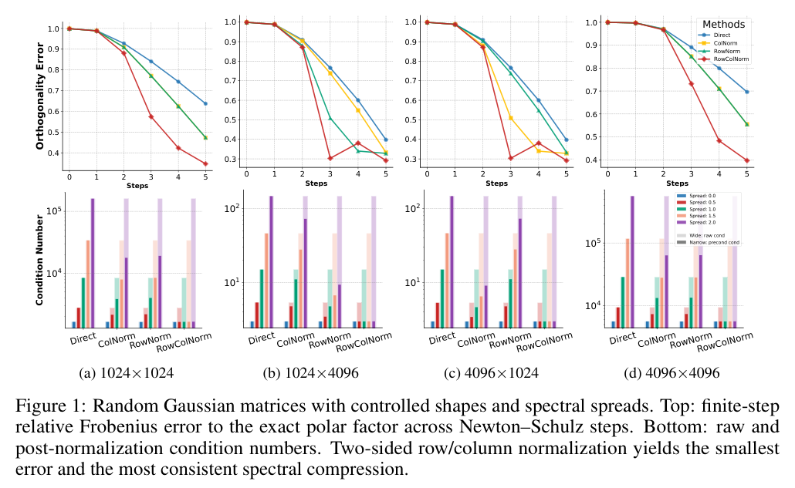
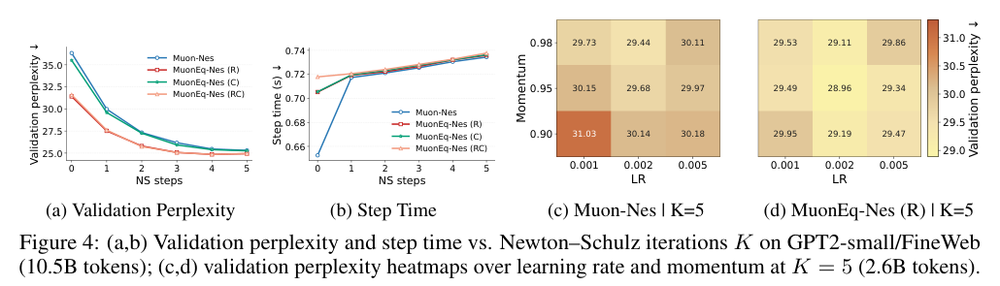

# MuonEq：先均衡动量，再进行有限步正交化

## 核心信息与阅读结论

- **原文**：arXiv:2603.28254v2，首次提交 2026-03-30，本次版本 2026-05-10；35 页，首页标注 Preprint。
- **作者**：Da Chang、Qiankun Shi、Lvgang Zhang、Yu Li、Ruijie Zhang、Yao Lu、Yongxiang Liu、Ganzhao Yuan；后两位为通讯作者。保留英文署名，不据拼音猜测中文姓名。
- **单位**：中国科学院深圳先进技术研究院、深圳理工大学、鹏城实验室、中山大学、南方科技大学、乔治华盛顿大学、中国科学院大学；详细署名对应见 PDF 首页。
- **链接**：[arXiv v2](https://arxiv.org/abs/2603.28254v2) / [原始 PDF](../../../01-raw/2026-10/MuonEq_Balancing_Before_Orthogonalization_with_Lightweight_Equilibration.pdf) / [解析全文](../../../02-markdown/2026-10/MuonEq_Balancing_Before_Orthogonalization_with_Lightweight_Equilibration.md) / [作者代码入口](https://github.com/MaeChd/muon-eq)。代码链接取自 PDF 首页；本笔记未审计作者仓库的固定提交。
- **阅读范围**：v2 全文结构、主文算法与定理、附录 B–I 的关键证明链、附录 J–M 的扩展实验、参数与限制；不声称已机械验证全部证明，也未执行训练复现。
- **实现定位**：当前代码中的 `muon-eq` 是本文的 MuonEq-Nes(R)。它不是知识库已有的 **MeqMuon: Matrix Equilibrating Muon for LLM Pretraining**，两者不得混用题录、算法或译文。

**主要结论。** MuonEq 用当前动量的行/列平方和做瞬时对角均衡，在不增加持久二阶状态的条件下改变有限步 Newton–Schulz（NS）看到的输入。行归一化 R 在本文隐藏层实验中提供最好的效果与成本折中；双侧 RC 的正交化近似误差更小，却未取得最好的训练效果。这是理解“更准正交化不必然更好训练”的直接证据。

**综合评分 7.2/10，优先级：精读并作为低成本强基线。** 理论比一句收敛阶数更有价值的是条件审查：主保证关闭 Nesterov、采用递减动量/学习率与受限递减衰减；有限步推论使用特定 Taylor 多项式，不能直接当作当前实际 NS5 实现的保证。

## 摘要翻译

### 英文摘要（本地 v2 PDF 原文）

Orthogonalized-update optimizers such as Muon improve training of matrix-valued parameters, but existing extensions typically either rescale updates after orthogonalization or use heavier whitening-based preconditioners before it. We introduce MuonEq, a lightweight family of pre-orthogonalization equilibration schemes for Muon with three forms: two-sided row/column normalization (RC), row normalization (R), and column normalization (C). By rebalancing the momentum matrix before finite-step Newton–Schulz orthogonalization, MuonEq improves the geometry seen by orthogonalization. We show that finite-step orthogonalization is governed by the input spectrum, especially stable rank and condition number, and that row/column normalization acts as a zeroth-order surrogate for whitening. For hidden matrix weights, R is the default variant. Theoretically, MuonEq (R) retains the standard $T^{-1/4}$ Muon-type nonconvex stationarity guarantee with decoupled weight decay and a horizon-free diminishing learning-rate schedule, and extends it to finite-step NS5 up to an explicit inexactness constant. In LLaMA2 pretraining on C4, MuonEq (R) consistently outperforms Muon on 130M, 350M, and 1B models, with faster convergence and lower validation perplexity. The code is available at the MuonEq codebase.

> 排版说明：原摘要收敛阶数带隐藏对数因子的渐近记号；为遵循本笔记的基础公式命令规范，上文仅保留其幂次。完整含义是忽略对数因子的 $T^{-1/4}$ 阶，不是严格的无对数常数界。其他文字按 PDF 转录并合并断词。

### 中文翻译

Muon 等正交化更新优化器改善了矩阵参数的训练，但现有扩展通常是在正交化之后重新缩放更新，或者在正交化之前使用更重的白化预条件器。本文提出 MuonEq，一组轻量的正交化前均衡方案，包括双侧行列归一化（RC）、行归一化（R）和列归一化（C）。通过在有限步 Newton–Schulz 正交化之前重新均衡动量矩阵，MuonEq 改善了正交化所面对的几何结构。作者表明，有限步正交化受输入谱，尤其是稳定秩和条件数支配，而行列归一化可以作为白化的零阶替代。对于隐藏层矩阵权重，默认使用 R。理论上，MuonEq(R) 在解耦权重衰减和不依赖训练总时长的递减学习率日程下，保留标准 Muon 型非凸平稳性保证，忽略对数因子后为 $T^{-1/4}$ 阶，并通过显式近似误差常数扩展到有限步 NS5。在 C4 上预训练 130M、350M 和 1B 的 LLaMA2 时，MuonEq(R) 均优于 Muon，收敛更快、验证困惑度更低。代码由作者提供。

### 核心要点提炼

1. **改什么**：在动量和 NS 之间插入一次行/列范数缩放，保持后续正交化及持久状态结构。
2. **为什么可能有用**：五步 NS 来不及充分放大较小奇异方向；输入的边际尺度不均衡可能使这个问题更严重。
3. **最关键反例**：RC 修正谱最强，R 的任务指标更好，因此 NS 误差只能作为机制指标，不能替代验证损失。
4. **证据范围**：多模型规模、实际步时和三种子小规模消融较扎实；未证明所有矩阵均可改善条件数，也未建立完整实际配方的收敛定理。

## 研究背景与动机

Muon 用动量矩阵的极因子提取矩阵方向。精确极因子将非零奇异值变为 1，但训练通常只运行少量 NS 迭代；因此实际更新还依赖原始奇异值分布。若一个方向起始奇异值很小，五步之后仍可能很小。只讨论精确极因子会漏掉这种实际谱塑形行为。[第 1–3.1 节]

后正交化的 NorMuon、AdaMuon 等调整最终更新幅度，无法改变当前 NS 的输入；完整白化则能处理更丰富的相关结构，但涉及 Gram 因子、矩阵分解或额外状态。MuonEq 位于中间：只处理边际幅度，成本是一到两次归约与逐元素乘法，不计算完整协方差。[第 1–2 节]

其研究问题不是“如何获得精确最优的对角预条件器”，而是“是否能用足够轻的输入均衡改善实际优化”。本文引用 Ruiz 的经典均衡与最优对角预条件研究，不应把行列归一化本身认作全新数学操作。净增量是插入 Muon 前的具体位置、有限步谱解释、R/RC 的理论分工以及配套实验。

## 方法概述

### 核心思想与流程

先把过大的行或列缩小，再让 NS 处理剩下的相关结构。均衡是缩放，不等于让行列互相正交；之后的 NS 才承担近似极分解。

### 动量、均衡与更新公式

设权重形状为 $m\times n$，按深度学习常用存储约定，行为输出通道、列为输入通道。算法 1 的 EMA 为：

$$
M_t=\beta_t M_{t-1}+(1-\beta_t)G_t
$$

启用 Nesterov 时送入均衡的矩阵为：

$$
\widetilde M_t=\beta_{t+1}M_t+(1-\beta_{t+1})G_t
$$

固定动量时这不需要额外保留上一梯度；附录 K 澄清其等价的一批次递推中，校正系数为 $\gamma=1-\beta$。实验 $\beta=0.95$ 对应 $\gamma=0.05$，乘在梯度差上的实际系数为 0.0475。不能把 0.05 再误作为独立新增机制。

用元素形式重写算法 2，避免对角矩阵构造掩盖实现：

$$
r_{t,i}=\sum_{j=1}^{n}(\widetilde M_{t,ij})^2+\varepsilon
$$

$$
c_{t,j}=\sum_{i=1}^{m}(\widetilde M_{t,ij})^2+\varepsilon
$$

R 模式令 $\widehat M_{t,ij}=\widetilde M_{t,ij}/\sqrt{r_{t,i}}$；C 模式令 $\widehat M_{t,ij}=\widetilde M_{t,ij}/\sqrt{c_{t,j}}$；RC 模式为：

$$
\widehat M_{t,ij}=\frac{\widetilde M_{t,ij}}{\sqrt{r_{t,i}}\sqrt{c_{t,j}}}
$$

**RC 的两组因子来自同一个原始输入。** 它不是先做行归一化、再用归一化后的矩阵重新计算列因子；也不是交替迭代直到行列都等范数。稳定项在平方和内部，不能改成范数之后加稳定项并宣称完全同式。[算法 2，式 (4)]

最终令 $O_t$ 为均衡后输入的 NS5 输出，更新：

$$
a=0.2\sqrt{\max(m,n)}
$$

$$
X_{t+1}=(1-\lambda_t\eta_t)X_t-a\eta_t O_t
$$

这个形状倍率是配方的一部分。辅助 AdamW 的学习率、参数分组及共享 embedding/head 处理也会影响真实训练，不能只复制均衡三行就认定完成作者整套复现。

### 状态与计算成本

R 增加行平方和归约及逐元素缩放，C 类似，RC 两者都有；均为矩阵元素数量线性级的额外操作。因子即时算完即丢，不增加持久二阶历史。它仍然保留 Muon 的完整矩阵动量，临时张量、归约开销及辅助 AdamW 状态也仍存在。“无额外持久状态”不能写成“零内存、零时间成本”。

## 理论精读与边界

### 1. 有限步 NS 的谱敏感性

若输入的紧奇异值分解为 $G=U\Sigma V^\top$，归一化后每个奇异值独立通过同一个多项式递推：

$$
s_i^{(0)}=\frac{\sigma_i}{\Vert G\Vert_F}
$$

$$
s_i^{(k+1)}=a s_i^{(k)}+b(s_i^{(k)})^3+c(s_i^{(k)})^5
$$

此处 $a,b,c$ 是 NS 多项式系数，与更新形状倍率不是同一语义。较小奇异值初期主要按线性项增长。稳定秩 $\Vert G\Vert_F^2/\Vert G\Vert_2^2$ 决定归一化后的最大奇异值量级；条件数 $\sigma_1/\sigma_r$ 决定最大与最小方向脱离线性区的时间跨度。定理 3.1 给出的是有限步误差的下界与谱递推，不是“任意均衡都会降低条件数”的定理，也不能单凭稳定秩变大就判断误差必然更低。[定理 3.1，附录 B]

> 原论文图 1。RC 在作者构造的矩阵族上有最强谱压缩；这是该实验族的结果，不是对所有矩阵的普遍保证。

### 2. 零阶白化解释是局部展开

命题 3.2 假设相应方向满秩，且归一化 Gram 与单位矩阵足够接近。行归一化先移除 Gram 对角尺度差异，精确白化再校正非对角相关项；附录 C–E 通过矩阵平方根导数与 Sylvester 方程建立一阶展开。

这一解释有两个边界。首先，宽矩阵的满行秩解释和高矩阵的满列秩解释不能随意互换；高矩阵通常不可能满行秩。其次，局部小扰动展开不是任意高度相关、秩亏或病态动量都近似白化的保证。本文隐藏权重默认 R 的理由还依赖其模块几何和实证，不能只靠白化展开覆盖所有矩阵。

### 3. 误差分解揭示 RC 为何未必最好

令 $S$ 表示均衡映射，$P$ 表示精确极因子。论文式 (5) 是三角不等式：

$$
\Vert NS_K(S(M))-P(M)\Vert_F
\le \Vert NS_K(S(M))-P(S(M))\Vert_F
+\Vert P(S(M))-P(M)\Vert_F
$$

第一项是对新输入的有限步近似误差；第二项是预处理改变目标极因子的偏移。前者更小不保证总体方向更接近原始极因子，更不保证损失下降更快。原始极因子也未被证明是训练中的唯一最优目标，因此第二项称作“偏差”不代表它一定有害。

> 原论文图 2，LLaMA2-130M/C4、2.6B-token Muon 轨迹的 1%、10%、50%、100% 位置；阴影为模块间四分位范围，不是多种子训练效果置信区间。

附录图 6 给稳定秩与奇异值熵，图 7 则逐层拆开近似误差和预处理偏差。RC 的谱修正优势与 R 的任务效果优势同时存在，支持“需要权衡”的解释；它们尚未建立偏差数值与泛化收益的因果函数。

### 4. R 的收敛结论不等于完整实际配方保证

| 条件或结论 | 定理 3.5 / 推论 3.6 | 实验与当前实现 |
|---|---|---|
| 目标及噪声 | 下有界、全局光滑、梯度无偏、方差有界 | 实际 Transformer 不自动满足全部全局假设 |
| 学习率 | $\eta_t=t^{-3/4}$ | warmup 与训练日程，非直接同式 |
| 动量 | $\beta_t=1-t^{-1/2}$，关闭 Nesterov | 固定 0.95，默认开启 Nesterov |
| R 稳定项 | 理论取 0，零行按伪逆约定保持为零 | 实际取 $10^{-8}$ |
| 权重衰减 | 有显式上界、随步递减 | 配方常数 0.1 |
| 正交化 | 精确极因子或附录 H.2 指定 Taylor NS5 | Moonlight 风格实用 NS5 |
| 保证对象 | 平均期望梯度 Frobenius 范数衰减 | 不是最后一点损失或泛化保证 |

证明关键是 R 对原始动量仍保留正对齐下界，系数为 $1/\sqrt m$；有限步扩展把它降为 $(1-\varepsilon_{ns})/\sqrt m$。再用动量误差递推和光滑下降不等式，得到平均梯度范数上界，其分子含 $1+\ln T$，分母含 $T^{1/4}$。这保留 Muon 型阶数，没有证明比原 Muon 更快，也没有证明改善常数。[附录 H.1、H.4、I]

**有限步推论的重要限制。** 附录 H.2 定义的五步 NS 使用系数 $15/8,-5/4,3/8$，输入除以 $\max(1,\Vert A\Vert_F)$。它对每个有限轨迹定义最大谱范数误差 $\varepsilon_{ns,T}<1$，但该常数依赖轨迹与时长；随着更病态的输入出现，它可以逼近 1，使对齐分母恶化。有限时长内小于 1 本身不足以证明与时长无关的良好常数，不能把形式幂次直接理解成实际固定五步长期稳定速率。

附录 Remark 3.3 认为启用 Nesterov 不应改变阶数，但定理陈述与附录 I 证明使用关闭 Nesterov 的 EMA 误差链；本笔记将其视为作者的扩展判断，而不是已完整给出的 Nesterov 定理。

### 5. RC 保证更窄

命题 3.4 关闭 Nesterov、无权重衰减、使用精确极因子，还要求梯度逐元素有界，且稳定项至少为梯度上界平方乘矩阵最大维度的 $4/5$。这与实用 $10^{-8}$ 稳定项相差甚远，目的是使双侧缩放不过分偏离标量以便得到正对齐。作者在附录 L 明确认可该保证不覆盖实用 RC 消融。不能用 RC 定理为默认 R 实现背书，也不能反过来把 R 保证扩大到所有 RC 实现。

## 实验结果

### 数据、预算与公平性

| 工作负载 | 训练量 | 硬件与用途 | 主要评价 |
|---|---|---|---|
| LLaMA2-130M / C4 | 10.5B tokens；LR pilot 2.6B | 32 个 Ascend 910C NPU | 验证 PPL、峰值内存、秒/步、损失对时间 |
| LLaMA2-350M / C4 | 21.0B tokens；LR pilot 7.5B | 64 个 910C NPU | 同上 |
| LLaMA2-1B / C4 | 21.0B tokens | 64 个 910C NPU | 同上；两个 LR 候选 |
| GPT2-small / FineWeb | 10.5B tokens；稳健性图部分为 2.6B | 4 张 RTX Pro6000 96GB | 三种子 PPL、R/C/RC、NS 步数与 LR/动量消融 |
| ResNet-18 / CIFAR-10 | 100 epochs | 同上，4 张 RTX Pro6000 | 三种子测试准确率 |

C4 主实验分别使用全局 batch 128/256/512，序列长度均 4096，warmup 500/500/1000 步，权重衰减 0.1，Muon 动量 0.95，默认 NS5。130M 的 Muon/Eq 系列 LR 为 0.003；350M 原 Muon 为 0.0015，Muon-Nes/Eq 为 0.002；1B 搜索 0.0005、0.0008。不同最优 LR 合理，但需要结合等额搜索预算解释，不能把所选配方优势都归因于同一个均衡操作。[表 4–6]

FineWeb 消融表 8 的默认 Eq LR=0.002，warmup=1000、总步数=20000、batch=128、序列4096、decay=0.1、动量=0.95。CIFAR 表 7 中 Muon 系列 LR=0.05、动量0.9、batch128、无warmup。三种子是小规模消融的报告方式；主表 1 未给对应种子误差条，不应借用消融误差条为 1B 提供统计保证。

### 主结果：同 token 更好，单步略贵

表 1 全部 PPL、内存与步时转录如下，内存单位 GB、时间单位秒/步。

| 方法 | 130M PPL / 内存 / 时间 | 350M PPL / 内存 / 时间 | 1B PPL / 内存 / 时间 |
|---|---|---|---|
| AdamW | 21.35 / 12.94 / 0.21 | 16.25 / 29.43 / 0.53 | 14.71 / 39.56 / 2.47 |
| MARS-AdamW | 20.03 / 12.99 / 0.23 | 15.62 / 29.47 / 0.57 | 13.22 / 39.57 / 2.50 |
| Muon | 20.52 / 12.52 / 0.25 | 15.21 / 28.18 / 0.61 | 13.06 / 34.81 / 2.76 |
| Muon-Nes | 20.18 / 12.52 / 0.25 | 15.19 / 28.18 / 0.61 | 13.24 / 34.81 / 2.76 |
| MuonEq | 19.96 / 12.52 / 0.26 | 15.07 / 28.18 / 0.63 | 12.86 / 34.81 / 2.78 |
| MuonEq-Nes | 19.56 / 12.52 / 0.26 | 14.96 / 28.18 / 0.63 | 12.91 / 34.81 / 2.78 |

| 配对比较 | 130M PPL 变化 | 350M PPL 变化 | 1B PPL 变化 |
|---|---:|---:|---:|
| Eq 相对 Muon | -0.56（-2.73%） | -0.14（-0.92%） | -0.20（-1.53%） |
| Eq-Nes 相对 Muon-Nes | -0.62（-3.07%） | -0.23（-1.51%） | -0.33（-2.49%） |

百分比由本笔记复算，以对应基线为分母。Eq 系列相对 Muon 系列的步时增加约 4.00%、3.28%、0.72%；峰值内存按表中两位小数相同，不代表额外瞬时内存严格为零。1B 上 Eq 12.86 优于 Eq-Nes 12.91，说明 Nesterov 并非处处更优。主文中的“更快”主要是收敛及达到质量的时间，不是更快的单步内核。

> 原论文图 3。三种规模都给了损失对训练时间曲线，比只报 token 效率更完整；未在图上人工估计精确目标损失加速比，也不把 910C 测得的开销直接外推到 A100。

### 消融：RC 更准但 R 更好

| 方法 | CIFAR-10 测试准确率（%） | FineWeb / GPT2-small 验证 PPL |
|---|---:|---:|
| AdamW | 93.36±0.10 | 26.48±0.12 |
| Muon | 94.39±0.04 | 未列此项 |
| Muon-Nes | 94.44±0.05 | 25.23±0.08 |
| AdaMuon | 未列此项 | 24.99±0.13 |
| Muon+ | 未列此项 | 25.12±0.08 |
| Mousse | 未列此项 | 25.16±0.10 |
| Eq-Nes RC | 94.29±0.10 | 24.94±0.04 |
| Eq-Nes C | 94.45±0.02 | 25.23±0.06 |
| Eq-Nes R | 94.57±0.07 | 24.88±0.02 |

表 2–3 均为三种子平均及作者报告的 ± 数值；当前正文未明确把这些 ± 定义为标准差或标准误，本笔记不自行指定。CIFAR 上 R 比 Muon-Nes 高 0.13 个百分点，RC 反而低 0.15 个百分点。FineWeb 上 R 比 Muon-Nes 的 PPL 降低 0.35（1.39%），比 RC 低 0.06。后者差距较小，只有三种子汇总，不能据此断言所有任务 R 都显著优于 RC。

> 原论文图 4。NS 步数扫描采用 10.5B tokens，LR/动量热图采用 2.6B tokens；不同预算的 PPL 不可横向混比。R 对 NS 步数更稳健，但减少步数的具体收益仍应按目标损失与总时间共同评估。

## 主张—证据—限制矩阵

| 主张 | 证据 | 可以支持 | 尚未支持 |
|---|---|---|---|
| 输入谱影响有限步 NS | 定理 3.1、图1–2 | 小奇异方向的响应与条件数、稳定秩有关 | 所有均衡必然改善谱或训练 |
| 均衡是零阶白化替代 | 命题3.2、附录C–E | 满秩、小相关扰动下的局部解释 | 任意秩亏/强相关矩阵近似完整白化 |
| R 有非凸保证 | 定理3.5、推论3.6、附录H–I | 限定日程、EMA和NS映射的平均梯度界 | 当前Nesterov、常数衰减及实用NS5整套保证 |
| R 是隐藏权重好默认 | 表1–3、图4 | 所测两类架构与任务中效果较好 | embedding/head/所有布局普遍适用 |
| 无额外持久状态 | 算法2、表1 | 无需历史二阶矩，所报峰值内存接近 | 零临时分配、零运行成本 |
| 谱修正解释效果 | 图1–2、6–7及消融 | 与误差/偏差权衡一致 | 已因果识别哪项谱统计决定泛化 |

## 与相关论文对比及技术路线定位

下列对照优先依据本地原论文解析文本及本文明确列出的基线结果。未在统一平台复现，性能不能跨论文直接排名。

| 近邻 | 统计信号与位置 | 状态及差异 | MuonEq 的净增量或不足 |
|---|---|---|---|
| **Muon / Muon is Scalable for LLM Training**（Jordan等，2024；Liu等，2025，arXiv:2502.16982） | 动量直接进入NS；形状缩放和混合参数分组 | 单完整动量，辅助AdamW另算 | 保留基本配方，只改变NS输入；本文提供直接实验对照 |
| [Muon²: Boosting Muon via Adaptive Second-Moment Preconditioning](../MUON2_Boosting_MUON_via_Adaptive_Second_Moment_Preconditioning/精读.md)（Liu等，2026，arXiv:2604.09967） | 原始梯度历史二阶矩逐元素预条件，再NS | 完整二阶状态；另有因子化Muon²-F | 同属NS前几何改造；MuonEq取当前动量行列范数，更轻但不建模时间波动 |
| [DGA-Muon](../DGA_Muon_Decoupled_Geometry_Aligned_Adaptive_Scaling_for_Muon/精读.md)（Zhang、Yu，2026，arXiv:2610.06578v2） | 原梯度行/列历史能量；极因子后按形状缩放 | 额外短轴二阶向量，带偏差校正和裁剪 | MuonEq改输入方向/谱；DGA主要改正交化后的幅度，两种顺序不等价 |

Muon² 原文第 3.1 节、算法 1 明确把历史二阶矩放在正交化前；DGA 原文第 4 节、算法 1 明确把原始梯度统计与极因子分离。本次读的是它们的方法原文，避免只从标题推断相似性。两篇发布时间晚于 MuonEq 首稿，属于当前研究近邻，不将其倒写成 MuonEq 首稿必须引用的先前工作。

本文表 3 还直接比较 **AdaMuon**（Si等，2025，arXiv:2507.11005）、**Muon+**（Zhang等，2026，arXiv:2602.21545）和 **Mousse**（Zhang等，2026，arXiv:2603.09697）。该表对实际竞争性有价值；本笔记对这些基线的数值来自 MuonEq 原文，没有额外声称已逐篇审计其作者实现。

技术路线可概括为：矩阵方向提取 → 认识有限步 NS 自身的谱塑形 → 在 NS 前后选择不同位置配置尺度信息。MuonEq 的位置是“当前动量、边际几何、无持久二阶状态的输入均衡”，不是完整曲率白化，也不是时间自适应二阶矩。

## 当前实现对照与复现注意事项

核对源码为 `pisa_shared/optimizers/muon_eq.py`、`muon.py` 和 `config/paper_muon.py`，路径见[实现文件](../../../../graduate-thesis-code/reproduction/pisa_repro/code/shared/src/pisa_shared/optimizers/muon_eq.py)。这里描述读取时的实现，不代表已跑训练验证。

| 关键项 | 当前实现 | 与论文关系 |
|---|---|---|
| 动量与Nesterov | EMA后用0.95/0.05混合EMA和当前梯度 | 对应固定动量算法1及附录K解释 |
| 行/列统计 | 对同一未均衡输入平方后分别求和 | 对应算法2，RC没有重复估计列因子 |
| 稳定项 | 平方和内加 $10^{-8}$ | 对应实用配方；不同于主理论零稳定项 |
| 正交化位置 | `diagonal_precondition`后`_newton_schulz` | 正确反映NS前均衡 |
| 输出倍率 | $0.2\sqrt{\max(m,n)}$ | 对应Moonlight式缩放 |
| 默认配置 | LR .002、动量 .95、NS5、R、Nesterov、decay .1 | 选取GPT2-small/FineWeb表8，而非LLaMA LR |
| 辅助AdamW LR | .002 | 本地补全；表8未单独列出该参数 |

**实际训练入口另行核对。** `train_powermuon_compare.py` 的 `PAPER_OPTIMIZER_OVERRIDES["muon-eq"]` 与上表相同，不存在 DGA 那样的局部稳定参数覆盖。该入口当前 `MATCHED_BUDGET=True`，选 MuonEq 后使用本地124M模型、FineWeb、batch64、序列1024、5100步，共334,233,600 tokens；warmup按原表5%的比例迁移为255步，随后用本地补全的cosine日程，最终LR比例0。它迁移的是优化器参数与warmup比例，并不是原文GPT2-small的10.5B-token完整复现。源码明确标记cosine形状为本地补全，不应把它写成论文已公布的完整日程。入口当前默认方法仍为DGA；需显式选择`--method muon-eq`才构造MuonEq请求。本次仅静态读取，未执行训练。

**明确的理论映射差异。** 本地 `_newton_schulz` 使用系数 3.4445、-4.7750、2.0315，除以 Frobenius 范数加 $10^{-7}$，CUDA时工作张量转BF16；附录 H.2 的理论 NS5 是 15/8、-5/4、3/8，并除以 $\max(1,\Vert A\Vert_F)$。二者虽都称 NS5，实际映射不同，不能直接引用推论 3.6 保证当前实现。论文实验也使用 Moonlight 实用实现，因此这是理论与实验映射的边界，不足以单独判定本地实现错误。

另外，当前通用 Muon 类的输出倍率是 $\sqrt{\max(1,m/n)}$，MuonEq 为上述 Moonlight 倍率。实际比较时需核对工厂最终采用的基线和学习率标定；否则可能将输出范数及辅助参数组差异误计为均衡收益。本笔记只提示需控制的因素，不根据单文件推断全部训练入口存在比较错误。

## 优势、局限与适用场景

**优势。** 方法足够简单；对当前动量做直接可解释的尺度修正；无持久二阶状态；既有合成谱诊断，也有真实动量、训练质量、内存与步时；小规模消融含三种子和数个强近邻。R 与 RC 的不同结论避免了把单一机制指标当作目标函数。

**局限。** 改善条件数及白化解释不是无条件全局性质；主要理论没有覆盖实验最常用的一整套超参数；主规模实验缺少种子误差条和更大模型/其他数据域；没有测得跨硬件恒定加速；训练收益与谱指标的因果关系仍未充分拆分。验证 PPL 改善也不能直接等同于下游能力或泛化普遍改善。

**适用。** 在内存受限、希望保留单动量 Muon状态、隐藏矩阵边际尺度差异明显、只用少量NS步的场景，R值得作为便宜强基线。当前代码已经具备R/C/RC切换，适合固定预算消融。

**谨慎外推。** embedding和LM-head、共享权重、稀疏/极低秩梯度、不同权重布局、按头切块、卷积展开及混合专家均应另核对。附录K.3强调“行/列”必须随实际存储方向解释：转置后同名操作可能对应完全不同的功能轴。

## 后续研究与最小反证计划

1. **固定幅度后验证几何收益。** 同一初始化、数据顺序、辅助AdamW和调参预算，比较原Muon、R、C、RC；增加逐矩阵更新范数匹配控制。若R收益被匹配范数消除，就应减弱“方向改善是主要来源”的解释。
2. **让机制指标面对任务结果。** 同时记录条件数、稳定秩、NS输出奇异值、相对原极因子的方向偏移、更新范数与验证loss。按模块和时段比较，检验RC误差下降是否伴随更大偏移；仅相关不足以定因果。
3. **理论映射与实用映射交叉。** 比较Taylor NS5与当前实用NS5，在相同输入、精度和预算下核对谱误差与正对齐，再做小模型配对训练。若实用映射已足够对齐，则不能把证明差异等同于实际故障。
4. **少步NS与墙钟收益。** 先测R配NS2/3/4/5，在达到同验证loss和同总时间两个口径上比较；计入归约、通信与调参成本，不从单步NS次数直接推导总加速。
5. **先拆参数块再扩规模。** 对Q/K/V、FFN和输入输出块分别做消融；保持共享权重只更新一次。至少三个配对种子，先在小模型确认稳定差异，再考虑完整预训练。

上述是分析者建议，未执行，不是论文已有实验结果；本次没有更改当前训练代码或触发GPU任务。

## 我的综合评价

按用户指定paper-analyze的五个0–10维度评分，均为分析者主观研究判断，不是会议评审或统计结论。

| 维度 | 分数 | 理由 |
|---|---:|---|
| 创新性 | 6.5/10 | 经典均衡的新插入位置与有限步解释有用；归一化本身并不新 |
| 技术质量 | 7.0/10 | 证明链较完整且区分RC/R；实践映射和日程的覆盖仍有限 |
| 实验充分性 | 7.5/10 | 三规模、墙钟、强近邻及三种子消融；主规模重复和更广任务不足 |
| 写作质量 | 7.0/10 | 算法、误差分解和局限清楚；NS5同名不同映射容易使读者过度解读 |
| 实用性 | 8.0/10 | 易实现、额外状态小、可直接加入现有Muon对照，仍需公平标定 |

五维等权平均 **7.2/10**，置信度中。最有研究价值的是“输入边际几何—有限步谱响应—任务效果”之间可以直接做受控干预，而不是单看一个较好的困惑度数字就结束判断。

> **关键启示：** 优化器中正交化的输入、目标与近似精度需要分别检查；把输入变得更易正交化，只是改善实际训练的一种可能机制。

## 资料与核查说明

- 主要证据为本地v2 PDF，数值按表1–8转录；算法定位第2节、理论第3节、证明附录B–I、实验附录J–K、限制附录L。
- 图片均来自原论文，本地资产及图号位置见[图片来源](images/_sources.md)。笔记可与images目录一起移动阅读。
- 近邻方法原文：[Muon²解析](../../../02-markdown/2026-10/MUON2_Boosting_MUON_via_Adaptive_Second_Moment_Preconditioning.md)、[DGA-Muon解析](../../../02-markdown/2026-10/DGA_Muon_Decoupled_Geometry_Aligned_Adaptive_Scaling_for_Muon.md)。
- [Muon原始方法](https://kellerjordan.github.io/posts/muon/) / [Muon is Scalable论文](https://arxiv.org/abs/2502.16982) / [Moonlight训练实现](https://github.com/MoonshotAI/Moonlight)。
- 本笔记没有把原始摘要中的主张直接视为已证明结论；关于收敛、默认R及速度的限定已在对应章节说明。

## 我的笔记

留给后续手动补充。
