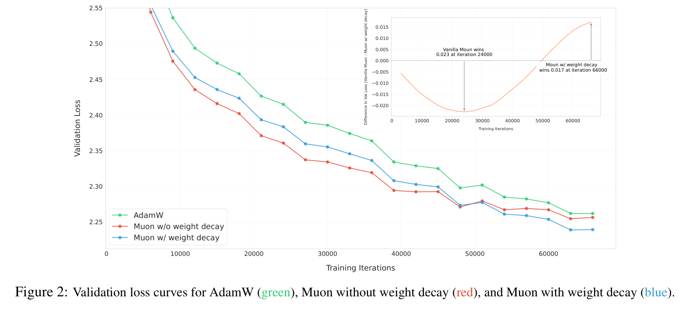
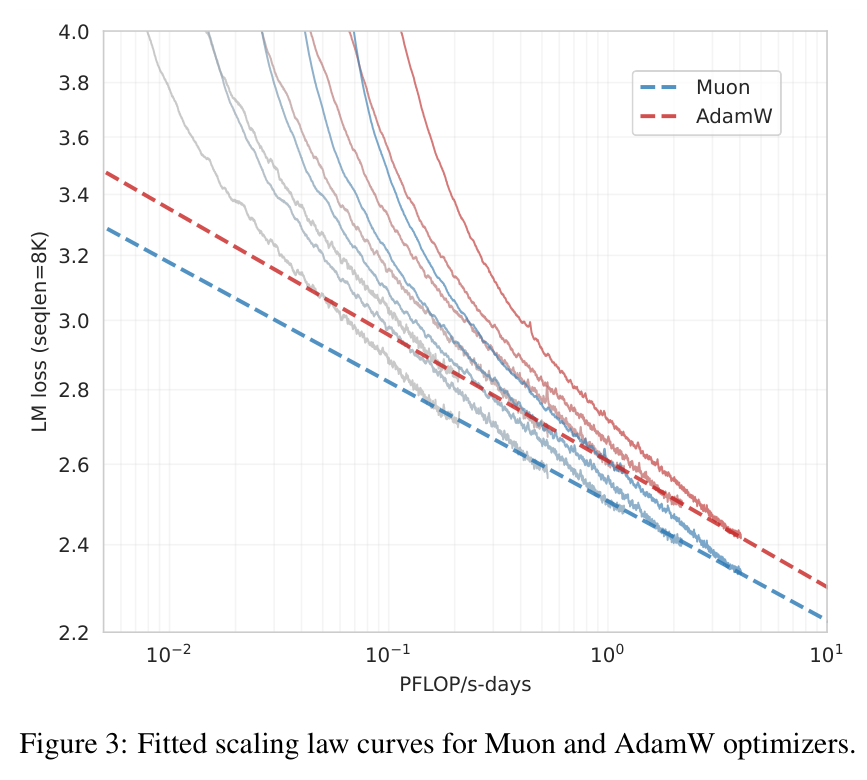
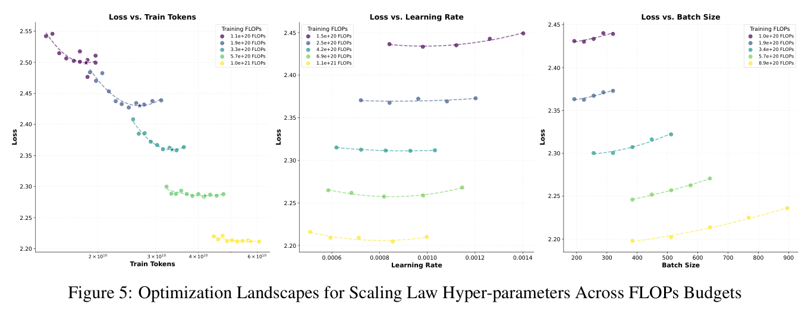
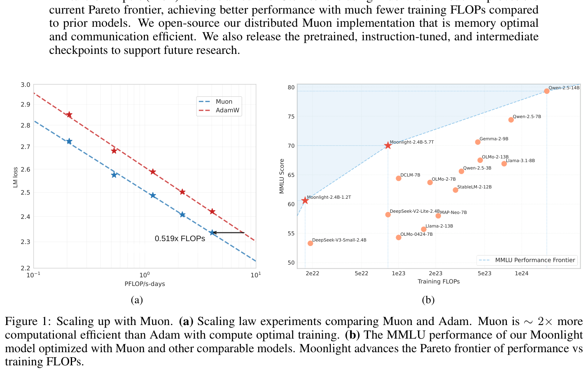
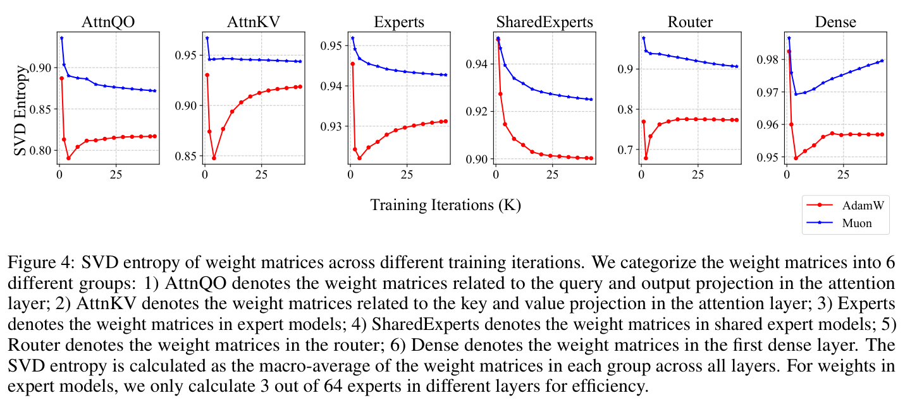
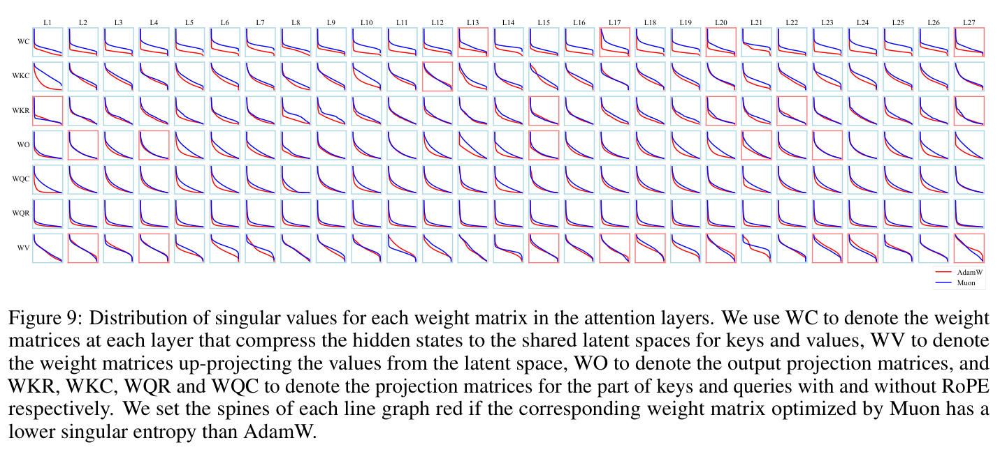
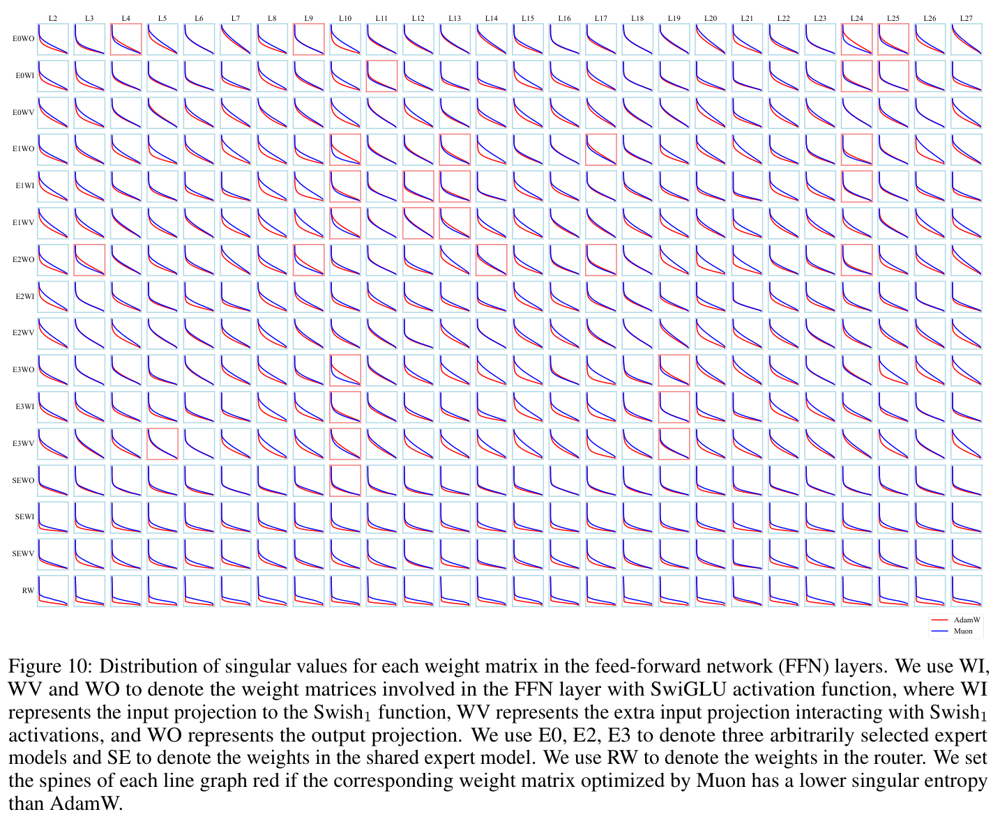
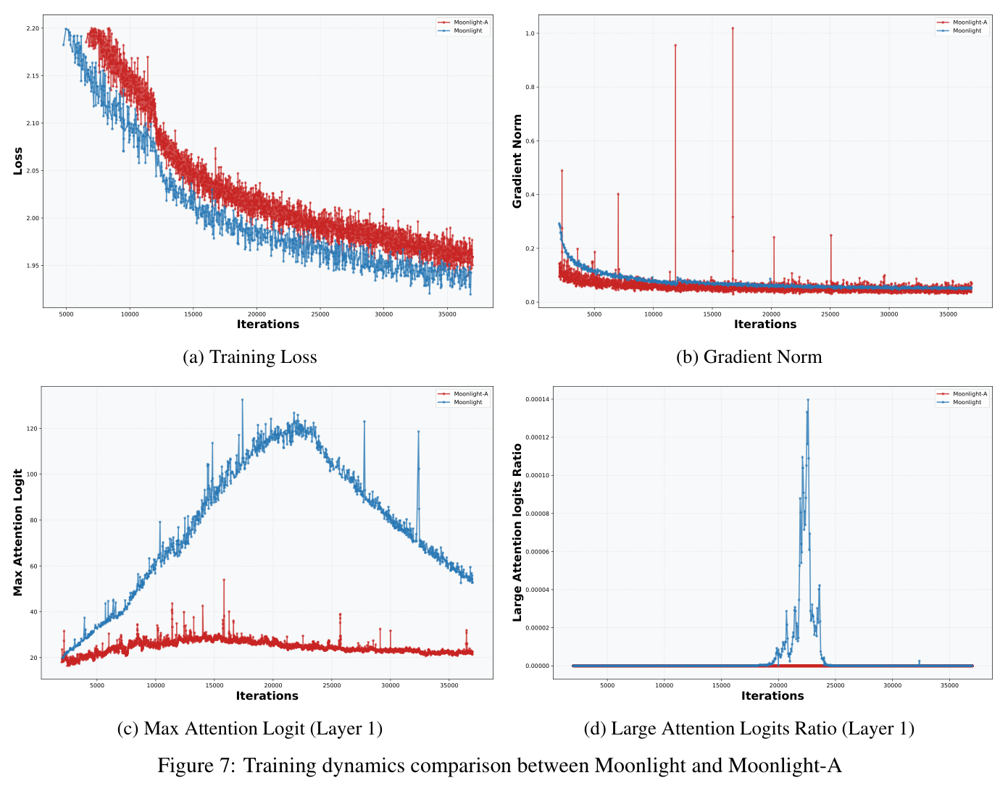
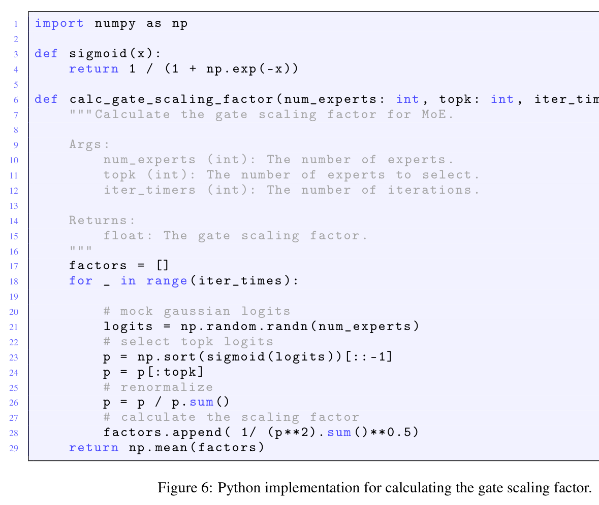
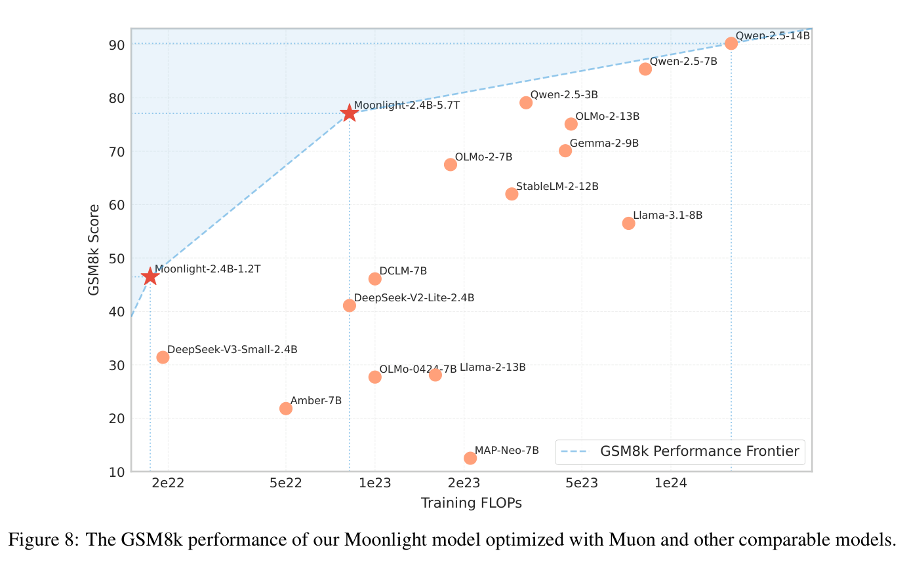

# Muon is Scalable for LLM Training

## 核心信息与阅读口径

- **分析对象**：2025-02-24 提交的 arXiv:2502.16982v1，19 页技术报告；主要类型为**实证方法与系统工程混合型**，含一个更新 RMS 引理，不是一般非凸收敛理论论文。
- **作者与机构**：Jingyuan Liu 等 28 人；Moonshot AI、UCLA，完整作者列于 frontmatter。
- **原始资料**：[本地英文 PDF](../../../01-raw/2026-10/Muon_is_Scalable_for_LLM_Training.pdf)、[双栏译文](../../../06-translation/2026-10/Muon_is_Scalable_for_LLM_Training/双栏对比.pdf)、[固定版本页面](https://arxiv.org/abs/2502.16982v1)。入库与精读日期均为 2026-10-29。
- **证据范围**：读完本地 PDF 正文和附录 A–F；摘要以本地 PDF 为准。联网核对了版本元数据、三项直接近邻及作者代码入口，访问日期 2026-10-29。没有运行训练、下载模型权重或独立复现性能。
- **版本隔离**：当前官网和代码用于检查资源入口，不拿后续实现或后续论文结果替换 v1 的原始实验。arXiv 页面摘要省去了 PDF 中的行内引用，以下保留 PDF 原文。

## 一句话贡献

本文把已有 Muon 的矩阵动量正交化，补成包含权重衰减、按矩阵形状校准更新尺度以及 ZeRO-1 式分布式处理的训练方案，并用密集模型缩放实验与 5.7T token 的 MoE 训练证明其大规模可用性；净增量主要是**规模化配方与实证验证**，而非首次提出正交化优化。

## 摘要翻译

### 英文摘要（PDF 原文，完整转录）

仅合并排版换行、行末断词；数学量转为可渲染形式。

Recently, the Muon optimizer (K. Jordan et al. 2024) based on matrix orthogonalization has demonstrated strong results in training small-scale language models, but the scalability to larger models has not been proven. We identify two crucial techniques for scaling up Muon: (1) adding weight decay and (2) carefully adjusting the per-parameter update scale. These techniques allow Muon to work out-of-the-box on large-scale training without the need of hyper-parameter tuning. Scaling law experiments indicate that Muon achieves $\sim 2\times$ computational efficiency compared to AdamW with compute optimal training. Based on these improvements, we introduce Moonlight, a 3B/16B-parameter Mixture-of-Expert (MoE) model trained with 5.7T tokens using Muon. Our model improves the current Pareto frontier, achieving better performance with much fewer training FLOPs compared to prior models. We open-source our distributed Muon implementation that is memory optimal and communication efficient. We also release the pretrained, instruction-tuned, and intermediate checkpoints to support future research.

### 中文翻译（与上述摘要逐句对应）

最近，基于矩阵正交化的 Muon 优化器（K. Jordan 等，2024）在小规模语言模型训练中取得了很好的结果，但其向更大规模模型扩展的能力尚未得到验证。我们识别出扩展 Muon 的两项关键技术：（1）加入权重衰减；（2）仔细调整逐参数更新的尺度。这些技术使 Muon 能够直接用于大规模训练，而无需进行超参数调优。缩放律实验表明，在计算最优训练设置下，Muon 相比 AdamW 实现了约两倍的计算效率。基于这些改进，我们推出了 Moonlight，这是一个使用 Muon、以 5.7T 个 token 训练的 3B/16B 参数专家混合（MoE）模型。与先前模型相比，我们的模型以少得多的训练浮点运算量获得更好的性能，改进了当前的帕累托前沿。我们开源了具有最优内存效率和高通信效率的分布式 Muon 实现。我们还发布预训练、指令微调和中间检查点，以支持未来研究。

### 核心要点提炼（分析者理解）

作者实际处理的是三个彼此耦合的问题：正交化之后每个矩阵的更新幅度如何选择；长时间训练时如何控制权重和激活增长；完整矩阵运算如何接入分片训练。大模型跑通说明配方可用，但不会自动证明其适用于所有模型、硬件和训练阶段。尤其是“无需调参”应理解为**论文所测试设置下，复用已经为 AdamW 搜索好的学习率和衰减**，不是不存在调参成本。最需要审计的是效率比较的计算口径、同数据对照与跨模型比较的差别，以及预训练到微调的迁移失败。

## 研究背景、问题与成功判据

对自回归语言模型，训练输入是 token 序列，优化变量包含注意力投影、MLP、MoE 专家和路由器等矩阵，以及嵌入、输出头和归一化参数；目标是降低下一 token 预测损失，并最终改善下游任务。AdamW 以逐坐标一、二阶矩估计调整更新幅度，部署成熟，但不能显式利用权重矩阵作为线性算子的结构。Muon 先积累梯度动量，再改变其奇异值谱，从而改变参数空间中不同方向的相对步幅。（§1、§2.1）

作者提出的空白不是“小模型中正交化从未有效”，而是小规模、短训练结果能否延伸到十几亿激活参数、万亿 token、分布式 MoE。近邻核查也表明，谱范数最速下降解释和 Newton–Schulz 近似都早于本文；这限制了理论新颖性的归属，但并不削弱长训练和系统验证的独立价值。本文的合理成功判据应分别是：同预算损失更低；相同数据、架构下下游成绩有改进；系统开销没有抵消收敛收益；长训练过程中不出现不可恢复的数值失稳。不能只用公开榜单上的一个分数包办全部判据。

还有一个参数口径必须先固定：Moonlight 正文给出不含嵌入的 **2.24B 激活参数、15.29B 总参数**；摘要约写为含嵌入的 3B/16B。MoE 的激活规模接近 3B 密集模型，不表示它只需要存储 3B 参数；因此 FLOPs、模型容量和显存必须分别比较。（§3.3、表 4–5）

## 方法主线：方向、尺度、衰减与分布式实现

### 1. Muon 改变了什么方向

令 $W_{t-1}$ 为一个矩阵权重，$G_t=\nabla L_t(W_{t-1})$ 为该批次梯度，$M_t$ 为动量，$\mu$ 为动量系数。正文式 (1) 写为：

$$
M_t=\mu M_{t-1}+G_t
$$

$$
O_t=\mathcal{N}(M_t)
$$

$$
W_t=W_{t-1}-\eta_t O_t
$$

这里 $\mathcal{N}$ 表示 Newton–Schulz 近似。原文脚注 1 进一步说明，实际用的是 Nesterov 风格输入 $\mu M_t+G_t$，不能把正文简写当作全部实现。无偏差校正的动量尺度不会直接保留到正交化结果中，但动量的方向和 Nesterov 混合仍然会改变最终更新。

直观上，设动量的紧致奇异值分解为 $M=U_r\Sigma_r V_r^\top$。理想的极分解部分因子为 $O=U_rV_r^\top$，把非零奇异值变成 1，而保留左右奇异向量。这会抬高原先相对弱的方向、压低强方向，但并非“增加原矩阵的代数秩”：零奇异值经多项式仍为零。对矩形矩阵，只可能是半正交；对秩亏矩阵，需用部分等距和伪逆解释，不能直接套用普通逆。（§2.1）

从几何上，谱范数球中的线性最小化可以产生这一方向：

$$
\min_{\Vert D\Vert_2\le 1}\sum_{i,j}M_{ij}D_{ij}
$$

一个最优解是 $D=-U_rV_r^\top$。因此本文的方向选择与谱范数约束有关系；这并不意味着整个含噪、含动量、有限步近似和权重衰减的训练过程都已经具有同一套严格收敛保证。这里的几何解释与完整算法定理需要分开。

### 2. 5 步 Newton–Schulz 是计算配方，不是精确 SVD

先作 Frobenius 归一化 $X_0=M/\Vert M\Vert_F$，再按式 (2) 迭代：

$$
X_k=aX_{k-1}+b(X_{k-1}X_{k-1}^\top)X_{k-1}
+c(X_{k-1}X_{k-1}^\top)^2X_{k-1}
$$

系数为 $a=3.4445$、$b=-4.7750$、$c=2.0315$。从 SVD 看，这对应对奇异值反复施加 $f(s)=as+bs^3+cs^5$。可用矩阵乘法与 bf16 实现是其工程吸引力所在；对 $A\times B$ 矩阵，把较短维度放入 Gram 矩阵，每步主计算量量级为 $AB\min(A,B)$，实际速度还受融合、通信和设备影响。

有一个容易误读的细节：代入本文系数，$f(1)=0.701$，并不等于 1。因此不能宣称“此系数反复迭代就精确收敛到奇异值 1”。作者也以实证说明 10 步正交化更准确却没有带来更好性能，最终使用 **5 步、动量 0.95**。（§2.2）这意味着应把有限步谱变换本身视为算法的一部分：过分追求精确极分解可能增加成本，却未必提高预测能力。

### 3. 为什么矩阵形状会改变更新 RMS

RMS 是所有元素平方的平均值再开方，不是谱范数，也不是参数范数。以下用 $\mathcal{R}$ 记矩阵 RMS。对形状 $A\times B$、秩为 $r$ 的理想部分等距更新，有：

$$
\mathcal{R}(O)=\frac{\Vert O\Vert_F}{\sqrt{AB}}
=\sqrt{\frac{r}{AB}}
$$

若满秩，$r=\min(A,B)$，于是引理 1 得到：

$$
\mathcal{R}(O)=\frac{1}{\sqrt{\max(A,B)}}
$$

推导的关键是正交列使交叉项求和后为零。更完整地，从 $O_{ij}=\sum_k U_{ik}V_{jk}$ 展开：

$$
\sum_{i,j}O_{ij}^2
=\sum_{k,l}\left(\sum_i U_{ik}U_{il}\right)
\left(\sum_j V_{jk}V_{jl}\right)=r
$$

附录 A 直接把平方和写成只含对角项的形式，省略了这个消交叉项步骤；其最后结论正确，上式补上了所需理由。这个引理严格适用于理想的非零奇异值单位化结果。对于实际 $N$ 步的输出，令奇异值为 $s_i^{(N)}$，则 RMS 是 $\sqrt{\sum_i(s_i^{(N)})^2/(AB)}$。因此形状公式给出的是校准依据，不能保证有限步算法每个矩阵都严格达到同一 RMS。

同样，低秩时直接按满秩形状缩放，实际 RMS 还会小于目标，缩小因子是 $\sqrt{r/\min(A,B)}$。这是由公式推得的分析者观察，不是本文已经验证的低秩结论，尤其不能未经实验迁移到 LoRA。

### 4. 统一尺度和加入衰减后的完整规则

正文式 (4) 采用：

$$
W_t=(1-\eta_t\lambda)W_{t-1}
-\eta_t\left(0.2\sqrt{\max(A,B)}\right)O_t
$$

其中 $\lambda$ 为衰减系数。乘上形状因子抵消理想满秩更新的维度依赖；乘上 0.2 是为了接近观测到的 AdamW 更新 RMS 区间 0.2–0.4。这里“更新 RMS”指学习率外的优化方向，最终参数变化还要乘以 $\eta_t$，并包含衰减项。把所有矩阵都称作“学习率相同”容易掩盖这一点：基础学习率相同，矩阵方向仍有形状缩放。

实际实现还必须注意，式 (4) 的形状因子只乘正交化方向，**不乘权重衰减项**。如果直接把参数组学习率乘以形状因子而保留相同衰减，就会改变相对衰减强度，已不等价于原文。本文 §3.1 的方法名 Adjusted LR 应结合显式公式理解。

作者观察到无衰减 Muon 长训练时权重与层输出 RMS 持续增长，并担心 bf16 数值精度受损。这里是量级增长与有限精度的工程解释，不宜扩写成“已经证明发生溢出”。更细的稳定性补充是 **RMSNorm gamma 也需要权重衰减**；仅在二维矩阵上添加衰减并不足以完整复制作者的配方。（§2.2、附录 D）

Muon 依然与 AdamW 混用：归一化参数、嵌入和输出头等交给 AdamW；嵌入和输出头本身也可能是矩阵，因此分组规则不能简化成“所有二维参数都用 Muon”。该分工属于网络角色选择，而不只是张量维度判断。

### 5. 分布式更新为什么需要额外收集

AdamW 可逐元素更新，所以 ZeRO-1 分片后通常无需重建完整矩阵。Muon 的矩阵乘法则要求看到完整的逻辑矩阵。算法 1 的顺序是：DP reduce-scatter 梯度；本地分片更新动量；收集所需动量方向为完整矩阵；执行 Newton–Schulz；保留与本地参数对应的更新分片；更新主参数并 all-gather。若启用 TP，还需要考虑其额外 gather。（§2.3、脚注 5）

只存一份动量而非 AdamW 的两份矩状态，可以减少相应状态内存；**这不是总训练显存减半**，因为主权重、激活、梯度、临时完整矩阵和未交给 Muon 的参数仍然存在。论文对通信量的字节核算是：基线 fp32 梯度与参数通信按 $4+4$，Muon 增加 bf16 收集后按 $4+2+4$，得到最多 1.25 倍；实际估计区间为大于 1、至多 1.25。字节数、通信延迟和训练墙钟时间不是同一指标。

论文说优化器操作通常只占前后向的大约 1%–3%，在其集群没有明显额外延迟。但缺乏完整硬件、并行配置与重复测量表，不能据此向任意多机网络保证“零开销”，也不能把五步矩阵乘法在单卡的速度直接外推到跨机。

## 实验与核算

### 1. 权重衰减：后期收益和早期收益不同

> 原文图 2，PDF 第 4 页；约 800M 模型、100B token，作者称约为计算最优 token 的五倍。

无衰减 Muon 在约 24,000 步时反而比有衰减版本低 0.023 验证损失，约 66,000 步时则是有衰减版本低 0.017。（图 2 内标注）这说明短训练排名可以反转，不能只观察最初几千步就决定长期配方。该对照支持“衰减对这条长训练轨迹有益”，但没有完整扫过衰减、精度和归一化设置，尚不能独立确定收益究竟由正则化、数值控制还是二者共同带来。

### 2. 尺度消融：形状校准有收益，但证据集中在早期

§3.1 为突出长宽差异，特意把 SwiGLU 改为普通两层 MLP，矩阵由约 $[H,2.6H]$ 改为 $[H,4H]$。实验采用约 800M 模型，在 20B token 计划的 4B 处比较，不是训练完成的最终结论。

| 方法（表 1） | 训练损失↓ | 验证损失↓ | Query 权重 RMS | MLP 权重 RMS |
|---|---:|---:|---:|---:|
| 统一用隐藏维度缩放的 Baseline | 2.734 | 2.812 | 0.03586 | 0.02520 |
| 每个更新直接归一化至 RMS 0.2 | 2.720 | 2.789 | 0.04918 | 0.05010 |
| 按矩阵形状缩放 Adjusted LR | 2.721 | 2.789 | 0.03496 | 0.04890 |

两种修正都降低验证损失 0.023；按损失本身作比值为 $0.023/2.812\approx0.82\%$，不等同于下游准确率增长。形状缩放保留 Query 权重 RMS 接近基线，却让 MLP RMS 从 0.02520 增至 0.04890，约 1.94 倍，与该例子中理论更新尺度增加两倍相吻合。作者因计算更省选择形状法，表 1 并未给两法的实际毫秒差。

附录 A 的表 8 在约 2B token 处扫描目标 RMS：

| 优化器／目标 RMS | AdamW | Muon 0.05 | Muon 0.1 | Muon 0.2 | Muon 0.4 | Muon 0.8 |
|---|---:|---:|---:|---:|---:|---:|
| 训练损失↓ | 3.512 | 3.355 | 3.239 | 3.198 | 3.199 | 3.386 |
| 验证损失↓ | 3.679 | 3.503 | 3.374 | 3.325 | 3.314 | 3.543 |

0.4 的验证损失比 0.2 低 0.011，而 0.2 的训练损失仅低 0.001；因此 0.2 是低成本、与 AdamW 尺度接近的实用选择，不能称为普遍最优常数。此表本身就是超参数实验，也限定了摘要“无需调参”的理解。

### 3. 密集模型缩放：优势明确，精确效率倍数仍需审计

表 2 覆盖以下不含嵌入参数规模，均为 8K 上下文；损失越低越好。

| 参数量 | 层数／头数 | 隐藏维度 | 训练 token | 学习率 | 批大小（序列数） |
|---|---:|---:|---:|---:|---:|
| 399M | 12／12 | 1536 | 8.92B | 0.0009503 | 96 |
| 545M | 14／14 | 1792 | 14.04B | 0.0009143 | 128 |
| 822M | 16／16 | 2048 | 20.76B | 0.0008825 | 160 |
| 1.1B | 18／18 | 2304 | 28.54B | 0.0008561 | 192 |
| 1.5B | 20／20 | 2560 | 38.91B | 0.0008305 | 256 |

> 原文图 3，PDF 第 7 页；比较的是语言模型损失与训练计算量，非下游准确率与墙钟时间。

附录 B 对 AdamW 先固定计算预算，用 $C=6ND$ 探索模型大小与 token 的组合，再搜索学习率和批大小，重复 2–3 轮缩小范围。Muon 复用其最优配置。这比随意采用弱基线可信，也意味着比较是在 **AdamW 选出的模型与数据配置上** 进行；不能当作分别找到两种优化器全局计算最优点后的严格比较。搜索资源本身没有合并进最终训练成本收益。

> 原文图 5，PDF 第 15 页；显示数据量、学习率、批大小的搜索，未提供全部原始运行记录和统计区间。

表 3 的拟合为：

$$
L_M(C)=2.506C^{-0.052}
$$

$$
L_A(C)=2.608C^{-0.054}
$$

其中横轴单位为 PFLOP/s-days。若固定目标损失 $L_*$，应分别反解所需计算量，再取比值：

$$
R(L_*)=\frac{(2.506/L_*)^{1/0.052}}{(2.608/L_*)^{1/0.054}}
$$

独立代数核算得到：目标损失 2.4 时比值约 0.493；2.5 时约 0.478；2.6 时约 0.465。图 1 报告 **0.519 倍 FLOPs**，即节省 48.1%，倒数约为 1.93 倍效率；但由于两个指数不同，比值本来就随目标损失变化，不能把 0.519 当成全范围恒定比例。表 3 系数的舍入、图 1 的参照点或不同拟合细节可能解释差异，**目前未从 v1 给出的数值精确还原该标注**，需作者原始点和拟合脚本确认。这个缺口限制精确倍数，不直接推翻曲线整体较低的现象。

> 原文图 1，PDF 第 1 页；左图是拟合效率，右图是跨公开模型的性能与估算训练预算，二者证据性质不同。

### 4. MoE 训练与同设置基线：最强下游证据在 1.2T

Moonlight 训练总量 5.7T token，上下文 8K，所有阶段衰减 0.1。0–33B token 以 2,000 步升到学习率 0.00042；33B–5.2T 余弦降到 0.000042；5.2T–5.7T 冷却阶段先在 100 步升到 0.0001，再线性降为零，并使用侧重数学、代码、推理的高质量数据。批大小先为 2,048 条序列，200B token 后增至 4,096。前两阶段 auxfree 路由偏置更新率 0.001，最后阶段为零。（§3.3）

与 DeepSeek-V3-Small 相比，作者取消 MTP、修改路由偏置更新并使用 2.446 的 gate scaling factor。（附录 C）这些修改让跨项目比较存在架构和数据混杂。相对干净的证据是 **Moonlight-A 对 Moonlight，在同一 5.7T 计划的 1.2T 检查点比较**：此时尚未完成学习率衰减和最终冷却，不是各自在 1.2T 独立训练到结束。

| 指标，均越高越好（表 4） | AdamW：Moonlight-A | Muon：Moonlight | 差值（百分点） |
|---|---:|---:|---:|
| MMLU | 60.2 | 60.4 | +0.2 |
| MMLU-pro | 26.8 | 28.1 | +1.3 |
| BBH | 45.3 | 43.2 | −2.1 |
| TriviaQA | 57.4 | 58.1 | +0.7 |
| HumanEval pass@1 | 29.3 | 37.2 | +7.9 |
| MBPP pass@1 | 49.2 | 52.9 | +3.7 |
| GSM8K | 43.8 | 45.0 | +1.2 |
| MATH | 16.1 | 19.8 | +3.7 |
| CMath | 57.8 | 60.2 | +2.4 |
| C-Eval | 57.2 | 59.9 | +2.7 |
| CMMLU | 58.2 | 58.8 | +0.6 |

HumanEval 相对增幅为 $7.9/29.3\approx26.96\%$，MATH 为 $3.7/16.1\approx22.98\%$，都不是“准确率增加 27 或 23 个百分点”。代码和部分数学任务的提升有实际意义，但 BBH 下降，MMLU 只增 0.2，不能声称全面支配。基准大小、采样方式和多随机种子误差未完整报告，较小差距应降低解释强度。

最终 5.7T 结果，Moonlight 的 MMLU 70.0、HumanEval 48.1、MATH 45.3，相对 Qwen2.5-3B 的 65.6、42.1、42.6 分别高 4.4、6.0、2.7 点；但 GSM8K 为 77.4，低于其 79.1。（表 5）这证明模型有竞争力，不是隔离优化器效果的随机对照。不同数据配比、tokenizer、总容量、训练时序与基准污染控制都可能影响结果；本文未提供完整去污染审计，故不能宣称已排除数据泄漏，也没有证据反向断言一定泄漏。

附录 E 的大模型比较同样有正有负，例如 Moonlight 在 MMLU 低于 Qwen2.5-7B 的 74.2，在 HumanEval 低于其 57.9。（表 10）所谓前沿是资源与能力的权衡，不等价于性能超过每个更大模型。

### 5. SFT 结果明确限定“可替代 AdamW”的范围

表 6 用 tulu-3-sft-mixture 训练两轮，4K 序列，学习率从 0.00005 线性降到零，比较预训练与 SFT 优化器的组合。

| 预训练 → SFT | MMLU | HumanEval | MBPP | GSM8K |
|---|---:|---:|---:|---:|
| Muon → Muon | 55.7 | 57.3 | 55.6 | 68.0 |
| AdamW → Muon | 55.3 | 53.7 | 55.5 | 62.1 |
| Muon → AdamW | 50.2 | 52.4 | 55.2 | 64.9 |
| AdamW → AdamW | 52.0 | 53.1 | 55.2 | 64.6 |

对 AdamW 预训练模型，只把 SFT 换成 Muon，MMLU 增 3.3 点，但 GSM8K 降 2.5 点；因而不能简化成“优化器一致一定更好”或“换成 Muon 一定更好”。而 Muon 预训练检查点继续用 Muon，四项都高于改用 AdamW，这提示存在路径依赖。比较表 4 时还要注意评测协议不同：表 6 的 MMLU 是 0-shot CoT，而表 4 为 5-shot，不能拿 60.4 与 55.7 直接说微调退步。

表 7 对公开 Qwen2.5-7B 用 8K packed SFT、学习率 0.00002 余弦降至 0.000002。Adam-SFT 与 Muon-SFT 分别为：MMLU 71.4/70.8，HumanEval 79.3/77.4，MBPP 71.9/71.6，GSM8K 89.8/85.8。四项点估计都是 Muon 更低，GSM8K 低 4.0 点。作者概括为接近，但未提供方差或等效性检验，严谨表述应为**没有显示出稳定的 Muon 微调优势，不能由此证明统计等效**。预训练来源的优化器也不应仅凭行业习惯猜测，表 5 对 Qwen 的标注为 Unknown。

### 6. 谱与稳定性：相关性证据强于机制证明

定义 $p_i=\sigma_i^2/\sum_j\sigma_j^2$，作者使用归一化谱熵：

$$
H(\sigma)=-\frac{1}{\log n}\sum_{i=1}^{n}p_i\log p_i
$$

熵高意味着权重能量更分散。图 4 的各组平均谱熵均倾向于 Muon 更高，附录 F 说超过 90% 权重如此；但这是**权重谱**，不是直接测量更新方向的覆盖，更不是“谱熵越高泛化越好”的因果证据。需要在匹配步幅和损失的前提下干预谱形状，才能区分谱变化是原因还是训练路径的结果。（§3.4）

> 原文图 4，PDF 第 10 页；图注说明专家只抽样 64 个中的 3 个，因此不代表每个专家均已检查。

> 原文图 9，PDF 第 18 页；以最大奇异值归一化后展示相对谱形，隐藏了绝对尺度。

> 原文图 10，PDF 第 19 页；红边框表示 Muon 谱熵更低的例外。图中出现 E0–E3，而图注称选 3 个专家，标注存在需核验的不一致。

作者在附录 D 称 Moonlight 没有损失或梯度范数尖峰；回看图 7，Muon 蓝线总体较平滑，AdamW 红线的梯度范数可见若干瞬时尖峰，故不能将“无尖峰”扩展为两种优化器都完全没有波动。Muon 的注意力最大 logit 一度超过 100，超过阈值的比例约为万分之一。（附录 D）“整体训练平稳”不代表所有内部量均受控。作者强调 gamma 衰减，这也意味着稳定性依赖多项实现细节，不能只复制矩阵更新式。

> 原文图 7，PDF 第 17 页；这些曲线支持一组运行的稳定性，不提供多种子失败概率。

## 主张—证据—限制矩阵

| 核心主张 | 证据锚点 | 证据能支持的最强结论 | 替代解释与限制 | 置信度 |
|---|---|---|---|---|
| 衰减与形状校准有助于扩展 | §2.2、图 2、表 1/8 | 被测模型中，长训练衰减与早期尺度修正改善损失 | 0.2 非普遍最优；缺完整因素交叉和方差 | 中高 |
| 约 2 倍计算效率 | §3.2、图 1/3、表 2/3 | 被测计算区间拟合曲线支持明显 FLOPs 优势 | 0.519 参照点不明；非墙钟；无拟合区间 | 中 |
| 能训练 5.7T 的 3B/16B MoE | §3.3、表 4/5、附录 D | 规模化方案可用，1.2T 同设置对照多数任务更优 | 最终 5.7T 缺对应 AdamW 完整对照；数据私有 | 中高 |
| 分布式内存与通信友好 | §2.3、算法 1 | 分片一阶状态，额外通信有字节估计 | 非总显存减半；缺完整系统基准 | 中 |
| 可跨训练阶段受益 | §3.5、表 6/7 | Muon 预训练继续 Muon SFT 有支持 | 公共 Qwen SFT 四项更低；优化器切换有路径依赖 | 中 |

## 与最接近工作的对照

近邻选择围绕“核心方向是否已有、尺度和衰减是否独创、净增量是否在大规模工程”三项问题。以下为原始来源的定向核查，不以二手解读或引用量判创新。

| 近邻原始工作 | 共同技术问题 | 关键差异 | 本文可归属的净增量／公平性限制 |
|---|---|---|---|
| **Muon: An optimizer for hidden layers in neural networks**，Keller Jordan 等，2024 | 动量矩阵的 Newton–Schulz 处理 | 已给出 Muon 与混合参数分组，小模型速度实验 | 本文承接方向与系数，扩展形状尺度、长训练和分布式；不是发明 Muon |
| **Old Optimizer, New Norm: An Anthology**，Bernstein、Newhouse，2024 | 半正交更新与谱范数最速下降 | 去掉累积后的 Shampoo 与谱方向建立联系 | 本文主要新增训练配方及规模证据，不宜把几何观点计为首次提出 |
| **Training Deep Learning Models with Norm-Constrained LMOs**，Pethick 等，2025 | 范数球 LMO、尺度、衰减与参数迁移 | 更统一的 uSCG/SCG 框架，可按层角色选择范数 | 本文面向特定 Muon 配方及 MoE 超长训练；缺同数据同预算的两工作直接比较 |

第一项原始 Muon 的作者说明把正交化作为 SGD 动量的后处理，并保留输入输出层等交给标准优化器；本文的方向与混合分组承接关系明确。原始说明当前页面可能更新，因此用它核对方法来源，不据其当前实验列表重建 2025 年的新颖性时间线。[原始说明](https://kellerjordan.github.io/posts/muon/)

第二项在 Story II 的命题 4–6 中说明无累积 Shampoo、半正交投影和谱范数最速下降的关系；因此本文不能把“非二阶的矩阵几何解释”作为独有贡献。本文更多回答这种方向如何在实际 LLM 中选择步幅并稳定训练。[原始论文 v1](https://arxiv.org/html/2409.20325v1)

第三项在 §3、§3.1 与 §3.2 讨论 LMO 更新、权重衰减的约束解释、按网络层角色选范数与超参数迁移。它的架构诱导缩放与本文统一逐元素 RMS 的原则相关，但并非所有形状下都同一公式；统一几何和大规模工程是两种贡献，不能互相替代证据。[原始论文 v1](https://arxiv.org/html/2502.07529v1)

本文自身脚注 2 和 4 已承认衰减、缩放方面存在并行工作。合理定位是：**把谱更新路线落实为可用的大规模配方并建立新的实证点**。论文没有证明它比上述所有矩阵优化器都更好，主要强对照是 AdamW。

## 优势、局限与是否存在致命问题

最有价值的优点是多层证据相互连接：先由引理说明形状依赖，再用表 1 的结构修改和表 8 的幅度扫描检验，最后把配方用于 MoE 长训练。另一个优点是报告了不利的 SFT 结果，提供了不应盲目替换优化器的直接边界。1.2T 的同设置 Moonlight-A 对照比跨模型榜单更有归因价值。

主要局限有四类。其一，缺种子和区间，不能把单次小差异当作稳定效应。其二，训练数据为私有数据，公开权重和优化器实现不能独立补足训练语料可得性。其三，系统评价主要是定性叙述与字节核算，缺硬件、规模、墙钟、显存曲线的完整表格。其四，谱熵只给机制相关性，有限步近似与低秩条件也超出了理想 RMS 引理的精确覆盖。

**目前没有足以推翻“Muon 可规模化训练”这一核心主张的致命缺陷证据。** 精确效率标注无法完全还原、附录推导省略交叉项、图 10 的专家数量标注不一致，都应记录，却不能把可修正的表述缺口升级成算法无效。相反，若把主张扩展成“任何模型、任意硬件、所有阶段都应替换 AdamW”，表 7 就构成论文内部的明确反例。

适用场景是愿意从头预训练、具备矩阵优化与分布式改造能力、能匹配数据和尺度做对照的团队。对于现成公开模型 SFT、极低秩适配、逐坐标梯度结构很强的参数或带宽受限的分片系统，不能仅依据本报告直接采纳，宜先做短预算筛选和延长训练验证。

## 可复现性审计与最小验证计划

作者 [Moonlight 仓库](https://github.com/MoonshotAI/Moonlight) 当前可访问，提供模型与指令模型入口，并链接分布式 Muon 的 [Megatron-LM 概念验证 PR](https://github.com/NVIDIA/Megatron-LM/pull/1428)。本次核验了这些入口；该 PR 页面显示 Closed，不能由“存在 PR”推出“已经合并到主线”。没有检查完整训练代码的每行实现、全部检查点、原始数据及训练日志，不能写成已完成可复现性认证。

**第一层：公式与实现一致性。** 在 CPU 或单卡生成方阵、不同长宽比和控制秩的矩阵，核对 SVD 极分解与五步近似的 RMS、奇异值和更新方向。记录是否有 eps、转置、Nesterov 和衰减分组差异。这里可在几分钟量级完成小矩阵核查；低秩场景只检验公式推导，不用这种玩具实验替代语言模型证据。

**第二层：最低成本训练筛选。** 计划用公开语料、约 100M–300M dense Transformer、1B–3B token，至少 3 个种子。设置已调参 AdamW、原始 Muon、Muon 加衰减、完整尺度配方四组；基础学习率和衰减既做迁移测试，也给各组有限且相等的搜索预算。模型具体大小、上下文和批量依硬件实测选择，资源建议为单机 1–8 张训练 GPU，不预报 GPU 小时。记录匹配 token、匹配 FLOPs和匹配墙钟三条损失曲线，峰值显存、优化器耗时、每组更新 RMS及权重谱。

成功标准是完整配方在多数种子中以较少 FLOPs 达到预先锁定的损失阈值，且墙钟收益没有被实现开销反转。若优势只在一条随机种子或被削弱的 AdamW 设置上存在，应停止“通用优越性”解释，转而定位调参和形状混杂。若早期有效，应延长到明显超过原最优 token 的区间再判断衰减作用，不能拿 2B token 筛选宣称复现 5.7T 结论。

**第三层：切换与归因。** 从第二层同预算的两类预训练检查点分别继续 AdamW 和 Muon，尽量补齐优化器状态初始化对照；在同一评测提示与解码协议下统计损失和代码／数学任务。独立改变衰减、谱处理、RMS匹配，避免把“优化器名字变化”与步幅、状态重置同时变化混为一个因素。这是一项新实验计划，尚未执行。

## 可证伪的后续研究机会

| 假设与来源缺口 | 最小验证 | 指标与预期 | 失败／停止条件 |
|---|---|---|---|
| 形状校准在低秩情况下会系统性低估目标 RMS（引理满秩条件） | 先构造不同秩矩阵，再在低秩适配中比较形状法与实测 RMS 法 | 缩放后 RMS 随秩按平方根变化；校准能改善同预算损失 | 有限步谱主导误差、秩解释不成立，或校准仅放大噪声 |
| SFT 切换退化主要来自步幅／状态不匹配，而非几何不可迁移（表 6/7） | 锁定数据和起点，交叉 RMS 匹配、状态暖启动与优化方向 | 校准后显著缩小固定评测差距，并在多种子成立 | 校准不改善或 AdamW 仍稳定更优，停止声称已解决不匹配 |
| 五步近似的谱形状比精确正交化更适合有噪梯度（5/10 步观察） | 匹配 RMS 后比较 3/5/10 步与小矩阵精确 SVD | 匹配尺度后仍存在最佳有限步数；关联谱与验证损失 | 收益完全消失，说明原观察主要是幅度混杂 |

对 Schatten 或其他 $L_p$ 扩展，本文 §4 只是研究方向，没有提供可直接复用的广义收敛结论。若当前目标是把其他几何与 Muon 结合，最先控制更新 RMS、矩阵形状和衰减，再比较谱变换；否则很容易把步幅变化误判为几何创新。

## 我的综合评价

以下是全文评价，不以作者声望、机构和后续流行度加分；八维中最后一维不进入学术价值聚合。

| 维度 | 分数（1–5／N/A） | 证据位置 | 理由 | 置信度 |
|---|---:|---|---|---|
| 问题重要性与界定 | 4.5 | §1–2、§3.3 | 真正处理长训练和分片矩阵更新瓶颈，成功判据可识别 | 高 |
| 原创性与净增量 | 3.5 | §2.2–2.3、脚注 2/4、三项近邻 | 规模配方和长训练有价值；方向与部分缩放思路已有／并行 | 中高 |
| 技术正确性与严谨性 | 3.5 | 式 1–4、引理 1、附录 A | 主链条自洽；理想与有限步差别、系统量化有限 | 中 |
| 证据强度与替代解释 | 3.5 | 表 1/4/6/7、图 1/3 | 有强基线与负结果；缺统计区间，跨模型混杂明显 | 中 |
| 可复现性与透明度 | 3.0 | 表 2、附录 B–D、代码入口 | 配方与资源部分公开；私有语料、原始点与系统配置不足 | 中 |
| 外推边界与稳健性 | 3.0 | 表 7、附录 D | 有阶段限制和内部极值报告，但跨硬件、种子和低秩覆盖不足 | 中 |
| 研究生成力 | 4.5 | §4、表 6/7、有限步近似观察 | 直接产生尺度、谱和预训练／微调切换的可检验问题 | 中高 |
| 当前课题契合度 | 待定 | 用户本次指定精读 | 工作区已有 Muon 材料；当前具体实验目标、资源和决策未知 | 低 |

前七维权重按共享准则依次为 15%、20%、20%、20%、10%、5%、10%。加权均值为 3.675，按 $2.5\times(3.675-1)=6.6875$ 映射，四舍五入到 0.5 分为 **6.5/10**。分数侧重可核验方法与证据，不评价历史影响力。整体置信度**中等**；原始训练点、方差和系统实测若补齐，会显著影响证据与复现维度。

**阅读决策：精读。** 若用于理解 Muon 的工程尺度和构建公平对照，§2.2、表 1、附录 A 最值得反复核对；若用于解释优化器为何有效，应把 §3.4 当机制线索而非结论。具体课题优先级仍取决于要做从头预训练、SFT、低秩适配还是收敛理论，不能把本次用户点名阅读自动换成“当前研究必需”。

> **关键启示：** 矩阵更新的方向、尺度、衰减和系统实现共同决定效果；比较几何之前，应先让步幅与资源预算可比。

## 补充原图与本地阅读衔接

> 原文图 6，PDF 第 16 页；表明架构中的数值尺度也经过设计，不能把训练差异全算到优化方向上。

> 原文图 8，PDF 第 18 页；用于效率定位，不是同数据同架构的优化器因果对照。

- [Convergence of Muon with Newton–Schulz 的本地精读](../Convergence_of_Muon_with_Newton_Schulz/精读.md)：可进一步区分有限步数值变换和理论条件；本笔记没有把后续论文结论回填为本文已证明的结果。
- [DGA-Muon 的本地精读](../DGA_Muon_Decoupled_Geometry_Aligned_Adaptive_Scaling_for_Muon/精读.md)：可用于继续研究方向与幅度的分离；其方法不计入本文的贡献。
- [插图来源记录](images/_sources.md)：10 张图均裁切自本地原始 PDF，保持相对路径，可将整个论文笔记目录复制分享。

## 我的笔记

供后续记录个人理解、推导问题和实验结果。
