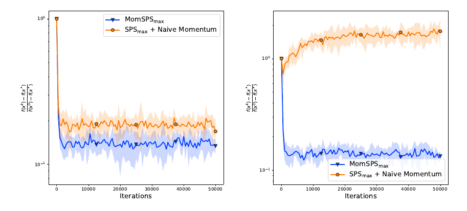
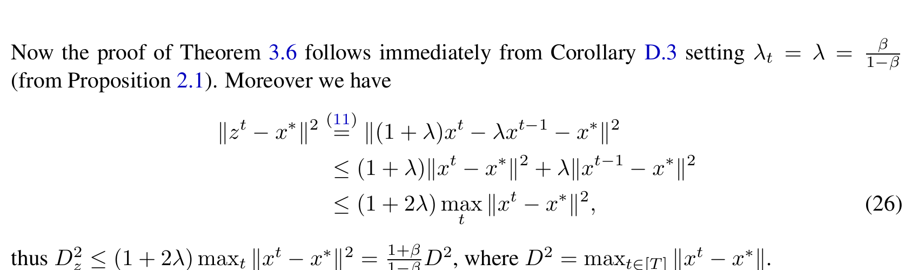
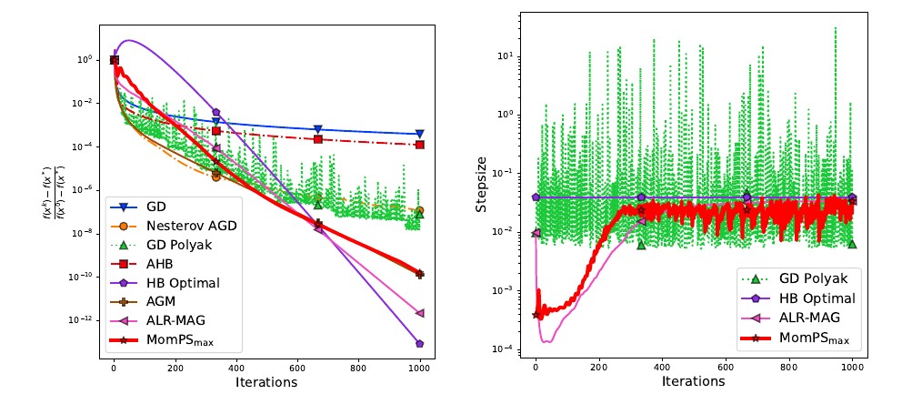
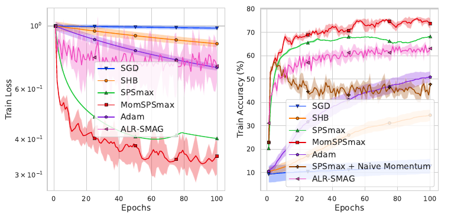
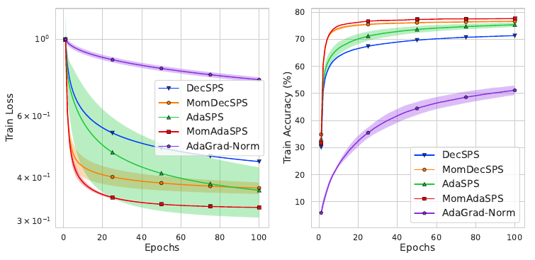
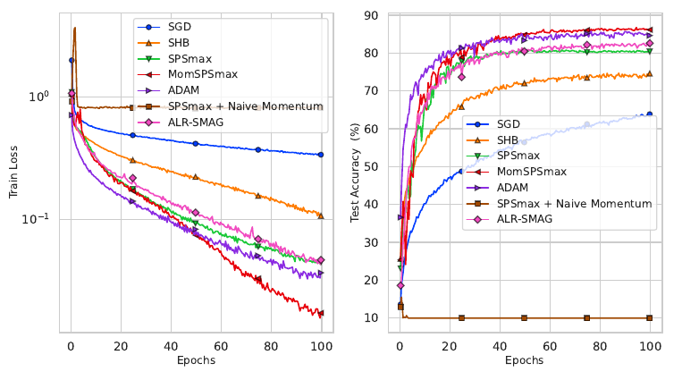
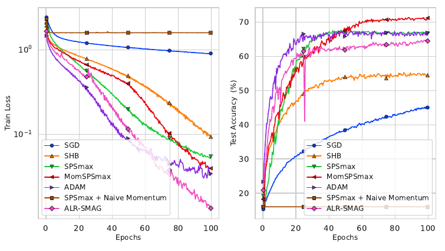

# Stochastic Polyak Step-sizes and Momentum：精读与证据审计

## 1. 核心信息与阅读结论

| 项目 | 内容 |
|---|---|
| 中文题名 | 随机 Polyak 步长与动量：收敛保证及实际表现 |
| 作者 | Dimitris Oikonomou、Nicolas Loizou，Johns Hopkins University |
| 发表 | ICLR 2025；arXiv 初稿为 2024-06-06，记录中的 v2 为 2025-03-04 |
| 本次依据 | 用户提供的会议版 PDF，40 页；正文第 1–10 页，参考文献第 11–14 页，附录第 15–40 页 |
| 类型 | 理论算法为主，配合凸优化及小规模深度学习实验 |
| 阅读目的 | 理解 SPS 如何适配动量，以及哪些内容能作为 SPS–Muon 研究的起点 |
| 本地原文 | [会议版 PDF](../../../01-raw/2026-10/Stochastic_Polyak_Step_sizes_and_Momentum_Convergence_Guarantees_and_Practical_Performance.pdf) |
| 一手资料 | [ICLR 会议记录](https://proceedings.iclr.cc/paper_files/paper/2025/hash/b6fa24257256b5068c5a7a7e04cd41f4-Abstract-Conference.html)、[arXiv](https://arxiv.org/abs/2406.04142)、[作者代码仓库](https://github.com/dimitris-oik/MomSPS) |

本文页码均指 PDF 印刷页码。arXiv 日期用于元数据识别，分析以本地 PDF 为准，没有假定两份文件逐字相同。图片均为本地 PDF 原图裁切；[图片来源清单](images/_sources.md)记录页码，完整裁切坐标与源文件哈希保存在本次阅读过程档案中。

**最强的一句话贡献：通过 heavy-ball 与 Iterate Moving Average（IMA）的等价表示，将已有三类 SPS 步长移植到位移动量，得到包含非插值情形的自适应动量分析，并揭示步长中必须出现的动量修正及其递归位置。**

先记住五点：

1. 标准 SPS 直接代入 heavy-ball，可能在简单凸问题上表现不稳定；本文不是把两个现成模块简单并列。
2. 修正来源是 IMA 的代数等价关系。核心因子是“一减动量系数”，但在三种算法中的放置位置不同。
3. MomSPSmax 一般只能保证到达最优值附近；MomDecSPS、MomAdaSPS 在额外有界迭代假设下，给出平均点的期望目标差趋零保证。
4. 本文没有证明一般意义上的动量加速。MomSPSmax 的理论常数随动量增大反而变差；实验中的加速与定理中的速率阶必须分开。
5. **附录 D.2 的式 (26) 有一个可直接检查的距离不等式问题。**它影响主文部分常数从 IMA 向 SHB 的转换。第 8 节提供原图、反例和保守替代界；这不是算法发散的反例，也不能据此断言整篇论文的渐近速率错误。

**阅读决策：对当前 SPS–动量课题属于必读。**它能直接改变算法定义、基线选择和理论目标；学术价值暂评 6.0/10，与“对你很值得读”是两个不同判断。

## 2. 原版摘要与中文翻译

### 2.1 英文原版摘要

Stochastic gradient descent with momentum, also known as Stochastic Heavy Ball method (SHB), is one of the most popular algorithms for solving large-scale stochastic optimization problems in various machine learning tasks. In practical scenarios, tuning the step-size and momentum parameters of the method is a prohibitively expensive and time-consuming process. In this work, inspired by the recent advantages of stochastic Polyak step-size in the performance of stochastic gradient descent (SGD), we propose and explore new Polyak-type variants suitable for the update rule of the SHB method. In particular, using the Iterate Moving Average (IMA) viewpoint of SHB, we propose and analyze three novel step-size selections: MomSPSmax, MomDecSPS, and MomAdaSPS. For MomSPSmax, we provide convergence guarantees for SHB to a neighborhood of the solution for convex and smooth problems (without assuming interpolation). If interpolation is also satisfied, then using MomSPSmax, SHB converges to the true solution at a fast rate matching the deterministic HB. The other two variants, MomDecSPS and MomAdaSPS, are the first adaptive step-size for SHB that guarantee convergence to the exact minimizer - without a priori knowledge of the problem parameters and without assuming interpolation. Our convergence analysis of SHB is tight and obtains the convergence guarantees of stochastic Polyak step-size for SGD as a special case. We supplement our analysis with experiments validating our theory and demonstrating the effectiveness and robustness of our algorithms.

### 2.2 中文翻译

带动量的随机梯度下降，也称随机重球法（SHB），是求解各种机器学习任务中大规模随机优化问题的常用算法之一。在实际应用中，调节该方法的步长和动量参数可能代价高昂、耗时很长。受随机 Polyak 步长近年来在随机梯度下降（SGD）中取得的优势启发，本文提出并研究适用于 SHB 更新规则的新 Polyak 型变体。具体而言，利用 SHB 的迭代移动平均（IMA）视角，我们提出并分析了三种新的步长选择：MomSPSmax、MomDecSPS 和 MomAdaSPS。对于 MomSPSmax，我们在不要求插值条件的凸光滑问题上，给出了 SHB 收敛到解的某个邻域的保证。如果还满足插值条件，采用 MomSPSmax 的 SHB 将收敛到真实解，其较快收敛率与确定性 HB 相匹配。另两种变体 MomDecSPS 和 MomAdaSPS，是首批既不需要预先知道问题参数、也不要求插值条件，便可保证 SHB 收敛到精确最小点的自适应步长。我们的 SHB 收敛分析是紧的，并将 SGD 使用随机 Polyak 步长的收敛保证包含为特殊情形。最后，通过实验验证理论，并展示算法的有效性和稳健性。

### 2.3 摘要中需要收窄理解的用语

| 作者用语 | 正文中可核对的含义 | 汇报时如何说 |
|---|---|---|
| fast rate matching deterministic HB | 一般凸光滑分析中的次线性阶；不是强凸二次问题上的加速线性率 | “插值时恢复一除以迭代数的平均目标差上界” |
| converge to exact minimizer | 主要定理控制平均迭代点的期望目标差，且递减变体要求有界迭代 | “平均点的期望目标差趋零” |
| no a priori knowledge | 步长公式无需输入光滑常数、强凸常数 | 仍有动量、比例常数、上限或初始化，以及损失下界 |
| tight | 无动量时恢复已有 SPS 结果 | 这是退化一致性；不能自动理解为所有常数或动量依赖都达到最优下界 |
| first | 作者在其相关工作范围内的定位 | 不把它当成对截至今天全部文献的独立优先权认证 |

## 3. 背景：SPS 在控制什么，为什么动量会破坏直接迁移

### 3.1 有限和目标与随机梯度

论文研究：

$$
\min_{x\in\mathbb{R}^{d}} f(x), f(x)=\frac{1}{n}\sum_{i=1}^{n} f_i(x).
$$

这里为兼容基础公式渲染，后续公式不使用特殊编号命令。每个分量损失都假设凸、光滑且有已知下界；最小点集合非空。每一步独立、均匀抽取 mini-batch，批损失和批梯度记为：

$$
f_{S_t}(x)=\frac{1}{B}\sum_{i\in S_t}f_i(x),
$$

$$
g_t=\nabla f_{S_t}(x^t).
$$

为了避免冗长，以下定义批损失与下界的差：

$$
\Delta_t=f_{S_t}(x^t)-\ell_{S_t}^{*}\ge 0.
$$

下界不是默认已经知道的最优值。非负损失可取零，但较松下界会改变实际步长和理论中的残差项；交叉熵取零也不代表有限参数处存在可达到的零损失最小点。

### 3.2 从普通 Polyak 步长理解分母

对无动量更新，展开到最小点的平方距离：

$$
\Vert x^t-\gamma g_t-x^{*}\Vert^2
=\Vert x^t-x^{*}\Vert^2
-2\gamma g_t^{\top}(x^t-x^{*})
+\gamma^2\Vert g_t\Vert^2.
$$

若该批次也以同一最小点达到其最小值，凸性将内积下界为批损失差。最小化由此得到的关于步长的二次上界，会给出“损失差除以梯度平方范数”的结构。SPSmax 再加入比例常数和上限：

$$
\gamma_t=\min\left\{\frac{\Delta_t}{c\Vert g_t\Vert^2},\gamma_b\right\}.
$$

这里的分母来自**更新方向就是当前梯度**时距离展开中的二次项；它不是可以脱离更新方向任意沿用的经验归一化。

普通随机、非插值情形下，同一个最小点一般不能同时最小化每个批损失。此时不能把全部批损失差直接当成全目标差，分析会出现后文的非插值残差。

### 3.3 SHB 的位移动量

本文分析的更新为：

$$
x^{t+1}=x^t-\gamma_t g_t+\beta(x^t-x^{t-1}),
$$

$$
0\le\beta<1, x^{-1}=x^0.
$$

动量使用上一步**实际参数位移**。如果直接把标准 SPSmax 当作这里的步长，平方距离展开中会增加位移范数及交叉项。原来为 SGD 选择的步长不再自动控制这些项。

> 原文图 1，第 4 页，合成逻辑回归。左、右动量系数分别为 0.2、0.5。曲线显示直接移植在较大动量时可能明显失稳，修正规则更稳定；这是一组失败案例证据，不是对全部问题与参数的充要稳定性刻画。

### 3.4 实现中最容易混淆的另一种动量

很多代码保存梯度缓冲，再用当期学习率乘整个缓冲：

$$
v_t=\beta v_{t-1}+g_t,
$$

$$
x^{t+1}=x^t-\gamma_t v_t.
$$

当相邻步长非零时，消去缓冲得到：

$$
x^{t+1}=x^t-\gamma_t g_t
+\beta\frac{\gamma_t}{\gamma_{t-1}}(x^t-x^{t-1}).
$$

因此，**自适应学习率下，固定系数的梯度缓冲与固定系数的 SHB 位移动量并不相同**。两者只在相邻学习率相同等特殊条件下重合。若要用梯度缓冲严格实现论文固定动量 SHB，需要相应修正缓冲系数，或者直接保存实际位移。

这点对 Muon 尤其重要：不能仅因代码里都有 momentum，就宣称本文理论已经覆盖 Muon。

## 4. 方法核心：从 IMA 推出修正因子

### 4.1 IMA 的两条更新

论文第 5 页用一个辅助序列和一个平均序列表示 SHB。对固定非负平均参数：

$$
z^{t+1}=z^t-\eta_t g_t,
$$

$$
x^{t+1}=\frac{\lambda}{1+\lambda}x^t
+\frac{1}{1+\lambda}z^{t+1}, z^0=x^0.
$$

辅助变量沿当前批梯度移动；实际参数则混合旧参数与新辅助变量。注意梯度在实际参数上计算，**不是**在辅助变量上计算，所以辅助序列不是一个可以不加检查地套用所有 SGD 定理的独立 SGD。

### 4.2 等价关系逐步推导

由上一次平均更新可反解：

$$
z^t=(1+\lambda)x^t-\lambda x^{t-1}.
$$

将它和辅助更新一起代入当前平均更新：

$$
x^{t+1}
=\frac{\lambda x^t+(1+\lambda)x^t-\lambda x^{t-1}-\eta_t g_t}{1+\lambda}.
$$

重新分组：

$$
x^{t+1}=x^t
+\frac{\lambda}{1+\lambda}(x^t-x^{t-1})
-\frac{\eta_t}{1+\lambda}g_t.
$$

与 SHB 对照就得到：

$$
\beta=\frac{\lambda}{1+\lambda},
\lambda=\frac{\beta}{1-\beta},
\gamma_t=(1-\beta)\eta_t.
$$

这就是 Proposition 2.1 在固定动量情形中的内容。**“一减动量系数”来自变量表示的精确换算，而不是通过拟合实验曲线猜出的缩小倍数。**

### 4.3 为什么比“缩小学习率”多了一步

只看 MomSPSmax，确实很像把 SPS 学习率乘上一个系数。论文的主要价值还包括：给出统一推导；处理非插值残差；将递减和累计自适应规则引入 SHB；明确哪些历史量应该按换算后的尺度递归保存。

不过，代数等价不自动等于收敛定理。后续仍要控制梯度在实际参数、距离却可能在辅助变量上的错位，并处理随机步长与随机梯度的相关性。

## 5. 三条算法：公式、作用与实现区别

三条算法都使用第 3.3 节的 SHB 参数更新，只改变步长。

### 5.1 MomSPSmax：给标准 SPS 加入动量尺度

$$
\gamma_t=(1-\beta)\min\left\{
\frac{\Delta_t}{c\Vert g_t\Vert^2},\gamma_b
\right\}.
$$

它保留当批自适应能力，不强制步长逐次递减；比例常数控制激进程度，上限限制过大步长。理论的主要版本固定比例常数为 1，并对动量和上限的组合加约束。

例如损失差为 2，梯度平方范数为 4，比例常数为 1，上限为 1，动量为 0.9，那么标准 SPSmax 步长是 0.5，MomSPSmax 为 0.05。这个例子只是显示尺度换算，不是推荐统一使用该数值。

**优点：**公式简单，所需损失和梯度通常已在训练中可得。**边界：**一般非插值时仍有理论残差邻域；更高动量也不是无条件稳定。

### 5.2 MomDecSPS：显式递减，逐渐消除非插值残差

定义递增控制序列：

$$
c_t=c\sqrt{t+1}, c_{-1}=c_0=c.
$$

论文第 6 页和 Algorithm 2 给出的步长是：

$$
\gamma_t=\min\left\{
\frac{(1-\beta)\Delta_t}{c_t\Vert g_t\Vert^2},
\frac{c_{t-1}\gamma_{t-1}}{c_t}
\right\}, \gamma_{-1}=\gamma_b.
$$

第一项是按时间衰减的当批建议值；第二项限制递推步长，避免损失或梯度波动让步长突然重新变大。它不需要在算法输入中提供光滑常数。

这里照录论文 Algorithm 2 的初始化约定。其第 19 页关于初始步长等于 MomSPSmax 的解释有上限尺度不一致，详见第 8.4 节；复现时应明确采用哪个初始化，不能把两个约定混用。

### 5.3 MomAdaSPS：根据累计损失差自适应衰减

定义累计量：

$$
A_t=\sum_{s=0}^{t}\Delta_s.
$$

步长为：

$$
\gamma_t=\min\left\{
\frac{(1-\beta)\Delta_t}{c\Vert g_t\Vert^2\sqrt{A_t}},
\gamma_{t-1}
\right\}, \gamma_{-1}=+\infty.
$$

累计量承担自适应衰减作用。当非插值使损失差持续累计时，它能持续压低步长；插值情形下则有机会保留较快理论阶。上一轮步长上限保证单调不增。

它需要保存累计标量和上一轮步长，不需要预先指定固定步长上限。比例常数仍然存在，累计损失的数值尺度也会影响其合理取值，不能称为彻底无超参数。

### 5.4 修正因子为什么不能统一移到最外面

MomSPSmax 的上限是一个固定外部参数，因此修正因子乘整个最小值。MomDecSPS 和 MomAdaSPS 中的历史步长，已经是**经过修正后**的 SHB 步长。换算下一轮时，历史项中的修正因子会抵消。

以 MomAdaSPS 为例。令 IMA 的当批候选值为：

$$
r_t=\frac{\Delta_t}{c\Vert g_t\Vert^2\sqrt{A_t}}.
$$

则：

$$
\gamma_t=(1-\beta)\min\left\{r_t,\eta_{t-1}\right\}
=\min\left\{(1-\beta)r_t,\gamma_{t-1}\right\}.
$$

若误写成修正因子再乘已经修正过的历史最小值，那么历史约束连续起作用时，就会额外逐步乘一个小于 1 的常数。动量为 0.9 时，相当于每步多缩小十倍，容易迅速停滞。原文 Remark 2.3、附录 C.3 和 F.3 专门讨论这件事。

### 5.5 三者的取舍

| 方法 | 步长记忆 | 主要理论目标 | 仍需提供或选择 | 适合先验证什么 |
|---|---|---|---|---|
| MomSPSmax | 无强制单调历史约束 | 一般非插值到邻域；插值时目标差趋零 | 动量、比例常数、上限、损失下界 | 动量修正本身是否改善稳定性 |
| MomDecSPS | 上一轮步长、时间控制序列 | 非插值下平均点精确目标值收敛 | 动量、控制常数、初始上限、下界 | 残差平台能否被递减机制消除 |
| MomAdaSPS | 上一轮步长、累计损失差 | 在插值与非插值之间自适应切换速率阶 | 动量、比例常数、下界 | 累计统计能否适应不同残差情形 |

“无光滑常数输入”是共同优点；“任何任务无需调参”并不是本文已经建立的事实。

## 6. 先理解假设，再读收敛率

### 6.1 平滑、凸性和损失下界各自负责什么

凸性把梯度内积与函数值差联系起来；光滑性使损失差能够控制梯度范数，从而给 SPS 建立上下界；损失下界确保步长分子非负。三者共同构成本文的分析环境，不能只保留“损失非负”就将理论套到神经网络。

记最大分量光滑常数为：

$$
L_{\max}=\max_i L_i.
$$

算法不必知道它，但定理的常数和允许的参数区域仍然依赖它。**不知道这个常数也能执行算法，不等于不知道这个常数也能事先验证所有理论条件。**

### 6.2 非插值量不是通常的梯度噪声方差

Assumption 3.1 定义：

$$
\sigma^2=\mathbb{E}_{S_t}\left[f_{S_t}(x^{*})-\ell_{S_t}^{*}\right]
=f(x^{*})-\mathbb{E}_{S_t}[\ell_{S_t}^{*}]<\infty.
$$

它度量全局最优点上仍然存在的批损失与选定下界之差。通常的梯度噪声方差则涉及随机梯度减全梯度的平方范数，两者不是一个量，不能直接进行数字比较。

如果下界选得偏低，即使各分量存在共同最小点，上式也可能大于零。因此这里的“插值”必须结合所用下界理解；不能只看训练数据是否可拟合。

当这个非负量等于零时，几乎所有可能批次在共同最小点都达到其下界，这是本文用到的插值含义。无需额外要求不同批次的最小损失数值彼此相等。

### 6.3 有界迭代是额外实质假设

递减方法的分析引入：

$$
D^2=\max_{0\le t<T}\Vert x^t-x^{*}\Vert^2.
$$

如果要把上界理解为随迭代次数趋于无穷时的统一收敛率，就需要这个半径能被一个不随时域增长的常数控制，随机情形还需相应统一或可积控制。仅仅说“每个有限时域里计算出的最大距离有限”，不足以证明渐近收敛。

附录 E 给出投影 IMA 的讨论，可在紧凸集合上控制辅助变量；但作者明确说明它与直接投影 SHB 不等价。不能把未实现的投影版本当作原始无约束实现已经自动满足有界假设的证明。

### 6.4 平均点、最后一步和参数收敛

主定理使用：

$$
\bar{x}^{T}=\frac{1}{T}\sum_{t=0}^{T-1}x^t.
$$

目标差趋零不等于最后一步的目标差必然趋零，更不自动等于参数序列逐点、几乎必然地收敛到某个唯一最小点。论文实验画的是训练过程中的损失、准确率曲线，也不能直接当作平均点定理的数值验证。

## 7. 三个主定理：结论与实际边界

### 7.1 Theorem 3.2：MomSPSmax 的邻域保证

在每个分量凸且光滑、比例常数为 1 的条件下，定义：

$$
\alpha=\min\left\{\frac{1}{2L_{\max}},\gamma_b\right\},
$$

$$
0\le\beta<\frac{\alpha}{2\gamma_b-\alpha}.
$$

结论是：

$$
\mathbb{E}\left[f(\bar{x}^{T})-f(x^{*})\right]
\le\frac{C_1\Vert x^0-x^{*}\Vert^2}{T}+C_2\sigma^2,
$$

$$
C_1=\frac{1-\beta}{\alpha\beta+\alpha-2\beta\gamma_b},
$$

$$
C_2=\frac{2\gamma_b-\alpha\beta-\alpha}{\alpha\beta+\alpha-2\beta\gamma_b}.
$$

第一项随迭代衰减，第二项是证明允许的残差上界。它是上界，不是说算法必然恰好停在该高度，也不是一个已经证明无法改善的下界。

**四个解读重点：**

1. 插值使残差项消失，得到一除以迭代数的阶；不是线性收敛或一般加速保证。
2. 固定上限越大，定理允许的动量可能越小。动量非零时不能在这个定理里随意去掉上限。
3. 原文也指出两个常数随允许范围内的动量增大而变差。这份最坏情形分析没有解释实验中动量的全部好处。
4. 动量为零时退化成已有 SPS 分析，是一致性检查；这不足以证明所有常数都最优。

一个具体参数例子：若最大光滑常数为 1、上限为 1，则这里的中间常数为 0.5，动量必须小于三分之一；常用的 0.9 不在这个理论区域。若把上限降到 0.5，则允许任意小于 1 的动量，但由于 SPS 候选值本身有下界，上限可能一直起作用，方法退化为保守常步长。不能把“允许更大动量”和“仍保留充分自适应”无条件同时宣称。

Corollary 3.5 进一步给出常步长情形：

$$
\gamma\le\frac{1-\beta}{2L_{\max}},
$$

$$
\mathbb{E}\left[f(\bar{x}^{T})-f(x^{*})\right]
\le\frac{\Vert x^0-x^{*}\Vert^2}{T\gamma}+\sigma^2.
$$

这里的残差界不显式随步长缩小，不应与基于梯度方差的另一种 SHB 噪声界混为同一个结论。

### 7.2 Theorem 3.6：MomDecSPS 的非插值目标值收敛

在凸、光滑、比例常数为 1、额外有界迭代条件下，原文对任意固定小于 1 的非负动量给出：

$$
\mathbb{E}\left[f(\bar{x}^{T})-f(x^{*})\right]
\le\frac{2\beta[f(x^0)-f(x^{*})]}{(1-\beta)T}
+\frac{(1+\beta)D^2}{(1-\beta)\alpha\sqrt{T}}
+\frac{2\sigma^2}{\sqrt{T}}.
$$

原文把中间常数写成下式：

$$
\alpha=\min\left\{\frac{1}{2L_{\max}},\gamma_b\right\}.
$$

**以上是原文结论的准确记录，不是对其所有常数的背书。**第 8 节的距离转换和初始化尺度问题需要进一步核验。

其方法性贡献是：通过递减机制消除一般非插值的固定残差平台，且算法无需输入光滑常数。它不必像 MomSPSmax 那样使用依赖上限的动量范围，但动量接近 1 时常数仍会恶化。

### 7.3 Theorem 3.7：MomAdaSPS 的自适应两种速率

在相同的凸光滑及有界迭代框架下，原文给出：

$$
\mathbb{E}\left[f(\bar{x}^{T})-f(x^{*})\right]
\le\frac{\tau^2}{T}+\frac{\tau\sigma}{\sqrt{T}},
$$

$$
\tau=\frac{\beta\sqrt{f(x^0)-f(x^{*})}}{1-\beta}
+\frac{(1+\beta)cLD^2}{2(1-\beta)}+\frac{1}{2c}.
$$

这里沿用原文的光滑常数记号；严格使用时应与统一控制分量光滑性的常数核对。中间常数依赖未知最优值和光滑性不妨碍执行算法，因为它们出现在分析而非步长输入中。

当非插值量为零时，第二项消失；非插值量非零时，平方根衰减项在渐近占主导。所谓 robust，指在这两个理论区域间适应，不是对分布偏移、对抗样本或所有超参数均稳健。

主文这一页的半径定义漏了平方，与前文统一半径定义不一致；本笔记统一采用平方半径。其动量相关常数还复用了第 8 节指出的距离转换，应视为待核验。

### 7.4 汇报时可用的总表

| 方法 | 非插值时作者报告的阶 | 插值时作者报告的阶 | 额外关键条件 | 结论对象 |
|---|---|---|---|---|
| MomSPSmax | 一除以迭代数，加固定残差项 | 一除以迭代数 | 比例常数为 1；动量与上限存在联合约束 | 平均点期望目标差 |
| MomDecSPS | 一除以迭代数平方根 | 此定理仍为平方根阶 | 有界迭代；比例常数为 1；初始化约定需核对 | 平均点期望目标差 |
| MomAdaSPS | 一除以迭代数平方根 | 一除以迭代数 | 有界迭代；累计损失统计；部分常数需复核 | 平均点期望目标差 |

共同边界：不覆盖一般非凸目标的驻点收敛，不给 Muon 正交化更新的保证，也不建立普遍的强凸加速率。

## 8. 证明怎么读，以及需要复核的地方

### 8.1 主证明的共同骨架

附录 C 先收集步长上下界、累计和不等式和 IMA 身份关系，附录 D 分三类证明。阅读时按以下链条追踪即可，不需要一开始就逐行背诵全部代数。

**第一步：展开辅助变量到最小点的距离。**

$$
\Vert z^{t+1}-x^{*}\Vert^2
=\Vert z^t-x^{*}\Vert^2
-2\eta_t g_t^{\top}(z^t-x^{*})
+\eta_t^2\Vert g_t\Vert^2.
$$

**第二步：利用 IMA 的身份关系拆开内积。**

$$
z^t-x^{*}=x^t-x^{*}+\lambda(x^t-x^{t-1}).
$$

因此会出现两类量：到最小点的当前函数差，以及相邻迭代点的函数差。后者通过求和产生望远镜抵消，是处理位移动量的核心。

**第三步：用 SPS 规则消去危险的梯度平方项。**

例如 IMA 中比例常数为 1 的 SPSmax 满足：

$$
\eta_t^2\Vert g_t\Vert^2\le\eta_t\Delta_t.
$$

**第四步：分离当前全局目标差与不可消除的非插值项。**

$$
\Delta_t=
f_{S_t}(x^t)-f_{S_t}(x^{*})
+f_{S_t}(x^{*})-\ell_{S_t}^{*}.
$$

采样独立性使适当条件期望后的第一部分变成全目标差，第二部分贡献非插值量。由于步长依赖同一批损失和梯度，不能把它直接提到期望之外；论文用上下界或先除以步长等操作绕开相关性。

**第五步：求和、用初值控制剩余项，再对平均点使用凸性。**最终不是直接得到每一步都下降，而是得到累计期望目标差上界。

### 8.2 三类证明各自最关键的额外操作

| 证明 | 最关键的控制 | 为什么会得到对应结论 |
|---|---|---|
| 附录 D.1，MomSPSmax | 固定上下界控制自适应步长与动量交叉项；要求目标差前的系数为正 | 产生对动量与上限的联合约束；非插值项累计后除以迭代数留下常数 |
| 附录 D.2，MomDecSPS | 先除以步长；利用步长单调性，对带倒数步长的距离求和 | 非插值项受到递减权重控制；平方根时间序列得到平方根阶 |
| 附录 D.3，MomAdaSPS | 使用非负累计和的平方根不等式，再解自洽的误差上界 | 同时产生一除以迭代数与非插值平方根项 |

特别注意 D.2 的式 (18)–(25)：先控制辅助变量半径，最后才转回实际参数半径。这个最后的转换正是下面需要复核的位置。

### 8.3 实质疑点：附录 D.2 式 (26) 的距离界

> 原文第 30 页。第一行是 IMA 的正确身份关系；随后第一条不等式不能作为一般向量范数不等式使用。此处已对照 PDF 图像，排除了纯文本抽取漏符号的可能。

原文使用的关键一步相当于：

$$
\Vert(1+\lambda)a-\lambda b\Vert^2
\le(1+\lambda)\Vert a\Vert^2+\lambda\Vert b\Vert^2.
$$

对任意向量并不成立。用一维数值即可核对：

$$
\lambda=1, a=1, b=-1.
$$

此时左侧为：

$$
\Vert 2\cdot1-1\cdot(-1)\Vert^2=9.
$$

右侧为：

$$
2\cdot1^2+1\cdot(-1)^2=3.
$$

这不是凸组合：其中有负系数，不能直接使用平方范数的凸性。它对应的精确展开是：

$$
\Vert(1+\lambda)a-\lambda b\Vert^2
=(1+\lambda)\Vert a\Vert^2-\lambda\Vert b\Vert^2
+\lambda(1+\lambda)\Vert a-b\Vert^2.
$$

若已知两个实际参数的距离都不超过同一个半径，三角不等式给出的无条件保守界为：

$$
\Vert z^t-x^{*}\Vert
\le(1+\lambda)\Vert x^t-x^{*}\Vert
+\lambda\Vert x^{t-1}-x^{*}\Vert
\le(1+2\lambda)D.
$$

从而：

$$
D_z^2\le(1+2\lambda)^2D^2
=\left(\frac{1+\beta}{1-\beta}\right)^2D^2.
$$

原文使用的是没有外层平方的系数：

$$
D_z^2\le\frac{1+\beta}{1-\beta}D^2.
$$

动量为 0.9 时，两个系数分别是 361 和 19，区别不能当作无关紧要的排版误差。Theorem 3.6 的半径项，以及 Theorem 3.7 在证明末尾复用的转换，都应复核。

**这个审计能说明什么：**按原文所展示的理由，该不等式缺少支撑；如果没有额外轨迹性质，主文相应动量常数无法从此处推出。

**它不能说明什么：**上面的任意向量反例不是一个已构造出的合法算法轨迹，不证明算法发散，也不证明所有可能的更精细分析都无法得到较好常数。若作者能证明轨迹另有特定约束，仍可能修补。

**可行的保守方向：**保留附录中以辅助变量半径表述的结论，在统一有界假设下使用带平方的系数进行转换。对于固定小于 1 的动量，增大的仍是与迭代次数无关的常数，因此这一步本身通常不改变渐近速率阶。这里没有宣称已完成整个定理的严格修复，初始化尺度和其他证明环节仍需一并核对。

组会建议用一句话表述：“我核对到距离转换这一步的一般不等式不成立，主要常数需要澄清；目前没有据此否定算法或其渐近阶。”

### 8.4 初始化上限的尺度不一致

第 19 页 Algorithm 2 规定上一步初始步长等于上限，并写初始步长等于 MomSPSmax。但给出的两个式子分别是：

$$
\min\left\{(1-\beta)r,\gamma_b\right\}
$$

和：

$$
(1-\beta)\min\left\{r,\gamma_b\right\}.
$$

它们一般不相等。例如动量 0.9、候选值 100、上限 1 时，前者为 1，后者为 0.1。

最自然的解释是 IMA 步长上限与 SHB 步长上限使用了相同记号，却没有在初始化处统一换算。若 IMA 初始化为某个上限，则对应 SHB 初始化应按等价关系乘修正因子。复现应分别命名这两个上限，记录最终选用的约定，而不是仅依靠“首步相同”的文字说明。

这个问题可能通过重新定义上限解决；不必上升为算法原理错误。但它会影响首次实际更新、步长下界以及对定理常数的逐项对应。

### 8.5 其他文字和排版问题

- Theorem 3.7 以及第 30 页末尾的平方半径定义少了平方，应与第 8 页正文一致核对。
- Lemma C.4 把递减步长的单调不等式写反；正文公式和证明按递减步长使用。这更像排版错误。
- 深度学习参数表把架构写为 ResNet 10/34，但正文和图注使用 ResNet18/34；复现时应以实际模型代码为准。
- 凸实验段落明确说没有标准测试划分、只画训练准确率，随后部分结果描述却称 test accuracy。应按图轴与协议读取为训练准确率。

这些问题与式 (26) 的逻辑缺口重要程度不同。本笔记不会把所有排版瑕疵都当作核心算法错误，也不把尚未完成的逐行形式化证明核验写成“全部证明正确”。

## 9. 实验：逐组看它真正检验了什么

### 9.1 实验总览

| 实验组 | 数据或任务 | 主要比较 | 指标与协议 | 可支持的判断 |
|---|---|---|---|---|
| 直接移植失败案例 | 合成逻辑回归 | MomSPSmax 与 SPSmax 加位移动量 | 相对目标差；不同动量 | 修正因子确实可能影响稳定性 |
| 确定性凸优化 | 最小二乘，样本数和维度均 1000，矩阵条件数一万 | GD、Nesterov AGD、Polyak GD、AHB、最优 HB、AGM、ALR-MAG、MomPSmax | 相对目标差、实际步长 | 特定条件良好的设置中有可竞争的下降表现 |
| 随机凸优化 | LIBSVM 多分类逻辑回归 | 非强制递减组与递减组分别比较 | 100 epochs，5 次试验，均值和标准差，训练损失与训练准确率 | 动量版本在所示数据上改善无动量对应方法 |
| 非凸深度学习 | CIFAR10/100，ResNet34；附录 ResNet18 | SGD、SHB、SPSmax、朴素 SPS 动量、Adam、ALR-SMAG、MomSPSmax | 100 epochs，5 次试验；训练损失、测试准确率 | 超出凸理论范围后，MomSPSmax 仍有实用的经验表现 |

没有公开的数值结果表可直接据此填写精确提升百分比。下面保留曲线并做定性比较，不把读图估计冒充精确测量。

### 9.2 确定性最小二乘：效果好，但用了哪些额外信息

> 原文图 2，第 9 页。左侧是相对误差，右侧是步长。MomPSmax 与部分已有自适应动量方法在这组问题上表现接近，显著改善普通 Polyak GD 的后期下降。

实验有三个应主动报告的条件：

1. MomPSmax 和 ALR-MAG 使用针对该二次问题的最优动量，需要光滑性、强凸性相关信息；不能用这幅图证明“动量不需调节”。
2. Polyak 系列使用预先通过 GD 算出的最优目标值。对一般随机学习任务，这种信息未必可得。
3. MomPSmax 上限选为 100；附录 F.4 才比较其他上限和去上限的替代形式。

因此这幅图更适合说明“在控制条件下有竞争力”，不适合证明无先验、无调参和普遍加速。理论保证的一除以迭代数也没有直接解释图中的快速线性状下降。

### 9.3 随机凸问题：两个分组不能混着读

非强制递减组主要比较 SGD、固定步长 SHB、Adam、SPSmax、直接加入位移动量的 SPSmax、ALR-SMAG 和 MomSPSmax。论文使用零下界、比例常数 1，相关动量方法取动量 0.9。

> 原文图 3，第 10 页，vowel，batch size 为 52。左图是训练损失，右图是训练准确率；不能称为泛化性能。修正后的动量版本在该组曲线中优于无动量 SPSmax 和直接移植版本。

递减组则比较 AdaGrad-Norm、DecSPS、AdaSPS、MomDecSPS 和 MomAdaSPS。

> 原文图 4，第 10 页，letter，batch size 为 1500。动量递减版本相对无动量对应方法下降更快。有限训练轮数上的训练曲线无法单独证明渐近精确目标值收敛。

附录第 39 页还报告 vehicle、letter、glass 等更多批大小和数据组合。该组实验使用 1 张 RTX 3050、100 epochs、5 次试验、零权重衰减。

**协议边界：**作者明确只报告训练损失和训练准确率；这是优化实验，并非采用了错误的划分，但它不能承担测试泛化的论证任务。5 次重复与误差带提供了一定不确定性信息，仍不等于每个差异都有显著性检验。

### 9.4 平滑上限让实用算法与固定上限定理产生区别

第 10 页引入平滑机制，根据上一轮实际步长生成本轮上限。为避免与 MomAdaSPS 定理中的常数重名，这里把增长参数另记为 rho：

$$
\gamma_b^t=\rho^{B/n}\gamma_{t-1}, \rho=2.
$$

它让允许的步长随训练进展缓慢恢复，限制逐步剧烈波动。这个“平滑”是**步长上限的平滑**，与 Muon 中对奇异值变换做谱软化是两回事。

固定上限的理论不自动覆盖这个随历史变化的实现。必须说明：实验用了更实用的规则，主定理分析了相对简洁的固定上限版本。二者相关，但不能直接逐项等同。

同时，含有修正因子的历史步长是否被再次缩放，需要检查实际代码的变量定义。仅看相似公式不能判断是否等价；本次未完成逐行代码审计，不替代码补出已验证的实现结论。

### 9.5 深度学习：有竞争力，但没有全面压过 Adam

> 原文图 5，第 10 页。左侧训练损失、右侧测试准确率。MomSPSmax 优于无动量 SPSmax，且测试表现与若干强基线接近；图中各方法的训练损失排序和测试准确率排序并不完全相同。

> 原文图 6，第 10 页。MomSPSmax 的末期测试准确率高于 Adam；训练损失方面 ALR-SMAG 更低，Adam 也与 MomSPSmax 接近并有不同排序。不同指标没有统一赢家，不能将论文结论说成“所有数据、所有指标都优于 Adam”。

正文用 MomSPSmax 的比例常数 0.4，超出 Theorem 3.2 的比例常数 1 条件，也超出凸目标假设。附录参数表给出 batch size 256、100 epochs、5 次试验、零权重衰减、1 张 RTX 6000 Ada；ALR-SMAG 的深度学习比例常数另设为 0.1。ResNet18 的额外结果位于第 40 页图 19、20。

**这些结果足以说明：**算法值得在常规神经网络训练中进一步验证，且相较无动量版本有稳定改进迹象。

**这些结果不足以说明：**当前大模型预训练、Transformer、不同 token 预算下仍胜出；相同调参成本下优于所有强基线；有更好的 wall-clock 效率；或者可直接替代 Muon。

### 9.6 消融与失败案例的证据强弱

| 消融或补充 | 位置 | 它排查了什么 | 尚未排除什么 |
|---|---|---|---|
| 直接加入动量对照 | 图 1、附录 F.2 图 9 | 不能无条件沿用 SGD 的 SPS 尺度 | 在充分搜索学习率与动量后，差距是否仍同样大 |
| 修正因子移到最外侧 | 附录 F.3，图 10、11 | 历史步长被重复缩小时会严重影响表现 | 更一般、重新参数化后的全部替代规则 |
| 上限取值及无上限替代 | 附录 F.4，图 12、13 | 上限影响明显；部分替代设置也可能表现较好 | 最优上限是否能跨任务复用；所有去上限方法是否稳定 |
| 理论常数随动量变化 | 附录 F.5，图 14 | 上界随动量增大恶化 | 实际轨迹中动量加速的机制 |
| 多种 LIBSVM 数据和 ResNet18 | 附录 F.6、F.7 | 结果不是只来自一个凸数据集或一个网络 | 大模型、现代训练配方、权重衰减与分布式训练 |

其中修正因子消融与方法推导联系最紧，适合组会重点讲。缺少大模型实验不是对这篇凸优化理论工作的自动否定，但它限制了对 Muon 应用价值的直接外推。

## 10. 技术路线与最接近的三篇工作

本文属于“利用损失信息构造自适应随机步长”的路线。其新增部分是将已有三类 SPS 规则迁移到 SHB 位移动量，并为相应条件给出分析；没有提出新的神经网络结构、梯度预条件矩阵或奇异值映射。

| 一手相关工作 | 共同问题 | 最接近的已有贡献 | 本文的净增量与比较边界 |
|---|---|---|---|
| Loizou 等，AISTATS 2021，**Stochastic Polyak Step-size for SGD: An Adaptive Learning Rate for Fast Convergence** | 用批损失和梯度自动选步长 | 建立 SPS/SPSmax 的 SGD 分析及实际效果 | 本文处理位移动量；无动量时退化回该路线。2021 原式使用批最优值，下界推广要结合后续工作理解 |
| Orvieto、Lacoste-Julien、Loizou，NeurIPS 2022，**Dynamics of SGD with Stochastic Polyak Stepsizes: Truly Adaptive Variants and Convergence to Exact Solution** | 非插值下固定 SPS 残差及相关性偏差 | DecSPS 通过合适递减设计获得精确目标值收敛，讨论可用下界 | 本文的 MomDecSPS 将此递减机制带到固定 SHB 动量；同样不能忽略有界迭代等条件 |
| Jiang、Stich，NeurIPS 2023，**Adaptive SGD with Polyak stepsize and Line-search: Robust Convergence and Variance Reduction** | 在插值与非插值之间适应 | AdaSPS/AdaSLS 等规则；累计统计产生不同区域的自适应速率；另有方差缩减部分 | 本文的 MomAdaSPS 沿用 AdaSPS 累计思想并处理位移动量；本文并未因此自动拥有相关论文的全部方差缩减结果 |

对应原始资料：[SPS 2021](https://proceedings.mlr.press/v130/loizou21a.html)、[DecSPS 2022](https://arxiv.org/abs/2205.04583)、[AdaSPS 2023](https://arxiv.org/abs/2308.06058)。以上用于近邻定位，不把摘要外未复核的全部证明细节当作已经完成的逐行审计。

还应知道一条旁线：本文第 2.2 节与附录 A 比较了 ALR-MAG/ALR-SMAG 及其他自适应动量工作。核心区别是位移动量和梯度平均动量在自适应步长下不等价。若要进一步主张“首个 SPS 加动量”，必须补查这条旁线；本文更准确的主张范围是其所讨论条件下的 **SHB 自适应步长与收敛分析**。

**为组会安排的阅读顺序：**先读 SPS 2021 的基本公式及其假设，再读本文第 2 节的 IMA 和三个变体；最后按需要补 DecSPS 与 AdaSPS 的非插值动机。不要先把全部附录从第一页读到最后一页才建立问题图景。

## 11. 主张—证据—限制矩阵

| 主张 | 最直接证据 | 限制或竞争性解释 | 本次判断与置信度 |
|---|---|---|---|
| 普通 SPS 不能直接无条件接入 SHB | 第 2.2 节，图 1；附录更多动量设置 | 是失败实例，不是全部参数的必要条件证明 | 成立，高 |
| 修正因子来自 IMA 等价换算 | Proposition 2.1、Corollary 2.2；第 4 节代数复核 | 只针对相应 SHB/IMA 定义；不覆盖任意 momentum 实现 | 成立，高 |
| 三种规则恢复无动量 SPS 家族 | Remark 2.4 及三条公式 | 恢复旧结果不代表全部参数依赖最优 | 算法退化一致性成立，高 |
| MomSPSmax 在非插值下有邻域保证 | Theorem 3.2 与附录 D.1 | 凸光滑、比例常数和动量上限约束；不说明残差界不可改善 | 条件性支持，中高 |
| 递减变体在非插值下达到精确目标值 | Theorem 3.6/3.7，附录 D.2/D.3 | 有界迭代；平均点；式 (26) 与上限初始化需复核 | 思路及以辅助半径表述的分析有支持，主文精确常数保留意见，中 |
| 动量提升实际表现 | 图 2–6、附录 F，多次重复 | 理论不证明一般加速；调参预算及部分初始化信息影响解释 | 所示任务支持，普遍外推不支持，中高 |
| 完全无需调参 | 摘要与方法段落的较强措辞 | 动量、比例常数、上限、下界仍需选择；实验使用不同常数 | 不宜照搬该强表述，高 |
| 可直接迁移到 Muon | 本文没有相关定理或实验 | 正交化方向和实际更新几何均改变 | 尚未证实，高 |

## 12. 如何用于你关心的 SPS–Muon

### 12.1 可以直接借鉴的三件事

1. **先写清楚更新，后设计步长。**损失差、梯度平方范数、动量缓冲和实际方向不是可以任意交换的量。
2. **分别处理即时规则和历史递归规则。**当已有历史变量被重新缩放时，不能每次更新都重复乘修正因子。
3. **把稳定性、非插值残差和速度分开验证。**修正因子可能解决尺度失配，但不必然解决零下界偏松、噪声残差或非下降方向。

### 12.2 为什么不能把本文修正因子直接抄进 Muon

用简化 Muon 表示：

$$
B_t=\beta B_{t-1}+G_t,
$$

$$
O_t=\mathcal{P}(B_t),
$$

$$
\theta_{t+1}=\theta_t-\eta_t O_t.
$$

其中中间映射代表极分解方向或其 Newton–Schulz 近似。实际实现还可能包含 Nesterov 混合、形状缩放、权重衰减等，实验前需先固定版本。

这个更新一般不能重写成本文的“当前梯度项加上一步参数位移”。正交化改变了方向的谱结构，梯度缓冲也不再等于可线性消去的参数位移。

对理想极分解方向，任意正常数缩放不会改变方向：

$$
\mathcal{P}(aB)=\mathcal{P}(B), a>0.
$$

因此，把某个统一正常数乘到整个缓冲，再期待它像本文一样缩小最终参数更新，通常没有效果。常见 Newton–Schulz 实现也会先归一化输入；具体数值误差、零矩阵和截断细节另论。**方向里的缩放可能被归一化消掉，而步长里的缩放会改变实际更新，两者不能混为一谈。**

### 12.3 应当重新从实际方向展开，而非照抄梯度分母

如果暂时把实际方向视为已确定，参数更新的距离展开为：

$$
\Vert\theta_t-\eta_t O_t-\theta^{*}\Vert^2
=\Vert\theta_t-\theta^{*}\Vert^2
-2\eta_t O_t^{\top}(\theta_t-\theta^{*})
+\eta_t^2\Vert O_t\Vert^2.
$$

这里为便于书写将全部参数和方向展平；矩阵情形对应 Frobenius 内积与范数。凸性能够控制的是梯度与误差的内积，不能自动替换为正交化方向与误差的内积。因此，哪怕把分母换成实际方向平方范数，也还没有补齐 SPS 证明。

另一方面，沿负方向的一阶损失变化为：

$$
f(\theta_t-\eta O_t)
\approx f(\theta_t)-\eta G_t^{\top}O_t.
$$

这说明梯度与实际方向的内积值得记录：内积为正才有局部一阶下降趋势。它可以成为设计和诊断的起点，**不是已经由本文证明的 Muon–SPS 步长**。负对齐时单纯增大或裁剪学习率不能建立下降保证。

若同时更新多层，应先决定设计的是全模型公共步长还是逐层步长。前者涉及所有实际更新块的内积和范数之和，后者不能把同一个全局损失差机械重复分配给每一层而不说明理由。

### 12.4 与前面讨论的谱软化是什么关系

谱软化改变中间映射如何处理奇异值，主要作用于方向；SPS 使用损失信息选择标量步长。二者可以在同一个算法中组合，但“做了谱软化”本身不属于 SPS。

同理，本文第 9.4 节的上限平滑与谱软化没有直接对应关系。这篇论文也没有评估 SMuon；任何关于 SMuon 好坏的结论都需要单独查它的确切定义、论文和实验，不能从本文推出。

### 12.5 最值得从本文带走的研究问题

真正有价值的问题是：**在明确实际 Muon 方向及其几何性质之后，能否构造既控制下降又适应非插值残差的损失驱动步长，并获得比充分调参的固定或调度学习率更好的结果？**

这比“给 Muon 学习率乘一个固定系数”更接近本文的研究逻辑。本文提供了提问方式和若干递归设计经验，尚未给出这个问题的答案。

## 13. 优势、问题严重度与适用范围

### 13.1 有价值的部分

- **问题界定具体。**不是泛泛提出一个新优化器，而是指出已有 SPS 与 SHB 的不匹配，并用失败案例引出方法。
- **推导可复用。**IMA 等价关系和历史步长换算可以指导其他自适应动量规则的实现检查。
- **非插值分析有实际意义。**没有只在所有批次共享最小点的理想情形下停留。
- **理论与实际行为保持了部分诚实距离。**作者明确承认常数未显示动量优势，并将深度学习标为超出凸理论范围的实验。
- **实验含对应的无动量版本和错误放置因子的对照。**这些对照比只和单一固定学习率 SGD 比较更能解释设计。

### 13.2 可能影响定理表述的实质问题

当前最重要的是第 8.3 节的距离转换。它直接参与主要定理常数，不能仅按拼写问题略过。初始化上限尺度也应与等价推导统一。

这些问题足以使本次阅读对“主文全部常数已严格成立”保留意见；当前证据不足以断言整套算法、以辅助半径表述的分析或者所有渐近阶都错误。没有发现经过构造和运行的算法发散反例，因此不标注为已经证实的整篇致命错误。

### 13.3 非致命但重要的限制

- 有界迭代没有在一般无约束问题上自动保证；投影补充改变算法。
- 自适应步长不消除所有超参数，理论允许区域与常用实践可能不同。
- 对松下界、损失尺度、模型分组和正则化的系统敏感性仍值得补充。
- 没有一般动量加速证明，也没有神经网络非凸驻点理论。
- 主要经验结果以 epoch 为横轴，未证明端到端时间效率、分布式同步成本或搜索预算优势。
- 公开代码增加了可复现性，但本次只核对到仓库与 README，未运行训练，也未完成源代码与论文算法逐行比对。

### 13.4 适合与不适合的用途

适合：随机凸优化、自适应步长与位移动量的理论讨论；复现基础算法；组会分析“看起来只差一个系数”的方法背后有哪些假设；作为 SPS–Muon 课题的基线与反例提醒。

不适合直接承担的结论：现代大模型最佳优化器推荐；Muon 或 SMuon 的有效性证明；完全无调参训练；任意非凸损失的精确全局最优收敛。

## 14. 最小复现与可证伪研究计划

本次完成的是文献精读与代数检查，**没有运行作者优化器、重训图中网络或复现实验曲线**。下面是后续验证计划，不是已完成结果。

### 14.1 先做最小算法核对

| 阶段 | 工作 | 资源与记录 | 成功或停止条件 |
|---|---|---|---|
| 代数与实现 | 用统一初值分别实现 SHB 位移版与 IMA；逐步比较参数 | CPU 即可；记录步长、辅助变量、位移与误差 | 在浮点误差内一致；否则先修初始化或缩放，停止性能比较 |
| 初始化审计 | 分别采用论文 Algorithm 2 的直接上限、由 IMA 换算后的上限 | 小型确定性二次目标 | 明确首步差异和何时触及上限；不将不同初始化混成同一算法 |
| 非插值基本验证 | 用分量最小点不同的凸二次问题，对比 SPSmax、MomSPSmax、MomDecSPS、MomAdaSPS | CPU，多初值、多个种子；可算准确全局最优值 | 区分固定残差平台与递减后的下降；记录最后一步和平均点 |
| 近插值验证 | 逐步减小分量最小点不一致程度 | 同一问题族、相同预算 | 检查自适应规则是否随非插值程度变化；不能仅凭一条直线宣称速率匹配 |
| 图 3/4 级别复现 | 一个 LIBSVM 数据集，固定数据协议和调参预算 | CPU 或单 GPU，至少沿用 5 次重复 | 能复现相对排序；否则先查损失 reduction、上限平滑和动量定义 |

### 14.2 移植 Muon 前必须记录的量

最小记录包括：当批损失及下界差、真实梯度范数、实际更新方向范数、梯度与方向内积、学习率及命中上限的比例、每层相对更新幅度、训练和验证损失、实际耗时、随机种子及数值异常。

先固定损失采用 batch mean 还是 batch sum、梯度累计、混合精度 unscale、梯度裁剪、权重衰减和 Muon 的矩阵形状缩放。若分子来自原始损失而分母来自裁剪或缩放后的另一套梯度，等价关系会改变。

### 14.3 三个可以被实验推翻的假设

**假设 A：现有 SPS–Muon 不稳定主要来自非下降对齐。**在相同训练和搜索预算下，记录对齐符号；加入明确的方向回退后，若异常步长和损失尖峰没有减少，或原本几乎从不发生负对齐，就不能把它当主要解释。

**假设 B：损失驱动步长能减少学习率搜索成本。**比较充分调参的 Muon 与候选方法，统一总训练预算并把失败运行计入成本；如果最佳验证性能和总成本都没有改善，应停止宣传“免调参优势”。

**假设 C：谱软化与 SPS 存在互补。**做四组对照：原 Muon、仅谱软化、仅候选 SPS、二者组合。在相同调参预算下，只有组合超出单独改动的收益及种子波动，才有互补证据。若组合收益只来自更保守的平均更新幅度，应优先解释为尺度效应。

这些是本次阅读提出的研究建议，不是作者已经开展的实验或本文证明的定理。

## 15. 组会汇报建议：围绕一个问题讲清楚

推荐题目：**“SPS 能直接接上动量吗？从 IMA 到三类自适应 Heavy-ball 步长”**。

如果准备约 20–25 分钟，可以按以下顺序组织内容；这是讲解提纲，尚未生成幻灯片文件。

| 环节 | 大致时间 | 必须讲清的内容 | 建议证据 |
|---|---|---|---|
| 问题与失败案例 | 3 分钟 | SPS 控制的是步长；直接加 SHB 动量可能失稳 | SPS 公式、图 1 |
| 动量定义 | 2 分钟 | 位移动量与梯度缓冲在变步长时不等价 | 第 3.4 节展开式 |
| 核心推导 | 5 分钟 | IMA 两条更新如何推出修正因子 | 第 4 节逐步代数 |
| 三个算法 | 4 分钟 | 邻域、显式递减、累计自适应；修正因子位置 | 第 5 节三条公式 |
| 理论保证 | 3 分钟 | 凸光滑、非插值量、有界迭代、平均点 | 第 7.4 节总表 |
| 实验与边界 | 3 分钟 | 凸训练指标与非凸测试指标；有竞争力而非全面领先 | 图 3–6，选两幅即可 |
| 批判讨论 | 3 分钟 | 距离界疑点；对 Muon 可以借鉴什么 | 式 (26) 原图、第 12 节 |

老师可能追问的五个问题：

1. **为什么不直接把学习率调小？**某些单一算法形式确实等价于缩小尺度；本文额外提供统一推导、非插值分析和递归设计，而不是证明所有收益都无法由调参获得。
2. **是不是证明动量加速？**没有。主要是收敛阶与可用区域，理论常数还会随动量恶化。
3. **下界取零是否总是合理？**非负损失可实现，但松下界会增大步长分子和非插值残差；不代表插值假设自动成立。
4. **为什么递减变体可以到精确解？**递减机制压低非插值项累计影响；但结论对象是平均点期望目标差，且需要额外条件。
5. **Muon 能照搬吗？**不能。其非线性方向变换破坏当前梯度加位移的 SHB 结构，需要从实际方向重新推导和验证。

对证明疑点的处理建议：先讲清楚作者完整贡献，再用一页单独说明距离不等式为何需要核验，避免把“发现一步问题”夸大成“全部贡献无效”。

## 16. 综合研究评价

### 16.1 七维全文评价与学术价值

按工作区研究评价准则使用 1–5 分、默认权重；先评价证据，再聚合。评分针对本地会议版及本次可核对的一手材料，技术项因式 (26) 及初始化尺度问题保留意见。

| 维度 | 分数 | 权重 | 证据位置、理由与剩余不确定性 | 置信度 |
|---|---|---|---|---|
| 问题重要性与界定 | 4.0 | 15% | 第 1、2 节明确区分 SHB 与梯度平均动量，失败案例具体；实际搜索成本未端到端量化 | 高 |
| 原创性与净增量 | 3.5 | 20% | IMA 将 SPSmax、DecSPS、AdaSPS 系统迁入 SHB；基础步长来自近邻工作，并非全部从零提出 | 中高 |
| 技术正确性与严谨性 | 2.5 | 20% | 等价换算可复核；附录 D.2 式 (26) 存在实质推导缺口，影响主文部分常数；尚未完成完整修复或反驳 | 中 |
| 证据强度与替代解释 | 3.5 | 20% | 对应无动量基线、错误因子放置、多次重复和不同任务；理论不解释全部实际加速，调参成本证据不足 | 中高 |
| 可复现性与透明度 | 3.0 | 10% | 算法、参数表和仓库公开；初始化、模型命名及理论实现差异需核对，本次未训练复现 | 中 |
| 外推边界与稳健性 | 3.0 | 5% | 区分凸理论和非凸实验；有界假设及无调参措辞需要更谨慎；不覆盖 Muon/大模型 | 中高 |
| 研究生成力 | 4.0 | 10% | 统一变量表示、递归缩放和非插值处理能直接生成可检验问题；向新方向的理论仍需重做 | 中高 |

加权均值为 3.35/5；按准则映射得到 5.875/10，取最近 0.5 分，**学术价值暂评 6.0/10**。总体置信度中等。若距离转换被额外轨迹性质严格修复、初始化与实现对应得到澄清，技术与复现评分可以上调；若发现更多关键环节无法成立，也应下调。

### 16.2 指定技能的五维 0–10 分评价

这张表使用技能自身的五维口径，不再与上一张表重复聚合，也不与学术价值分简单求平均。

| 维度 | 分数 | 证据及理由 | 置信度 |
|---|---|---|---|
| 创新性 | 7/10 | 第 2 节给出有价值的统一迁移与三类规则；相对已有 SPS 家族的边界清楚 | 中高 |
| 技术质量 | 5/10 | 核心等价关系简洁；部分主要常数需要复核，不能按已完全核实的理论评分 | 中 |
| 实验充分性 | 7/10 | 对理论算法论文，凸问题、失败案例和 CIFAR 补充较有针对性；不因没有 LLM 自动扣分，但无法支持 LLM 外推 | 中高 |
| 写作质量 | 6/10 | 主线清楚，伪代码完整；多处记号与协议措辞不一致，影响精确复现 | 中高 |
| 实用性 | 6/10 | 损失和梯度通常现成，附加状态少；下界、超参、平滑实现和当前训练配方适配仍有工作 | 中 |

### 16.3 对当前课题的优先级

**必读。**当前契合度 4.5/5，理由是它直接回答“SPS 与动量如何结合”，并能帮助避免把重球法理论误当成 Muon 理论。最有用的内容依次是：第 2 节 IMA、Remark 2.3 修正因子位置、三个主定理的条件、第 4 节及附录 F 的对应实验。

若只准备组会，优先完成上述主线；若准备做研究，则下一步应先修清理论与代码的精确定义，再安排 Muon 方向实验。

## 17. 外部资料与阅读范围记录

- [ICLR 2025 官方会议记录](https://proceedings.iclr.cc/paper_files/paper/2025/hash/b6fa24257256b5068c5a7a7e04cd41f4-Abstract-Conference.html)：标题、作者、发表信息与会议版入口。
- [会议版官方 PDF](https://proceedings.iclr.cc/paper_files/paper/2025/file/b6fa24257256b5068c5a7a7e04cd41f4-Paper-Conference.pdf)：与本地文献对应的官方来源入口；本次实际分析使用用户提供的本地文件。
- [arXiv:2406.04142](https://arxiv.org/abs/2406.04142)：版本和元数据；未假定在线版本等于本地会议版的逐字修订。
- [MomSPS 作者仓库](https://github.com/dimitris-oik/MomSPS)：已核对公开仓库与 README。README 示例包含固定与平滑 MomSPS 入口；未运行其代码，不声称已核实三个论文变体全部在包中实现。
- [SPS 2021](https://proceedings.mlr.press/v130/loizou21a.html)：基础随机 Polyak 步长路线。
- [DecSPS 2022](https://arxiv.org/abs/2205.04583)：非插值、递减规则与精确目标值收敛。
- [AdaSPS 2023](https://arxiv.org/abs/2308.06058)：累计自适应统计与不同插值区域的稳健速率。

本次覆盖全文及附录，重点核对方法、主要定理、证明关键转换、实验协议与原图；不是所有引理的形式化验证。相关工作完成一手资料定位与关键关系核实，没有把全部近邻论文逐篇完整复现。没有对截至阅读日的所有 Muon 变体做穷尽检索，因此本笔记不主张 SPS–Muon 的研究优先权。

## 18. 用户后续笔记

此处留作你组会讨论后补充：可记录对式 (26) 的解释、最终复现采用的上限初始化、老师建议和 Muon 实验结论。
