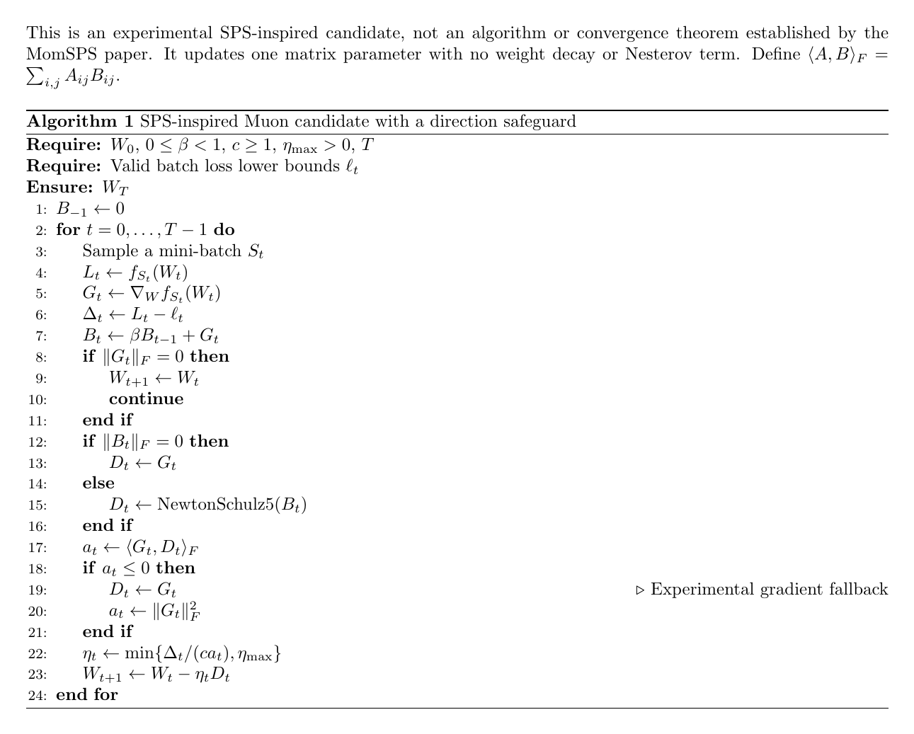

# 公式伴读

- 生成时间：2026-10-22 10:38

---


## 2026-10-22：迁移到 Muon 的候选选择与 LaTeX 伪代码

### 结论和证据边界

建议第一版借鉴Algorithm 1（MomSPSmax）的损失驱动候选加上限框架，而不是直接抄原算法。算法2、3保留作后续递减对照；算法3有意义的非插值适应性不自动成为Muon理论。理由是第一版避免同时引入方向变换、显式时间衰减、累计统计和不可回升的历史步长；便于区分哪个机制产生效果。这是实验顺序建议，不是三算法在Muon上已有优劣结果。

用户图片的总体表述正确，但“不能直接继承梯度范数分母”应明确为不能不加推导地移植并引用SHB原收敛保证。原分母可以作为无保证的朴素对照；替换为方向内积也不是自动完成证明。

建议幻灯片文案：先明确Muon的实际更新方向、尺度及动量递归，再设计损失驱动步长。SHB中的动量修正及梯度范数分母不能不加推导地照搬，原收敛保证也不能直接迁移。可基于梯度与实际方向的内积构造步长候选，监测相对更新幅度，并通过公平消融和端到端时间成本验证。

### 一阶模型启发的候选

先限定单个矩阵参数，其他参数固定，不加Nesterov和权重衰减。当前批损失为L，梯度为G；B为动量矩阵，D为最终用于参数更新的方向。

$$
B_t=\beta B_{t-1}+G_t.
$$

初始Muon方向由固定的Newton--Schulz5映射产生。定义梯度与实际方向的Frobenius内积：

$$
a_t=\sum_{i,j}(G_t)_{ij}(D_t)_{ij}.
$$

这里i、j是矩阵行列编号。若a非正，沿负D没有一阶下降趋势，候选保护规则将D回退为G，然后重新计算a为梯度平方范数。若梯度为零，跳过本轮参数更新。回退和跳过都是额外设计，需要单独消融，不是论文算法的一部分。

当a为正时，当前批的一阶近似为：

$$
f_{S_t}(W_t-\eta D_t)\approx L_t-\eta a_t.
$$

设希望一阶预测下降量为损失下界差除以c，解出候选，再用上限截断：

$$
\Delta_t=L_t-\ell_t\ge0,
$$

$$
\eta_t=\min\left\{\frac{\Delta_t}{c a_t},\eta_{\max}\right\},
$$

$$
W_{t+1}=W_t-\eta_tD_t.
$$

c至少为1是这版候选的保守选择，不是新的理论保证。没有乘SHB的一减beta修正，因为该因子来自SHB--IMA的特定等价关系，在此没有对应推导。c和上限仍需选择，不能称为无超参数。

当方向等于当前梯度时，内积等于梯度平方范数，恢复普通带上限SPS。将非零方向整体缩放为s倍，内积同比缩放；未命中上限时步长缩小为原来的1/s，实际更新保持不变。固定数值上限被命中时，这个不变性不再自动成立。

### 为什么仍不能声称保证下降或收敛

正内积只控制无限小步长的一阶项。若当前批损失是L光滑，则下降上界还包含曲率二次项：

$$
f_{S_t}(W_t-\eta D_t)
\le L_t-\eta a_t+\frac{L\eta^2}{2}\Vert D_t\Vert_F^2.
$$

损失差除以内积没有自动控制后面的曲率项，任意固定上限也不是稳定性证明。如果需要实际的批损失下降检查，应额外采用回溯/Armijo并计入额外前向成本；这也不自动等于总体目标或验证集下降。

以f(W)=二分之一Frobenius范数平方为例，W为16维对角矩阵，首个对角元100，其余15个为1；精确极分解方向为单位阵。动量为零、c为1、上限不生效时，内积115，损失5007.5，候选约43.54348，更新后损失约15168.276。这个反例说明正对齐和该候选不能单独保证下降；它是精确极分解方向的检查，不冒充有限NS5的训练复现。

### 多层、其他参数组与相对更新

多层共享一个学习率时，应把所有实际方向计入同一个一阶模型：

$$
a_t=\sum_{k=1}^{K}\sum_{i,j}(G_t^{(k)})_{ij}(D_t^{(k)})_{ij}.
$$

K为参与共同标量步长的参数块数。方向必须包含实际的形状缩放等处理。不能把一个全局损失差机械重复分配给每层，并称为同一个全局SPS步。

若还同时更新AdamW参数组，应计入它们的实际方向和相对步长，或明确区分其损失贡献；单矩阵候选不自动覆盖混合优化器。Nesterov、权重衰减、裁剪和形状缩放改变实际方向后，也要重新对应。

建议记录实际相对更新幅度（分母加小正数只用于监测）：

$$
r_t=\frac{\eta_t\Vert D_t\Vert_F}{\Vert W_t\Vert_F+\varepsilon}.
$$

eps是正的数值稳定量。记录上限命中率、非正对齐回退率、训练/验证损失、实际耗时及多个随机种子。若几乎每步都命中上限，自适应部分可能并未发挥主要作用。最小消融：调参后的原Muon、朴素梯度范数SPS对照、内积候选、加入回退的内积候选；算法2/3式历史约束后加，统一总调参成本。

### LaTeX 可复制源代码

下面是完整最小文档源代码，使用algorithm和algpseudocode。2026-10-22 已完成实际编译及视觉检查；神经网络训练尚未验证。用于预览的工程只增加了页边距及隐藏页码的排版设置。

```latex
\documentclass{article}
\usepackage{amsmath,amssymb}
\usepackage{algorithm}
\usepackage{algpseudocode}
\begin{document}
\noindent
This is an experimental SPS-inspired candidate, not an algorithm
or convergence theorem established by the MomSPS paper.
It updates one matrix parameter with no weight decay or Nesterov term.
Define $\langle A,B\rangle_F=\sum_{i,j}A_{ij}B_{ij}$.

\begin{algorithm}[ht]
\caption{SPS-inspired Muon candidate with a direction safeguard}
\begin{algorithmic}[1]
\Require $W_0$, $0\le\beta<1$, $c\ge1$, $\eta_{\max}>0$, $T$
\Require Valid batch loss lower bounds $\ell_t$
\Ensure $W_T$
\State $B_{-1}\gets 0$
\For{$t=0,\ldots,T-1$}
  \State Sample a mini-batch $S_t$
  \State $L_t\gets f_{S_t}(W_t)$
  \State $G_t\gets\nabla_W f_{S_t}(W_t)$
  \State $\Delta_t\gets L_t-\ell_t$
  \State $B_t\gets\beta B_{t-1}+G_t$
  \If{$\Vert G_t\Vert_F=0$}
    \State $W_{t+1}\gets W_t$
    \State \textbf{continue}
  \EndIf
  \If{$\Vert B_t\Vert_F=0$}
    \State $D_t\gets G_t$
  \Else
    \State $D_t\gets\operatorname{NewtonSchulz5}(B_t)$
  \EndIf
  \State $a_t\gets\langle G_t,D_t\rangle_F$
  \If{$a_t\le0$}
    \State $D_t\gets G_t$ \Comment{Experimental gradient fallback}
    \State $a_t\gets\Vert G_t\Vert_F^2$
  \EndIf
  \State $\eta_t\gets\min\{\Delta_t/(c a_t),\eta_{\max}\}$
  \State $W_{t+1}\gets W_t-\eta_tD_t$
\EndFor
\end{algorithmic}
\end{algorithm}
\end{document}

```

### 一手来源

- [本文ICLR会议记录](https://proceedings.iclr.cc/paper_files/paper/2025/hash/b6fa24257256b5068c5a7a7e04cd41f4-Abstract-Conference.html)：原论文分析的是SHB与IMA。
- [Muon作者说明](https://kellerjordan.github.io/posts/muon/)：动量更新后执行Newton--Schulz映射。
- [Muon作者实现](https://github.com/KellerJordan/Muon/blob/master/muon.py)：当前实现还有Nesterov、形状缩放等细节，本候选限定了更简洁版本。

本节不是已有SPS--Muon算法的优先权声明，也未穷尽检索所有相关文献。候选、回退和实验建议均与原论文已经证明的结果分开标注。

### 已编译的算法预览



[PDF](muon-sps-render/build/main.pdf) · [LaTeX源码](muon-sps-render/main.tex)

渲染采用 TeX Live，单页 PDF；桌面编辑器的独立编译检查也已成功。已检查公式、编号、缩进和行宽，未发现截断。
