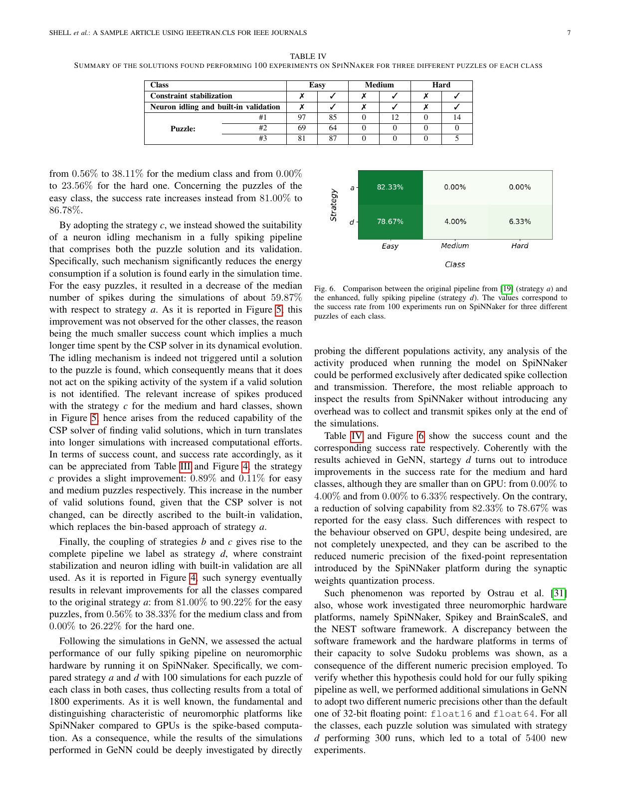
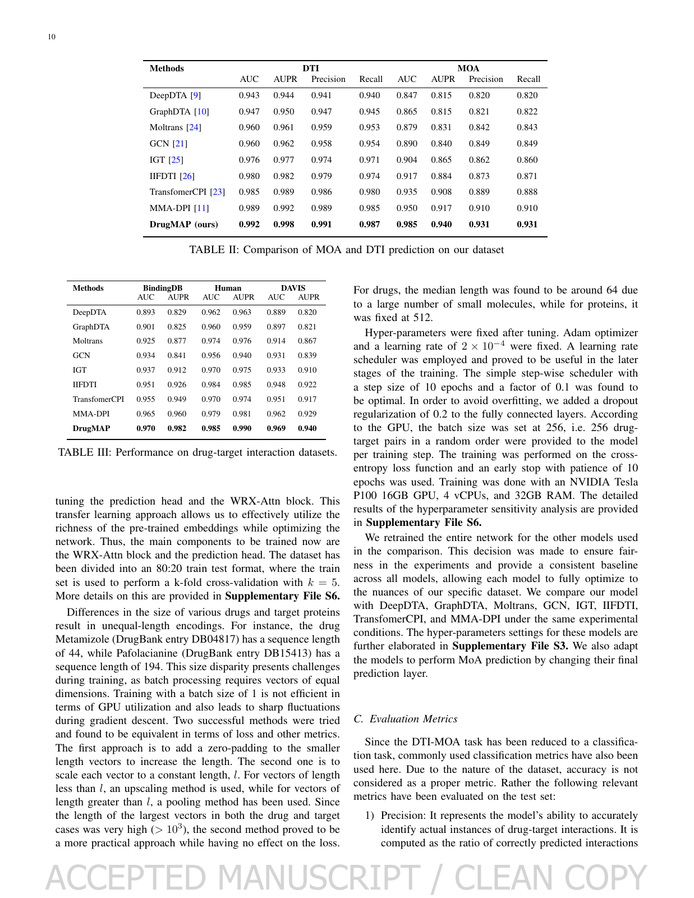

# TAI 2025 两篇归纳样本：连续主稿审阅

本轮仅审阅已锁定的 `tai-2025-16` 与 `tai-2025-01`，未调整原样本、归纳／留出划分或全局进度。两篇主稿均已逐页连续审阅；**两篇均引用独立补充材料，本轮未取得实际补充内容，因此完整正文＋相关附录新增完成数为 0**。这不是摘要阅读：共覆盖 27 个实际 PDF 页面，另对两页关键结果表进行视觉核验。

## 身份与版本

| 样本 | 实际阅读版本与页面 | 已核验发表身份 | 未核验事项 |
|---|---|---|---|
| tai-2025-16，数独神经形态验证 | 机构接受作者稿；PDF 1 为机构封面，2–12 为稿件 1–11 | [Politecnico di Torino 正式记录](https://iris.polito.it/handle/11583/2992746)及[出版者 Crossref 登记](https://api.crossref.org/works/10.1109%2Ftai.2025.3536428)均指向 2025 年 6(8)，2061–2072；四作者一致 | 接受稿与正式版本字节／版面等价性；独立补充方法对比 |
| tai-2025-01，DrugMAP | 接受作者稿 clean copy；PDF 1 为 HAL 封面，2–15 为稿件 1–14 | [HAL 固定版本](https://hal.science/hal-05067564v1)、[HAL API](https://api.archives-ouvertes.fr/search/?q=halId_s%3Ahal-05067564&fl=*&wt=json)与[出版者 Crossref 登记](https://api.crossref.org/works/10.1109%2Ftai.2025.3565671)核对标题、七作者与 DOI，正式记录为 2025 年 6(11)，3087–3099 | 接受稿与正式版本等价性；S1–S7实际内容及S6附件归属 |

原 OpenAlex 标签 `submittedVersion` 在这两例中都不能作为实际稿件身份的证据。数独机构封面明确标识 Author's Accepted Manuscript；DrugMAP 正文有接受稿水印，HAL “Submitted on” 是仓储提交日期。数独篇内遗留 2021 年 LaTeX 样例页眉和样例作者名，不能当作发表年份，更不能复制为 TAI 规范。DrugMAP 最后一位作者在接受稿/HAL与正式 DOI 中存在 `Bandopadhyay`／`Bandyopadhyay` 拼写差异，记录保留双方，不静默修改原文。

## 可采用的组织观察与不应模仿的反例

数独工程稿先提出旧管线的外部验证瓶颈，用新旧架构图解释新增模块，逐块给参数与连接，再分开报告软件消融、实际平台部署和精度诊断。它把更广相关方法比较放入补充材料，没有独立 Related Work 章节。正文对硬件 easy 类的下降有明确说明：82.33% 降到 78.67%。润色不能概括为“所有难度均提高”。提取 spike 数量、提取时间和模拟总 spike 数各是不同测量量；这些代理指标不能被改写为直接测得的整体能耗节省。

DrugMAP 先将二分类 DTI 与 MoA 分类任务区别说清，再将自建数据集放在模型方法之前，单列来源版本、过滤、类别合并、增强和负样本。结果按自建任务、公共二分类基准、测试集案例和消融分类。它的 Related Works 独立，局限则放在结论，不能据两篇强制统一期刊章节顺序。所有观察的适用范围是相应类型的交叉领域应用／工程稿，不是 TAI 的统计规律或官方要求。

DrugMAP 还提供了应进入润色审计的反例：实际 PDF 表 II 的 MoA AUC/AUPR 是 0.985/0.940，VI-A 文字却写 0.940/0.931，结论又使用 98.5%/94.0%。这是已核对实际渲染的冲突，不能通过语言优化静默选择一个值。0.950→0.985 是 3.5 个百分点；百分点与相对百分比必须区分。主文的亲和力预测措辞也与分类任务定义不一致，应留作者查询。未开展实验复现、药理文献逐条真实性核验或公式独立证明审计。

逐篇十维观察、支持页码、反例、适用条件、置信与 SHA-256 详见 [数独记录](tai-2025-16.json)和 [DrugMAP记录](tai-2025-01.json)。单篇组织观察可信度高，推广为 venue 风格的置信低；两篇均属归纳样本，不构成留出验证。

## 实际补充材料缺口

数独稿 PDF 11 的结论明确将 Latin square 方法的更广对比放入 Supplementary Material。机构正式记录仅列接受稿与限制访问的正式论文版本，未列补充；正式 IEEE 文章页面需要 JavaScript/机器人验证。普通公开网页抓取和自己创建的后台浏览器未取得有效材料，未对验证机制做绕过。

DrugMAP 主文指向 S1 排除项、S2 数据修正、S3 基线参数、S4 消融、S5 类别曲线、S6 划分与超参数、S7 案例。HAL 一手 API 确实列出七个附件 URL（另一篇 PDF、S3、S4、S5、S7，以及两个 XLSX），完整 URL 清单保存在 [HAL 原始响应](sources/drugmap-hal-full.json)。七次下载全部返回机器人挑战 HTML，文件类型检查拒绝把 HTML 保存为 PDF/XLSX；失败原因逐项保存于 [附件抓取日志](sources/annex-fetch-log.json)。未读取附件，未推断无编号附件就是 S6。

作者[公开代码仓库](https://github.com/JUCompBio/DTI-MOA)的固定提交 `6d46ebf10c82a277c8a216be54a05f153759fce2` 的完整树（未截断）仅含代码、数据和简短 README，没有 S1–S7 文档。目录清单并不能代替官方补充材料，也未将代码运行当作完成阅读的前提。

## 视觉核验

图像仅为本地研究核验所需的页面渲染；PDF 原件未修改。原稿 SHA、来源响应 SHA 和附件下载结果分别保存在逐篇 JSON 与 `sources/` 日志。
